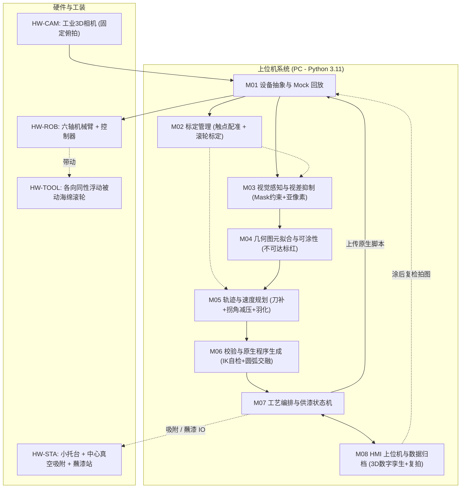

# VisionEdgeSystem.md — 基于 3D 视觉的机器人免示教木板边缘自动涂漆系统上下文

> **最近更新**：2026-10-22。**本期只做固定场景演示**：一块小木板、机器人与相机位置固定、一键沿边涂胶，挪动后再成功一次。  
> **权威口径**：基线文首的演示范围，以及报价 `Docs/机器人视觉免示教沿边涂抹系统报价单.xlsx`（20261022-3，180 人天 × 2,800 元 = ¥504,000）。  
> **下文第 1 节起**：保留 v1.1 扩展方案，客户认可演示后再启用，不作为本期验收。  
> **关联过程文档**：  
> - Opus 终审意见：`Docs/Vision_Edge_System_Final_Review.md`（v1.0 存档：`Docs/Vision_Edge_System_Baseline_v1.0.md`）  
> - 防拧转计算：`Docs/assets/vision_edge/calc_push_rotation.py`  
> - Gemini 初版方案：`Docs/Vision_Guided_Robot_Edge_System_Gemini.md`  
> - Claude Opus 独立评审方案：`Docs/Vision_Edge_System_Design_Claude.md`  
> - Opus 审查意见报告：`Docs/Reivew.md`  
> - 参考视频：`C:\Users\mimovr\Videos\NVIDIA\screa.mp4`（证据帧保存在 `Docs/assets/vision_edge/`）

---

## 1. 用户原始需求与核心痛点（Phase 2）

- **用户需求原话**：
  > “我们的计划有变了，项目的主体不是离线编程了，而是机器人的焊接尖端能够根据物体的形状进行动态操作，在没有任何编程和调试的情况下，仅仅靠视觉就能够让机器人感知到周围物体。比如机器人前方有一块 20cm*20cm 的木板，并且机器人焊接尖端有一个可以转的小圆柱，这个小圆柱可以涂抹油漆。下达指令后，机器人通过视觉识别到前方的木板，然后自动用小圆柱在木板的边缘缓慢涂抹油漆。我们整个项目只要能做到这点就可以了，不需要离线编程了。虽然这个功能看起来简单，但是肯定也要有不少工作要做。我有一个视频，大概 20M 左右，我要的功能就在这个视频中体现了，不知道你能不能看懂这个视频 @C:\Users\mimovr\Videos\NVIDIA\screa.mp4”
- **核心本质与“动态”定性**：
  - **免示教、无 CAD、无示教编程**：工作台任意角度平放单块木板，系统通过 3D 视觉感知位姿与轮廓，自主生成避障与接触涂抹轨迹，一键下发执行。
  - **“动态”含义对齐（重要）**：P0 严格定义为**“每次放板现拍现算、全自动自适应执行”**；并非作业过程中视觉闭环动态跟踪工件（闭环跟踪属 P2）。
  - **接触式沿边工艺**：机器人末端小圆柱必须紧贴板材外侧立面，以稳定接触力、恒定线速度走完闭合边缘，既不刮伤/推跑工件，也不漏涂或流挂积漆。

---

## 2. 参考视频事实核查与去伪存真（逐帧核验结论）

视频 `C:\Users\mimovr\Videos\NVIDIA\screa.mp4` 为新时达 STEP SmartRobot 2.0 演示切片（16.2s，原长 1分14秒）。经抽帧核实，厘清以下关键事实：
1. **工艺属性**：视频为**电主轴+千叶砂布轮打磨**，非流体涂漆。涂漆增加供漆续航、流挂、表面吸附与羽化搭接问题，物理机理截然不同。
2. **摆放姿态**：演示者用灰色垫块垫起三角板一角（倾斜约 $10^\circ$）；带 U 型内凹槽的为另一块红色平板。P0 聚焦**水平平放**，斜置板（6-DOF）作为 P1。
3. **相机与安装**：视频片段未展示高位扫描动作；不能盲从视频的 Eye-in-Hand，需根据视野、精度与线缆寿命独立评估（P0 推荐 Eye-to-Hand 固定俯拍）。
4. **工件材质**：视频为红白复合发泡板（易反光、无纹理），实际木板存在端面吸漆、毛刺、倒角与木纹干扰。
5. **工件固定**：工件无夹具，完全靠自重平放。

---

## 3. 双模型复审收敛的核心物理决策（修正 B1~B5 偏差）

### 【C1】拐角接触速度与减压退让规划（修正 B2）
- **物理机理**：在 $90^\circ$ 凸角处，滚轮圆心走半径 $d=R-\delta$ 的圆弧包络时，接触点在角点上几何线速度为 0（原地回转）。若 TCP 恒速 $20\text{ mm/s}$，停留时间达 $0.67\text{ s}$。原理上角点停留时间不可能完全消除为 0。
- **收敛控制**：
  1. 凸角圆弧段 TCP 速度提升 $k_c = 2\sim 3\times$（初值 2.5，停留时间压缩至 **$0.27\text{ s}$**，受限于机器人加速度）；
  2. 结合**法向接触微退让**（$\delta_c$ 初值 $0.5\delta_0$）。$k_c$、$\delta_c$ 均为**配方参数**（终审 F5）：2σ 偏差 ±1.3 mm 下 $\delta_c$ 过小会干涂，在 S0-6 与阶段 4 按“不积漆、不干涂”调优；
  3. 平缓凹弧段（$\rho \ge 2R$）按 $v_{\text{tcp}} = v_e(\rho-d)/\rho$ 主动降速，保证接触点线速度恒定。

### 【C2】防推力学与各向同性顺应机构（修正 B1）
- **力学判据前提**：
  - $20\text{ cm}\times 20\text{ cm}\times 1.8\text{ cm}$ 胶合板重力约 $4.2\text{ N}$；
  - **光滑台面（$\mu \approx 0.3$）**：静摩擦极限约 $1.26\text{ N}$。若保持安全系数 $SF=3$，允许最大法向力仅为 **$0.42\text{ N}$**；
  - **硅胶防滑垫/托台（$\mu \approx 0.6\sim 0.8$）**：静摩擦达 $2.5\sim 3.4\text{ N}$，法向力 $\le 0.8\text{ N}$ 时安全系数 $\ge 3$；
  - **防拧转（终审 F1，决定性工况）**：接触点在边端头/拐角时板绕瞬心转动，临界力 / $\mu G$：170 方满托 0.525、Ø70 圆托 0.224、Ø50 圆托 0.163（200 板 μ=0.7 时 Ø70 仅 0.66 N < 0.8 N）。托台须缩进板边 ≥ R+5 且适配 100 mm 板 → 只能 ≤ Ø70，**不吸附必然失效**；
  - **P0 标配 Ø40~50 小托台（高 ≥ 15 mm）+ 中心真空吸附**（Ø40 吸盘 −50 kPa ≈ 63 N，边端拧转临界约 5~6 N，安全系数 6~8；MDF 透气性【待核】）；电动微型真空泵 + 压力开关，M07 互锁；
  - 摆放公差 $e_{\max}=W_{\min}/2-(R+5)-r_{ped}$（Ø50、R=10：100 板 ±10、200 板 ±60、300 板 ±110 mm），角度任意；
  - 被动辊切向阻力列入 S0-4 实测；接触力存在窗口（上限防推，下限上漆），S0-4/S0-5 联做（终审 F4）。
- **顺应机构设计**：
  - 名义压紧量 $\delta_0 = 2.5\text{ mm}$（工作范围 $1.0\sim 4.0\text{ mm}$），吸收 $\pm 1.5\text{ mm}$ 综合误差预算；
  - 采用柔性海绵弹性 + 摆杆式各向同性浮动机构（$\pm 3\text{ mm}$ 水平平动偏摆），**串联**等效刚度控制在 **$k_{\text{equiv}} \le 0.2\text{ N/mm}$**（浮动越软海绵压缩越少、出漆越少）。

### 【C3】滚轮动力学（随动辊 vs 电机驱动）
- **决策结论**：P0 坚决采用**无动力被动随动海绵滚轮（Free-wheeling Sponge Roller）**。纯滚动接触，自转由工件反力驱动，零驱动滑差扭矩，零甩漆，免除电机控制与旋转接头故障源。

### 【C4】供漆工艺与续航（修正 B4）
- **漆量与距离**：$20\times 20\times 1.8\text{ cm}$ 板侧面需漆量约 $0.7\sim 1.4\text{ mL}$。海绵滚轮单次蘸漆涂布距离 $L_{load}$ **必须由阶段 0（S0-5）实测测定**，严禁人为臆造；
- **机构设计**：P0 采用**被动式蘸漆站（恒液位漆槽 + 边缘刮板 + 接漆盘，去除自清洗过度设计）**；
- **搭接规划**：断点重合处执行 **$10\text{ mm}$ 线性斜坡羽化搭接（Feathering Overlap）**；
- **竖直辊重力沉积**：涂料向辊下端沉积 → S0-5 增测板厚方向上下均匀性与待机滴漆；
- **备选方案（方案 B）**：若 S0-5 验证蘸漆槽浸润不均或滴挂不可控，立即启动微型蠕动泵微量注漆方案（+5~8 人天）。

### 【C5】透视视差抑制与真上棱提取
- **机理**：单相机俯拍时，因透视效应外侧边缘露出数毫米侧面，常规 Canny 易误识为底棱；
- **算法方案**：点云分割出木板上表面平面后，生成严格的上表面点云内点 2D 投影 Mask；仅在该 Mask 内边缘过渡带提取亚像素法向梯度，剔除底棱视差。

### 【C6~C8】标定、原生执行与双层安全
- **标定**：P0 首选 Eye-to-Hand 固定俯拍；以工作区 9 点 TCP 触点刚体配准（SVD）为主，$AX=XB$ 为辅；
- **执行**：放弃 Windows 逐点流式下发 MoveL，采用**编译生成目标控制器原生离线程序（直线+圆弧+交融 Blending 半径）**整包上传执行；
- **安全**：以机器人控制器内部安全平面为第一道防线，PC 规划高度钳位为第二道防线。

---

## 4. 统一系统模块架构（M01 ~ M08）

- **M01 设备抽象与 Mock 回放**：提供统一硬件接口并实现离线数据集回放，**保障在无实物硬件环境下算法先行开发**；
- **M02 标定管理**：负责工作区触点刚体配准、托台标定与滚轮半径自学习；
- **M03 视觉感知**：点云上表面平面拟合、Mask 约束搜索、亚像素上棱提取；托台外露 / 偏移超限检测；
- **M04 几何拟合**：图元提取；两级可涂性（$\rho < 2R$ 超 P0 范围警告，$\rho \le d$ 不可达标红）；
- **M05 轨迹规划**：接触线速度恒定、凸角提速减压、平缓凹弧减速、断点羽化；
- **M06 原生程序**：生成带 Blending 的控制器原生脚本，全路径 IK 与安全校验；
- **M07 工艺编排**：系统生命周期状态机（Idle → 吸附 → 拍照 → … → 复拍 → 释放），真空压力互锁，管理蘸漆与异常中断恢复；
- **M08 HMI与归档**：Qt/PyVista 3D 界面、100% 数据归档、涂后复拍 2D ICP 位移检测。

---

## 5. 阶段 0：预研排雷清单（锁定 S0-1 ~ S0-7）

| 编号 | 预研项 | 实验方法 | 通过判据 | 熔断退路 |
| :-- | :-- | :-- | :-- | :-- |
| **S0-1** | 硬件全链路打通 | 相机采图、机器人脚本上传运行、状态回传、IO全通 | 全链路无报错跑通，时延稳定 | 更换通信路线/板卡 |
| **S0-2** | 边缘精度与视差 【红线 1】 | CNC 200 方板在 9 位置 × 4 角度实测 | **上棱 RMS $\le 0.3\text{ mm}$，最大 $\le 0.6\text{ mm}$，边长误差 $\le 0.5\text{ mm}$** | 加 2D 相机/降低架高 |
| **S0-3** | 标定精度验证 | 触点配准 vs $AX=XB$，9 点复测 | 平均 $\le 0.5\text{ mm}$，最大 $\le 0.8\text{ mm}$，两法互验 $\le 0.5\text{ mm}$ | 加做局部精度补偿 |
| **S0-4** | 接触力与防推/防拧转 【红线 2】 | 边中点/边端头/拐角三处测临界力（有/无吸附，MDF 与胶合板）；浮动与海绵分别及串联的力—位移曲线；辊切向阻力 | **压缩 4 mm 时 $F_n \le \frac13\min(F_{mid},F_{end},F_{corner})$**；真空度稳定 | 加大吸盘/双吸盘；降刚度；收窄板材 |
| **S0-5** | 供漆距离与搭接 【红线 3】 | **在 S0-4 压紧量下**直线实涂：$L_{load}$、羽化接缝、厚度方向上下均匀性、待机滴漆 | **测定 $L_{load}$，方板单边一次涂完（$\ge 200\text{ mm}$）；侧面无流挂** | 切换至微型蠕动泵方案 |
| **S0-6** | 速度平稳性 | 记录原生程序实际 TCP 速度；初调 $k_c$、$\delta_c$ | 直线与圆弧段速度波动 $\le \pm 10\%$，段间 0 停顿 | 加大交融半径/降速/伺服点流 |
| **S0-7（条件触发）** | 相机构型对比 | 仅当 S0-2 在 E2H 下未达标且 2D 辅助相机仍不能解决时才做 | 出具对比报告并定型 | 视为红线 1 退路，另行评估 |

> **红线警示**：S0-2、S0-4、S0-5 为项目红线，第 3 周未通过必须重新确认方案后才可进入阶段 1。阶段 0 为 28~30 人天，自硬件到位日 T0 起算。

---

## 6. P0 量化验收标准与商务契约

### 6.1 量化验收指标（合同技术附件）
> 生效条件：① 三条红线通过或已书面约定退路；② 主相机为工业近距结构光（选 D405 时视觉/标定指标阶段 0 后重定）；③ 现场条件与 Q1~Q7 确认书一致。

1. **视觉上棱精度**：RMS $\le 0.3\text{ mm}$，最大 $\le 0.6\text{ mm}$；
2. **尺寸估算精度**：边长误差 $\le 0.5\text{ mm}$，角度误差 $\le 0.3^\circ$；
3. **标定残差**：9 点验证平均 $\le 0.5\text{ mm}$，最大 $\le 0.8\text{ mm}$；
4. **运动平稳性**：速度波动 $\le \pm 10\%$，段间停顿 0 次；
5. **涂层质量**：侧面可涂区域覆盖率 $\ge 95\%$，无流挂堆漆，搭接区无明显厚印；
6. **防推位移**：涂毕复拍平移 $\Delta \le 0.5\text{ mm}$，转角 $\Delta\theta \le 0.3^\circ$；
7. **一键成功率**：6 种测试样板随机摆放 30 次，$\ge 28$ 次完全免示教成功；
8. **运行节拍**：识别规划 $\le 3\text{ s}$；200 方板单圈涂抹 $\le 60\text{ s}$；
9. **端到端空跑**：刚性假辊名义间隙 2 mm，8 个采样点实测 $2 \pm 0.8\text{ mm}$；
10. **现场清洁**：工作台面与托台无沾漆。

### 6.2 工期与商务条款
- **基准工期与工作量**：**12 周（阶段 0 预研 3 周 + 研发 9 周），125 ~ 145 人/天**；
- **基准总价**：**27.5 万 ~ 31.9 万元人民币**（日单价 2,200 元/天）；
- **阶段拆分**：阶段 0 28~30 / 阶段 1 30~34 / 阶段 2 24~28 / 阶段 3 20~24 / 阶段 4 18~22 / 工装 5~7 人天（v1.0 上限误加为 145，实为 147，终审以 S0-7 条件触发修正）；
- **报价增补与前提**：
  - 工期自相机、机器人、真空组件、CNC 测试板到位之日（T0）起算；
  - 若为 FANUC/ABB 等传统工业臂：追加 10~15 人天（+2.2万~3.3万元）；
  - 若取消托台（直接放吸附防滑垫）：追加 5 人天（+1.1万元），底部约 2 mm 不涂，防推在 S0-4 重新验证；
  - 若改用微型蠕动泵：追加 5~8 人天（+1.1万~1.76万元）；
  - S0-7 触发时另行评估；
  - 硬件采购（相机、机械臂、真空组件、工装加工件、CNC 测试板）费用另外计费。
- **已出具报价**（2026-10-21）：`Docs/机器人视觉免示教沿边涂抹系统报价单.xlsx`，按上限 145 人天 / ¥319,000；Q1~Q7 确认前为待确认基线价。
- **已填基金指南**：`Docs/附件1 国家工程中心创新基金储备项目指南.docx`。模板档位为 10/25/50 万元，取 50 万元（软件 31.9 万，其余 18.1 万为工装试制、真空组件、测试板、相机试用和耗材）。

---

## 7. 待用户决策确认清单（报价已按下列默认前提出具）

1. **Q1 机器人型号**：现场机械臂品牌型号？协作臂还是工业臂？是否支持原生脚本下发？
2. **Q2 3D 相机预算**：预算偏好研发级（千元级 RealSense D405）还是工业级（万元级结构光，如梅卡曼德）？（坚决不用 ToF 相机）。
3. **Q3 涂料与滚轮**：油漆化学属性与黏度？滚轮接受无动力随动海绵滚轮（外径 $\approx \varnothing 20\text{ mm}$）？
4. **Q4 “动态”定义**：确认是否为“每次放板现拍现算”，排除执行中实时跟踪？
5. **Q5 托台与吸附**：是否接受 Ø40~50 小托台 + 中心真空吸附（电动微型真空泵，无需气源）？板底面是否平整可吸附？是否接受“任意角度 + 偏移圈内”摆放？
6. **Q6 涂抹覆盖与包边**：侧面立面是否需 $100\%$ 满涂？上棱是否允许 $\le 1\text{ mm}$ 微量包边？
7. **Q7 交付属性与板型**：演示样机还是工业级产线设备？P0 必须覆盖哪些板型？
