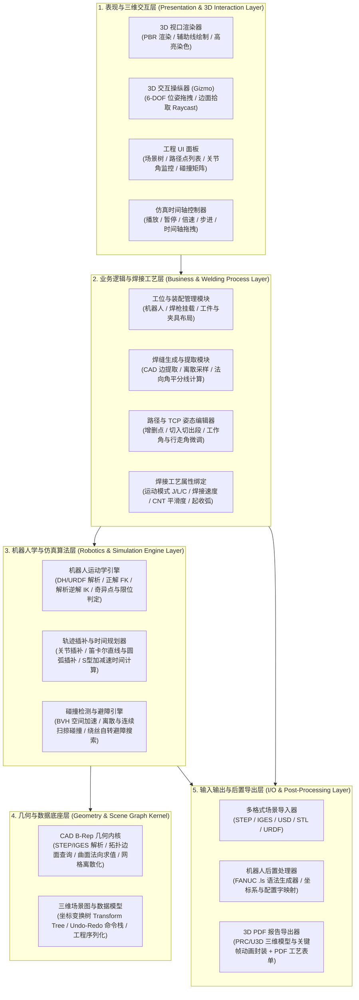
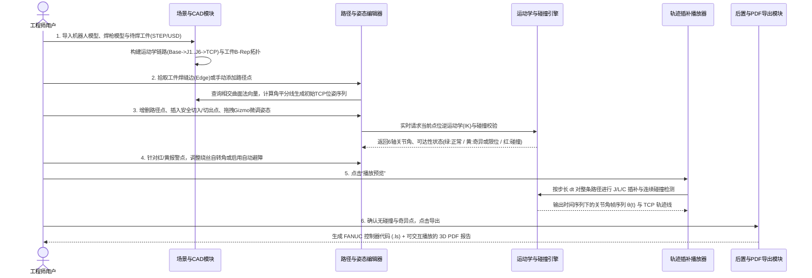
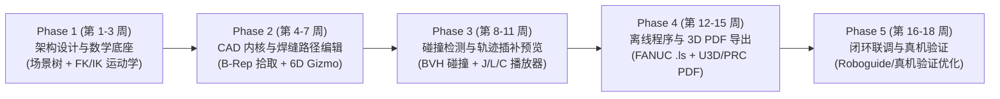

# 工业机器人焊接离线编程（OLP）系统架构设计与开发周期规划
> **对标参考产品**：CENIT FASTSUITE Edition 2  
> **文档目标**：从零构建具备“场景导入 $\rightarrow$ 路径规划与姿态编辑 $\rightarrow$ 碰撞检测 $\rightarrow$ 运动学仿真预览 $\rightarrow$ 离线程序（`.ls`）与 3D PDF 导出”完整闭环的工业机器人焊接离线编程软件。

---

## 一、 对 FASTSUITE 的认知对齐与底层原理解析

### 1.1 您的理解 vs 工业软件底层逻辑映射
您通过视频观察到的工作流程非常准确地抓住了**机器人离线编程（Offline Programming, OLP）**的核心主干。为了将“看到的视觉交互”转化为“可编码的工程模块”，我们需要先将直观描述映射为机器人学与 CAD 几何学的标准概念：

| 您的直观描述 | 工业软件标准术语 | 背后隐藏的核心技术与工程逻辑 |
| :--- | :--- | :--- |
| **3D 场景中的机器人与工件导入** | **工位布局（Workcell Layout）与装配树** | 不仅要导入 3D 模型外观，还必须建立**运动学父子层级（Kinematic Chain）**（6 个旋转关节的 DH 参数或 URDF 模型）、基座坐标系（Base Frame）与工件坐标系（User/Workobject Frame）。 |
| **焊接部位尖尖的那个轴** | **TCP（Tool Center Point，工具中心点）与工具坐标系** | 焊丝尖端即为 TCP 原点。它不仅是一个 3D 坐标 $(X, Y, Z)$，更是一个包含姿态的 **6 自由度刚体坐标系** $(X, Y, Z, W, P, R)$：通常 $Z$ 轴沿焊枪方向（决定焊丝伸出方向），$X$ 轴沿焊接前进方向。在焊接工艺中还会映射为**工作角（Work Angle）**、**行走角（Travel Angle）**和**绕丝自转角（Spin Angle）**。 |
| **生成虚拟路径线、增删路径点、调整位置与方向** | **焊缝提取（Seam Extraction）与轨迹示教（Path Teaching）** | 1. **自动生成**：从工件 CAD 模型的拓扑边（Edge）或两个相交面（Face）自动提取连续曲线，并根据两侧曲面的法向量计算角平分线，自动生成初始焊枪姿态。<br>2. **离散化与编辑**：将连续曲线离散为有序的**目标路径点（Target/Via Points）**，支持插入/删除点、调整切入/切出过渡段（Approach/Retract），以及通过 3D 坐标轴控件（Gizmo）微调每个点的位置与欧拉角/四元数姿态。 |
| **编辑碰撞信息** | **碰撞检测（Collision Detection）与姿态避障（Clearance Optimization）** | 当焊枪与夹具/工件发生干涉（变红报警）时，系统支持定义**碰撞检测对（Collision Pairs）**与**安全距离（Safety Margin）**。由于弧焊焊丝是轴对称的，绕焊丝轴线（TCP 的 $Z$ 轴）旋转焊枪不会改变焊接位置，这是焊接离线编程中最核心的**一维自由度避障机制**。 |
| **按播放预览** | **逆运动学求解（IK）+ 轨迹插补（Interpolation）+ 时间轴仿真** | 播放预览绝不是简单地让焊枪模型沿直线平移，而是要在每一帧实时解算**机器人逆运动学（Inverse Kinematics）**，驱动机器人 6 个关节轴协同转动，同时校验：**是否超出关节限位（Joint Limits）**、**是否经过奇异点（Singularity）**、**连杆之间是否碰撞**，并按设定的运动类型（关节运动 `J` / 直线运动 `L` / 圆弧运动 `C`）及焊接速度进行插补播放。 |
| **输出 `.ls` 格式** | **后置处理器（Post-Processor / Downloader）** | 不同品牌机器人控制器使用不同的专有语言。**`.ls` 是发那科（FANUC）机器人控制器的 ASCII 离线程序格式**（编译后为二进制 `.tp`）。软件内部维护中立的轨迹指令集，通过后置处理器翻译为包含点位坐标、手系配置字（如 `NUT 000`）、速度、平滑度（`FINE`/`CNT`）及起弧/收弧指令（`Arc Start`/`Arc End`）的 `.ls` 文本。 |
| **输出可直接播放预览的 PDF** | **交互式 3D PDF 工艺文档导出（U3D / PRC 标准）** | PDF 标准支持内嵌 **PRC（Product Representation Compact）** 或 **U3D（Universal 3D）** 格式的三维场景与关键帧骨骼动画。在 Adobe Acrobat Reader 中打开即可360°旋转查看工位、点击播放焊接仿真动画，常用于给车间操作工发放免安装客户端的电子作业指导书（SOP）。 |

---

### 1.2 FASTSUITE Edition 2 的真实核心架构特点
根据对 CENIT FASTSUITE Edition 2 官方架构的调研，其之所以能在工业界立足，核心在于**“几何内核 + 运动学数字孪生 + 工艺驱动 + 解耦后置器”**的四层解耦设计：
1. **品牌无关的运动学内核（Brand-Independent Kinematics）**：场景内部使用统一的数学模型表达所有品牌的六轴机器人、变位机（Positioner）和外部导轨。
2. **基于 CAD B-Rep 的特征提取**：直接读取精确 CAD 拓扑边界而非单纯的三角网格（Mesh），从而能够精确识别焊缝边缘与相邻曲面夹角。
3. **工艺与轨迹绑定（Weld Cockpit）**：路径不仅仅是一串空间点，而是携带了焊接工艺属性（焊接速度、起收弧参数、安全过渡点属性）的结构化有向图。
4. **脚本化后置处理器（Python-based Downloader）**：如内置的 `Fanuc.py` 下载器，将内部仿真指令映射为真实控制器代码，极易扩展到 ABB（`.mod`）、KUKA（`.src`）、安川（`.jbi`）等其他品牌。

---

## 二、 系统总体架构设计（System Architecture）

为了实现您提出的**“场景导入 $\rightarrow$ 场景与路径编辑 $\rightarrow$ 碰撞与姿态修正 $\rightarrow$ 仿真预览 $\rightarrow$ 输出 `.ls` 与 3D PDF”**完整闭环，系统在架构上应划分为 **5 大横向分层** 与 **9 个核心业务模块**。

### 2.1 系统分层架构图



---

### 2.2 端到端业务数据流闭环



---

### 2.3 核心领域数据模型（Domain Model）
在动手写代码前，必须明确软件内存中流转的核心数据结构：

1. **坐标系体系（Coordinate Frames）**：
   - `WorldFrame`（世界坐标系） $\rightarrow$ `RobotBaseFrame`（机器人基座坐标系） $\rightarrow$ `FlangeFrame`（六轴末端法兰坐标系） $\rightarrow$ `TCPFrame`（焊枪尖端工具坐标系，`UTOOL`）。
   - `WorldFrame` $\rightarrow$ `UserFrame`（工件坐标系，`UFRAME`） $\rightarrow$ `WaypointPose`（路径点相对于工件的位姿，确保工件在现实中微小移位时只需重标定 `UFRAME` 而无需重新生成所有路径点）。
2. **路径点对象（`Waypoint` / `TargetPoint`）**：
   - **空间位姿**：位置 $P = (x, y, z) \in \mathbb{R}^3$，姿态 $R \in SO(3)$（内部用四元数存储，UI 与导出时转换为欧拉角 $W, P, R$）。
   - **工艺角色枚举**：`APPROACH`（切入安全点）、`WELD_START`（起弧点）、`WELD_VIA`（焊接中间点）、`WELD_END`（收弧点）、`RETRACT`（切出安全点）。
   - **运动指令参数**：插补类型（`PTP/JOINT`、`LINEAR`、`CIRCULAR`）、目标速度（如 `2000 mm/sec` 或 `50 cm/min`）、平滑过渡等级（`FINE` 精确定位 或 `CNT 0~100` 圆滑过渡）。
   - **机器人形态配置字（Robot Configuration）**：如 FANUC 的 `[F/N, U/D, T/B, J4_turn, J5_turn, J6_turn]`，用于消除同一空间位姿对应 8 组不同逆运动学解的歧义。
   - **校验状态标记**：`IsReachable`（是否可达）、`IsColliding`（是否碰撞）、`IsNearSingularity`（是否接近奇异点）、`CachedJointAngles`（当前解出的 6 个关节角 $[\theta_1 \dots \theta_6]$）。

---

## 三、 模块功能组成部分详细清单

以下是实现该系统所需的 **9 大核心模块**及其细分功能点（Feature Breakdown）：

### 模块一：3D 场景与工位管理模块（Scene & Workcell Layout）
负责构建虚拟焊接工作站的数字孪生环境。
- **1.1 多格式资产导入**：
  - 支持精确几何格式（`.step` / `.stp`、`.iges`）及通用网格/场景格式（`.stl`、`.obj`、`.gltf`、`.usd`）。
  - 支持机器人模型描述文件（如 URDF 或自定义 JSON/XML 机器人运动学包）导入。
- **1.2 场景装配树（Scene Graph Tree）**：
  - 树状管理工位内的所有实体：机器人本体、末端焊枪（End-Effector）、工装夹具（Fixture）、待焊工件（Workpiece）、安全围栏。
  - 支持节点的显隐控制、透明度调节（方便观察焊枪内部深入工件的情况）、锁定与层级挂载。
- **1.3 焊枪挂载与 TCP 标定设置**：
  - 将焊枪模型挂载到机器人第 6 轴法兰盘（Flange）下，随机器人末端联动。
  - 支持输入或通过 3D 拾取焊丝尖端顶点，定义工具坐标系（`UTOOL`：平移偏移量 $X,Y,Z$ 与旋转偏移量 $W,P,R$）。
- **1.4 工件坐标系（`UFRAME`）定义**：
  - 支持经典的“三点法”（原点、+X轴点、XY平面点）在工件模型上拾取并建立用户坐标系。

---

### 模块二：CAD 几何内核与焊缝提取模块（CAD B-Rep & Seam Extraction）
负责从导入的工件三维模型中快速提取生成初始焊接路径，避免纯手工在空中盲调点位。
- **2.1 拓扑元素交互拾取（Topology Picking）**：
  - 高亮拾取工件上的精确拓扑元素：顶点（Vertex）、边（Edge，直线段/圆弧/NURBS曲线）、面（Face，平面/圆柱面/自由曲面）。
- **2.2 焊缝曲线自动提取与离散化**：
  - **单边拾取模式**：点击工件上的焊缝边，自动沿曲线按设定步长（如每 10mm）或弦高误差（Chordal Deviation）离散出路径点。
  - **两面求交模式（进阶）**：当 CAD 模型没有显式倒角边（例如垂直搭接的T型接头两个平板直接插在一起）时，选取两个相交曲面，通过几何内核计算面-面交线（Surface-Surface Intersection）并生成焊缝。
- **2.3 初始焊枪姿态自动计算**：
  - 在每个离散路径点处，计算曲线切向量 $\vec{T}$ 作为焊接前进方向，查询相邻两个焊接母材曲面的法向量 $\vec{N}_1, \vec{N}_2$。
  - 自动取 $\vec{N}_1 + \vec{N}_2$ 的角平分线方向作为焊枪默认指向（例如角焊缝自动呈 $45^\circ$ 姿态），彻底免去手动逐点旋转姿态的繁琐操作。

---

### 模块三：机器人运动学引擎（Robot Kinematics Engine）
整个离线编程软件的“数学心脏”，决定仿真是否真实有效。
- **3.1 正运动学求解器（Forward Kinematics, FK）**：
  - 输入 6 个关节角度 $[\theta_1, \theta_2, \theta_3, \theta_4, \theta_5, \theta_6]$，基于标准/改进 DH 参数（Denavit-Hartenberg）或旋量理论（Product of Exponentials），实时计算每个连杆的变换矩阵及末端 TCP 在世界坐标系和工件坐标系下的精确位姿。
- **3.2 解析逆运动学求解器（Analytical Inverse Kinematics, IK）**：
  - 输入目标 TCP 位姿矩阵 $T_{target}$，在微秒级时间内求出全部 **最多 8 组解析解**（对应工业机器人常见的肩部左/右、肘部上/下、腕部翻转/不翻转，即 FANUC 的 `F/N`、`U/D`、`T/B` 配置）。
  - **最优解连续性选择算法**：根据上一路径点的关节角，自动选择关节空间距离最近且不发生腕部 $180^\circ$ 突变（Flip）的解。
- **3.3 关节限位与奇异点检测（Limits & Singularity Check）**：
  - **软限位检测**：实时对比解出的关节角是否超出各轴物理行程（如 $J_1 \in [-170^\circ, +170^\circ]$）。
  - **三大奇异点检测**：实时计算雅可比矩阵（Jacobian Matrix）行列式或条件数，检测**腕部奇异点**（$\theta_5 \approx 0^\circ$，最常见，会导致 $J_4$ 和 $J_6$ 瞬间高速反转）、**肘部奇异点**与**肩部奇异点**，并在路径线上以黄色高亮预警。
- **3.4 关节调试面板（Joint Jogging）**：
  - 提供虚拟示教器滑块，支持单轴点动（J1~J6 滑块）与笛卡尔点动（沿基座/工具/工件坐标系的 X/Y/Z 平移与旋转）。

---

### 模块四：路径与 TCP 姿态编辑器模块（Path & TCP Pose Editor）
对应您描述的“对路径进行添加删除点操作，对路径点可以调整位置、方向，生成虚拟路径线”。
- **4.1 路径与轨迹树管理**：
  - 一条完整的焊接任务由多条焊缝轨迹（`Seam Path`）组成；每条焊缝包含有序的路径点列表（`Waypoint List`）。
- **4.2 路径点增删改查**：
  - **添加点**：支持在表面点击新增点、在两个现有点之间中点插值插入新点、或复制当前机器人姿态记录为新点（Teach Target）。
  - **删除与重排序**：支持单选/框选删除路径点、一键反转路径方向（Reverse Path，交换起弧与收弧端）。
- **4.3 自动生成切入/切出过渡段（Approach & Retract Generator）**：
  - 焊接不能直接从空中撞向起弧点。系统需支持一键在起弧点前自动生成沿焊枪反方向退后 $N$ 毫米（如 50mm）的**安全切入点（Approach Point）**，在收弧点后自动生成抬枪**安全切出点（Retract Point）**。
- **4.4 6-DOF 位姿交互与焊接专用角度编辑**：
  - **3D Gizmo 操纵器**：选中单个或多个路径点时，在 TCP 处显示三色平移箭头与旋转圆环，鼠标拖拽时**机器人实时跟随运动（IK 实时解算）**。
  - **焊接工艺角参数化调整**：除直接改欧拉角 $(W,P,R)$ 外，提供符合焊工直觉的参数面板：
    - **工作角（Work Angle）**：焊枪在垂直于焊缝截面内的倾角。
    - **行走角（Travel Angle / 推拉角）**：焊枪沿焊接前进方向的前倾/后倾角（一般前倾或后倾 $10^\circ \sim 15^\circ$）。
    - **自转角（Spin Angle）**：焊枪绕自身焊丝中心轴的旋转角（用于避开夹具）。
  - **批量姿态传播与平滑插值**：修改首尾两个点的姿态后，支持一键对中间所有路径点进行**球面线性插值（SLERP）**，使焊枪姿态平滑过渡。
- **4.5 虚拟路径线可视化**：
  - 在 3D 视口中绘制连接各点的虚拟轨迹线（如切入段用黄色虚线、焊接段用绿色实线、切出段用蓝色虚线），并在每个路径点绘制微型三色坐标轴指示 TCP 朝向。

---

### 模块五：碰撞检测与避障修正模块（Collision Detection & Clearance）
对应您描述的“可以编辑碰撞信息”。
- **5.1 碰撞对配置矩阵（Collision Matrix）**：
  - 允许用户配置哪些分组之间需要检测碰撞（例如：`[焊枪 + 机器人前臂]` vs `[工件 + 夹具]`），自动忽略相邻运动学连杆之间的天然接触。
  - 支持设置**碰撞（Collision，距离 $\le 0$）**与**接近预警（Near-Miss Clearance，距离 $< d_{safe}$ 如 5mm）**两级阈值。
- **5.2 高性能空间碰撞检测算法**：
  - 基于层次包围盒树（**BVH / OBB Tree**，可集成开源库 `FCL` 或 `Bullet Collision`）对三角网格进行加速。
  - **离散点检测**：在编辑路径点时，即时检测该点位下机器人各连杆与环境是否干涉，碰撞部件在 3D 视口中实时染成高亮红色，并在路径点列表中标记红叉。
  - **连续路径扫掠检测**：在两个路径点之间的插补运动过程中进行高频采样检测，防止“端点不撞但中间穿过夹具”的漏检。
- **5.3 焊接专用碰撞修正与自动避障**：
  - **碰撞可达性圆盘（Reachability / Collision Cone）**：选中碰撞点时，系统自动以 $5^\circ$ 为步长遍历焊枪绕焊丝轴（TCP Z轴）旋转 $[-180^\circ, +180^\circ]$，在 UI 上以绿/红扇形环显示哪些自转角度区间无碰撞、哪些区间发生碰撞，用户只需把指针拖到绿色扇区即可解除碰撞。
  - **一键自动避障优化**：自动搜索既无碰撞、关节运动变化又最小的焊枪绕丝自转角或微小倾角偏置，自动修复红点。

---

### 模块六：运动插补与仿真播放器模块（Trajectory Interpolation & Simulation Player）
对应您描述的“最后可以按播放预览”。
- **6.1 三种标准机器人运动插补器**：
  - **关节插补（Joint / PTP, `J`）**：用于空行程快速移动。在关节空间对 $[\theta_1 \dots \theta_6]$ 进行线性或样条插值，TCP 走出的空间轨迹是曲线。
  - **直线插补（Linear, `L`）**：用于焊接过程或切入切出。在笛卡尔空间对 TCP 位置进行严格直线插值，姿态进行四元数球面线性插值（SLERP），并在每个微小步长 $\Delta t$ 调用逆运动学求出关节角。
  - **圆弧插补（Circular, `C`）**：用于圆形或圆弧焊缝。通过起点、中间点、终点三点拟合空间圆弧并匀速插补。
- **6.2 速度规划与周期时间估算（Cycle Time Estimation）**：
  - 根据每个路径点设定的运行速度（如空走 `50%` 关节速度，焊接 `10 mm/s` 线速度）和加减速参数，计算整条焊接程序的预计总耗时。
- **6.3 交互式仿真播放控制与可视化特效**：
  - 支持播放、暂停、停止、单步前进/后退、0.1x ~ 4.0x 倍速播放、任意拖拽时间轴进度条。
  - **焊道动态生成视觉效果**：在焊接段播放过程中，沿着 TCP 经过的路径动态渲染出高亮的虚拟焊缝沉积轨迹（Weld Bead Trail）和火花粒子特效，直观区分“空走段”与“真实施焊段”。
  - **实时监控图表**：播放时同步刷新 6 个关节轴的角度变化曲线与与最近障碍物的安全距离监控条。

---

### 模块七：离线程序后置处理器模块（Post-Processor - `.ls` 导出）
对应您描述的“将离线编程数据输出成 `.ls` 格式，`.ls` 格式中是具体的离线编程数据”。
- **7.1 中立中间指令表示（Intermediate Representation, IR）**：
  - 将内部路径和工艺参数先转化为与品牌无关的抽象语法树（AST）：包含帧声明、运动语句（`MoveJ`、`MoveL`、`MoveC`）、工艺事件（`ArcStart`、`ArcEnd`、`Wait`、`SetDO`）。
- **7.2 FANUC `.ls` 语法代码生成器**：
  - 严格按照发那科（FANUC Robotics）ASCII 程序规范生成 `.ls` 文件，核心包含四大段落：
    1. **`/PROG` 与 `/ATTR` 头信息段**：程序名、所有者、修改时间、所属运动组掩码（`DEFAULT_GROUP = 1,*,*,*,*`）。
    2. **`/MN` 主程序指令段**：
       - 声明使用的工具号与工件坐标系号：`UFRAME_NUM=1 ;`、`UTOOL_NUM=1 ;`
       - 空走接近指令：`J P[1] 50% CNT100 ;`
       - 直线切入与起弧指令：`L P[2] 500mm/sec FINE Arc Start[1] ;`
       - 焊接过程指令：`L P[3] Weld_Speed CNT50 ;`
       - 收弧指令：`L P[4] Weld_Speed FINE Arc End[1] ;`
       - 安全撤离指令：`L P[5] 1000mm/sec CNT50 ;`
    3. **`/POS` 点位坐标数据段**：
       - 输出每个 `P[i]` 对应的精确笛卡尔坐标与手系配置字：
         ```text
         P[2:"Weld_Start"]{
            GP1:
             UF : 1, UT : 1,     CONFIG : 'N U T, 0, 0, 0',
             X =   450.250  mm,  Y =  -120.500  mm,  Z =   310.000  mm,
             W =   180.000 deg,  P =   -45.000 deg,  R =     0.000 deg
         };
         ```
    4. **`/END` 结束标记**与行号自动重排器。
- **7.3 插件化后置模板架构**：
  - 支持基于脚本（如 Python 模板或 Jinja2）配置不同品牌的导出格式，首期交付 FANUC `.ls`，后续仅需增加百行级转换脚本即可扩展 KUKA（`.src`/`.dat`）、ABB（`.mod`）、安川（`.jbi`）。

---

### 模块八：交互式 3D PDF 与报表导出模块（3D PDF Exporter）
对应您描述的“输出成 PDF 格式，PDF 则是可以直接在里面播放预览”。
- **8.1 3D PDF 底层实现原理说明**：
  - 标准 PDF 规范（ISO 32000）原生支持嵌入 **U3D（Universal 3D，ECMA-363）** 或 **PRC（Product Representation Compact，ISO 14739）** 三维注释对象（`3D Annotation`），并支持嵌入基于关键帧的刚体变换动画（Keyframe Transform Animation）与 Acrobat 3D JavaScript 控制脚本。
- **8.2 3D 场景与仿真动画烘焙（Animation Baking）**：
  - 将工位中的网格模型（压缩减面后的机器人各连杆、焊枪、工件、夹具）及虚拟路径线导出为 U3D/PRC 节点树。
  - 将仿真播放器计算出的时间序列下机器人 6 个连杆的局部变换矩阵 $M_i(t)$ 烘焙为关键帧动画轨道，连同播放/暂停按钮脚本一并写入 PDF 的 3D 视口流中。
- **8.3 2D+3D 混合工艺报表排版**：
  - PDF 上半部分为**可交互旋转、缩放、点击播放焊接动画的 3D 视口**。
  - PDF 下半部分自动生成结构化的 **2D 工艺参数表**：包含工位名称、所使用的 `UFRAME`/`UTOOL` 参数、预计总焊接时长、焊缝数量、每个路径点的坐标明细及注意事项。
  - *工程提示*：由于现代浏览器内置的简化版 PDF 阅读器（如 Chrome/Edge 默认阅读器）大多阉割了 Adobe 的 3D PRC/U3D 渲染引擎（需使用 Adobe Acrobat Reader 打开才能交互播放 3D），建议在系统中**同时提供“导出单文件免安装 HTML5/WebGL 3D 播放器”或“MP4 动画录制 + PDF 报表”作为补充选项**，兼顾传统工业规范与现代跨平台浏览体验。

---

## 四、 专项技术评估：我们是否需要英伟达开源的 `NVIDIA-Omniverse/usd-brep`？

您提到的 GitHub 仓库 [`NVIDIA-Omniverse/usd-brep`](https://github.com/NVIDIA-Omniverse/usd-brep) 是英伟达近期以 **Apache 2.0 宽松开源协议**重磅开源的 **NURBS 边界表示（B-Rep）实体造型几何内核与 OpenUSD 扩展库**。

为了回答“**开发这套机器人焊接离线编程软件到底需不需要用到它**”，我们需要先拆解两个核心问题：
1. **我们的软件需不需要一个 CAD B-Rep 内核？**
2. **如果需要，选 `NVIDIA usd-brep` 还是传统的 `OpenCASCADE (OCCT)`？**

---

### 4.1 为什么做机器人焊接离线编程（OLP）**必须**用到 CAD B-Rep 内核？
如果您只用普通的 3D 游戏引擎或网格库（如只支持读取 `.stl`、`.obj`、`.fbx` 的三角网格 Mesh），在开发焊接路径功能时会遇到极大的痛点：
- **没有“焊缝边”的概念**：在三角网格（Mesh）中，一个圆柱与平面的相交焊缝被拆成了几百条零碎的三角形短边，软件根本无法知道“这是一条连续的焊缝曲线”。
- **无法精确计算焊枪角度**：在网格中只有离散三角面片的法线，难以稳定获取相交两个母材曲面的精确数学法向量，无法自动算出 $45^\circ$ 角平分线姿态。

而在 **B-Rep（Boundary Representation，边界表示）CAD 内核**中：
- 模型由精确的数学曲面（NURBS、平面、圆柱面）及严格的拓扑关系（**体 Solid $\rightarrow$ 壳 Shell $\rightarrow$ 面 Face $\rightarrow$ 环 Loop $\rightarrow$ 边 Edge $\rightarrow$ 顶点 Vertex**）构成。
- 当用户在视图中点击一条焊缝时，拾取到的是一条完整的拓扑边 `Edge`；通过拓扑邻接查询，立刻就能拿到共享这条边的左、右两个曲面 `Face_1` 和 `Face_2`；在边上任意参数 $u \in [0, 1]$ 处求值，即可直接得到精确的三维坐标 $P(u)$、曲线切向量 $\vec{T}(u)$ 以及两个相邻面的精确法向量 $\vec{N}_1(u), \vec{N}_2(u)$！

> **结论 1**：要做出像 FASTSUITE 那样顺滑的“在工件上选边生成路径、自动计算焊枪姿态、导入工业 STEP 模型”的能力，**您的系统中必须包含一个 B-Rep CAD 几何内核**。

---

### 4.2 `NVIDIA-Omniverse/usd-brep` 到底是什么？
经过对 `NVIDIA-Omniverse/usd-brep` 源码架构与背景的核查，它的真实技术构成如下：
1. **核心数学引擎（SMLib）**：其底层是英伟达于 2022 年收购的商用几何建模公司 Solid Modeling Solutions (SMS) 耗时数十年研发的商业级几何内核 **SMLib**（基于 NLib NURBS 库）。过去 SMLib 需要高昂的商业授权费，现在英伟达将其打包进 `usd-brep` 并以 **Apache 2.0 协议完全免费开源**。
2. **原生打通 OpenUSD（`omniSolid` Schema）**：标准 OpenUSD 过去只能存多边形网格（`UsdGeomMesh`），一旦把 CAD 导入 USD 就会丢失精确的 B-Rep 边和面。`usd-brep` 允许在 `.usd` / `.usda` / `.usdc` 文件中直接原生存储精确的 NURBS 曲面和 B-Rep 拓扑。
3. **内置 OpenCASCADE 转换桥**：为了支持工业界最常用的 `.step`、`.iges`、`.jt` 文件读写，`usd-brep` 内部集成了基于 OpenCASCADE 的文件导入导出工具，将其转为 SMLib / OpenUSD B-Rep 结构。
4. **C++ 与 Python (`pybind11`) 双接口**：提供了开箱即用的 C++ 头文件和 Python wheel 包（`usd_brep`），支持布尔运算、曲面求交（Surface Intersection）、倒角、扫掠、偏置（Offset）以及高质量网格离散化（Tessellation）。

---

### 4.3 选型对比：`NVIDIA usd-brep` vs 传统 `OpenCASCADE (OCCT)`

| 评估维度 | 方案 A：引入 `NVIDIA-Omniverse/usd-brep` | 方案 B：直接使用 `OpenCASCADE (OCCT)` / `PythonOCC` |
| :--- | :--- | :--- |
| **开源协议** | **Apache 2.0**（极其友好，闭源商业化毫无传染风险，且底层搭载了原商业级内核 SMLib） | **LGPL 2.1**（动态链接可商用，若修改内核源码需开源修改部分） |
| **核心场景格式** | **OpenUSD (`.usd`)**。天然适合将机器人（URDF转USD）、工位布局与精确 CAD 工件统一保存在同一个 `.usd` 场景文件中 | 无固定场景图格式（通常使用 OCCT 自带的 **XCAF** 文档树或自定义工程文件） |
| **STEP / IGES 导入** | 支持（底层同样调用了打包好的 OCCT 转换器转入 USD B-Rep） | 原生支持（工业界开源最成熟的 STEP/IGES 解析器，支持颜色与装配树读取） |
| **焊缝几何计算能力** | **极强**：SMLib 的 NURBS 求值、面-面求交（用于无倒角T型焊缝提取）、曲线偏置（用于多层多道焊路径偏置）数学稳定性极佳 | **强**：`BRepAdaptor_Curve` 与 `BRepLProp_SLProps` 完全满足边提取、离散化与法向计算，但在极端复杂 NURBS 求交上偶有脆弱性 |
| **生态与工程成熟度** | **较新（前沿）**：由 NVIDIA 维护，预编译包目前主要针对特定 Python（如 3.12）与现代 C++ 环境，社区现成教程较少 | **极其成熟（传统工业标配）**：FreeCAD、RoboDK 插件等大量开源工业软件均基于它构建，与 Qt/VTK 结合的资料极多 |
| **依赖体积与集成成本** | 捆绑了 OpenUSD 运行时，若您的软件原本不打算用 USD，仅为了读个 STEP 文件而引入它会显得偏重 | 独立的 C++ 库（或通过 Conda 一键安装 `occt` / `pythonocc-core`），职责单一 |

---

### 4.4 给您的最终决策建议：到底用不用 `usd-brep`？

**结论非常明确——取决于您打算采用哪种整体软件底座路线：**

1. **路线一（强烈推荐使用 `usd-brep`）：如果您计划采用“OpenUSD + 现代渲染/仿真引擎”架构**
   - 如果您希望软件的工位工程文件直接采用工业数字孪生标准 **OpenUSD (`.usd`)**，或者计划后续与 **NVIDIA Omniverse / Isaac Sim** 生态打通，那么 `usd-brep` **正是过去 OpenUSD 最缺失的那块拼图**！
   - 以前用 USD 做工业机器人仿真，最大的痛点就是工件转成 USD Mesh 后丢失了 CAD 的精确边（Edge）和面（Face），导致没法做焊缝拾取。现在有了 `usd-brep`，您可以把机器人运动学（`UsdPhysics`）和精确的工件 B-Rep 拓扑（`omniSolid`）完美存在同一个 `.usd` 场景里，还能直接用它强大的 SMLib 算子做两面求交提取焊缝和路径偏置。

2. **路线二（暂不需要 `usd-brep`，直接用 `OpenCASCADE`）：如果您采用传统的“C++/Python + Qt + VTK/OpenGL/Three.js”轻量桌面软件架构**
   - 如果您的第一阶段目标是**以最快速度、最小外部依赖**跑通“导入 STEP $\rightarrow$ 选边生成路径 $\rightarrow$ 逆解与碰撞 $\rightarrow$ 导出 `.ls` 与 PDF”的独立桌面软件，且不使用 OpenUSD 作为场景格式，那么直接集成 **`OpenCASCADE (OCCT)`**（C++ 或 `pythonocc-core`）会更加直接、轻便，因为 `usd-brep` 解析 STEP 文件的底层用的也是 OpenCASCADE。

3. **折中架构建议（接口隔离法）**：
   - 在代码设计上，我们在第四层定义一个抽象接口 `ICadGeometryProvider`（仅暴露：`LoadCAD(path)`、`GetEdges()`、`EvaluateEdgeAndNormals(edgeId, param_u)`、`TessellateToMesh()` 四个核心方法）。
   - **MVP 阶段**可以同时用 Python 快速验证 `usd_brep` 和 `pythonocc` 的 API 手感；因为隔离了几何接口，无论底层挂接 `usd-brep` 还是 `OCCT`，上层的运动学、路径编辑、碰撞检测和 `.ls` 导出代码**一行都不需要改动**。

---

## 五、 软件开发生命周期（SDLC）与分阶段研发路线图

从零开发一套具备工业实用价值的焊接离线编程系统，切忌一上来就追求大而全的复杂 UI，而必须遵循**“先打通数学与数据内核，再叠加三维交互，最后完善工艺与导出”**的迭代路径。

假设由 **2~4 名研发人员**（涵盖三维图形/前端交互、机器人学/几何算法、系统架构）组成精干团队，整个首期闭环研发周期预计为 **16 ~ 20 周（约 4 ~ 5 个月）**，划分为 **5 个研发阶段（Phases）**：

### 5.1 研发阶段总览（Gantt 流程视图）



---

### 5.2 各阶段详细任务、交付物与验收标准

#### 阶段一（Phase 1）：系统底座与机器人运动学跑通（第 1 ~ 3 周）
* **核心目标**：让一台六轴机器人在 3D 视口中“正确地动起来”，实现正逆运动学闭环。
* **核心开发任务**：
  1. **三维视口与场景树框架搭建**：完成基础 UI 布局（左侧装配树、中间 3D 视口、右侧属性面板、底部时间轴）、相机旋转/平移/缩放交互。
  2. **机器人模型与焊枪装配加载**：支持加载一台标准六轴焊接机器人（如 FANUC Arc Mate 100iD / M-10iD）及焊枪模型，配置各关节旋转轴与限位参数，配置焊丝尖端 TCP（`UTOOL`）偏移矩阵。
  3. **正/逆运动学引擎（FK & Analytical IK）**：
     - 实现 FK：拖动 J1~J6 关节滑块，3D 视图中机器人各轴与焊枪 TCP 实时正确联动。
     - 实现解析 IK：在空间中给定一个目标坐标轴，实时求出 8 组逆解，校验关节限位与奇异点（$\theta_5 \approx 0^\circ$），并驱动机器人末端精确吸附到该目标点。
* **阶段里程碑交付物**：可在 3D 场景中通过关节滑块或拖动末端目标点实时驱动机器人运动的原型程序（Prototype v0.1）。

---

#### 阶段二（Phase 2）：CAD 几何导入与焊缝路径编辑器（第 4 ~ 7 周）
* **核心目标**：实现工件导入、焊缝自动提取、路径点增删改以及 TCP 姿态交互调整。
* **核心开发任务**：
  1. **CAD 内核集成（`usd-brep` 或 `OCCT`）**：导入工件与夹具的 `.step` / `.usd` 模型，生成用于渲染的三角网格并保留底层精确的 B-Rep 边（Edge）和面（Face）拓扑结构。
  2. **工件坐标系（`UFRAME`）与表面拾取**：实现射线检测（Raycasting），支持在工件表面拾取拓扑边或任意表面点。
  3. **焊缝提取与初始姿态生成**：选中一条 CAD 边后，按指定间距自动生成一串有序路径点（Waypoints），并根据相邻两面法向量的角平分线自动算出每个点的初始焊枪姿态。
  4. **路径与姿态编辑器（Path Editor）**：
     - 路径树与路径点列表 UI：支持插入点、删除点、调整顺序、反转路径。
     - 自动插入切入点（Approach）与切出点（Retract）。
     - **6-DOF Gizmo 交互**：选中路径点时显示三轴平移与旋转手柄；支持通过**工作角（Work Angle）/ 行走角（Travel Angle）/ 绕丝自转角（Spin Angle）**滑块微调焊枪方向，并支持多点姿态球面线性插值（SLERP）平滑。
  5. **虚拟路径线渲染**：实时绘制连接各点的轨迹折线/曲线及每个点的微型 TCP 坐标系图标。
* **阶段里程碑交付物**：支持导入工件并在工件上交互创建、编辑完整焊接路径点的核心编辑器（v0.3）。

---

#### 阶段三（Phase 3）：碰撞检测引擎与轨迹仿真预览（第 8 ~ 11 周）
* **核心目标**：加入空间干涉检查与时间轴插补动画，确保规划出的路径在物理世界中安全可执行。
* **核心开发任务**：
  1. **BVH 网格碰撞检测引擎集成**：
     - 构建机器人各连杆、焊枪、工件、夹具的 BVH 加速结构（如集成 `FCL` 库）。
     - 实现碰撞对配置矩阵（Collision Matrix）与安全距离（Clearance）计算。
  2. **碰撞状态可视化与绕丝自转避障**：
     - 对整条路径的所有点位进行批量 IK 与碰撞扫描：将路径点标记为绿色（正常）、黄色（接近奇异点或限位）、红色（不可达或发生碰撞），并将发生碰撞的模型部件高亮染红。
     - 实现**绕焊丝轴（TCP Z轴）自转避障工具**：由于弧焊绕焊丝旋转不影响焊缝成形，提供角度无碰撞区间可视化与一键自动避障旋转功能。
  3. **运动插补器（PTP / LIN / CIRC）与时间轴播放器**：
     - 实现关节插补（`J`）、直线插补（`L`）与圆弧插补（`C`），将离散路径点转化为按固定时间步长（如 $\Delta t = 20\text{ms}$）采样的连续帧序列。
     - 实现播放、暂停、倍速、进度条拖拽预览，并在播放施焊段时动态绘制虚拟焊道轨迹线。
* **阶段里程碑交付物**：具备完整碰撞报警、姿态避障修正与丝滑动画预览能力的仿真系统（v0.6）。

---

#### 阶段四（Phase 4）：后置处理器（`.ls`）与交互式 3D PDF 导出（第 12 ~ 15 周）
* **核心目标**：打通最后一公里，将仿真验证通过的路径转化为发那科机器人代码和可交互预览的 PDF 工艺文档。
* **核心开发任务**：
  1. **焊接工艺参数绑定**：为每个路径点提供运动类型（`J`/`L`/`C`）、速度（`mm/sec` 或 `%`）、平滑等级（`FINE`/`CNT`）及起弧/收弧指令（`Arc Start[n]` / `Arc End[n]`）设置。
  2. **FANUC `.ls` 后置处理器开发**：
     - 实现从内部坐标系到 FANUC `UFRAME` / `UTOOL` 欧拉角 $(X, Y, Z, W, P, R)$ 的精确数学转换（注意 FANUC 使用的是固定轴 XYZ 欧拉角约定）。
     - 实现机器人手系配置字符串（如 `'N U T, 0, 0, 0'`）的精确计算。
     - 生成符合标准语法的 `.ls` 文本文件并支持代码预览与导出。
  3. **交互式 3D PDF 工艺文档导出器开发**：
     - 将场景网格模型、虚拟路径线以及仿真播放器的连杆变换关键帧动画封装为 **U3D / PRC** 三维流对象（可通过开源库 `libHaru` + `U3D` 转换模块，或商用 SDK 如 PDF3D / TechSoft 3D HOOPS Publish，亦或同时生成内嵌 Three.js 的单文件离线交互包）。
     - 排版生成包含 3D 交互播放视口 + 2D 焊接参数明細表的 PDF 文件。
* **阶段里程碑交付物**：打通从场景导入到导出 `.ls` 与 3D PDF 全链路闭环的 MVP 版本（v0.9）。

---

#### 阶段五（Phase 5）：工业验证、精度校准与工程化打磨（第 16 ~ 18 周）
* **核心目标**：消除仿真与真机之间的误差，提升软件稳定性与操作体验。
* **核心开发任务**：
  1. **官方仿真器与真机闭环验证**：将导出的 `.ls` 文件导入发那科官方仿真软件 **FANUC ROBOGUIDE**（或直接通过 FTP/U盘导入真机控制器），重点核对：欧拉角正负号约定、手系配置字 `CONFIG`、工具与工件坐标系偏移是否 100% 一致。
  2. **撤销/重做（Undo/Redo）与工程文件存取**：完善所有路径点增删改与姿态调整的 `Undo/Redo` 命令栈，支持将整个工位状态保存为自定义工程文件（或 `.usd` 工程包）。
  3. **性能优化**：针对复杂大型焊接工装夹具（百万级三角面）进行渲染合批（Instancing/LOD）与碰撞检测多线程异步化，确保拖动 3D Gizmo 时帧率稳定在 60 FPS 以上。
* **阶段里程碑交付物**：可投入实际焊接工位试用的正式版软件 **V1.0 Release**。

---

## 六、 推荐技术栈组合方案（Tech Stack Recommendations）

根据您的团队技术背景与产品形态定位，推荐以下两套经过工业验证的技术栈方案供选型：

| 模块层级 | 方案一：现代 C++ / Python 混合架构（推荐，兼顾开发效率与工业性能） | 方案二：纯 C++ 工业级桌面架构（对标传统重型工业软件） |
| :--- | :--- | :--- |
| **UI 与主框架** | **PySide6 (Qt6 for Python)** 或 **C++ Qt6**（负责停靠面板、树视图、参数表） | **C++17/20 + Qt 6** |
| **3D 渲染与 Gizmo 交互** | **VTK (Visual Toolkit)** / **OpenSceneGraph** 或 **Omniverse Kit (OpenUSD)** | **OpenCASCADE AIS / VTK / 自研 Vulkan/OpenGL 渲染器** |
| **CAD B-Rep 几何内核** | **`NVIDIA-Omniverse/usd-brep`**（若基于 USD）或 **`pythonocc-core` (OCCT)** | **OpenCASCADE (OCCT C++)** 或 **`usd-brep` C++ SDK** |
| **机器人运动学与数学库** | **Eigen3**（C++ 矩阵运算）+ **IKFast / 自研解析六轴逆解** + **Pinocchio / KDL** | **Eigen3 + Orocos KDL / 自研六轴解析 IK 求解器** |
| **碰撞检测引擎** | **FCL (Flexible Collision Library)** / **Coal** 或 **Bullet Collision** | **FCL (C++) + Opcode / Embree BVH** |
| **后置处理器（`.ls`）** | **Python + Jinja2 模板引擎**（极易定制和热更新各品牌机器人输出格式） | **C++ 内置脚本引擎（嵌入 Python 或 Lua）** |
| **3D PDF 导出** | **U3D/PRC 转换管线 + `libHaru` / `pypdf`**（并附带单文件离线 WebGL 预览器导出） | **libHaru (U3D 支持) / Asymptote PRC / HOOPS Publish** |

---

## 七、 关键技术壁垒与避坑指南（Engineering Pitfalls）

在从零开发本系统的过程中，以下几个技术细节最容易踩坑，建议在架构设计初期就重点关注：

1. **欧拉角约定（Euler Angles Convention）的一致性**：
   - 三维图形引擎、CAD 内核与不同品牌的机器人对旋转欧拉角的定义截然不同！
   - 例如：**FANUC `.ls` 中的 `W, P, R`** 代表绕固定坐标系 X、Y、Z 轴的旋转（即内旋 Z-Y'-X''，Roll-Pitch-Yaw）；而 ABB 使用四元数（Quaternion），KUKA 使用 `A, B, C`（Z-Y-X）。
   - **规范做法**：软件内部数据结构统一使用 **四元数（Quaternion）或 $4\times 4$ 齐次变换矩阵（Homogeneous Transformation Matrix）**，仅在 UI 显示与后置处理器导出 `.ls` 的最后一刻才按目标品牌公式转换为 `W, P, R`。
2. **机器人逆解的多解跳变问题（Configuration Flip）**：
   - 同一个焊枪空间位姿，六轴机器人通常有 8 组不同的关节角都能到达。如果在直线焊接过程中第 3 个点选了第 1 组解，第 4 个点选了第 2 组解，机器人在焊接中途就会发生剧烈的甩臂或腕部 $360^\circ$ 翻转，直接扯断焊枪电缆或撞毁工件。
   - **规范做法**：在路径规划与直线插补（`LIN`）时，必须锁定手系配置字（如全程保持 `N U T`），并强制检查相邻插补帧之间的关节角增量 $\Delta \theta_i$ 是否连续受限。
3. **CAD 模型渲染网格与碰撞网格的精度分离**：
   - 工业导入的 STEP 工装夹具往往包含成百上千个螺栓孔和倒角，直接高精离散化会产生上千万个三角形，导致碰撞检测卡顿。
   - **规范做法**：利用 CAD 内核（`usd-brep` 或 `OCCT`）的网格离散控制参数，生成两套网格——一套用于视觉高精度显示，另一套忽略微小孔洞特征、采用较粗弦高误差生成轻量级碰撞包围网格（Collision Proxy Mesh），可使碰撞检测速度提升 10~50 倍。
