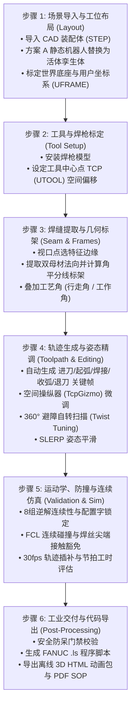

# 工业机器人离线编程 (OLP) 基础概念全景指南
### —— 专为 UE5 / 游戏引擎程序员量身定制的工业降维入门手册

> **文档位置**：`Docs/Instruction/OLP_Basics_For_Game_Devs.md`  
> **面向对象**：熟悉 Unreal Engine 5 (UE5) / 现代游戏引擎，具备 C++、三维变换与动画驱动基础，但对工业制造、机器人学与焊接离线编程（OLP）零经验的开发者。  
> **配套操作手册**：[`Docs/Instruction/Operation_Guide.md`](Operation_Guide.md)

---

## 目录

1. [写给 UE5 程序员的降维前言](#1-写给-ue5-程序员的降维前言)
   - 1.1 从游戏世界到车间物理世界
   - 1.2 UE5 核心技术 vs 工业机器人技术概念对照表（一秒打通任督二脉）
2. [为什么需要离线编程 (OLP)？](#2-为什么需要离线编程-olp)
   - 2.1 传统“在线示教（Online Teaching）”的致命痛点
   - 2.2 什么是离线编程（Offline Programming, OLP）？
3. [工业离线编程的标准 6 步闭环流](#3-工业离线编程的标准-6-步闭环流)
4. [坐标系族谱（Frames Hierarchy）](#4-坐标系族谱frames-hierarchy)
   - 4.1 世界坐标系（World Frame）
   - 4.2 机器人基座坐标系（Robot Base Frame）
   - 4.3 机械法兰末端（Flange / `tool0`）
   - 4.4 工具中心点（TCP / UTOOL）
   - 4.5 用户与工件坐标系（UFRAME）
5. [正运动学 (FK) 与逆运动学 (IK)](#5-正运动学-fk-与逆运动学-ik)
   - 5.1 正运动学（Forward Kinematics, FK）—— 简单确定性
   - 5.2 逆运动学（Inverse Kinematics, IK）—— 复杂多解性
6. [OPW 6 轴解析逆解与 8 组姿态解（核心拆解）](#6-opw-6-轴解析逆解与-8-组姿态解核心拆解)
   - 6.1 什么是 OPW 机器人？
   - 6.2 为什么空间同一个点，机器人会有 8 组不同的姿势？
   - 6.3 8 组解的物理机械解构（$2 \times 2 \times 2 = 8$）
7. [FANUC 8 态配置字（Config 字）与构型锁定](#7-fanuc-8-态配置字config-字与构型锁定)
   - 7.1 为什么工业机器人必须死锁配置字？
   - 7.2 解构 `'N U T, 0, 0, 0'` 字符密码
   - 7.3 直线插补中的“构型跳变（Config Jump）”灾难
8. [奇异点（Singularity）—— 为什么机器人会“发疯甩手”？](#8-奇异点singularity为什么机器人会发疯甩手)
   - 8.1 什么是奇异点？
   - 8.2 腕部奇异（Wrist Singularity，J5 趋近 0°）
   - 8.3 肘部与肩部奇异
   - 8.4 遇到奇异点如何“自救”？
9. [姿态数学：WPR 欧拉角 vs 四元数 vs 旋转矩阵](#9-姿态数学wpr-欧拉角-vs-四元数-vs-旋转矩阵)
   - 9.1 FANUC 的 WPR 欧拉角定义机制
   - 9.2 工业上的万向节死锁（Gimbal Lock）
   - 9.3 四元数球面插补（SLERP）平滑消除姿态抖动
10. [机器人运动指令：J、L、C 与 FINE、CNT](#10-机器人运动指令jlc-与-finecnt)
    - 10.1 运动轨迹模式（J 关节运动、L 笛卡尔直线运动、C 圆弧运动）
    - 10.2 平滑过渡模式（FINE 精确定位 vs CNT 飞跃平滑）
11. [焊接工艺专属几何特征](#11-焊接工艺专属几何特征)
    - 11.1 角平分线局部标架（Bisector Frame）
    - 11.2 行走角（Travel Angle）与工作角（Work Angle）
    - 11.3 焊枪绕焊丝 Z 轴自转（Twist Spin）
    - 11.4 工业级焊丝尖端接触豁免（Tip Exemption）
12. [代码后处理与下发交付（从代码到火花）](#12-代码后处理与下发交付从代码到火花)
    - 12.1 什么是后处理器（Post-Processor）？
    - 12.2 FANUC `.ls` vs `.tp`
    - 12.3 现场安全规程（T1 模式、Deadman 开关、STEP 单步）
13. [带着知识看战场：如何流畅阅读 `Operation_Guide.md`](#13-带着知识看战场如何流畅阅读-operation_guidemd)

---

## 1. 写给 UE5 程序员的降维前言

### 1.1 从游戏世界到车间物理世界

作为一名 **Unreal Engine 5 (UE5)** 程序员，你对以下概念一定如数家珍：
- `FVector`、`FRotator`、`FQuat`、`FTransform`；
- `SkeletalMeshComponent`、骨骼层级树（Parent-Child Bones）、骨骼挂点（Sockets）；
- 动画蓝图中的 `TwoBoneIK`、`Control Rig`、`FABRIK`；
- `LevelSequence` 关键帧烘焙、动画曲线平滑插值；
- `PhysX / Chaos` 刚体碰撞、AABB/OBB 包围盒；
- 将游戏打包编译并在真机（PC/主机/手机）上部署运行。

**好消息是：工业机器人离线编程（OLP）底层的数学原理与软件架构，跟游戏引擎的动画/物理/渲染管线有超过 80% 的直接同构性！**

两者的核心差异只有一点：
- **游戏引擎追求的是“好看与好玩”**：人物手持武器如果稍微穿模或者骨骼发生轻微抽搐，玩家可能只是笑笑；
- **工业机器人追求的是“绝对安全与微米级精度”**：一台 6 轴工业机械臂自重数百公斤、末端负载数十公斤、移动速度高达数米/秒。一旦出现逆解翻转、奇异点失控或撞击夹具，**轻则报废数十万的精密工装与激光割枪，重则击穿车间安全防护网危及人身生命安全**！

因此，工业 OLP 软件本质上就是一个**在数学严谨性、防穿模安全门禁、多解分支锁定上做到极致的“专用工业仿真引擎”**。

---

### 1.2 UE5 核心技术 vs 工业机器人技术概念对照表

请看下表，把你在 UE5 中的认知直接映射到工业机器人领域：

| UE5 游戏引擎概念 | 工业机器人 (OLP) 概念 | 核心共性与物理本质 |
| :--- | :--- | :--- |
| **Skeletal Mesh (骨架网格体)** | **Robot Model (机器人运动学模型)** | 由父子层级相连的刚体链（6 轴串联机械臂）。 |
| **Bone / Joint (骨骼 / 关节)** | **Link / Joint (连杆 / 关节轴 J1~J6)** | 具有回转自由度（Revolute Joint）的旋转轴，带软限位。 |
| **Bone Socket (骨骼挂点)** | **Tool0 / Flange (第 6 轴安装法兰)** | 机器人机械臂最末端的标准法兰机械接口。 |
| **AttachComponent (挂载组件，如武器)** | **Mounted Tool (装配工具，如焊枪)** | 螺栓固定在法兰末端的末端执行器（End-Effector）。 |
| **Socket Local Offset (枪口偏移)** | **TCP (Tool Center Point, 工具中心点)** | 焊枪尖端相对法兰本地坐标系的相对偏移变换。 |
| **Actor World Transform (世界坐标)** | **World Frame (车间世界大地坐标系)** | 车间地面的绝对参考原点。 |
| **Actor Local Space (局部空间)** | **UFRAME (User Frame, 用户坐标系)** | 绑定在工装工作台或待焊工件上的局部基准坐标系。 |
| **Control Rig / TwoBoneIK (IK 逆解节点)** | **OPW Kinematics Solver (解析逆解器)** | 输入空间目标位姿，反向解算各个关节旋转角度的算法。 |
| **IK 骨骼多解翻转 (如肘部朝左/朝右)** | **8 组逆解姿态 / FANUC Config 字** | 空间同一目标点，机械臂摆出的 8 种对称构型分支。 |
| **Anim Curve / Sequence Track (动画轨道)** | **Trajectory Interpolation (轨迹插补)** | 在路标点之间按照速度曲线进行连续插值。 |
| **Bake Animation (烘焙序列帧)** | **Baked Frames (离线轨迹帧烘焙)** | 离线计算出 30 fps 下每一帧 6 个关节的绝对位姿。 |
| **Chaos Collision / BVH (物理碰撞检测)** | **FCL (Flexible Collision Library)** | 连续三角网格最近邻距离（Clearance）与干涉计算。 |
| **PIE (Play In Editor, 编辑器预览播放)** | **Timeline Simulation (时间轴仿真控制)** | 在软件视口中实时拖拉进度条预览机械臂运动。 |
| **Cross-Compile & Package (打包构建)** | **Post-Processing (后处理生成 .ls 代码)** | 将虚拟工程编译为真机硬件可认的工业脚本代码。 |
| **Play On Target Device (真机真机运行)** | **RoboGuide 编译 & 现场 T1 试跑** | 真实机器人执行代码并引弧焊接。 |

---

## 2. 为什么需要离线编程 (OLP)？

### 2.1 传统“在线示教（Online Teaching）”的致命痛点

在很多传统车间里，老师傅是这样教机器人干活的：
1. 老师傅脖子上挂着一个重达 3 公斤的遥控器，叫**示教器（Teach Pendant, TP）**；
2. 走进满是灰尘和高温的机器人安全围栏里；
3. 一只手按住背后的安全使能开关，另一只手按着点动按钮，点一下动一点，像开行车一样把机器人慢慢挪动到工件缝隙前；
4. 眯着眼睛趴在工件上，用肉眼看焊枪尖端有没有对准焊缝，对准了按一下 `[RECORD]` 记一个点；
5. 一条工件有上百个焊点，逐点记录需要花费整整几天甚至几周时间。

```
[传统在线示教的工业暗坑]
• 停机成本极高：整条自动化产线必须完全停产陪着调试，每小时损失数万元；
• 人身安全隐患：调试人员就在几吨重的大臂下方穿梭，稍有误操作极易发生伤亡；
• 精度完全看心情：全靠肉眼观察，焊枪倾角、入角误差大，焊接质量参差不齐；
• 复杂工装寸步难行：遇到密密麻麻的气动夹具，老师傅根本无法肉眼预判机械臂大臂会不会撞在夹具背部。
```

---

### 2.2 什么是离线编程（Offline Programming, OLP）？

**离线编程（OLP）说白了，就是把整座物理车间“搬进电脑里做数字孪生”**：
1. **电脑里建图**：把产品零件、工装夹具、机器人的 3D CAD 模型（STEP）导入软件；
2. **点线自动化**：鼠标在工件缝隙上点一条边，算法自动提取曲面法向、自动生成焊枪姿态、自动避开夹具；
3. **毫秒级安全审计**：利用数学算法跑完 6 轴逆解、碰撞检测、奇异点检测、连续性检测；
4. **一键生成代码**：导出直接能给发那科、库卡、ABB 识别的程序脚本；
5. **车间直接下发**：工人只需拿着 U 盘插上机柜，直接运行！

整个过程，**车间产线不需要停工 1 秒钟，程序员在有空调的办公室里就完成了所有轨迹调试与避障**。

---

## 3. 工业离线编程的标准 6 步闭环流

在任何专业工业离线编程软件（如德国 CENIT FASTSUITE、达索 DELMIA、西门子 Process Simulate 或本项目 Si_FastSuite）中，标准工作流都严格遵循以下 6 步闭环：



---

## 4. 坐标系族谱（Frames Hierarchy）

在 UE5 中，所有的变换都在一个大体系下（`WorldTransform = ParentTransform * LocalTransform`）。  
工业机器人也是一模一样的树状父子矩阵变换结构，但在工业标准中，各个层级有专用的行业术语：

```
                    [车间世界坐标系 World Frame (UF: 0)]
                                     │
                  ┌──────────────────┴──────────────────┐
                  ▼                                     ▼
     [工件/工台坐标系 UFRAME]                [机器人基座坐标系 Robot Base]
                  │                                     │
      (所有焊点记录在 UFRAME 下)                 (经过 J1~J6 连杆正向变换)
                                                        ▼
                                             [法兰末端安装面 tool0]
                                                        │
                                                        ▼
                                             [工具中心点 TCP (UTOOL)]
                                           (焊枪喷嘴尖端, 真正碰焊缝的点)
```

### 4.1 世界坐标系（World Frame）
- **对应 UE5**：场景绝对原点 `(0, 0, 0)`。
- **工业定义**：车间地面的绝对大地标架。在 FANUC 系统中，未指定坐标系时默认即为 `UF : 0`。

### 4.2 机器人基座坐标系（Robot Base Frame）
- **对应 UE5**：机器人的 `RootComponent` 或 Root Bone 的世界 Transform。
- **工业定义**：机器人第 1 轴铸铁底座与车间安装台面贴合的中心基准面。

### 4.3 机械法兰末端（Flange / `tool0`）
- **对应 UE5**：骨骼末端名为 `hand_r` 或 `weapon_socket` 的挂载点。
- **工业定义**：机械臂第 6 轴（最后一个电机）输出端的金属圆盘。当机器人没有任何焊枪工具时，它的末端就是 `tool0`。

### 4.4 工具中心点（TCP / UTOOL）
- **对应 UE5**：挂载在右手上的武器（如法杖尖端、枪口 muzzle 处的局部 Transform 偏移）。
- **工业定义**：**Tool Center Point（工具中心点）**。
  - 对于弧焊机器人，**TCP 必须精准定义在伸出导电嘴的焊丝最尖端**！
  - 机器人在走直线焊接时，在物理上做直线运动的**不是法兰，而是这个 TCP 尖端**。
  - 在 Si_FastSuite 中，标准直角焊枪的 TCP 标定为法兰向前延伸 $Z + 150.0\text{ mm}$。

### 4.5 用户与工件坐标系（UFRAME）
- **对应 UE5**：一个包含工作台所有零件的 `Parent Actor` 的局部坐标系。
- **工业定义**：**User Frame（用户坐标系）**。
  - **为什么不直接用世界坐标记录焊点？**  
    想象一下：工件在工作台上如果向右平移了 $100\text{ mm}$，如果你的几千个焊点都是用绝对世界坐标写的，你必须把这几千个点全部重新计算一遍；
    但如果你把这几千个点都记录在 `UFRAME 1` 内部，当工作台整体移动时，**你只需要在示教器里把 `UFRAME 1` 的原点改动 $100\text{ mm}$，所有成千上万个焊接轨迹点就会像骨骼动画一样自动全部跟随更新！**
  - **标准三点标定法**：工业上只要确定 3 个点就能唯一确定一个三维坐标系：原点 $O$、X 轴正向点 $P_X$、XY 平面内参考点 $P_{XY}$。

---

## 5. 正运动学 (FK) 与逆运动学 (IK)

这是机器人学最核心的基础门槛，但对于做过动画系统的 UE5 程序员来说，理解起来轻而易举。

### 5.1 正运动学（Forward Kinematics, FK）—— 简单确定性

```
输入: [J1角度, J2角度, J3角度, J4角度, J5角度, J6角度] 
  ───▶ (正解计算: 纯矩阵连乘 T = T1 * T2 * ... * T6) 
  ───▶ 输出: 工具尖端 TCP 在空间中的绝对位置与姿态 (X, Y, Z, W, P, R)
```
- **特点**：**单射（一对一），唯一解**。只要 6 个电机度数定死了，机械臂在空间里的位置姿态就是板上钉钉的，没有任何悬念。

### 5.2 逆运动学（Inverse Kinematics, IK）—— 复杂多解性

```
输入: 焊枪尖端想要到达的空间目标位姿 (X, Y, Z, W, P, R)
  ───▶ (逆解计算: 解高度非线性的三角函数联立方程组) 
  ───▶ 输出: 6 个电机应该转多少度？ [J1, J2, J3, J4, J5, J6]
```
- **特点**：**多对一，非唯一解（多解问题）**！
- 就像你的右手食指尖端固定在桌子上的某个点、方向朝下保持不动，你的大臂手肘是可以在空中自由扇动、手腕可以向内折也可以向外翻的！
- 这就引出了工业机器人领域最经典、最重要的概念：**OPW 8 组姿态解**。

---

## 6. OPW 6 轴解析逆解与 8 组姿态解（核心拆解）

### 6.1 什么是 OPW 机器人？

工业界超过 90% 的工业机器人（如 **FANUC M-10iA** / ARC Mate、**KUKA KR6/KR16**、**ABB IRB 2600**、**安川 GP12**）在机械结构上都属于同一种几何构型：**球形手腕 6 轴串联关节机器人**。

1986 年学者 Orth, Pierce 与 Waldron 将这种特定几何结构的机器人的运动学归纳为 7 个几何尺寸常数（$a_1, a_2, b, c_1, c_2, c_3, c_4$），统称为 **OPW 构型**：
- 它的最大机械几何特征是：**第 4 轴、第 5 轴、第 6 轴的旋转轴线在空间中严格交汇于同一点（手腕球心）**！
- 这个交汇点直接解耦了位置与姿态，使得原本需要耗费数秒数值迭代逼近的逆解，可以通过**纯闭式代数解析几何在 5 微秒内一次性求出全部数学解**！

---

### 6.2 为什么空间同一个点，机器人会有 8 组不同的姿势？

在 UE5 中你用 `TwoBoneIK` 解算角色手臂时，手臂弯曲方向通常只有 2 种（朝上弯或朝下弯，通过 Pole Vector 极向量控制）。  
而在 6 轴工业机器人中，这种空间对称弯折分支一共有 **3 处二值对称**，组合起来恰好是：

$$2 \times 2 \times 2 = 8\text{ 组数学逆解！}$$

也就是说：**给定空间中任意一个合法的焊点位姿，在不碰撞、不超限的前提下，机器人可以摆出 8 种截然不同、但枪尖完全重合的身体姿势！**

---

### 6.3 8 组解的物理机械解构

```
                          [8 组逆解姿态分支构成]
                                    │
           ┌────────────────────────┼────────────────────────┐
           ▼                        ▼                        ▼
     【肩部对称】               【肘部俯仰】               【手腕翻转】
   Left (肩向左)             Elbow Up (肘朝上)         NoFlip (正手腕)
        vs                       vs                       vs
   Right (肩向右)           Elbow Down (肘朝下)        Flip (反手腕翻转)
       (2 种)                   (2 种)                   (2 种)
```

1. **肩部朝向（Shoulder / J1 旋转）：2 种分支**
   - **Left / Front**：底座 J1 轴直接朝向工件方向；
   - **Right / Back**：底座 J1 轴转过 $180^\circ$ 背对工件，然后大臂小臂从背后越过头顶反向伸过来。
2. **肘部俯仰（Elbow / J2-J3 联动）：2 种分支**
   - **Elbow Up（肘朝上）**：大臂和小臂向上拱起（像螳螂捕食的手势，最常见的稳定姿态）；
   - **Elbow Down（肘朝下）**：大臂和小臂向下沉入（像从桌子底下掏东西的姿势）。
3. **手腕翻转（Wrist / J4-J5-J6 联动）：2 种分支**
   - **NoFlip（手腕不翻转）**：手腕 J5 轴处在正常正角度弯折区间；
   - **Flip（手腕 $180^\circ$ 翻转）**：将 J4 轴旋转 $+180^\circ$，J5 轴反向对折，同时 J6 轴再反向补偿旋转 $180^\circ$。**此时枪尖方向纹丝不动，但整只手腕像翻麻花一样完全反了过来！**

这 8 组姿态在空间数学上都是绝对正确的解，但在车间物理世界中，**可能只有 1 组解既不撞夹具、电缆不缠绕、各轴又舒展远离限位！**

---

## 7. FANUC 8 态配置字（Config 字）与构型锁定

### 7.1 为什么工业机器人必须死锁配置字？

> [!CAUTION]
> **游戏 vs 工业的致命分水岭：**  
> 在游戏里，如果角色的手臂在某一帧因为 IK 翻转突然从“手肘朝上”瞬间弹到“手肘朝下”，这叫动画穿模或抖动；  
> 但如果一台自重半吨的焊接机器人，在沿着直线焊接的过程中，控制器为了求解下一帧，自作主张从“肘朝上”变到“肘朝下”，**大臂小臂会在高速直线焊缝中间瞬间原地大幅甩动几百毫米，直接将夹具、焊枪撞得粉碎！**

因此，工业焊接的铁律是：**在一条连续焊接路径（从起弧到收弧）中，机器人的机械构型必须从始至终严格死锁，绝不允许发生构型跳变！**

---

### 7.2 解构 `'N U T, 0, 0, 0'` 字符密码

在 Si_FastSuite 导出的 FANUC `.ls` 代码中，每一个笛卡尔焊点都附带一串奇怪的字符串代码：

```
CONFIG : 'N U T, 0, 0, 0'
```

这绝不是乱码，而是发那科机器人的**机械构型配置字身份证（Configuration String）**：

```
   '  N        U        T  ,   0  ,   0  ,   0  '
      │        │        │      │      │      │
      │        │        │      │      │      └─ Turn_J6: 第 6 轴转数圈数 (-1, 0, +1...)
      │        │        │      │      └──────── Turn_J4: 第 4 轴转数圈数 (-1, 0, +1...)
      │        │        │      └─────────────── Turn_J1: 第 1 轴转数圈数 (-1, 0, +1...)
      │        │        └────────────────────── Top/Bottom: J3 小臂俯仰 (Top=肘向上, Bottom=肘向下)
      │        └─────────────────────────────── Up/Down: J2 大臂朝向 (Up=大臂直立, Down=大臂趴下)
      └──────────────────────────────────────── NoFlip/Flip: J5 手腕构型 (N=正手腕, F=反手腕翻转)
```

- **第一组三字母（`N/F`, `U/D`, `T/B`）**：锁死前面讲的 8 组对称构型分支；
- **第二组三整数（`Turn_J1, Turn_J4, Turn_J6`）**：
  - 这三个轴是能够连续 $360^\circ$ 大幅回转的旋转轴；
  - 角度 $10^\circ$ 与 $370^\circ$ 在笛卡尔空间指向完全一致，但机械臂的内部线缆却整整多缠绕了一整圈！
  - 圈数参数就是为了明确告诉机器人：“请走第 0 圈的姿态，不要绕远路把电缆拉断”。

---

### 7.3 直线插补中的“构型跳变（Config Jump）”灾难

如果路径点 1 是 `'N U T, 0, 0, 0'`，而路径点 2 突然变成了 `'F U T, 0, 0, 0'`（手腕 Flip 翻转）：
- 系统的后处理器会直接报出严重阻断：`Config Jump in Linear Motion`；
- **导出门禁立刻锁定，拒绝生成生产代码**，直到工程师微调姿态消除跳变为止。

---

## 8. 奇异点（Singularity）—— 为什么机器人会“发疯甩手”？

### 8.1 什么是奇异点？

在 UE5 中你可能听说过“万向节死锁（Gimbal Lock）”，在特定角度两个旋转轴重合导致丢失一个旋转自由度。  
工业机器人由于多轴串联，同样存在几何退化点，这就是**奇异点（Singularity）**。

当机器人进入奇异点状态时，**它的雅可比矩阵行列式等于 0（数学矩阵不可逆）**：
- 在物理表现上：TCP 只需要向前移动仅仅 $1\text{ mm}$，算法反算出的电机角速度却会**趋近于无穷大**！
- 现场直观感受：机器人平稳走着走着，到了某个位置，手腕像触电一样突然以极限最高速猛烈自旋半圈，发出刺耳的尖叫并报警过载停机。

---

### 8.2 腕部奇异（Wrist Singularity，J5 趋近 0°）

这是焊接离线编程中最常碰到的“头号杀手”：
- **触发条件**：**当第 5 轴（J5）的角度接近 $0.0^\circ$ 时**（即焊枪法兰表面正对小臂，手臂完全伸直成一条棍子）；
- **物理原因**：此时第 4 轴（J4）与第 6 轴（J6）的旋转中心线**在空间中完全共线重合**！
- 机械臂此时在绕手腕侧向摆动的维度上丧失了瞬时自由度，数学逆解在这个奇点处产生无穷大奇点。

```
          J4 轴回转中心线 ─────────┐
                                  ├──▶ 【完全重合，自由度退化！】
          J6 轴回转中心线 ─────────┘
                 (此时 J5 摆角 = 0.0°)
```

---

### 8.3 肘部与肩部奇异
- **肘部奇异（Elbow Singularity）**：大臂小臂完全绷直（像人伸直手臂到极限），无法再向前伸；
- **肩部奇异（Shoulder Singularity）**：手腕的球心点刚好穿过了底座 J1 轴垂直旋转轴线的延长线上。

---

### 8.4 遇到奇异点如何“自救”？

在 Si_FastSuite 中，遇到腕部奇异不用慌：
1. 观察右侧属性面板，如果显示 `奇异: 腕部奇异 (J5 接近 0°)`；
2. **绝招**：点击属性面板下方的 **【★ 一键微调至最优自转角】**！
3. 算法自动让焊枪绕着焊丝自转（TCP 尖端和熔池不变），迫使手腕产生倾角，J5 轴瞬间偏离 $0^\circ$ 区间（例如变成 $15^\circ$），自由度立刻恢复，奇异点警报瞬间解除！

---

## 9. 姿态数学：WPR 欧拉角 vs 四元数 vs 旋转矩阵

作为 UE5 程序员，你对四元数（`FQuat`）非常熟悉，但在看工业机器人代码时可能会纳闷：为什么机器人报的是 $W, P, R$？

### 9.1 FANUC 的 WPR 欧拉角定义机制

FANUC 机器人的笛卡尔姿态采用的是 **Yaw-Pitch-Roll** 的变体：
- **$W$ (Yaw / 偏航角)**：绕 $X$ 轴旋转的角度（以度为单位）；
- **$P$ (Pitch / 俯仰角)**：绕 $Y$ 轴旋转的角度；
- **$R$ (Roll / 翻滚角)**：绕 $Z$ 轴旋转的角度；
- **复合旋转矩阵乘法顺序**（极其严格，绝不能乘反）：
  $$R_{\text{matrix}} = R_z(R) \cdot R_y(P) \cdot R_x(W)$$

---

### 9.2 工业上的万向节死锁（Gimbal Lock）

当俯仰角 $P = \pm 90.0^\circ$ 时，$X$ 轴与 $Z$ 轴共线，同样会产生欧拉角死锁。  
为此，Si_FastSuite 底层在核心数学库 [`MathTypes.h`](file:///c:/Users/mimovr/Desktop/TEmp/Si_FastSuite/include/olp/core/MathTypes.h) 中内置了万向锁退化保护（当 $P$ 逼近 $90^\circ$ 时，锁定 $W = 0$，将全部旋转差值收敛至 $R$）。

---

### 9.3 四元数球面插补（SLERP）平滑消除姿态抖动

在两个路径点 $P_{\text{start}}$ 与 $P_{\text{end}}$ 之间，如果直接对欧拉角 $W, P, R$ 进行线性插值（LERP），机械臂中途的角速度是非匀速的，甚至会走出怪异的扭动曲线。

**工业级做法（与 UE5 动画插值完全一致）**：
1. 将两端的旋转矩阵转换为单位四元数 $q_1, q_2$；
2. 沿着四维超球表面进行**球面线性插补（SLERP, Spherical Linear Interpolation）**：
   $$\text{SLERP}(q_1, q_2, t) = \frac{\sin((1-t)\theta)}{\sin\theta}q_1 + \frac{\sin(t\theta)}{\sin\theta}q_2$$
3. 在工具栏点击 **【姿态平滑】（SLERP）** 按钮，系统就会自动调用这段算法，保证焊枪在焊缝中间平滑过渡，消除各轴抖动！

---

## 10. 机器人运动指令：J、L、C 与 FINE、CNT

在导出的机器人代码中，运动指令是核心逻辑行，每种字母代表完全不同的电机驱动方式：

```
1:  J  P[1]  50%       FINE  ;
2:  L  P[2]  200mm/sec FINE  ;
3:  L  P[3]  WELD_SPEED CNT50 Arc Start[1] ;
```

### 10.1 运动轨迹模式

| 指令 | 英文全称 | 电机控制原理 | 视觉轨迹特征 | 适用工序阶段 |
| :---: | :---: | :--- | :--- | :--- |
| **`J`** | **Joint (关节运动)** | 6 个轴的电机以各自的同步梯形加减速曲线旋转，各轴同时起动、同时到达。计算最轻量。 | 枪尖在空中走出一条**自然弯曲的弧线**，不保证是直线。 | **安全大位移空走**（如从 Home 待机位到焊缝上空）。 |
| **`L`** | **Linear (直线运动)** | 控制器以毫秒级高频实时解算逆解，强行约束枪尖 TCP 在笛卡尔空间走绝对直线。 | 枪尖在空间走出**笔直的几何线段**。 | **进退刀切入、有效焊接段**（严禁在焊接段使用 J）。 |
| **`C`** | **Circular (圆弧运动)**| 由 3 个点（起点、过渡点、终点）在空间唯一拟合一段空间三维圆弧。 | 枪尖走出一段**精密三维圆弧**。 | 圆形管件或大圆角焊缝。 |

---

### 10.2 平滑过渡模式

```
         FINE (停稳打点)                     CNT 50 (飞跃倒角)
        P1 ───────┐                       P1 ───────╭────── P3
                  │                                 │
                  ▼                                 ▼
                  P2 (完全停死, 再启动)             P2 (不经过P2, 提前倒角切削过去)
```

- **`FINE`（精准定死）**：
  - 机器人到达目标点时，各轴电机必须减速直到速度完全降为 $0$，伺服就位信号（In-Position）亮起，才准执行下一条；
  - **应用场景**：进刀到达起弧点（准备起弧）、起弧点、收弧点、退刀最终安全点。
- **`CNT`（Continuous / 连续平滑过渡）**：
  - 取值范围 `CNT 0` 到 `CNT 100`。
  - 机器人接近目标点时**绝不减速停死**，而是在接近距离时提前开始向下一个目标点拐弯切削（类似贝塞尔曲线倒角平滑）；
  - `CNT 100` 拐角半径最大，速度最连贯；`CNT 0` 轨迹无限贴近点但依然不停留；
  - **应用场景**：长焊缝中间的多个过渡特征点（`WELD_VIA_*`）。

---

## 11. 焊接工艺专属几何特征

### 11.1 角平分线局部标架（Bisector Frame）

对于工业上最广泛的 **T 型接头角焊缝（Fillet Weld）**（一块立板贴在一块底板上）：
- 焊枪绝对不能瞎指，必须严格指向两块金属板夹角的最深处根部；
- 系统在焊缝上任意一点提取立板外法向 $\vec{n}_1$ 和底板外法向 $\vec{n}_2$；
- 计算两母材外法向的单位角平分线：
  $$\vec{b} = \frac{\vec{n}_1 + \vec{n}_2}{\|\vec{n}_1 + \vec{n}_2\|}$$
- **将焊枪的局部入针进给轴（$-Z$ 轴）精确反向绑定在 $-\vec{b}$ 方向**，保证焊丝严格平分两板夹角对准焊根！

---

### 11.2 行走角（Travel Angle）与工作角（Work Angle）

在角平分线的基础上，工艺员可以叠加两个微观倾角：
- **行走角（Travel Angle）**：沿前进方向倾斜。后倾为“拉焊（Drag）”（铁水容易成型成堆高），前倾为“推焊（Push）”（熔深大）；
- **工作角（Work Angle）**：偏离对称平分面朝其中一块板倾斜（例如厚板吸热快，工作角偏向厚板侧 $5^\circ$）。

---

### 11.3 焊枪绕焊丝 Z 轴自转（Twist Spin）

请记住这句口诀：
> **“焊丝是根轴，自转不走样；枪尖不动弹，枪身大避障！”**

焊枪绕着焊丝本地轴（Z 轴）旋转时，枪尖焊丝在熔池中的位置和夹角彻底不变，但后方粗大的防撞传感器和鹅颈枪身在空间中可以画出一个巨大的圆弧！利用这个自由度，可以神奇地甩开旁边的气动压紧气缸。

---

### 11.4 工业级焊丝尖端接触豁免（Tip Exemption）

- **在游戏引擎中**：两把武器碰撞盒子一旦重叠，就会触发 HitEvent；
- **在焊接仿真中**：物理上焊丝尖端**必须 100% 紧贴工件表面**才能导电打火起弧！如果通用仿真软件把这种物理接触当成“碰撞报警”，整个工件在起弧瞬间就会变成一片血红；
- **Si_FastSuite 的工业解法**：在焊缝焊接段内，系统自动将枪尖球体（半径 $10.0\text{ mm}$）与当前正在焊的母材工件从碰撞矩阵中定向豁免；但焊枪如果碰到旁边的夹具压头，防撞报警依然会以毫秒级严苛触发！

---

## 12. 代码后处理与下发交付（从代码到火花）

### 12.1 什么是后处理器（Post-Processor）？

- **对应 UE5**：相当于你写好了虚幻关卡，最后点击 `Package Project` 生成 `.exe` 和 `.pak` 资产包；
- **在工业 OLP 中**：仿真软件里所有的点都是内存里的 C++ 结构体（`core::Target`）。后处理器负责将这些内存数据，按照具体厂商（FANUC、KUKA、ABB、Yaskawa）的语法规则，**翻译排版成对应的机器人汇编文本脚本**。

---

### 12.2 FANUC `.ls` vs `.tp`

- **`.ls`（ASCII Listing File）**：明文文本文件。可以用记事本打开，人类完全可读，包含指令、坐标表、注释。
- **`.tp`（Teach Pendant Binary File）**：FANUC 机器人的二进制编译目标文件。真机控制器直接执行的是 `.tp`。
- **转换关系**：通常先由 OLP 生成 `.ls`，再通过发那科官方的仿真编译器 **ROBOGUIDE**（或机柜内部的 `ASCII Program Loader` 模块）将 `.ls` 编译成 `.tp`。

---

### 12.3 现场安全规程（工业铁律）

当程序员把生成的代码拿到车间现场第一次测试时，必须严格执行三件套：
1. **模式开关打到 `T1` 模式**：
   - 控制柜钥匙开关旋转到 T1。此时内部伺服硬件物理限速在 **$\le 250\text{ mm/s}$**。即便程序里写了 $2000\text{ mm/s}$，机器人也绝对走不快；
2. **倍率降到 `10%`**：
   - 示教器右下角速度倍率调至极低，留足反应时间；
3. **Deadman 安全开关中位 + `STEP` 单步推演**：
   - 示教员单手握持使能开关（不可全按死，不可全松开）；
   - 开启单步，按一次 `[FWD]` 走一个点，人眼全程盯紧焊枪与工装间隙！

---

## 13. 带着知识看战场：如何流畅阅读 `Operation_Guide.md`

有了上面完整的概念铺垫，现在你可以打开主操作手册 **[`Docs/Instruction/Operation_Guide.md`](Operation_Guide.md)** 了！你会发现所有曾经晦涩的专有名词，现在都变得无比亲切和具象：

```
当你看到 Operation_Guide.md 中的...      你会立刻联想到本指南中的...
─────────────────────────────────────────────────────────────────────────────
• § 2.3 双工作台 (Layout vs OLP)      ──▶ 虚幻关卡搭建 (Place Actors) 与 动画蓝图 (Animation Blueprint) 的分工
• § 4.1 方案 A 静态机器人替换          ──▶ 导入装配体时, 自动将无骨骼的静态 Mesh 替换为带完整 Rig 的 SkeletalMesh
• § 4.3 UFRAME 三点标定              ──▶ 建立一个基准 Parent Actor Local Space, 实现所有焊点的相对位移解耦
• § 5.2 角平分线局部标架               ──▶ 提取两母材面法向 n1, n2, 计算 (-b) 向量作为 TCP 的对齐朝向
• § 6.1 TcpGizmo 五条交互铁律         ──▶ 视口三维平移旋转 Manipulator, 步进吸附与无损 Esc 撤销
• § 6.3 SLERP 姿态平滑               ──▶ 对相邻关键帧四元数执行球面线性插值, 消除欧拉角姿态抖动
• § 6.6 多目标点批量编辑              ──▶ 表格按 Shift/Ctrl 多选点, 统一批量修改属性并合并为一条 MacroCommand
• § 7.2 TwistScan 360° 避障扫描       ──▶ 绕焊丝 TCP 本地 Z 轴自转, 寻找远离碰撞且避免奇异点的最大安全开阔角
• § 8.2 焊丝尖端接触豁免              ──▶ 焊接段内屏蔽枪尖球体与当前焊接工件的碰撞重叠判定 (Overlap 豁免)
• § 9.2 FANUC 8态 Config 配置字      ──▶ 骨骼逆解的 8 组对称构型分支, 在直线运动中严禁跳变翻转
• § 9.3 腕部奇异点 (J5 接近 0°)       ──▶ J4 轴与 J6 轴线共线导致的雅可比矩阵退化万向死锁
• § 10.3 30fps 轨迹帧烘焙            ──▶ 离线计算每 33ms 一帧下 7 组连杆刚体矩阵并在时间轴上自由 Seek 播放
• § 11.1.4 ROBOGUIDE 与现场实机联调    ──▶ 类似跨平台打包发布并部署到真实主机上, 遵循 T1 限速单步验收 SOP
```

祝你在工业机器人数字孪生与离线编程的世界里大显身手！
