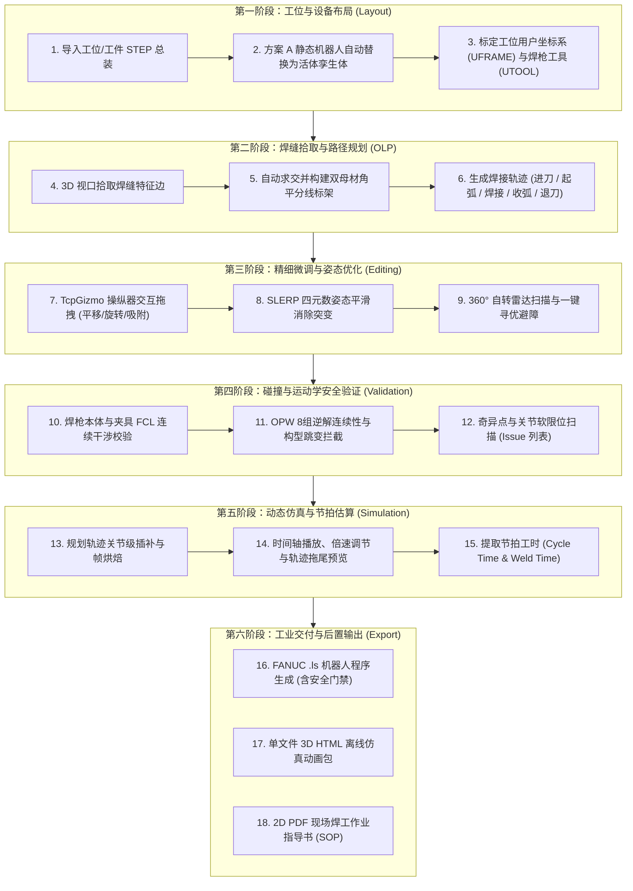
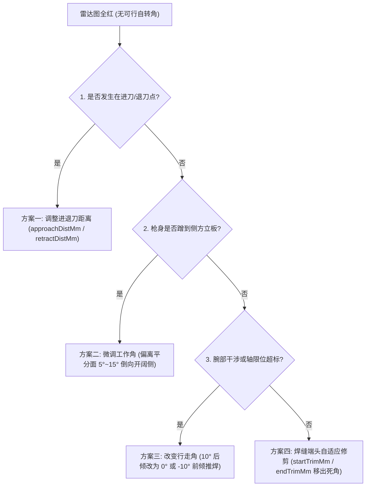
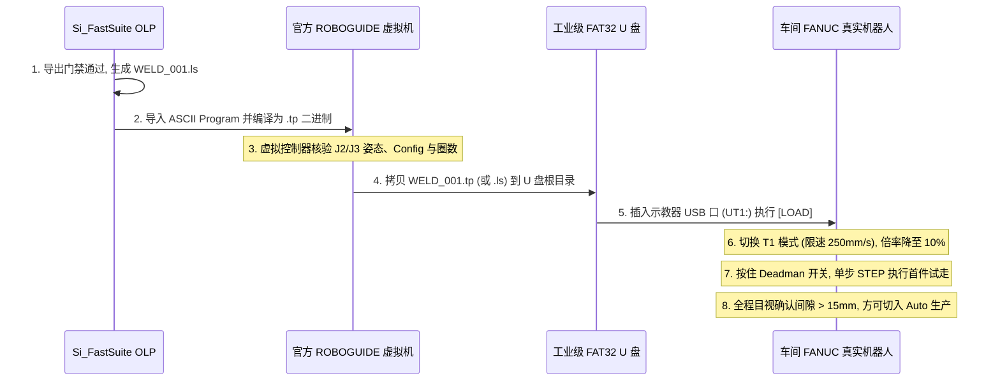

# Si_FastSuite 工业机器人焊接离线编程系统 (OLP) 用户操作手册与完整指南

> **软件版本**：Si_FastSuite OLP v0.1.0  
> **对标产品**：德国 CENIT **FASTSUITE Edition 2**  
> **文档位置**：`Docs/Instruction/Operation_Guide.md`  
> **适用人群**：机器人焊接工艺工程师、离线编程（OLP）工程师、数字化产线集成仿真人员

> [!TIP]
> **零基础概念前置指引**：如果您对工业制造与机器人离线编程（OLP）尚不熟悉（例如具备游戏引擎 / UE5 / 图形学背景），建议先阅读配套前置概念手册：[**《工业机器人离线编程 (OLP) 基础概念全景指南 —— 专为 UE5 / 游戏程序员量身定制》**](OLP_Basics_For_Game_Devs.md)，先快速打通坐标系族谱、OPW 8组逆解、FANUC 8态配置字与奇异点等核心概念。

---

## 目录

1. [系统概述与整体工作流闭环](#1-系统概述与整体工作流闭环)
   - 1.1 系统定位与核心能力
   - 1.2 端到端操作闭环逻辑全景图
2. [界面布局与功能栏目全景详解](#2-界面布局与功能栏目全景详解)
   - 2.1 菜单栏（MenuBar）功能一览
   - 2.2 主工具栏（Ribbon 快捷操作区）
   - 2.3 双工作台体系（Layout 布局工作台 vs OLP 编程工作台）
   - 2.4 中央 3D 交互视口（OcctViewport）与导航手势
   - 2.5 左侧面板：场景大纲树与程序树（Scene Dock & Program Dock）
   - 2.6 右侧面板：目标点属性面板与关节点动面板（Property Dock & Jog Dock）
   - 2.7 底部面板：路径点表格与安全问题列表（Target Dock & Issue Dock）
   - 2.8 底部时间轴工具栏（Timeline Panel）
3. [工位与场景数据导入指南](#3-工位与场景数据导入指南)
   - 3.1 一键加载内置示例工位（快速上手与演示验证）
   - 3.2 导入外部 CAD STEP 工位与零件总装
     - 3.2.1 自定义 STEP 场景导入规范与装夹角色自动识别规则
   - 3.3 工程项目文件的打开与保存（.json 存档）
4. [机器人与工位设备编辑配置](#4-机器人与工位设备编辑配置)
   - 4.1 方案 A 静态机器人自动替换机制
   - 4.2 机器人基座定位与世界坐标查看
   - 4.3 用户坐标系（UFRAME）三点法标定原理与基准设定
   - 4.4 工具坐标系（UTOOL / 焊枪）装配与 TCP 配置
   - 4.5 关节安全软限位与关节点动预览
5. [焊缝拾取与工艺路径线生成](#5-焊缝拾取与工艺路径线生成)
   - 5.1 视口交互边线拾取（Edge Picking）
   - 5.2 T 型角焊贴合面识别与角平分线局部标架
   - 5.3 一键生成焊接操作路径（Operation）
   - 5.4 进刀段（Approach）与退刀段（Retract）自动规划
   - 5.5 焊枪默认工艺角度（行走角、工作角、自转角）
6. [路径点与姿态精细化编辑](#6-路径点与姿态精细化编辑)
   - 6.1 TcpGizmo 空间操纵器交互规范（五条交互铁律）
   - 6.2 步进吸附与四种参考坐标系机制（Tool / World / UFrame / Seam）
   - 6.3 姿态平滑插值（SLERP 球形线性插值）
   - 6.4 路径点表格行内快捷参数编辑
   - 6.5 单步前后切换快捷键（`[` 与 `]`）
   - 6.6 多目标点批量选择与批量编辑实操（Batch Editing）
7. [焊枪避障自转扫描与精细微调](#7-焊枪避障自转扫描与精细微调)
   - 7.1 绕焊丝 Z 轴自转角的工程意义
   - 7.2 TwistScanWidget 360° 环形可行域雷达图
   - 7.3 ★ 一键微调至最优自转角（自动化避障与远离奇异）
   - 7.4 快速步进微调与顺逆时针微调
   - 7.5 避障“极端死角”下的进阶救生指南（全圈红色/无可行自转角时的工艺解法）
8. [碰撞检测与安全间隙验证](#8-碰撞检测与安全间隙验证)
   - 8.1 碰撞角色分类（工件、夹具、环境、连杆、焊枪、忽略）
   - 8.2 工业级焊丝尖端接触豁免机制（消除焊根全红假报警）
   - 8.3 FCL 连续碰撞与精细安全距离计算（Clearance mm）
   - 8.4 初始位置到进刀点安全过渡段（Clearance Transit Points）
   - 8.5 避开夹具的焊缝起点自适应裁剪（Start Trim）
9. [运动学验证与故障诊断排障](#9-运动学验证与故障诊断排障)
   - 9.1 FANUC OPW 6 轴解析逆解与 8 组姿态解
   - 9.2 运动学配置字（Config 字）一致性与构型跳变检测
   - 9.3 奇异点监测（腕部、肘部、肩部奇异）
   - 9.4 关节限位超限报警（Joint Limit Exceeded）
   - 9.5 问题列表（Issue List）单击/双击直达联动定位
10. [轨迹仿真与时间轴播放](#10-轨迹仿真与时间轴播放)
    - 10.1 连续轨迹插补与帧烘焙机制
    - 10.2 播放控制器（播放/暂停/停止/从选中点起播）
    - 10.3 倍速调节（0.25x ~ 4x）与时间轴滑块精确定位
    - 10.4 节拍工时与焊接有效时间读数
    - 10.5 视口 3D 轨迹拖尾线（Trail）与电弧起收状态显示
11. [成果输出与工业交付](#11-成果输出与工业交付)
    - 11.1 FANUC ASCII `.ls` 源程序导出
      - 导出门禁与防呆红条（`RISK-001` 草稿门禁）
      - 代码高亮预览与选项配置（/APPL、Return Home 等）
      - 复制与写出
      - ROBOGUIDE 与现场实机联调标准操作规范（SOP）
    - 11.2 单文件离线 3D HTML 交互仿真动画包导出
    - 11.3 2D PDF 工位作业指导书（SOP 工艺报告）导出
12. [端到端实战操作范例：T 型角焊箱工位离线编程](#12-端到端实战操作范例t-型角焊箱工位离线编程)
13. [快捷键一览与常见问题排查（FAQ）](#13-快捷键一览与常见问题排查faq)

---

## 1. 系统概述与整体工作流闭环

### 1.1 系统定位与核心能力

**Si_FastSuite** 是一套面向高端装备制造与工业机器人弧焊/激光焊场景的专业级**离线编程（OLP, Offline Programming）软件系统**，在软件架构与交互体验上全面对标德国工业仿真巨头 CENIT 的行业标杆软件 **FASTSUITE Edition 2**。

系统基于现代 C++20 与分层解耦架构设计，具备以下核心技术底座：
- **工业级几何建模内核**：依托 OpenCASCADE 8.0 纯正 B-Rep（边界表示）几何引擎，具备微米级（$< 0.001\text{ mm}$）装配体特征解析、跨零件贴合面求交与拓扑选边能力。
- **FANUC 6 轴闭式解析运动学**：内置 FANUC OPW 运动学核心算法，支持 8 组解析逆解毫秒级秒出、圈数动态展开、FANUC 标准 8 态姿态配置字（如 `'N U T, 0, 0, 0'`）一致性检查，以及 J2/J3 机械耦合联动换算。
- **高保真碰撞检测与安全裕度评估**：基于 FCL（Flexible Collision Library）连续包围盒树（BVH）进行网格干涉分析，并首创**焊丝尖端接触豁免机制**，彻底解决传统仿真软件在焊缝根部“全红误报”的痛点。
- **数字孪生后置输出矩阵**：支持生产级 FANUC ASCII `.ls` 程序语法生成、离线单文件 3D WebGL（Three.js）交互仿真动画导出，以及符合国际标准的 2D PDF 作业指导书（SOP）报告自动排版打印。

---

### 1.2 端到端操作闭环逻辑全景图

从现场拿到客户工件图纸到最终把代码打入车间机器人控制器，本系统遵循严格的工业级 6 步闭环逻辑：



---

## 2. 界面布局与功能栏目全景详解

软件主界面采用专业 CAD/CAM 软件的标准暗青灰深色主题（主色调 `#243746`，底色 `#d5dde4`），符合长时间车间离线编程视觉抗疲劳标准。

整个工作台划分为 **7 大核心功能区域**：

```
+-----------------------------------------------------------------------------------------------+
|  菜单栏: 文件(F)   编辑(E)   工作台(W)   视图(V)   帮助(H)                                       |
+-----------------------------------------------------------------------------------------------+
|  主工具栏 (Ribbon): [文件] 新建 打开 保存 导入 示例 | [编辑] 撤销 重做 | [工作台] 布局 编程 | ...   |
+-------------------------+---------------------------------------------------+-----------------+
|  [场景大纲树 (Scene)]   |                                                   |  [属性面板]     |
|  - 零件 Part            |                                                   |  - 坐标 WPR     |
|  - 机器人 Robot         |             中央 3D 交互视口 (OcctViewport)        |  - 工艺参数     |
|  - 焊枪 Tool            |                                                   |  - 360°自转雷达 |
|  - 坐标系 Frame         |          (OpenCASCADE 8.0 AIS 渲染引擎)            +-----------------+
+-------------------------+                                                   |  [关节点动]     |
|  [程序树 (Program)]     |                                                   |  J1 ~ J6 滑块   |
|  - 焊缝 Seam            |                                                   |  角度实时预览   |
|  - 焊接操作 Operation   |                                                   |                 |
+-------------------------+---------------------------------------------------+-----------------+
|  [底部多标签区 (Tabified)]                                                                    |
|  选项卡 1: [路径点表格 (Target Waypoint Table)] —— 名称、运动类型、速度、平滑度、状态、间隙 mm   |
|  选项卡 2: [安全问题列表 (Issue List)] —— 碰撞冲突、奇异点、不可达、跳变、超限位双击直达定位     |
+-----------------------------------------------------------------------------------------------+
|  时间轴 (Timeline): [播放] [暂停] [停止] [上一点] [下一点] [1x ▽]  [══════●══════] 节拍工时读数 |
+-----------------------------------------------------------------------------------------------+
```

---

### 2.1 菜单栏（MenuBar）功能一览

| 主菜单 | 菜单项 | 工具栏对应按钮 | 功能详细说明 |
| :--- | :--- | :--- | :--- |
| **文件 (File)** | 新建 | `新建`（置灰预留） | 预留动作（鼠标悬停提示：“后续接入，现在还不能用。”）。 |
| | **打开...** | `打开` | 打开之前保存的 JSON 工程项目文件（恢复所有工位树、焊缝数据、程序轨迹与微调记录）。 |
| | **保存...** | `保存` | 将当前全部工作现场保存为 JSON 工程项目文件（默认文件名 `project.json`）。 |
| | **导入...** | `导入` | 导入外部 CAD STEP（`.step`、`.stp`）总装工位或单体零件模型。 |
| | **加载示例工位** | `示例` | 一键加载内置双板 T 型角焊整工位场景，自动完成方案 A 机器人替换、焊缝提取与离线编程演示闭环。 |
| | **导出 FANUC .ls 程序...** | `导出` | 弹出 FANUC ASCII 代码导出对话框，进行语法校验、代码预览、配置选项勾选与 `.ls` 文件写出。 |
| | **导出 2D PDF 工艺报告...** | — | 截取当前视口画面，提取工位元数据、焊缝总长与焊点明细，自动排版导出 PDF SOP 指导书。 |
| | **导出 3D HTML 仿真动画...**| — | 导出包含工位三维模型、机器人 7 节连杆+焊枪运动、焊缝拖尾的离线交互式单文件网页（零外部依赖）。 |
| | 退出 | — | 关闭主窗口退出软件（若有未保存改动会触发防丢失确认弹窗）。 |
| **编辑 (Edit)** | **撤销 (Undo)** | `撤销` | 撤销上一步操作。包括 Gizmo 拖放、数值修改、自转微调、路径生成等，均经 `CommandManager` 入栈可撤销。 |
| | **重做 (Redo)** | `重做` | 重做刚刚撤销的操作。 |
| | 复制 / 粘贴 / 删除 | `复制` / `粘贴` / `删除`（置灰预留） | 预留动作，当前版本置灰禁用。 |
| **工作台 (Workbench)** | **布局工作台 (Layout)**| `布局` | 切换至设备布局模式，默认保持【场景】、【属性】、【关节点动】面板打开。 |
| | **编程工作台 (OLP)** | `编程` | 切换至焊接编程模式，同时展开【场景】、【程序】、【路径点】、【问题】、【属性】、【关节点动】全部面板。 |
| **视图 (View)** | **整个工作台 (Fit All)** | `全景` | 自动计算当前所有可见三维模型的空间包围盒，将相机对准并收进视口中心。 |
| | 各浮动面板勾选开关 | — | 自由显示或隐藏【场景】、【程序】、【路径点】、【属性】、【关节点动】、【问题】六个停靠面板。 |
| **帮助 (Help)** | 关于 | — | 在底部状态栏提示软件名称与 3D 视口鼠标导航手势说明。 |

---

### 2.2 主工具栏（Ribbon 快捷操作区）

主工具栏按工业交互逻辑划分为 5 大功能组：
1. **文件组**：
   - `新建`（灰色预留）
   - `打开`：快速打开 `.json` 工程
   - `保存`：快速保存当前工程
   - `导入`：调用 STEP 模型导入管线
   - `示例`：一键触发全套演示会话
2. **编辑组**：
   - `撤销`（Undo） / `重做`（Redo）
   - `复制` / `粘贴` / `删除`（灰色预留）
3. **工作台组**：
   - `布局`（单选切换） / `编程`（单选切换）
4. **编程组**：
   - `拾取`（Pick，高亮开关）：开启后视口处于特征边拾取模式，点击模型边缘即可提取焊缝；关闭后恢复普通对象整体选择。
   - `路径`（Path）：选定当前焊缝，一键计算母材角平分线并生成包含进刀、起弧、收弧、退刀的操作轨迹。
   - `平滑`（SLERP）：对当前操作全部焊点或表格多选选定区间，执行四元数球面线性姿态平滑，消除轴向姿态突变。
   - `仿真`（灰色预留，轨迹连续播放与单步推演由底部时间轴面板直接承载）。
   - `导出`（Export）：一键呼出 FANUC `.ls` 后处理器对话框。
5. **视图组**：
   - `全景`（菜单名为“整个工作台”，Fit All）：一键复位视口视角。

---

### 2.3 双工作台体系（Layout 布局工作台 vs OLP 编程工作台）

系统将复杂的机器人工作站工程划分为两个清晰的职责阶段：

```
       [用户进入系统]
             |
             +-----------------------------------------+
             |                                         |
             v                                         v
    [布局工作台 Layout Workbench]              [编程工作台 Olp Workbench]
  • 导入整工位 STEP 场景                     • 视口交互提取特征焊缝
  • 方案 A 自动识别并替换机器人              • 自动生成进退刀与焊接点
  • 标定 UFRAME (工件标架)                   • TcpGizmo 交互微调位姿
  • 标定 UTOOL (焊枪 TCP)                   • 避障自转扫描与 SLERP 平滑
  • 配置部件干涉角色 (工件/夹具/连杆)        • 碰撞检测、逆解与奇异点排障
                                             • 时间轴仿真、估算节拍工时
                                             • 导出 FANUC .ls 与 3D HTML
```

- **布局工作台（Layout Workbench）**：面向设备工程师与工装夹具设计人员。用于规划工作站空间干涉、确认机器人安装底座台高度、配置各实体的干涉角色（谁是工件、谁是夹具、谁是机身连杆），并精确设定工作台用户坐标系（UFRAME 1）与工具 TCP（UTOOL 1）。
- **编程工作台（Olp Workbench）**：面向焊接工艺人员与现场示教程序员。隐藏底层拓扑复杂性，聚焦于焊缝轨迹质量、工艺角度调谐、起收弧工艺事件注入、防撞间隙排查与机器人控制代码输出。

---

### 2.4 中央 3D 交互视口（OcctViewport）与导航手势

视口底层基于 OpenCASCADE 8.0 `V3d_View` 与 `AIS_InteractiveContext` 构建，具备硬件加速的高性能多边形渲染与三维交互拾取管线。

#### 鼠标标准手势

| 鼠标按键 / 操作 | 交互行为 | 详细机制与技巧 |
| :--- | :--- | :--- |
| **右键按住拖拽** | **3D 转盘自由旋转** | 围绕当前相机旋转中心进行工业级转盘（Turntable Orbit，保持世界 Z 轴朝上）多角度自由观察。 |
| **中键按住拖拽** | **平移视口 (Pan)** | 平行于当前视平面进行画面平移移动。 |
| **滚轮滚动** | **依光标缩放 (Zoom)** | **以当前鼠标光标在视平面上的投影点为缩放中心**进行无级放大与缩小并自动做视平面平移补偿，防止画面飞散。 |
| **左键单击** | **交互拾取 (Pick)** | - 当主工具栏【拾取】关闭时：拾取整个场景节点（高亮对象）；<br/>- 当主工具栏【拾取】开启时：拾取 CAD 零件精确特征边线（Edge），触发即时焊缝生成逻辑。 |
| **键盘 `[` 键** | **上一目标点** | 快速将当前操作的焦点切换到上一个路径点，视口同步更新机器人姿态与 TcpGizmo 位置。 |
| **键盘 `]` 键** | **下一目标点** | 快速将焦点切换到下一个路径点，视口同步更新机器人姿态与 TcpGizmo 位置。 |
| **键盘 `Esc` 键** | **取消操纵器** | 中断并取消当前的 TcpGizmo 鼠标拖拽动作，目标点瞬间无损回滚至拖动前位姿。 |

---

### 2.5 左侧面板：场景大纲树与程序树

#### 1. 场景大纲树（Scene Dock）
直观树状展示工位内部所有几何实体与设备单元（自动按 `工件`、`夹具`、`机器人`、`坐标系`、`已隐藏的静态外形`、`其他` 分组归纳），包含三列信息：
- **名称（Name）**：如 `Workpiece_BoxWall_Front`、`Fixture_Clamp_Left`、`FANUC M-10iA`、`Welding_Torch_150mm`、`UFRAME_1_Table`。
- **类型（Type）**：
  - `零件 (Part)`：工位上的实体工装、待焊零件、底座台架等。
  - `机器人 (Robot)`：具备运动学链接关系的活动机器人孪生体。
  - `工具 (Tool)`：安装于机器人 J6 法兰末端的工具（焊枪），内含 TCP 空间偏移矩阵。
  - `坐标系 (Frame)`：用户自定义的基准坐标系节点。
  - `组 (Group)`：复合装配体或装夹组件分组。
- **角色（Role）**：对应后续碰撞检测矩阵的干涉行为角色（`工件`、`夹具`、`环境`、`机器人连杆`、`焊枪`、`忽略`）。

#### 2. 程序树（Program Dock）
包含 `程序` 与 `说明` 两列，结构化组织焊接逻辑资产：
- **焊缝（Seams）**：列出工位内所有的焊缝几何（如 `FilletSeam_E3` 或 `ChainSeam_E...`），说明列显示焊缝起点修剪量（如 `起点后移 5 mm`）。
- **控制器与程序（Controller & Program）**：对应机器人的控制器单元（`FANUC_R30iB_Plus` / `cu_1`）与主焊接程序（`WELD_001`），其下挂接具体的焊接操作序列（如 `Fillet_BoxWall_Front`）。

---

### 2.6 右侧面板：目标点属性面板与关节点动面板

#### 1. 目标点属性面板（Target Property Panel）
面板上方为只读详情文本区，下方为交互式自转角微调控件区：
- **当选中场景节点时**：展示节点名称、类型、碰撞角色、可见性、局部位置（`位置 mm`）与欧拉角姿态（`姿态 WPR °`）。
- **当选中路径点时**：
  - **点位核心参数**：路径点名称、运动指令类型（`J` / `L`）、运行速度（`WELD_SPEED (10 mm/s)` 或空移数值）、平滑过渡指标（`FINE` / `CNT 0~100`）。
  - **工艺事件**：指示该点是否绑定了起弧（`Arc Start[1]`）或收弧（`Arc End[1]`）事件。
  - **安全与间隙数值**：当前点的运动学与碰撞状态（`通过` / `碰撞` / `间隙不足` / `超限位` 等）、FCL 精确安全间隙（`间隙 mm`）。
  - **运动学逆解信息**：FANUC 8 态构型字（如 `'N U T, 0, 0, 0'`）、可操作度指标（Manipulability Index）、各轴解析求解关节度数（`J1 ~ J6`）及 `UFRAME` 下的坐标与 WPR 姿态。
  - **焊枪自转角微调区（焊枪自转角微调 (TCP Z 自转)）**：内嵌 360° 可行域雷达图、一键最优自转角按钮及步进微调按钮簇。

#### 2. 关节点动面板（Jog Dock）
专为示教人员设计的 6 轴关节角读数与滑块预览面板：
- 包含 J1 至 J6 独立的滑动条，滑块范围严格对应机器人型号的物理软限位（精度 $0.1^\circ$，例如 J1: $-180^\circ \sim +180^\circ$, J2: $-90^\circ \sim +160^\circ$, J3: $-170^\circ \sim +180^\circ$ 等）。
- 当在表格中选中某个路径点或播放时间轴仿真时，滑块与顶部读数（`场景机器人：J1 ...` / `仿真（未写入程序）：J1 ...`）以及 3D 视口内的机器人 7 节连杆会自动同步至对应关节角。
- 手动拖拽滑块时，面板顶部实时显示 `预览（未写入程序）：J1 0.0°  J2 15.2° ...` 供核对角度范围。
- **安全免责防呆机制**：界面明确提示 `“点动只显示角度，不写入程序。”`，绝不会无意污染已生成的工艺程序点。

---

### 2.7 底部面板：路径点表格与安全问题列表

底部区域采用 Tab 标签页折叠设计（可自由切换标签），兼顾高效列表查看与警报诊断：

#### 选项卡 1：路径点表格（Target Waypoint Table）
以表格化形式展现选中操作的全部路径点（例如含安全过渡点时为 `CLEARANCE_1` -> `APPROACH` -> `WELD_START` -> `WELD_VIA_*` -> `WELD_END` -> `RETRACT`）：
- **7 列信息与行内编辑能力**：
  1. `名称`（只读）：路径点标识（如 `APPROACH`、`WELD_START`、`WELD_END`、`RETRACT`）
  2. `运动`（**可双击编辑**）：输入 `J`（关节运动）或 `L`（直线运动）
  3. `速度`（**可双击编辑**）：支持输入 `200`、`15 mm/s`、`72 cm/min`、`50%`、`weld`、`weld 10` 等人性化格式
  4. `平滑度`（**可双击编辑**）：输入 `FINE` 或 `CNT 50`（或直接输入 `0~100` 数值）
  5. `工艺事件`（**可双击编辑**）：显示或输入 `Arc Start[1]`、`Arc End[1]`（支持条件号 `1~32`），输入 `-` 或 `None` 可清除事件
  6. `状态`（只读）：显示当前点校验结论（`通过`、`碰撞`、`间隙不足`、`奇异`、`构型跳变`、`超限位`、`靠近限位`、`不可达`、`未检查`）
  7. `间隙 mm`（只读）：显示该点与周边非豁免障碍物的最小净空间隔（单位：mm）

#### 选项卡 2：安全问题列表（Issue List Panel）
当工程中存在任何物理干涉或运动学异常时，该列表实时汇聚告警（无异常时显示绿色 `未发现干涉或运动学异常 (全部正常)`）：
- **色彩分级**：阻断级错误（`碰撞`、`不可达`、`超限位`、`构型跳变`）以**红色**高亮显示；预警级问题（`间隙不足`、`奇异`、`靠近限位`）以**橙色**显示。
- **显示格式**：`[<操作名>] <目标点名>: <具体原因>`。
- **单击/双击联动定位机制**：**在列表中单击或双击任意一条问题项，系统自动选中对应的焊接操作与目标点，3D 视口内机器人立即切换至该点姿态并在点位处浮现黄色代理球与 TcpGizmo，同时路径点表格自动滚动选中该行、右侧属性面板调出完整参数与 360° 自转雷达图**，方便工艺员快速排障！

---

### 2.8 底部时间轴工具栏（Timeline Panel）

时间轴位于软件最底部，负责控制离线编程的全流程插补仿真与动态再现：
- **控制按钮簇**：
  - `播放`：启动连续轨迹动态仿真；
  - `暂停`：冻结当前仿真时刻；
  - `停止`：重置回轨迹起始点；
  - `上一点` / `下一点`：按程序路标点进行离散跳转；
  - `步进 0.1s`：按 $0.1$ 秒步长高精度逐帧推演；
  - `从选中点`：直接从工程师当前高亮选中的路标点开始播放。
- **倍速下拉框**：提供 `0.25x`（慢动作排障）、`0.5x`、`1x`（标准物理时间）、`2x`、`4x`（快速推演）五档倍率。
- **高精度进度滑块**：刻度范围 $0 \sim 10000$，支持鼠标随意拖拽 Seek，视口机器人连杆与焊枪实时跟随位置更新。
- **工时读数面板**：动态实时显示：
  $$\text{总周期时间 (Cycle Time)} = \text{有效焊接工时 (Weld Time)} + \text{空走过渡工时 (Air Time)}$$

---

## 3. 工位与场景数据导入指南

### 3.1 一键加载内置示例工位（快速上手与演示验证）

对于首次使用系统、进行客户汇报、或验证环境安装完整性的工程师，系统内置了一套标准的大型箱体 T 型角焊工作站：

1. 打开软件主界面；
2. 点击主菜单 **【文件】 -> 【加载示例工位】**，或直接点击主工具栏上的 **【示例】** 图标；
3. **系统全自动执行以下管线**：
   - 自动加载 `SampleScenes/Scene2_Full_Workcell_STEP/Full_Welding_Cell_With_Robot.step`；
   - 导入 12 个精密 B-Rep 实体（包括工作台、底座台架、左右气动压紧夹具、箱体底板、箱体前侧板等）；
   - 触发【方案 A】自动将 STEP 模型中静止的 `FANUC_M10iA_Static_*` 隐藏，并在底座基准面精准加载内置的带真实连杆网格的活体 `FANUC M-10iA` 机器人；
   - 自动标定 UFRAME 1 用户坐标系与 UTOOL 1 焊枪；
   - 自动拾取箱体前侧板与底板贴合处特征边，构建焊缝；
   - 自动规划安全过渡点、规避夹具干涉、执行 OPW 逆解、完成连续碰撞检测与 30 帧/秒插补烘焙；
4. 完成后，底部时间轴将展示总节拍（约 $15.8$ 秒）与焊接有效时间（约 $8.4$ 秒），视口展现完整的工业仿真场景。

---

### 3.2 导入外部 CAD STEP 工位与零件总装

当需要处理客户实际项目的全新产品与工作站时：

1. 点击主菜单 **【文件】 -> 【导入...】**，或点击工具栏 **【导入】** 按钮；
2. 在弹出的文件选择器中，定位至您的 3D CAD STEP 文件（支持 `.step` 或 `.stp`，标准 AP203/AP214 协议，完整支持含中文字符的文件路径）；
3. 点击【打开】，OpenCASCADE 内核将启动装配体解析管线：
   - 解析 STEP 实体拓扑结构与部件名称；
   - 自动计算渲染与碰撞三角网格；
   - 构建 FCL 碰撞包围盒树（BVH）；
4. 导入完成后，左侧【场景大纲树】将按角色分类列出全部节点，视口自动全景对焦。

> [!NOTE]
> 如果导入的 STEP 总装文件中已包含静态机器人模型（例如模型名称带有 `FANUC_` 或 `Static_`），系统的【方案 A】引擎将自动匹配其底座并一键替换为活体机器人，无需手动逐一装配连杆！

#### 3.2.1 自定义 STEP 场景导入规范与装夹角色自动识别规则

当工程师导入自身企业通过 SolidWorks / NX (UG) / Catia / Creo 建模导出的整工位 STEP 装配体（AP203 / AP214）时，系统底层基于装配体零部件的**实体命名特征（Naming Conventions）**实现全自动化图层识别与干涉角色分配：

| 命名特征关键词 | 自动识别之节点类型 | 自动赋予之碰撞角色 | 自动化处理行为与工程语义 |
| :--- | :--- | :--- | :--- |
| **`Workpiece_*`** | `零件 (Part)` | **`工件 (Workpiece)`** | 标记为待焊接产品；参与邻接贴合面角平分线计算，享受**焊丝尖端接触豁免**。 |
| **`Fixture_*`** | `零件 (Part)` | **`夹具 (Fixture)`** | 标记为气动压具、定位销或支承胎具；纳入 **100% 严格防撞矩阵**，枪身严禁触碰。 |
| **`Environment_*`** | `零件 (Part)` | **`环境 (Environment)`** | 标记为外部安全围栏、清枪台或立柱；纳入防撞矩阵。 |
| **`Static_*`** 或 **`FANUC_*`** | `零件 (Part)` | **`忽略 (Ignored)`** | 识别为整工位 STEP 中作为参考展示的“静态假机器人壳”；系统自动将其**从视口隐藏并排除出碰撞检测**。 |
| **`Static_Base`** 或 **`Pedestal_Base`** | `零件 (Part)` | — | 自动提取其上表面或安装配合面中心，作为**方案 A 活体机器人安装底座的吸附原点**。 |

> [!TIP]
> **如果外部 CAD 命名不符合上述约定怎么办？**
> 如果客户给出的 CAD 零件名称为任意编号（例如 `PART_001`、`ASM_BRACKET`）：
> 1. 模型依然能被 100% 完整导入并参与三维渲染；
> 2. 系统默认将所有未识别零件的碰撞角色设为 `工件 (Workpiece)`；
> 3. 工程师可在左侧【场景大纲树】中直观核查所有节点名称与角色分布；若需将某部件设为免检（如防护软帘），可在工程保存后的 JSON 中将其 `collisionRole` 标为 `Ignored`。

---

### 3.3 工程项目文件的打开与保存（.json 存档）

为了方便工艺方案的版本迭代与跨工程师交接，系统采用自包含的 JSON 工程持久化机制：

- **保存工程**：点击 **【文件】 -> 【保存...】** 或工具栏 **【保存】**，指定保存路径（默认 `project.json`）。系统将把以下数据完整固化：
  - 场景所有节点及其世界变换矩阵；
  - 零件对应的 CAD 源文件引用与拓扑签名；
  - 所有焊缝定义、采样标架、起点/终点修剪量；
  - 全部控制器、焊接作业程序、路径点位姿、工艺事件与微调增量（`userDeltaOffset`）；
  - 当前工作台安全配置参数。
- **打开工程**：点击 **【文件】 -> 【打开...】** 或工具栏 **【打开】**，选择工程 JSON 文件，系统将自动重绑定 CAD 几何句柄并完整恢复现场工作进度。
- **防丢失机制**：当工程处于“脏状态（有修改未保存）”时，执行加载示例工位、导入 STEP、打开工程或关闭软件均会弹出确认对话框，防止工作意外丢失。

---

## 4. 机器人与工位设备编辑配置

### 4.1 方案 A 静态机器人自动替换机制

在大型汽车或重工集成项目中，机械设计部门输出给离线编程工程师的往往是一整份 STEP/IGES 静态装配大图。传统仿真软件要求工程师先把装配体里的假机器人删掉，再手动从库里拖一个机器人、一点点对齐底座法兰螺栓孔，耗时耗力且极易产生装配误差。

**Si_FastSuite 创新落地了方案 A 自动替换机制**：
1. **自动特征指纹识别**：扫描 STEP 节点名称，凡包含 `Static_` 或 `FANUC_` 的部件，自动识别为静态几何实体；
2. **底座安装面自适应提取**：自动检索 `Static_Base`（静态机器人底座）或 `Pedestal_Base`（支承台架）的包围盒顶面/底面坐标；
3. **微米级精准吸附**：静态外形被自动置为 `隐藏` 且干涉角色置为 `忽略`（归入场景树 `已隐藏的静态外形` 分组）；内置标准运动学与 7 节 URDF 连杆网格的活体 `FANUC M-10iA` 机器人自动装载并落位于该安装面；
4. **误差控制**：基座对齐偏差保证在 $< 0.01\text{ mm}$ 以内，与真实物理装配 100% 重合！

---

### 4.2 机器人基座定位与世界坐标查看

若需要核查机器人或工装部件在车间世界坐标系下的安装位姿：
1. 在左侧【场景大纲树】中展开并点击选中机器人或零件节点；
2. 在右侧【属性面板】中，可直观查看该节点的空间属性：
   - 节点类型、碰撞角色与可见状态；
   - 局部位置：`位置 mm  X  Y  Z`；
   - 旋转姿态：`姿态 WPR °  W  P  R`。
3. 机器人基座变换矩阵通过【方案 A】自动提取或由工程 `.json` 文件精确配置，所有 OPW 运动学正逆解与碰撞检测均基于该基座矩阵自动解算。

---

### 4.3 用户坐标系（UFRAME）三点法标定原理与基准设定

遵循工业机器人主流（FANUC / ABB / KUKA）坐标系标定规程，系统底层命令（`DefineUFrameCommand`）采用标准**三点法（Three-Point Method）**建立工件或工台用户坐标系（UFRAME）：

$$O_{\text{world}} \rightarrow \text{原点 (Origin)},\quad P_{X} \rightarrow X\text{ 轴正向点},\quad P_{XY} \rightarrow XY\text{ 平面内参考点}$$

系统内部执行正交化标定算法：
$$\vec{u}_X = \frac{P_{X} - O}{\|P_{X} - O\|},\quad \vec{u}_Z = \frac{\vec{u}_X \times (P_{XY} - O)}{\|\vec{u}_X \times (P_{XY} - O)\|},\quad \vec{u}_Y = \vec{u}_Z \times \vec{u}_X$$

在示例工位中，系统自动将焊接工作台面标定为 `UFRAME 1 (UFRAME_1_Table)`，其后生成的所有路径点均以 `poseInUFrame` 相对基准记录空间姿态，**保证了工装治具一旦发生整体微调，只需更新 UFRAME 即可全盘迁移程序点**！

---

### 4.4 工具坐标系（UTOOL / 焊枪）装配与 TCP 配置

焊枪装配在机器人第 6 轴（J6 法兰）表面，其工具中心点（TCP, Tool Center Point）是离线编程的基准：
1. 在场景树中，工具节点（`tool_torch_1` / `Welding_Torch_150mm`）挂载于机器人节点下；
2. **TCP 偏移量配置**：标准焊枪 TCP 定义为沿法兰 $Z$ 轴延伸 $150.0\text{ mm}$（即相对法兰局部坐标系 $T = [0, 0, 150]\text{ mm}$）；
3. **数字孪生一致性**：在三维渲染与 HTML 导出中，焊枪模型枪尖物理位置与数学 TCP 坐标实现 $0.0\text{ mm}$ 零误差严格贴合。

---

### 4.5 关节安全软限位与关节点动预览

在核查各轴行程范围与工作姿态时，可以使用【关节点动面板】：
- 系统内置了 FANUC M-10iA 的出厂软限位配置表：
  - **J1 轴**：$-180.0^\circ \sim +180.0^\circ$
  - **J2 轴**：$-90.0^\circ \sim +160.0^\circ$
  - **J3 轴**：$-170.0^\circ \sim +180.0^\circ$
  - **J4 轴**：$-190.0^\circ \sim +190.0^\circ$
  - **J5 轴**：$-180.0^\circ \sim +180.0^\circ$
  - **J6 轴**：$-360.0^\circ \sim +360.0^\circ$
- 选中任意路径点或运行轨迹仿真时，滑块会自动同步显示各轴当前角度与限位余量；手动拖动滑块可在顶部读数栏预览目标角度且不会覆盖已生成的程序数据。

---

## 5. 焊缝拾取与工艺路径线生成

### 5.1 视口交互边线拾取（Edge Picking）

系统支持极致简化的 3D 视口直观选边建缝交互：

1. 确保主工具栏上的 **【拾取】** 按钮处于激活高亮状态（默认为激活）；
2. 鼠标移入 3D 视口，光标靠近工件的任何边线（Edge）时，边线将呈现预选高亮反馈；
3. **鼠标左键单击**该边线：
   - 视口拾取通道瞬间捕获该实体所属的 CAD 句柄 ID（`cadHandleId`）与边索引（`edgeIndex`）；
   - 系统立刻调用 `CreateSeamFromPickedEdgeCommand` 解析该边线（或相连切矢连续边链），自动搜寻跨零件贴合母材面并进行等弧长离散化采样；
   - 界面状态栏提示：`已基于拾取边创建焊缝: <seamId> (CAD句柄 <cadHandleId>, 边索引 <edgeIndex>)`；
   - 软件工作台自动切换至 **【编程工作台】**，并在视口中以青色粗线渲染该焊缝！

---

### 5.2 T 型角焊贴合面识别与角平分线局部标架

对于工业上最普遍也最难处理的**跨零件 T 型角焊（Fillet Weld）**（例如立板与底板贴合焊接），系统采用独创的双母材投影匹配算法：

```
                 母材 1 (立板)
                     │
                     │  n1 (母材1法向)
                     │  ▲
                     │  │
                     ┼──┴───────────────
                     │ ＼
                     │   ＼ -b (焊枪指向: 角平分线反向指向焊根)
                     │     ＼
  ───────────────────┴───────▼──────────  母材 2 (底板)
                     ────────► n2 (母材2法向)
```

1. **双母材邻接法向求解**：
   - 提取边线所属的母材 1 外法向向量 $\vec{n}_1$；
   - 自动在邻近工件候选集中进行距离投影，搜寻紧密贴合的母材 2 接触面，提取母材 2 外法向向量 $\vec{n}_2$；
2. **正交焊根标架构建**：
   - 计算两母材外法向的单位角平分线：
     $$\vec{b} = \frac{\vec{n}_1 + \vec{n}_2}{\|\vec{n}_1 + \vec{n}_2\|}$$
   - 定义局部正交坐标系：
     - 切向 $\vec{X} = \vec{t}$（沿焊缝前进方向）；
     - 焊枪进给向 $\vec{Z}_0 = -\vec{b}$（严格对称反向直指焊根深度方向，平分夹角）；
     - 侧向 $\vec{Y} = \vec{Z}_0 \times \vec{X}$；
3. **工艺姿态叠加**：
   - 在此基础标架上，叠加**工作角（Work Angle）**、**行走角（Travel Angle）**与**自转角（Twist Angle）**，最终解算出焊枪在该采样点的姿态旋转矩阵。

---

### 5.3 一键生成焊接操作路径（Operation）

提取焊缝后，只需在主工具栏上点击 **【生成路径】**（快捷按钮 `路径`）：
- 系统自动根据当前选中的焊缝，通过 `GenerateOperationFromSeamCommand` 生成对应的焊接操作并立即执行 OPW 逆解与 FCL 碰撞验证；
- 自动按顺序生成一整套符合焊接物理规范的路标点序列；
- 界面状态栏显示：`已由焊缝生成焊接操作路径。`，路径点表格立即填满各点位数据。

---

### 5.4 进刀段（Approach）与退刀段（Retract）自动规划

为防止焊枪直接从高空直插焊缝导致碰枪，系统在焊接起收点两侧自动构建引弧与退刀过渡向量：
- **进刀点（`APPROACH`）**：从起弧点沿着焊枪工具局部 $-Z$ 轴方向回退指定的安全距离（`ToolpathGenParams` 默认 $50.0\text{ mm}$，内置示例工位配置为 $45.0\text{ mm}$），默认运动类型为 `J`（速度 `50%`）、终止类型为 `FINE`；
- **起弧点（`WELD_START`）**：从进刀点直线（`L`）接近至焊缝物理起点（速度默认 $200\text{ mm/s}$），定位方式 `FINE`，并自动挂接 `Arc Start[1]` 事件；
- **中间焊段点（`WELD_VIA_1`, `WELD_VIA_2`, ...）**：对于曲线或多段折线焊缝，沿焊缝采样点生成中间过渡点（运动类型 `L`、速度标记 `WELD_SPEED (10 mm/s)`、平滑度 `CNT 50`）；对于单条直线段焊缝，默认启用 `endpointsOnlyForLine = true` 仅保留首尾焊点以精简机器人代码；
- **收弧点（`WELD_END`）**：以工艺焊接速度 `WELD_SPEED (10 mm/s)` 直线（`L`）到达焊缝物理终点，定位方式 `FINE`，触发 `Arc End[1]` 停弧事件；
- **退刀点（`RETRACT`）**：从收弧点沿焊枪局部 $-Z$ 轴安全抽离（默认 $50.0\text{ mm}$，示例工位 $45.0\text{ mm}$），运动类型为 `L`（速度 $200\text{ mm/s}$）、`FINE`，确保枪头完全脱离熔池与近距工件。

---

### 5.5 焊枪默认工艺角度（行走角、工作角、自转角）

生成操作路径时，系统自动应用标准弧焊默认工艺角参数（`ToolpathGenParams`）：
- **行走角（Travel Angle / 后倾或前倾角）**：默认取 **$+10.0^\circ$**（绕局部 $Y$ 轴倾斜，改善熔池铁水流动与气孔排出）；
- **工作角（Work Angle）**：默认取 **$0.0^\circ$**（严格沿两母材角平分面对称入射）；
- **初始自转角（Twist Angle）**：默认取 **$0.0^\circ$**（生成后可通过视口 `TcpGizmo` 操纵器或属性面板的 360° 自转雷达图对任意单点或多点进行精细微调）。

---

## 6. 路径点与姿态精细化编辑

### 6.1 TcpGizmo 空间操纵器交互规范（五条交互铁律）

在 3D 视口中选中任意路径点时，点位处会浮现出醒目的黄色目标代理球与专用的 **TcpGizmo 3D 操纵器**（红绿蓝三轴平移箭头 + 绕三轴旋转圆环，已禁用非刚体缩放）。

为了保证工业级软件的稳定性与严肃性，系统的 TcpGizmo 严格遵守 **五条交互铁律**：

> [!IMPORTANT]
> 1. **不污染底层 CAD 零件拓扑**：视口中的 `AIS_Manipulator` 仅挂载于独立的轻量级黄色代理球体（`targetGizmoProxyAis`），绝不直接附着或修改底层 CAD 零件的 B-Rep 拓扑结构；
> 2. **步进吸附防误触**：默认开启步进吸附，平移按 $1.0\text{ mm}$ 整倍数吸附，旋转按 $1.0^\circ$ 整倍数吸附，严防手抖导致产生零碎坐标；
> 3. **拖拽过程预览隔离（Rule 3）**：在鼠标按住拖动过程中，仅通过 `GizmoDragPreviewHandler` 发送轻量预览位姿，绝不直接篡改 `ProjectDocument` 或向撤销栈刷入海量中间命令；
> 4. **单次释放统一入栈（Rule 4 & Rule 5）**：松开鼠标左键完成拖动时，单点拖拽仅向 `CommandManager` 压入 **一条干净的 `ModifyTargetPoseCommand`**，表格多选拖拽则合并压入 **一条 `MacroCommand`**，执行一次【撤销】即可完整回滚；
> 5. **`Esc` 键无损取消逃生通道**：在拖拽过程中如果发现拉扯有误，**只要按下键盘 `Esc` 键，点位瞬间无损回滚到拖动开始前的原始位姿**，鼠标释放后不产生任何脏数据。

---

### 6.2 步进吸附与四种参考坐标系机制（Tool / World / UFrame / Seam）

`TcpGizmo` 与 `OcctViewport` 在底层完整支持四种工程参考坐标系（视口默认激活最常用的 **工具参考系 `Tool`**）：
- **工具参考系 (`GizmoRefFrame::Tool`，默认激活)**：沿着焊枪枪尖本地坐标系平移与旋转（例如沿着焊枪 $Z$ 轴进针/拔出，或绕焊丝 $Z$ 轴自转）；
- **世界参考系 (`GizmoRefFrame::World`)**：沿着车间绝对水平与垂直方向变换（$X, Y, Z$）；
- **用户参考系 (`GizmoRefFrame::UFrame`)**：沿着工件工作台面坐标系（UFRAME）变换；
- **焊缝参考系 (`GizmoRefFrame::Seam`)**：沿着当前点最近焊缝采样点的局部切向与角平分线标架变换。

---

### 6.3 姿态平滑插值（SLERP 球形线性插值）

在多曲面焊接或复杂空间三维焊缝中，若逐点调整焊枪容易造成相邻路标点之间姿态扭动过大，导致机器人在直线运动中各关节大幅摆动。

此时只需使用主工具栏上的 **【平滑】（姿态平滑，SLERP）** 功能：
1. **全局平滑**：如果不选或仅选中一个点，点击【平滑】，系统对当前焊接操作中的焊点姿态，基于四元数球面线性插值（SLERP, Spherical Linear Interpolation）进行整段均匀平滑过渡；
2. **局部区间平滑**：在底部路径点表格中按住 `Ctrl` 或 `Shift` 多选起始点与终止点，点击【平滑】，系统仅针对选中的子区间进行局部姿态插补，保持区间外的点位姿态不变；
3. 状态栏将反馈：`已完成路径姿态 SLERP 平滑插值。` 或 `已完成局部区间 [<起点ID> -> <终点ID>] 路径姿态 SLERP 平滑插值。`

---

### 6.4 路径点表格行内快捷参数编辑

对于熟悉表格操作的工程师，可直接在底部【路径点表格】中双击单元格快速修改四类工艺属性（所有修改均通过 `ModifyTargetProcessParamsCommand` 入栈支持撤销）：
- **运动类型修改（第 2 列）**：双击输入 `J` 或 `L`（大小写不敏感）；
- **速度快速修改（第 3 列）**：支持极其宽容的人性化工业输入语法：
  - 输入 `12` 或 `12 mm/s` $\rightarrow$ 自动识别为速度数值 $12\text{ mm/s}$；
  - 输入 `weld` 或 `weld 10` $\rightarrow$ 自动赋予工艺焊接速度标记 `WELD_SPEED (10 mm/s)`；
  - 输入 `72 cm/min` $\rightarrow$ 自动依工业公式换算：$v = \frac{72 \times 10}{60} = 12\text{ mm/s}$；
  - 输入 `50%` $\rightarrow$ 自动识别为关节空移百分比 $50\%$。
- **平滑度快速修改（第 4 列）**：输入 `FINE`（精确定位）或输入 `CNT 50` / `50`（圆角连续过渡，自动钳位至 $0 \sim 100$）；
- **工艺事件快速修改（第 5 列）**：输入 `Arc Start[1]`、`Arc End[1]`（支持条件号 `1~32`），或输入 `-` / `None` 清空事件。

---

### 6.5 单步前后切换快捷键（`[` 与 `]`）

工艺员在逐点微调核查时，不必反复用鼠标去表格里点击：
- 键盘轻按 **`]`**（右中括号）：视口与面板同步切换到**下一个点**；
- 键盘轻按 **`[`**（左中括号）：同步切换到**上一个点**；
- 配合键盘快速巡检，工作效率提升数倍！

---

### 6.6 多目标点批量选择与批量编辑实操（Batch Editing）

在实际焊接工艺中，一条焊缝往往包含 $10 \sim 30$ 个离散焊点。逐点微调效率低下，系统在表格、视口与属性面板之间构建了**多目标点批量联动编辑通道**：

#### 1. 批量多选操作方式
在底部【路径点表格】中：
- **连续区间多选**：点击选中第一个点（如 `WELD_START`），按住键盘 **`Shift`** 键点击目标点（如 `WELD_VIA_3`），整段点位高亮选中；
- **离散跳跃多选**：按住键盘 **`Ctrl`** 键，依次点击需要的行（如单独选中全部起收弧或进退刀点）；
- **全选**：在表格内按 `Ctrl+A` 快速选中当前操作中的全部路径点。

#### 2. 批量编辑的联动响应机制
当多个目标点处于选中状态时：
- **批量绕焊丝自转（`rotateTargetsTcpZ`）**：在右侧属性面板中点击 `+5°`、`-5°` 或输入任意度数，系统自动以宏命令的形式将旋转增量**同时施加于所有选中的目标点**；
- **批量最优自转角寻优**：多选后点击【★ 一键微调至最优自转角】，系统以选中点集为对象执行连续可行域交集寻优，一键解决多点干涉；
- **局部区间姿态平滑（SLERP）**：多选后点击主工具栏【平滑】按钮，系统自动提取多选点集的首节点为起始姿态、尾节点为终止姿态，自动将其中间所有点平滑插值过渡；
- **视口 TcpGizmo 批量拖拽**：在视口中拖动操纵器时，所有选中点保持相对空间几何刚体位姿同步平移/旋转；松开鼠标后系统向撤销栈压入一条 **`MacroCommand`**，按一次 `Ctrl+Z` 即可将全部受影响点位瞬时复原！

---

## 7. 焊枪避障自转扫描与精细微调

### 7.1 绕焊丝 Z 轴自转角的工程意义

在机器人弧焊工艺中，焊枪的焊丝沿着工具局部坐标系的 $Z$ 轴延伸。**当焊枪绕着焊丝自身的 $Z$ 轴自转时，枪尖（TCP）在空间中的三维位置完全不变，焊丝指向焊缝熔池的入射角也完全不变**！

然而，**焊枪后方粗大的枪身、电缆支架、导电嘴以及机器人的腕部关节，却会随着自转产生巨大的空间扫掠**。利用这一个关键的自由度，我们可以神不知鬼不觉地转动枪身，**避开身旁的压紧夹具、避开机械限位、或者彻底跳出奇异点区间**！

---

### 7.2 TwistScanWidget 360° 环形可行域雷达图

在右侧【属性面板】下方，内嵌了直观的 **360° 环形自转扫描雷达图（TwistScanWidget）**：

```
                    [ 0° ]
                  . - ~ - .
              . '     |     ' .
            '         |         '
     [-90°] --------- + --------- [+90°]
            .    ▲  可行弧段 (绿色) .
              .  │  碰撞弧段 (红色)
                  ' - ~ - '
                   [ 180° ]
```

- 系统以后台轻量多线程对当前点在 $[-180^\circ, +180^\circ]$ 范围内，以 $5^\circ$ 为步长（共 72 组样本）预先计算正逆解与碰撞：
  - **绿色弧段**：表示完全可行区间（逆解成立、无碰撞、远离奇异、关节在限位内）；
  - **红色弧段**：表示危险区间（枪身与夹具干涉，或轴超软限位）；
  - **黄色/橙色扇区**：表示临界警告区间（接近奇异点或间隙低于预警阈值）；
- **鼠标交互直选**：鼠标直接点击圆环上的任意角度刻度，焊枪即刻精准自转到该角度！

---

### 7.3 ★ 一键微调至最优自转角（自动化避障与远离奇异）

如果不确定哪个角度最好，直接点击雷达图下方的金星按钮：

> **【★ 一键微调至最优自转角】**

**算法内部寻找最大连续绿色可行域的几何中心角**：
- 既最大程度避开了两侧的夹具碰撞边缘（最大碰撞安全裕度）；
- 又保证机器人 J4/J5/J6 轴处于最舒展、最远离腕部奇异点的位置；
- 状态栏即刻反馈：`已自动微调至最优自转角 25.0° (增量 +15.0°)`，原本报警的干涉冲突瞬间化解！

---

### 7.4 快速步进微调与顺逆时针微调

面板还提供了微调按钮阵列：
- **快速步进按钮组**：`-15°`, `-5°`, `-1°`, `+1°`, `+5°`, `+15°` 一键递增；
- **自定义步长微调**：在数值框输入角度（如 `10.0°`），点击 **【逆时针 ⟲】** 或 **【顺时针 ⟳】**，满足毫米级微观调姿需求。

---

### 7.5 避障“极端死角”下的进阶救生指南（全圈红色/无可行自转角时的工艺解法）

在狭窄深腔箱体、密闭管箱或带有高耸气动夹臂的复杂工装内，工程师偶尔会遇到：选中某个焊点后，右侧 **TwistScanWidget 360° 环形雷达图全圈呈现刺眼的红色**（72 组采样全部提示碰撞或奇异点），点击“一键最优自转角”也提示未找到可行角度。

遇到这种“全死角”工况，切忌放弃碰撞检查盲目放行，可按以下**工业四步法救生指南**逐步化解：



#### 方案一：调整进退刀安全向量距离（适用于 `APPROACH` / `RETRACT` 点）
进刀点默认沿枪轴反向退回 $50.0	ext{ mm}$。如果工件上方正好横跨了一根夹具龙门横梁，退回 $50	ext{ mm}$ 刚好顶在梁上：
- 在路径点生成参数或表格中，将进刀距离缩短为 $25.0	ext{ mm}$（避开高空横梁），或增大至 $80.0	ext{ mm}$（直接穿出横梁上方净空）；
- 重新生成后雷达图即可转绿。

#### 方案二：微调工作角（Work Angle，适用于近立壁角焊）
默认工作角为 $0.0^\circ$（严格平分双母材夹角）。当立壁外侧空间受阻时：
- 手动给工作角赋予 $+5.0^\circ \sim +15.0^\circ$（向底板开阔侧侧倾）或 $-5.0^\circ \sim -15.0^\circ$；
- 倾角稍微打破对称性即可让后方笨重的防撞传感器和气管转出狭缝，恢复通过。

#### 方案三：调整行走角（Travel Angle，推焊变拉焊）
默认行走角为 $+10.0^\circ$（后倾拉焊）。在深角焊尽头，后倾的枪尾极易触碰后壁：
- 将行走角改为 $0.0^\circ$（垂直焊），或改为 $-10.0^\circ$（前倾推焊）；
- 机器人姿态彻底反向展开，解除 J5 轴腕部奇异或 J4/J6 轴机械干涉。

#### 方案四：焊缝端头自适应修剪（Start / End Trim）
如果夹具压爪直接压在焊缝开端前 $5	ext{ mm}$ 处，物理空间已被压死：
- 启用系统的自适应修剪功能，将焊缝起点修剪量（`startTrimMm`）设为 $10.0 \sim 15.0	ext{ mm}$；
- 避开压脚在净空区起弧（熔池仍可通过电弧热扩散覆盖焊缝根部），既保住了机械绝对安全，又无需重新设计昂贵的物理模具！

---

## 8. 碰撞检测与安全间隙验证

### 8.1 碰撞角色分类

为了保证仿真高效且合乎物理逻辑，工位内的每个实体都必须具有明确的碰撞检测角色：

| 碰撞角色 | 涵盖对象 | 在碰撞检测矩阵中的交互逻辑 |
| :--- | :--- | :--- |
| **工件 (Workpiece)** | 待焊板材、管件、总成 | 严格检测与夹具、机器人连杆的碰撞；**与焊枪尖端焊丝区域豁免**。 |
| **夹具 (Fixture)** | 压紧气缸、定位销、底座夹板 | 严格检测与机器人所有连杆、焊枪枪身的干涉。严禁任何触碰！ |
| **环境 (Environment)** | 车间护栏、清枪站、安全围栏 | 严格检测与机器人任何运动部件的干涉。 |
| **机器人连杆 (RobotLink)** | J1 底座到 J6 法兰的各段臂身 | 连杆与连杆间自碰撞检测；连杆与夹具、工件干涉检测。 |
| **焊枪 (WeldingTorch)** | 焊枪主体、防撞传感器、气包 | 检测对工装夹具与周边环境的干涉；主体严禁撞击工件。 |
| **忽略 (Ignored)** | 坐标系图标、辅助标记、方案A隐藏的静态壳 | 不参与任何碰撞矩阵计算，极速提升仿真帧率。 |

---

### 8.2 工业级焊丝尖端接触豁免机制（消除焊根全红假报警）

> [!CAUTION]
> 许多通用仿真软件在导入焊接零件后，一旦焊枪走到起弧点，系统就会疯狂发出全红碰撞报警——因为物理上焊丝尖端本就必须接触焊缝根部！这导致许多工程师被迫彻底关闭碰撞检测，从而在车间发生严重的撞夹具翻车事故。

**Si_FastSuite 在底层彻底解决了该工业痛点**：
- 系统引入了**焊丝尖端球域豁免空间算法**（默认豁免半径 `wireTipExemptionRadiusMm = 10.0 mm`）；
- 在焊接段内（`WELD_START`、`WELD_VIA_*`、`WELD_END`），系统自动将焊丝尖端局部球域与当前焊接目标母材工件（`exemptionPartIds`）的接触求交从告警中剔除；
- **但焊枪上方的导电嘴、喷嘴本体以及紧固件，对侧边夹具（如 `Fixture_Clamp_Left/Right`）的防撞监测依然维持 100% 最高安全级别！**

---

### 8.3 FCL 连续碰撞与精细安全距离计算（Clearance mm）

除了判断“是否相撞（0或1）”外，系统利用 FCL（Flexible Collision Library）进行连续最近邻距离计算：
- 在路径点表格与属性面板中，实时更新 `间隙 mm` 数值（全局安全间隙阈值 `collisionSafeClearanceMm` 默认设为 **$5.0\text{ mm}$**）：
  - $\text{间隙} > 5.0\text{ mm}$：安全状态（状态显示 `通过`）；
  - $0.0 < \text{间隙} \le 5.0\text{ mm}$：**间隙不足告警（Near Collision，状态显示 `间隙不足`，问题列表橙色预警）**，提示工程师虽然未发生穿透，但现场工装误差极易导致擦碰；
  - $\text{间隙} \le 0.0\text{ mm}$：**碰撞阻断错误（Collision，状态显示 `碰撞`，问题列表红色报警）**，默认触发代码后处理门禁拦截！

---

### 8.4 初始位置到进刀点安全过渡段（Clearance Transit Points）

机器人在安全待机位（Home）距离焊缝进刀点（`APPROACH`）往往跨度很大，直接连线运动容易横穿夹具龙门架。

系统在求解规划时自动执行 `insertSafeTransitBeforeApproach` 算法：
- 自动沿工位净空高度空间计算无碰撞过渡路径；
- 自动插入安全过渡抬起点（如 `CLEARANCE_1`、`CLEARANCE_2`）；
- 保证机器人从待机点舒展进入进刀点全流程无干涉！

---

### 8.5 避开夹具的焊缝起点自适应裁剪（Start Trim）

当气动压头直接压在焊缝开端附近时，焊枪喷嘴外壳不可避免会刮蹭夹具：
- 系统内置 `extendStartTrimUntilTorchClears` 智能算法；
- 在保持双母材角平分线姿态完全不变的前提下，算法自动将焊缝起点向内侧安全自适应推移（程序树说明列同步显示 `起点后移 X mm`）；
- 一旦枪身外包络与压具之间的间隙达到安全裕度即刻收敛，既保证了机械安全，又最大化保留了有效焊缝长度！

---

## 9. 运动学验证与故障诊断排障

### 9.1 FANUC OPW 6 轴解析逆解与 8 组姿态解

系统采用专为球腕 6 轴工业机器人研发的 OPW（Orthogonal Parallel Wrist）闭式解析运动学引擎：
- 基于 7 大标准几何构型参数（$a_1, a_2, b, c_1, c_2, c_3, c_4$）实现纯解析解算；
- **计算速度**：单点 8 组逆解仅需微秒级，绝不存在数值迭代算法在死点附近发散迭代死循环的问题；
- **$\pm 360^\circ$ 圈数智能展开**：结合当前关节绝对角度，智能遴选角位移最小的连续无跳跃解。

---

### 9.2 运动学配置字（Config 字）一致性与构型跳变检测

FANUC 机器人在笛卡尔空间中具有 8 种典型的机械姿态构型字，定义格式为：

```
'[Flip/NoFlip  Up/Down  Top/Bottom,  Turn_J1,  Turn_J4,  Turn_J6]'
例如: 'N U T, 0, 0, 0'  (NoFlip, Up, Top)
```

- **构型一致性锁定**：在一条直线焊接轨迹（`WELD_START` 到 `WELD_END`）中，**严禁机械臂发生构型突变**（例如从肘部朝上 `Up` 突然翻转为肘部朝下 `Down`）；
- **构型跳变拦截**：一旦插补器发现直线段相邻两点构型字不匹配（`构型跳变` / `ConfigJump`），系统立即向【问题列表】报告红色阻断报警，阻止后处理导出，避免真机在焊接途中原地大幅打轴自旋损坏工件！

---

### 9.3 奇异点监测（腕部、肘部、肩部奇异）

当机器人的某些轴线共线或处于临界几何位置时，会导致笛卡尔空间自由度瞬时退化，此时微小的 TCP 运动将迫使关节以极高的角速度旋转，在真机上极易引起伺服过载跳闸：
- **腕部奇异（Wrist Singularity）**：**J5 轴角度趋近于 $0.0^\circ$**（J4 轴与 J6 轴线几乎共线）。系统检测到接近腕部奇异时，立即提示 `奇异` 预警；
- **肘部奇异（Elbow Singularity）**：机器人腕部中心点落在 J2 与 J3 轴连线的极限延伸面；
- **肩部奇异（Shoulder Singularity）**：腕部中心点投影穿过 J1 轴的回转中心线。

> [!TIP]
> **消除奇异点秘诀**：选中发生奇异的点，在属性面板的自转雷达图上点击 **【★ 一键微调至最优自转角】**，或手动给焊枪增加 $5^\circ \sim 15^\circ$ 的自转/侧倾角，即可瞬间打断轴线共线状态，恢复平滑运行！

---

### 9.4 关节限位超限报警（Joint Limit Exceeded）

如果设定的焊点位置距离底座过远、或焊枪姿态倾角过大，导致某个轴计算出的目标度数超出了机器人出厂物理范围（例如 J2 要求达到 $+165^\circ$，而软限位仅到 $+160^\circ$）：
- 目标点状态显示为 `超限位`（接近限位边界时提示 `靠近限位`）；
- 底部【问题】面板与右侧【属性】面板的 `说明` 栏会给出具体超限描述；
- 可通过微调该点位姿或自转角将其收敛回工作包络以内。

---

### 9.5 问题列表（Issue List）单击/双击直达联动定位

工艺人员无需在密密麻麻的路径点中盲目寻找哪一个点超限或碰撞。

在 Si_FastSuite 中：
1. 切换到底部 **【问题】** 面板；
2. 看到红色阻断项或橙色预警项（如 `[Fillet_BoxWall_Front] WELD_START: ...`）；
3. **鼠标单击或双击该行文字**；
4. 系统自动选中该操作与目标点，3D 视口内机器人连杆立即同步至该点姿态，同时在目标点位置浮现黄色代理球与 `TcpGizmo` 操纵器，底部【路径点】表格自动滚动高亮对应行，右侧【属性】面板调出完整参数与 360° 自转雷达图供您即时修复！

---

## 10. 轨迹仿真与时间轴播放

### 10.1 连续轨迹插补与帧烘焙机制

系统内置专业级轨迹仿真器（`TrajectorySimulator`）：
- 对关节空间运动（`J`）执行连续平滑插补；
- 对笛卡尔直线运动（`L`）执行高精度位置线性叠加四元数球形姿态插补；
- 以每秒 30 帧（$33\text{ ms}$ 一帧）的标准频率，预先对整套动作进行**全量离线帧烘焙（Baked Frames）**；
- 每一帧不仅记录了 TCP 的空间坐标与起弧状态（`arcActive`），更计算好了机器人底座与 6 个活动连杆（共 7 节网格）在世界坐标系下的全部 $4 \times 4$ 空间刚体变换矩阵。

---

### 10.2 播放控制器

通过底部时间轴面板进行直观控制：
- 点击 **【播放】**：仿真时钟启动，视口内机械臂 7 节连杆平滑运动；
- 点击 **【暂停】**：视口定格，方便工艺员从侧方观察枪头距离工装边缘的微观间隙；
- 点击 **【停止】**：停止播放并清除轨迹预览，进度条归零；
- 点击 **【上一点】 / 【下一点】**：在烘焙轨迹中按目标路标点时刻直接前后跳转；
- 点击 **【步进 0.1s】**：以 $0.1\text{ s}$ 为固定时间步长逐帧向前推演；
- 点击 **【从选中点】**：如果只想单独验证某条焊缝局部区段的运动姿态，先在表格选中该目标点，再点击该按钮，仿真直接 Seek 到该点对应时刻并开始播放，无需从头等待！

---

### 10.3 倍速调节（0.25x ~ 4x）与时间轴滑块精确定位

- **慢速排障**：对于间隙极为狭窄的拐角过渡，切换为 `0.25x` 或 `0.5x` 慢动作，细致研判防撞裕度；
- **快速验证**：对于长工序，切换为 `2x` 或 `4x` 倍速，数秒内快速确认整体工步连贯性；
- **自由 Seek**：直接用鼠标按住时间轴滑块（刻度 $0 \sim 10000$）左右拖拽，机器人连杆与 TCP 预览球实时跟随时间轴位置更新！

---

### 10.4 节拍工时与焊接有效时间读数

在时间轴右侧，实时展示工业节拍估算读数（格式：`估算 <当前> / <总计> s   焊接 <焊时> s   空走 <空移> s   节拍为估算`）：

$$\begin{aligned}
\text{总生产节拍 (Cycle Time)} &= 15.8\text{ s} \\
\text{有效焊接起弧时间 (Weld Time)} &= 8.4\text{ s} \\
\text{空走辅助时间 (Air Time)} &= 7.4\text{ s}
\end{aligned}$$

这为产线工艺节拍平衡（Takt Time Balance）与生产效率评估提供了量化依据。

---

### 10.5 视口 3D 轨迹拖尾线（Trail）与电弧起收状态显示

在动态仿真进行时，3D 视口提供直观的视觉反馈：
- **实时轨迹线（Playback Trail）**：视口自动勾勒出整条程序的 TCP 空间插补轨迹线；
- **TCP 预览球与电弧起收变色**：
  - 当机器人处于空走或进退刀段（`arcActive = false`）时，TCP 轨迹预览标志呈现非起弧状态；
  - 一旦触发 `Arc Start` 进入焊接段（`arcActive = true`），TCP 预览球自动切换为高对比起弧高亮颜色，工艺起收弧边界一目了然！

---

## 11. 成果输出与工业交付

### 11.1 FANUC ASCII `.ls` 源程序导出

#### 1. 导出门禁与防呆红条（`RISK-001` 草稿门禁）
点击主菜单 **【文件】 -> 【导出 FANUC .ls 程序...】** 或工具栏 **【导出】** 按钮，弹出专业导出对话框（打开或切换选项时会自动触发 `ensureProgramSimulatedForExport` 重仿真，确保校验结果反映最新场景几何）：

```
+-----------------------------------------------------------------------------------+
|  FANUC ASCII .ls 导出与代码预览                                                   |
+-----------------------------------------------------------------------------------+
|  ⚠ RISK-001 草稿门禁 — 尚未完成示教器 / ROBOGUIDE 金样对拍。                      |
|    本导出仅为草稿，严禁直接作为成品下发真机。                                      |
+-----------------------------------------------------------------------------------+
|  ✓ 语法与运动学校验通过 | 程序: WELD_001 | 操作数: 1 | 注释: "Generated by ..."   |
+-----------------------------------------------------------------------------------+
|  导出选项 (LsPostConfig):                                                         |
|  [√] 包含 /APPL 焊接应用  [√] 尾部追加 Return Home  [ ] Home 输出为 GP1 关节点    |
|  [√] 阻断碰撞点导出                                                               |
+-----------------------------------------------------------------------------------+
|  /PROG  WELD_001                                                                  |
|  /ATTR                                                                            |
|  OWNER            = MNEDITOR;                                                     |
|  COMMENT          = "Generated by SiFastSuite OLP";                               |
|  ...                                                                              |
|  /APPL                                                                            |
|    ARC Welding Equipment : 1,*,*,*,*;                                             |
|  /MN                                                                              |
|     1:  ! DRAFT - UNVERIFIED ON ROBOGUIDE (RISK-001) ;                            |
|     2:  UFRAME_NUM=1 ;                                                            |
|     3:  UTOOL_NUM=1 ;                                                             |
|     4:  ! --- Operation: Fillet_BoxWall_Front --- ;                               |
|     5:  J P[1:APPROACH] 50% FINE    ;                                             |
|     6:  L P[2:WELD_START] 200mm/sec FINE    ;                                     |
|     7:  Arc Start[1] ;                                                            |
|     8:  L P[3:WELD_END] WELD_SPEED FINE    ;                                      |
|     9:  Arc End[1] ;                                                              |
|    10:  L P[4:RETRACT] 200mm/sec FINE    ;                                        |
|    11:  ! HOME joints deg 0.000 0.000 0.000 0.000 -90.000 0.000 ;                 |
|  /POS                                                                             |
|  P[1:"APPROACH"]{                                                                 |
|     GP1:                                                                          |
|       UF : 1, UT : 1,         CONFIG : 'N U T, 0, 0, 0',                          |
|       X =   545.000  mm,      Y =  -150.000  mm,      Z =   665.000  mm,          |
|       W =  -180.000 deg,      P =     0.000 deg,      R =   -90.000 deg           |
|  };                                                                               |
|  /END                                                                             |
+-----------------------------------------------------------------------------------+
|  [ 复制到剪贴板 ]                                  [ 导出为 .ls 文件... ] [ 关闭 ] |
+-----------------------------------------------------------------------------------+
```

> [!CAUTION]
> **强力安全门禁拦截（FIX-EXPORT-GATE）**：
> 如果当前程序中存在尚未解决的**硬碰撞（Collision，且勾选了“阻断碰撞点导出”）、轴超限位（JointLimitExceeded）、运动学不可达（Unreachable）、构型跳变（ConfigJump）或非法速度/CNT 参数**，对话框状态栏将显示红色 **`导出校验未通过`** 及具体错误列表，同时**清空代码预览区并拒绝写出 `.ls` 文件**！若存在近碰撞（NearCollision）或奇异点（Singularity），则会以黄色显示 **`⚠ 校验通过（含警告，可导出）`** 提醒工程师重点复核。

#### 2. 代码预览与导出选项配置（`LsPostConfig`）
- **包含 `/APPL` 焊接应用**：勾选后在代码头部生成 `ARC Welding Equipment : 1,*,*,*,*;` 扩展段；
- **尾部追加 Return Home**：在 `/MN` 尾部追加 `! HOME joints deg ...` 注释（若同时勾选 **Home 输出为 GP1 关节点**，则额外生成一条 `J P[n:HOME] 30% FINE` 指令及 `UF : 0` 关节角坐标块 `P[n:"HOME"]`）；
- **阻断碰撞点导出**：默认勾选（将硬碰撞视为阻断级 Error 禁止导出；若取消勾选，硬碰撞降级为黄色 Warning 显示，绝不静默显示为纯绿通过）。

#### 3. 复制与写出
- 点击 **【复制到剪贴板】**：代码进入系统剪贴板，方便快速粘贴查阅；
- 点击 **【导出为 .ls 文件...】**：保存为标准的 ASCII `.ls` 文件（支持中文路径写出），可导入发那科官方仿真软件 **ROBOGUIDE** 中编译为二进制 `.tp` 文件并开展金样对拍。

#### 4. FANUC ROBOGUIDE 与现场实机联调标准操作规范（SOP）

为彻底闭环 `RISK-001` 草稿门禁，将离线编程导出的 `.ls` 代码安全下发车间，必须严格遵循以下三阶段标准作业程序（SOP）：



##### 阶段一：ROBOGUIDE 离线虚拟仿真与金样对拍
1. 打开 FANUC 官方仿真软件 **ROBOGUIDE (WeldPRO / HandlingPRO)**；
2. 打开或创建与现场物理工作站配置完全一致的 Workcell（确保控制器版本一致，如 R-30iB Plus，软件版本一致，如 ArcTool 9.40，且机器人型号严格匹配 `M-10iA`）；
3. **导入 ASCII 源程序**：
   - 在左侧工位树右键点击 `Robot Controllers -> Files -> Add -> From ASCII File...`；
   - 选中 Si_FastSuite 导出的 `WELD_001.ls`；
   - ROBOGUIDE 内置的编译器（`ktrans.exe` / Virtual Robot Engine）将自动进行语法校验，并在数秒内成功编译为机器人二进制可执行程序 `WELD_001.tp`；
4. **金样姿态对拍检查**：
   - 双击打开生成的 `WELD_001.tp`，点击单步运行；
   - 重点比对：**J2/J3 机械联动角度是否与 Si_FastSuite 一致**、**8态配置字（`CONFIG` 如 `'N U T, 0, 0, 0'`）在直线运动中是否发生翻转**、各轴转数（`Turn_J1/J4/J6`）是否匹配。

##### 阶段二：现场机器人控制柜文件下发
1. 将准备好的工业 U 盘在电脑上格式化为标准 **FAT32** 格式；
2. 将导出的程序文件复制到 U 盘根目录（现场控制器支持直接加载 `.tp`，若控制柜开通了 `ASCII Program Loader` 选项亦可直接加载 `.ls`）；
3. 将 U 盘插入 FANUC 示教器（TP）侧方 USB 端口或控制柜门上的 USB 接口；
4. 在示教器界面操作：
   - 按下示教器 **`[MENU]`** 键，选择 **`[7 FILE]` -> `[1 File]`**；
   - 按下功能软键 **`[F5: UTIL]`**，选择 **`Set Device` -> `USB on TP (UT1:)`**（或控制柜口 `UD1:`）；
   - 在文件列表中找到 `WELD_001`，光标对准后按下 **`[F3: LOAD]`**，确认载入机器人主内存（FROM）。

##### 阶段三：现场首件运行试教安全规程（严禁直接全速 Auto 运行）
任何 OLP 生成的代码首次上真机，**必须严格执行以下防撞防翻车守则**：
1. **钥匙开关切入 `T1` 模式**：
   - 将机器人控制柜门上的选择开关旋转至 **`T1`（手动低速测试模式）**；
   - 在 T1 模式下，机器人内部固件强制将 TCP 移动速度硬锁定在 **$\le 250	ext{ mm/s}$**，绝不超速；
2. **速度倍率压制至 $10\%$**：
   - 通过示教器右下角的 `[-SPEED]` 键，将运行速度倍率降至 **`10%` 甚至 `5%`**；
3. **安全握持（Deadman Switch）**：
   - 示教员必须双手规范握持示教器，单手适度按压示教器背部的**三位使能安全开关（Deadman switch）至中间档位**（轻按接通，松手或惊慌死按均会瞬间切断伺服抱闸）；
4. **单步逐步推演（`STEP` 模式）**：
   - 按下示教器键盘上的 **`[STEP]`** 键，点亮单步指示灯；
   - 示教员站在安全视野开阔区，按住 **`[SHIFT]` 键 + 点击 `[FWD]`（前进）键**；
   - 每触发一次仅走一个路标点，在机器人接近夹具压板和起弧点时，**肉眼仔细观察焊枪喷嘴距离实际金属件的物理间隙（保持 $\ge 15	ext{ mm}$ 安全裕度）**；
5. **首件验收放行**：
   - 确认全流程各轴运转平稳、电缆无缠绕拉扯、轨迹与实际接缝对齐、空走段无任何碰撞风险后；
   - 方可退出单步模式，逐步将速度递增至 50% 验证，最后清场人员撤出安全围栏，合上安全门切入 `AUTO` 生产！

---

### 11.2 单文件离线 3D HTML 交互仿真动画包导出

为了让没有安装离线编程软件的评审人员、现场焊工或客户在普通电脑浏览器上自由查看三维仿真方案，系统内置了单文件 3D HTML 导出引擎：

1. 点击 **【文件】 -> 【导出 3D HTML 仿真动画...】**；
2. 指定保存文件名（默认 `WELD_001_3D_Animation.html`）；
3. **生成的 HTML 文件具备以下技术特性**：
   - **完全自包含零外部依赖**：整个交付物仅为一个单独的 `.html` 文件，**完整内嵌了 3D 渲染管线、工位零件网格、机器人 7 节连杆+焊枪几何体（枪尖与 TCP 物理重合 $0.0\text{ mm}$）与烘焙轨迹帧数据**；
   - **断网离线可用**：无需连接互联网或加载任何外部 CDN 脚本，双击即可在主流现代浏览器（Chrome、Edge、Firefox、Safari）中直接打开；
   - **全自由 3D 转盘交互**：支持在网页中用鼠标旋转、平移和缩放观察工位每个角落；
   - **网页时间轴交互**：内嵌播放/暂停、进度条拖拽、倍速切换以及 TCP 轨迹线/起弧发光特效显示！

---

### 11.3 2D PDF 工位作业指导书（SOP 工艺报告）导出

点击 **【文件】 -> 【导出 2D PDF 工艺报告...】**：
- 系统自动抓取当前 3D 视口渲染画面；
- 自动提取工位元数据、机器人型号、UFRAME / UTOOL 标定参数；
- 统计总焊缝条数、焊缝总毫米长度、节拍工时报表（总节拍、焊接时间、空走时间）；
- 排版列出每一个路径点的工步号、笛卡尔坐标、速度、平滑度与工艺事件；
- 一键生成标准工程 PDF 文件（默认 `Workcell_SOP_Report.pdf`），可直接打印下发作为车间作业指导参考！

---

## 12. 端到端实战操作范例：T 型角焊箱工位离线编程

下面以双板 T 型角焊箱体工位为例，从零演示一次完整的实战闭环流程：

### 步骤 1：启动软件与载入工位
1. 运行 `SiFastSuiteOLP.exe` 进入主界面（初始位于【布局工作台】）；
2. 点击主工具栏 **【示例】** 按钮（或点击 **【导入】** 导入 `Full_Welding_Cell_With_Robot.step`）；
3. 视口展现 12 实体角焊工位，方案 A 自动隐藏静态机器人外壳，活体 `FANUC M-10iA` 机器人精准落位在底座安装面上。

### 步骤 2：拾取焊缝并构建角平分线标架
1. 观察主工具栏，确认 **【拾取】** 按钮处于高亮按下状态；
2. 鼠标悬停在箱体前立板与底板交界处的接缝边线上，出现预选高亮后**左键单击**；
3. 系统自动求解立板与底板外法向并构建角平分线标架，左侧【程序】树新增焊缝节点（如 `FilletSeam_E3`），界面自动切入【编程工作台】。

### 步骤 3：自动生成焊接轨迹
1. 保持该焊缝处于选中状态，点击主工具栏的 **【路径】**（生成路径）按钮；
2. 底部【路径点】表格立刻生成标准焊接路标点序列：
   - `APPROACH`（进刀点，`J`，`50%`，`FINE`）
   - `WELD_START`（起弧点，`L`，`200 mm/s`，`FINE`，含 `Arc Start[1]`）
   - `WELD_VIA_*`（若为多段/曲线焊缝则包含中间过渡焊点，`L`，`WELD_SPEED`，`CNT 50`）
   - `WELD_END`（收弧点，`L`，`WELD_SPEED (10 mm/s)`，`FINE`，含 `Arc End[1]`）
   - `RETRACT`（退刀点，`L`，`200 mm/s`，`FINE`）

### 步骤 4：排查夹具间隙与一键自转微调
1. 观察底部【问题】面板，若某路径点（如 `WELD_START`）因靠近压紧夹具出现碰撞或橙色预警（例如间隙低于 $5.0\text{ mm}$ 安全阈值）；
2. 在【问题】面板中单击或双击该告警项，3D 视口内机器人自动切换至该点姿态并显示 `TcpGizmo` 操纵器；
3. 查看右侧【属性】面板下方的 **360° 自转雷达图**，观察绿色可行扇区与红/黄受限扇区分布；
4. 点击雷达图下方的 **【★ 一键微调至最优自转角】** 按钮；
5. 焊枪绕着焊丝 $Z$ 轴原地自转至最大连续可行域中心角，枪身避开夹具包络，安全间隙恢复至 $> 5.0\text{ mm}$，状态更新为 `通过`！

### 步骤 5：姿态平滑度校验
1. 若对多段焊缝的起止点分别调整了姿态，可在表格中选中起止点或直接点击主工具栏上的 **【平滑】**（姿态平滑）按钮；
2. 系统自动在首尾焊点之间完成四元数 SLERP 球面线性插值，消除相邻点姿态突变。

### 步骤 6：全流程动态仿真验证
1. 视线移至最底部时间轴工具栏；
2. 倍速下拉框保持 `1x`（或切换 `0.25x` 慢放观察细节）；
3. 点击 **【播放】** 按钮；
4. 视口中机械臂从 Home 位出发，沿安全过渡点平滑进入进刀点，到达 `WELD_START` 瞬间起弧标志点亮，匀速完成焊接后沿 `RETRACT` 退刀；
5. 查看时间轴右侧估算节拍读数（如内置示例工位：总周期约 $15.8\text{ s}$，焊接约 $8.4\text{ s}$）。

### 步骤 7：工业交付输出
1. 点击主工具栏 **【导出】** 按钮，弹出 FANUC `.ls` 导出窗口；
2. 确认状态栏显示绿色 **`✓ 语法与运动学校验通过`**，点击 **【导出为 .ls 文件...】** 保存为 `WELD_001.ls`；
3. 点击菜单 **【文件】 -> 【导出 3D HTML 仿真动画...】**，生成单文件离线交互网页；
4. 点击菜单 **【文件】 -> 【导出 2D PDF 工艺报告...】**，生成 PDF 工艺指导书。

**至此，一套符合工业规范的机器人焊接离线编程端到端全流程圆满完成！**

---

## 13. 快捷键一览与常见问题排查（FAQ）

### 13.1 键盘快捷键与主工具栏速查表

#### 键盘直接快捷键（已绑定）

| 键盘按键 | 功能指令 | 触发场景与效果 |
| :--- | :--- | :--- |
| `]`（右中括号） | **下一目标点 (Next Target)** | 在当前焊接操作中顺向步进切换到下一个路径点，同步更新视口机器人姿态与 Gizmo |
| `[`（左中括号） | **上一目标点 (Prev Target)** | 在当前焊接操作中逆向步进切换到上一个路径点，同步更新视口机器人姿态与 Gizmo |
| `Esc` | **无损取消操纵器拖拽** | 在按住鼠标拖拽 TcpGizmo 过程中按下，立即中断变换并将点位无损回滚至拖拽前位姿 |

#### 常用菜单与主工具栏指令速查

| 功能分类 | 菜单路径 | 主工具栏按钮 | 功能说明 |
| :--- | :--- | :--- | :--- |
| 打开工程 | 【文件】->【打开...】 | `打开` | 载入已保存的 `.json` 离线编程工程存档 |
| 保存工程 | 【文件】->【保存...】 | `保存` | 将当前工位、焊缝与程序保存至 `.json` 存档 |
| 导入模型 | 【文件】->【导入...】 | `导入` | 导入外部 `.step` / `.stp` 工位或零件模型 |
| 示例工位 | 【文件】->【加载示例工位】 | `示例` | 一键运行内置 T 型角焊整工位完整闭环演示 |
| 撤销 / 重做 | 【编辑】->【撤销】/【重做】 | `撤销` / `重做` | 回滚或重做位姿拖拽、参数修改、选边建缝与路径生成 |
| 导出代码 | 【文件】->【导出 FANUC .ls 程序...】 | `导出` | 打开 FANUC `.ls` 代码预览、门禁校验与导出对话框 |
| 全景收拢 | 【视图】->【整个工作台】 | `全景` | 将当前所有可见 3D 模型居中收拢进视口画面 |

---

### 13.2 常见问题排查（FAQ）与工业避坑指南

#### Q1：为什么主界面的“导出”按钮是灰色的，或者在导出对话框中提示“导出校验未通过 / 无法导出”？
- **原因**：
  1. 若主菜单和工具栏上的 **【导出】** 按钮呈灰色禁用状态，说明当前工程中**尚未生成任何包含路径点的焊接操作**（需先拾取焊缝并点击【路径】生成操作）。
  2. 若打开导出对话框后代码预览区为空、顶部显示红色 **`导出校验未通过`**，这是系统的**安全防呆门禁（Safety Gate）**在起作用：只要程序中存在未解决的阻断性错误（物理碰撞 `Collision` 且开启了“阻断碰撞点导出”、轴超限位 `JointLimitExceeded`、运动学不可达 `Unreachable`、直线段构型跳变 `ConfigJump` 或非法速度/CNT 参数），系统都会清空预览并拒绝写出 `.ls` 文件，严防带撞机风险的代码流向现场。
- **解决办法**：切换到底部【问题】面板，单击或双击具体的红色错误行定位至该点，通过 `TcpGizmo` 拖拽位姿或点击属性面板中的 **【★ 一键微调至最优自转角】** 消除报警；当阻断性错误全部消除后，重新打开导出窗口即可正常预览并写出 `.ls` 文件。

#### Q2：导入外部 STEP 文件后，为什么左键点击模型只能选中整个零件，无法拾取单条焊缝边线？
- **原因**：请确认主工具栏【编程】组中的 **【拾取】** 按钮是否处于激活高亮状态（按下状态）。当【拾取】关闭时，视口处于对象整体选择模式（`SelectionSubShapeMode::Object`），无法捕获局部边线。
- **解决办法**：点击主工具栏上的 **【拾取】** 图标使其处于按下高亮状态（切换至 `SelectionSubShapeMode::Edge`），再将鼠标移近工件特征边即可看到边线预选高亮并单击建缝。

#### Q3：为什么焊缝根部总是显示紧贴着工件，但系统却没有报碰撞？
- **原因**：这是系统的核心工程特性——**焊丝尖端接触豁免机制**。物理上焊丝尖端必须接触焊缝母材才能起弧施焊，系统在焊接点自动将焊丝尖端局部球域（默认半径 $10.0\text{ mm}$）与当前焊缝关联的双母材工件（`exemptionPartIds`）豁免，避免了传统仿真软件“焊根全红误报”的痛点；但焊枪上方的大体积喷嘴套管或机器人连杆只要触碰工件或夹具，系统依然会立即报出红色碰撞！

#### Q4：在仿真播放时，为什么机器人偶尔会出现腕部关节大幅翻转？
- **原因**：通常是因为焊枪在空间移动过程中穿过了**腕部奇异点区间（J5 轴接近 $0^\circ$）**，或者相邻两个路径点之间的姿态变化过大。
- **解决办法**：
  1. 选中该点，在右侧属性面板查看 `J5` 轴度数是否接近 $0^\circ$；
  2. 点击属性面板中的 **【★ 一键微调至最优自转角】**，让焊枪绕焊丝自转避开奇异扇区；
  3. 点击主工具栏的 **【平滑】**（姿态平滑，SLERP），让整段轨迹姿态平稳过渡。

#### Q5：导出的 `.ls` 代码可以直接拷给现场真机全速运行吗？
- **权威答复**：**严禁直接作为成品下发真机全速运行！**
  正如导出对话框顶部的 **`⚠ RISK-001 草稿门禁`** 红色警示条以及代码 `/MN` 首行 `! DRAFT - UNVERIFIED ON ROBOGUIDE (RISK-001)` 水印所明确指出的：任何离线编程系统生成的代码，在下发真实物理产线之前，**必须先在 FANUC 官方仿真软件（ROBOGUIDE）中进行虚拟控制器语法编译（生成 `.tp` 文件）与金样姿态对拍（核验 J2/J3 耦合、圈数与法兰零位），并在现场以低速手动单步模式（T1 模式）进行空走试教核验无误后**，方可投入正式生产！

---

> **文档编制**：Si_FastSuite 核心研发团队  
> **更新维护**：遵循 `Rules.md` 记忆规范与工业工程基线定版标准  
> **技术支持**：如遇未涵盖之复杂工况，请参阅架构手册 [`Docs/OLP_System_Design_Claude.md`](../OLP_System_Design_Claude.md) 或联系系统集成专家。
