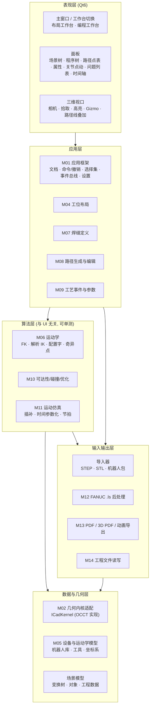
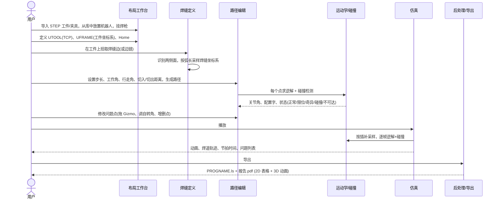
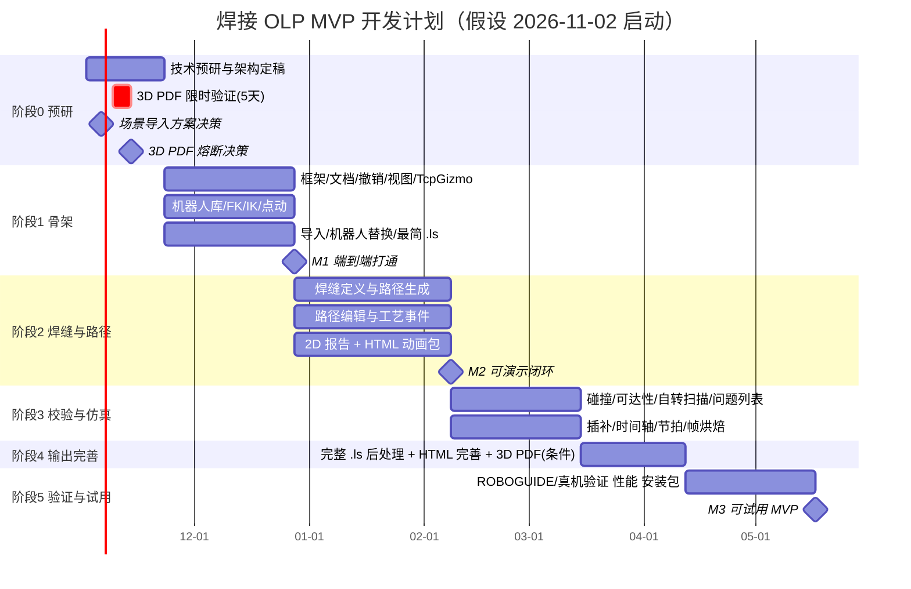

# 焊接机器人离线编程（OLP）系统 —— 系统分析、模块设计与开发周期方案

> 对标产品：CENIT FASTSUITE Edition 2（下文简称 FS E2）
> 目标闭环：**场景导入 → 工位/机器人配置 → 焊缝与路径编辑 → 可达性/碰撞校验 → 仿真预览 → 输出 FANUC `.ls` 与 3D PDF**
> 本文是在审阅 Gemini 方案（`FASTSUITE_OLP_System_Architecture.md`）基础上，结合官方资料和源码核对后给出的独立方案。两份文档建议对照阅读：Gemini 那份对“概念是什么”讲得比较全，本文更侧重“范围怎么切、先做什么、哪里有坑、怎么验收”。
>
> **版本：v1.1（最终版）**。v1.1 吸收了 Gemini 对 v1.0 的三条复审建议（拖拽控件、3D PDF 熔断、场景导入范围），修订内容见第 13 节。

---

## 0. 结论先行

1. **你对 FASTSUITE 的理解大方向正确**，需要修正的细节有三处：
   - 你说的“焊接部位尖尖的轴”在行业里叫 **TCP（工具中心点）/工具坐标系**。它不是机器人的一根轴，而是焊丝尖端上的一个带方向的坐标系。用户编辑的是 TCP 的位姿，机器人 6 个关节怎么转由逆运动学自动算出来。
   - `.ls` 是 FANUC 的**文本源程序**。控制器一般运行的是二进制 `.tp`。`.ls` 要么用 ROBOGUIDE 自带的 MakeTP 工具编译成 `.tp`，要么控制器需要装 ASCII Upload 选项才能直接加载。这一点决定了我们的验收方式。
   - PDF 里“直接播放”指的是 **3D PDF**（内嵌 U3D/PRC 三维模型 + JavaScript 动画）。它只能在 Adobe Acrobat/Reader 里播放，而且新版 Reader 默认关闭 3D 内容，要在首选项里手动开启。浏览器自带的 PDF 阅读器不支持。
2. **MVP 范围建议收窄**到：1 个品牌（FANUC）、1~2 款 6 轴弧焊机器人、1 把焊枪、静止工件（不含变位机/导轨）、角焊/搭接焊为主、直线运动（L）和关节运动（J）为主（圆弧运动 C 作为 P1）。先把闭环做通，再横向扩展。
3. **技术路线建议**：C++17/20 + Qt6 + **OpenCASCADE（OCCT）** 作为 CAD 内核和三维视图（OCCT 自带的 AIS 视图支持直接拾取模型上的边/面；路径点拖拽在其 `AIS_Manipulator` 之上自建一层 TcpGizmo 交互控制，见 M03）+ Eigen + 自研解析逆解（参考开源 OPW 运动学）+ FCL/Coal 碰撞库。
4. **NVIDIA `usd-brep` 第一阶段不用**，理由见第 8 节。最关键的一条：它**不能直接读 STEP/IGES**，它的 OCCT 转换模块只解析 OCCT 自己的 `.brep` 文件，所以读 STEP 还是离不开 OCCT。另外它 2026-10-08 才发布 v1.0.0，太新。架构上预留几何内核抽象接口，半年后再评估。
5. **开发组织方式与 Gemini 不同**：Gemini 是“分层瀑布”式，先做底层，最后才做 `.ls` 和 PDF。本文建议**先用 2~3 周做技术预研**，把风险最高的三件事（`.ls` 能否被 ROBOGUIDE 正确加载、逆解是否与 ROBOGUIDE 一致、3D PDF 动画能否做出来）提前验证；然后**尽早打通一条最简单的端到端链路**（第 8 周左右），再逐步加厚。
6. **“可播放预览”的保底交付物是单文件离线 HTML**（浏览器双击即可旋转、播放、拖进度条），与 2D PDF 报告一起作为 P0。3D PDF 动画在预研阶段限时 5 个工作日验证，通过才进入 P0，否则转为“采购商业 SDK”或“后续版本”的决策（见 M13 与第 9.2 节）。
7. **“导入带机器人的场景”在预研第一周就要定方案**。默认做“整场景 STEP 导入 + 用机器人库中的同型号机器人替换静态机器人外形”，成本约 1 周；如果上游数据是带关节定义的格式（URDF/USD）或机器人型号不在库中，再按第 3.4 节的分支追加工期。
8. **工期估计**：4 名研发 + 1 名兼职焊接工艺/FANUC 顾问。约 **14 周可演示闭环**，约 **28 周（6~7 个月）达到可在真实工位试用的 MVP**。Gemini 给的 16~20 周对“演示版”是可行的，对“可试用版”偏乐观。

---

## 1. FASTSUITE E2 真实信息核对

### 1.1 官方资料中的工作流

根据 CENIT 官方文档《Programming a welding operation》（弧焊基础教程），FS E2 编程一条焊缝的步骤是：

1. 切换到 **OLP 工作台（Offline Programming workbench）**，打开在 Layout 工作台中布置好的工位工程。
2. **Select controller unit**：选择要为哪个控制器生成程序（工位可以有多个控制器/机器人）。
3. **Unit setup**：确认已选择**工具坐标系（tool frame）**和**基坐标系（base frame）**，两者缺一不可。
4. **Teach home position**：示教一个起始/Home 点。可以直接拖机器人的轴，也可以用操纵器（manipulator）拖动，修改后需要 Apply 确认。
5. **Generate process geometry（生成工艺几何）**：定义焊缝轮廓。教程用的是 *Welding contour by projection*：先选第一块板，拖到第二块板上松开，软件把第一块板的边投影到第二块板上得到焊缝。定义时用键盘左右键调**工具角（tool angle）**，上下键调**行走角（travel angle）**。
6. **Automatically generate toolpath**：由焊缝轮廓自动生成焊接路径和所有路径点。
7. **Play** 仿真；仿真条中有 **Reset start state**（首个操作创建时自动生成的起始状态）。
8. **Events and teach（事件与示教）**：在这个子环境里逐点导航、修改、优化路径点，插入工艺事件（起弧、收弧、信号等）。

官方《Offline programming》章节把 OLP 抽象为：工件携带**工艺几何（process geometry）** → 生成**刀路/路径（toolpath）** → 用自动/手动操作和插值算法优化各路径步 → 加入**工艺事件和信号（technical events / signal handling）** → 仿真分析 → 由**下载器/上传器（downloaders / uploaders）**转换成各品牌控制器的程序。

2023.2 版新增的重点是：基于 AI 的自动路径优化（自动处理碰撞、轴限位、奇异点）、焊缝寻位/跟踪的传感器功能，以及 **Weld Cockpit**（插入焊接符号或从 3D 主模型直接导入焊缝定义与工艺参数）。官方博客提到仿真结果可以导出为 **3D PDF 或 USD**，内容包括焊了哪些焊缝、用了什么参数、什么顺序。

资料来源：

- [FS E2 文档：Offline programming](https://documentation.cenit.com/software/FastsuiteEdition2/en_US/olp_offlineprogramming.html)
- [FS E2 文档：Programming a welding operation](https://documentation.cenit.com/software/FastsuiteEdition2/en_US/arcwelding1_bas_step3_1.html)
- [FS E2 2023.2 发布说明（New Equipment Digest）](https://www.newequipment.com/product-news/software-computers/product/21277611/cenit-north-america-inc-fastsuite-e2-ai-based-robot-simulation-tool-release-20232)
- [FASTSUITE 博客：Automated Offline Programming](https://www.fastsuite.com/news-events/blog/article/automated-offline-programming-the-future-of-robotic-manufacturing)

### 1.2 从 FS E2 学到的设计要点

| FS E2 概念 | 对我们设计的启示 |
| :--- | :--- |
| Layout 工作台 / OLP 工作台分离 | 界面按“工作台”组织：布局阶段和编程阶段的工具栏、面板不同，避免一个界面塞满所有功能 |
| Process geometry（工艺几何）与 Toolpath（路径）分离 | 焊缝定义是独立对象，路径由它**生成**。改了焊缝参数可以重新生成路径，而不是只存一串点 |
| Controller unit + Unit setup | 程序挂在“控制器单元”下，生成程序前必须指定工具号和基坐标/用户坐标号 |
| Start state | 仿真必须有确定的初始状态（关节角、夹具状态），否则每次播放结果不同 |
| Events and teach | 路径点上挂“工艺事件”（起弧/收弧/IO/等待），后处理把事件翻译成指令 |
| Downloader / Uploader | 后处理是可插拔的。MVP 只做 FANUC 下载器，上传（读回 `.ls`）放到后期 |
| Apply toolpath modification = Manual | 修改路径点需要显式确认（可配置为自动），这与撤销/重做设计直接相关 |

---

## 2. 对 Gemini 方案的评审

### 2.1 认同的部分（本文直接沿用）

- 五层架构划分（表现层 / 业务工艺层 / 机器人与仿真算法层 / 几何与场景层 / IO 层）基本合理。
- 路径点数据模型：位姿存四元数或矩阵、相对于用户坐标系存储、带工艺角色、运动类型、速度、CNT、配置字、校验状态。这一部分写得很到位。
- 必须有 B-Rep 内核的论证（网格没有“边”的概念，无法选焊缝、无法得到两侧面的精确法向）。
- 绕焊丝轴自转避障、切入/切出点、SLERP 姿态插值、渲染网格与碰撞网格分离，这些都是正确的工程要点。

### 2.2 需要更正的事实

1. **usd-brep 能读 STEP/IGES/JT —— 不准确。** 仓库源码里的转换模块是 `source/OCCT_BREP_IMPORT` 和 `source/OCCT_BREP_EXPORT`，自带的解析器读写的是 OCCT 原生 `.brep` 文本/二进制文件（导入链路是 `.brep → OcctFileSource → OcctStagingDriver → USD BrepArray → SMLib`）。STEP/IGES/JT 只是仓库里作为测试样例存放的文件。也就是说，用 usd-brep 读 STEP，仍然要先用 OCCT 把 STEP 转成 `.brep`。
2. **“英伟达 2022 年收购 SMS”** —— 仓库中没有说明这一点，我没有核实到，不建议写进对外文档。仓库能确认的是：内核名为 SMLib，版权声明为 NVIDIA 2020-2026，Apache 2.0 协议。
3. **“FS E2 使用 Python 下载器如 `Fanuc.py`”** —— 未在公开资料中核实到，建议删除。
4. **“FANUC 的 WPR 与 KUKA 的 ABC 截然不同”** —— 数学上是同一种约定。FANUC：`R = Rz(R)·Ry(P)·Rx(W)`；KUKA：`R = Rz(A)·Ry(B)·Rx(C)`。只是参数排列顺序不同（KUKA 先写绕 Z 的角）。真正不同的是 ABB（四元数）。这不影响结论（内部统一用矩阵/四元数），但避免团队误以为要写两套公式。

### 2.3 遗漏或安排不当的部分

1. **撤销/重做和工程文件放在最后阶段** —— 这是最大的问题。撤销/重做要求所有修改都走“命令”通道，后期补等于重写编辑器。必须在第一阶段建立。
2. **高风险项放在最后** —— `.ls` 能否被控制器接受、仿真是否与真机一致、3D PDF 动画能否实现，这三件事都排在第 12 周以后，一旦失败没有调整空间。应在预研阶段先验证。
3. **机器人模型从哪来没讲** —— 需要“设备库/运动学建模”模块：机器人的 DH/OPW 参数、关节限位、各连杆网格、Home 位置。FANUC 官网可下载 STEP 外形，但没有运动学定义；ROS-Industrial 的 `fanuc` 仓库有部分型号的 URDF。导入“带机器人的场景”时，如果机器人只是一堆静态几何，还需要一个“运动学定义向导”把几何绑定到关节上。
4. **FANUC 的 J2/J3 耦合** —— FANUC 示教器显示的 J3 角度受 J2 影响（J2/J3 interaction），与标准 DH 模型的 J3 不同。如果不处理，关节坐标输出和仿真对比都会对不上。
5. **焊缝之间的过渡（空走）路径** —— 只讲了单条焊缝的切入/切出，没讲多条焊缝之间如何连接（经过 Home 或安全点、避开夹具）。
6. **单位与坐标约定** —— STEP 通常是毫米、Z 向上；URDF/USD 默认米；glTF 是 Y 向上。导入时必须统一，否则后期到处是 1000 倍和轴向错误。
7. **仿真与真机的差异** —— FANUC 的 CNT 圆滑过渡和加减速是专有算法，我们只能近似，节拍时间估算有误差。商业 OLP 软件通过 RRS（Realistic Robot Simulation）接口调用厂商控制器内核来做到精确，那需要厂商授权。MVP 应明确“轨迹几何准确，节拍时间为估算”。
8. **问题列表（Issues）面板** —— 可达性、碰撞、限位、奇异点的结果需要汇总成可点击跳转的列表，否则用户在几百个点里找不到问题点。
9. **测试与验收方法** —— 没有说明如何证明仿真正确、`.ls` 正确。
10. **范围边界** —— 没有明确哪些不做（变位机协同、多机器人、寻位、多层多道等），容易范围蔓延。
11. **技术栈没有做决定** —— 列了很多备选，没有给出明确选型。

---

## 3. MVP 范围定义

### 3.1 包含（P0，必须做）

- 导入 STEP（`.step/.stp`）工件和夹具，保留装配结构和颜色；导入 STL 作为辅助几何。
- 导入带机器人的整场景 STEP，并把其中静态的机器人外形替换为机器人库中可动的同型号机器人（见 3.4 节方案 A）。
- 内置机器人库：至少 1 款 FANUC 6 轴弧焊机器人（如 ARC Mate 100iD 或 M-10iD/12，具体按你们手头真机/ROBOGUIDE 能验证的型号定）。
- 焊枪定义：挂到法兰，定义 TCP。
- 用户坐标系（UFRAME）定义：数值输入 + 三点法。
- 焊缝定义：拾取边 / 边链 → 自动识别两侧面 → 计算焊缝坐标系。
- 路径生成：按步长离散、工作角/行走角、切入/切出点。
- 路径编辑：增、删、插入、重排、反向、Gizmo 拖动、数值修改、多点姿态插值。
- 运动学：正解、解析逆解、配置字、限位、奇异点检测、关节点动。
- 校验：可达性、碰撞（离散 + 段内采样）、绕焊丝轴自转避障辅助。
- 仿真：J/L 运动插补、时间轴播放、倍速、拖动进度、节拍估算。
- 工艺事件：起弧（Arc Start[n]）、收弧（Arc End[n]）、焊接速度、CNT/FINE。
- 输出：FANUC `.ls`（能在 ROBOGUIDE 中加载并正确运行）、2D PDF 工艺报告（含多视角截图）、单文件离线 HTML 3D 动画包。3D PDF 动画为“预研通过后进入 P0”的条件项（见 M13）。
- 工程保存/打开、撤销/重做。

### 3.2 下一阶段（P1）

- 圆弧运动（C）、圆弧/曲线焊缝的圆弧拟合。
- 两面求交生成焊缝（模型上没有现成的边时）、FS E2 式“投影法”焊缝。
- 自动避障优化（自动搜索自转角/倾角）。
- 焊缝之间过渡路径的自动规划（简单的安全平面/安全点策略）。
- 运动学定义向导（把任意 STEP 机器人几何绑定成可动设备）、URDF 导入（若 3.4 节判定为方案 B/C，则提前到 P0）。
- USD 动画导出、MP4 视频导出。
- 3D PDF 动画（若预研未通过且不采购商业 SDK）。
- 焊接参数模板库（按板厚/焊脚尺寸自动带出速度、电流、电压等）。

### 3.3 明确不做（P2 或以后）

变位机/导轨等外部轴协同、多机器人、焊缝寻位与跟踪、多层多道焊、机器人标定与 TCP 实测补偿、读回 `.ls`（上传器）、其他品牌后处理（ABB/KUKA/安川）、AI 路径优化、焊接符号识别（Weld Cockpit 类功能）。

### 3.4 “导入带机器人的场景”的范围决策

需求原话是“能够将带机器人的场景导入”。这句话的工作量取决于上游场景文件里机器人是什么形式，差别可达数周，所以必须在预研第 1 周拿到真实场景文件后定方案。

| 方案 | 适用情况 | 做法 | 额外工期 |
| :--- | :--- | :--- | :--- |
| **A. 整场景导入 + 机器人替换（默认）** | 场景是 STEP 总装，机器人只是静态外形，且型号在我们的机器人库里 | 整体导入；用户在场景树中把机器人外形部件标记为“待替换”（或按名称自动识别）；拾取机器人底座安装面确定基座位置；从库中放入同型号可动机器人并对齐；静态外形隐藏或删除。场景中机器人的初始关节角若不是零位，提供“按外形反算”或手工输入 | 约 1 周 |
| **B. 运动学定义向导** | 场景是 STEP 总装，但机器人型号不在库中（或客户的机器人带特殊改装） | 用户把各部件指定为连杆 1~6，拾取或输入各关节轴线，填写限位；软件拟合 OPW 参数并与外形做一致性检查；生成机器人定义并入库 | 约 3~4 周 |
| **C. 带关节定义的格式** | 场景是 URDF、USD（UsdPhysics 关节）或其他仿真软件导出的带运动学格式 | 解析关节树和网格，拟合 OPW 参数做解析逆解；拟合失败则退回数值逆解 | 每种格式约 1.5~2 周 |

方案 A 能覆盖“现场工位用的是常见 FANUC 型号”这一最常见情况，所以作为 P0 默认实现。B、C 是否进 P0 由预研结论决定；进 P0 时，总工期相应顺延。

---

## 4. 系统总体架构

### 4.1 分层与模块



设计原则：

- **算法层不依赖 Qt 和视图**。运动学、碰撞、插补、后处理都做成纯 C++ 库，可以写命令行测试，也方便以后提供 Python 绑定做批量处理。
- **所有修改都走命令**。UI 只发命令，命令修改文档并入撤销栈，文档发出变更事件，视图和面板监听刷新。
- **派生数据可重算**。路径由焊缝定义生成，逆解、碰撞、仿真结果都是缓存，可以随时失效重算。工程文件只存“源数据 + 用户手工修改”。
- **几何内核隔离**。上层只通过 `ICadKernel` 接口访问边/面/法向/离散化，以后可以替换或并存 usd-brep。

### 4.2 端到端数据流



### 4.3 核心数据模型

```text
Project (工程)
├── Units / Settings                 单位(内部统一 mm、rad)、公差、显示设置
├── Scene (场景)
│   └── SceneNode*                   变换树节点: 名称、局部变换、父子关系、显隐、锁定
│       ├── PartNode                 工件/夹具: 引用 CadModel(B-Rep) + 渲染网格 + 碰撞网格
│       ├── RobotNode                引用 RobotModel; 当前关节值; 挂载的工具
│       ├── ToolNode                 焊枪: 几何 + TCP 列表(UTOOL n)
│       └── FrameNode                用户坐标系 UFRAME n / 参考点
├── Library                          机器人型号、焊枪、焊接参数模板
├── ControllerUnit*                  控制器单元: 关联机器人、UTOOL/UFRAME 号表、后处理器配置
│   └── Program*                     程序(一个 .ls)
│       ├── StartState               起始关节值、夹具状态
│       └── Operation*               操作: 焊接操作 / 空走操作 / 示教点
│           ├── SeamRef              引用的焊缝定义 (焊接操作)
│           ├── GenParams            生成参数: 步长、角度、切入切出、速度...
│           └── Target*              路径点
│               ├── pose (相对 UFRAME 的 4x4 变换)
│               ├── role: APPROACH / WELD_START / WELD_VIA / WELD_END / RETRACT / VIA / HOME
│               ├── motion: J / L / C ; speed ; termination FINE | CNTn
│               ├── config: 期望配置字(可锁定) ; turn 数
│               ├── events*: ArcStart[n] / ArcEnd[n] / DO / WAIT / 注释
│               ├── userModified: 是否被手工改过(重新生成时保留)
│               └── cache: 关节角、状态、最小间隙 (不存盘或存为缓存)
└── SeamDefinition*                  焊缝定义: 边链引用(持久化 ID)、两侧面引用、焊缝类型、焊脚尺寸
```

几个需要提前定的规则：

- **位姿存相对 UFRAME 的矩阵**。工件在现场挪了，只改 UFRAME，路径点不动。
- **“生成 + 手工修改”共存**。焊缝参数改了要重新生成路径，但用户手工改过的点不能丢。做法是给手工修改过的点打标记，重新生成时按弧长位置匹配并保留其偏移，或者提示用户。
- **B-Rep 拓扑的持久化引用**。工程文件不能只存“第 37 条边”这种索引，因为重新导入同一 STEP 时索引可能变。MVP 可以存“模型文件哈希 + 边索引 + 边的几何签名（端点、长度、中点）”，打开时校验签名，不一致就提示重新选择。

---

## 5. 模块清单与功能点

优先级：**P0** = MVP 必须；**P1** = MVP 之后第一批；**P2** = 远期。

### M01 应用框架

| 功能点 | 说明 | 优先级 |
| :--- | :--- | :--- |
| 主窗口与停靠面板 | 菜单、工具栏、可停靠面板、布局保存与恢复 | P0 |
| 工作台切换 | 布局工作台 / 编程工作台，各自的工具栏和面板组合 | P0 |
| 文档模型 | 单工程文档，统一管理场景、程序、焊缝、库引用 | P0 |
| 命令系统与撤销/重做 | 所有修改封装为命令；支持合并（拖动 Gizmo 时连续修改合并为一条）；撤销栈深度可配 | P0 |
| 选择集 | 统一管理当前选中对象（场景节点、路径点、边/面），视图和面板同步 | P0 |
| 事件总线 | 文档变更通知；派生数据（逆解、碰撞）失效与重算调度 | P0 |
| 后台任务 | 批量逆解、碰撞扫描、导出放后台线程，带进度和取消 | P0 |
| 设置 | 单位、公差、颜色、快捷键、默认生成参数 | P0 |
| 日志与崩溃转储 | 文件日志；Windows 下生成 minidump，便于远程排查 | P0 |
| 多语言 | 中文/英文 | P1 |
| 插件/脚本接口 | Python 绑定，用于后处理器扩展和批处理 | P2 |

### M02 几何内核适配层（OCCT）

| 功能点 | 说明 | 优先级 |
| :--- | :--- | :--- |
| `ICadKernel` 抽象接口 | 加载、遍历拓扑、边求值、面法向、最近点、离散化、包围盒；上层只依赖接口 | P0 |
| STEP 导入 | 用 OCCT XCAF（`STEPCAFControl_Reader`）读装配结构、名称、颜色、单位 | P0 |
| IGES 导入 | 同上（`IGESCAFControl_Reader`） | P1 |
| STL/OBJ 导入 | 只作为显示和碰撞几何，不可选边 | P0 |
| 单位统一 | 读取文件单位并换算到内部毫米；记录原始单位 | P0 |
| 拓扑查询 | 边 → 相邻面（`TopExp::MapShapesAndAncestors`）；边链（切线连续的相邻边）；面类型（平面/圆柱/自由曲面） | P0 |
| 曲线求值 | 按弧长参数取点、切向（`BRepAdaptor_Curve`、`GCPnts_AbscissaPoint`）；处理边的方向（`TopAbs_REVERSED`） | P0 |
| 曲面求值 | 在边上某点投影到相邻面，取 UV 和法向（`BRepLProp_SLProps`）；处理面方向使法向朝外 | P0 |
| 网格离散化 | 渲染网格（细）和碰撞网格（粗）两套参数（`BRepMesh_IncrementalMesh`）；缓存到工程 | P0 |
| 几何修复 | 导入后的基本修复（`ShapeFix`），记录修复报告 | P1 |
| 面面求交 | 两面相交生成焊缝（`BRepAlgoAPI_Section`） | P1 |
| 拓扑持久化签名 | 边/面的几何签名生成与匹配（见 4.3） | P0 |

### M03 三维视图与交互

| 功能点 | 说明 | 优先级 |
| :--- | :--- | :--- |
| 视图基础 | 旋转/平移/缩放、标准视图、适应窗口、透视/正交、视图立方体（`AIS_ViewCube`） | P0 |
| 显示模式 | 着色、着色+边线、线框、透明度；按对象设置 | P0 |
| 拾取 | 对象级、面级、边级、顶点级拾取模式切换（OCCT AIS 原生支持子形状选择）；悬停预高亮 | P0 |
| 高亮 | 选中高亮、碰撞部件红色高亮、问题点颜色 | P0 |
| 坐标轴操纵器 | 自研 `TcpGizmo` 交互层（见下方说明）：平移/旋转拖拽，参考坐标系可切换（世界/工具/用户/焊缝），步进吸附（如 1mm、1°），屏幕恒定尺寸显示 | P0 |
| 路径叠加显示 | 路径折线（按段类型着色：切入/焊接/切出/空走）、每个点的小坐标系、点序号标签、问题点标记 | P0 |
| 坐标系显示 | 世界、机器人基座、UFRAME、UTOOL 的三轴标记 | P0 |
| 机器人显示 | 每帧更新各连杆变换（只改变换矩阵，不重建几何） | P0 |
| 焊道与 TCP 轨迹 | 播放时沿 TCP 画已走过的轨迹，焊接段加粗显示 | P0 |
| 测量 | 两点距离、点到面距离、角度 | P1 |
| 剖切 | 剖切平面，看焊枪伸进夹具内部的情况 | P1 |
| 截图/录屏 | 视口截图（报告用，P0）；录制 MP4（P1） | P0/P1 |

**TcpGizmo 设计说明**

OCCT 自带的 `AIS_Manipulator` 默认会在拖动时直接改写挂接对象的变换，吸附和参考坐标系切换也比较简陋。直接拿它去拖路径点，会出现三个问题：拖动过程中每一帧都在改文档，撤销栈被刷满；机器人跟随和碰撞变色只能事后补挂；焊缝坐标系这类自定义参考系不好接入。所以在它之上做一层自己的交互控制：

1. **不挂接对象**。`AIS_Manipulator` 只作为可视化手柄和拖动增量的来源（调用 `StartTransform / Transform / StopTransform` 取得变换增量），不调用 `Attach` 去直接修改路径点。如果后续发现它的显示效果（手柄尺寸、配色、半透明）不满足要求，再基于 `AIS_InteractiveObject` 派生自绘手柄，接口不变。
2. **参考系与吸附在我们这一层做**。拖动增量先换算到当前参考坐标系（世界/工具/用户/焊缝），再按吸附步长取整，最后得到预览位姿。
3. **拖动中只预览**。每次鼠标移动发出 `PreviewPoseChanged(targetId, pose)`：路径点的显示位置更新，机器人用这个位姿求逆解并刷新姿态，只对当前点做碰撞检测并变色；文档数据不变。逆解和碰撞放在工作线程，只处理最新一次请求，跟不上时丢弃中间请求，保证界面不卡。
4. **松开才提交**。鼠标释放时生成一条 `ModifyTargetPoseCommand` 压入撤销栈，随后触发该点所在段的可达性和段内碰撞重算。按 Esc 取消拖动，恢复原位姿。
5. **多选拖动**。选中多个点时，增量按同一参考系作用到所有点，松开时合并为一条宏命令。

预计开发量约 1 周，已计入阶段 1。

### M04 工位布局

| 功能点 | 说明 | 优先级 |
| :--- | :--- | :--- |
| 场景树 | 树状显示所有对象；重命名、显隐、锁定、删除、拖拽改父子关系 | P0 |
| 对象放置 | 数值输入位置/姿态；Gizmo 拖动；对齐到面/点 | P0 |
| 从库放置机器人 | 选择型号放入场景，设置基座位置 | P0 |
| 整场景导入与机器人替换 | 导入整场景 STEP；按部件名称自动识别或由用户标记机器人外形；拾取底座安装面对齐库中同型号机器人；隐藏/删除静态外形；初始关节角手工输入或按外形反算（见 3.4 节方案 A） | P0 |
| 工具挂载 | 把焊枪挂到机器人法兰，随机器人运动 | P0 |
| 工件/夹具分组 | 标记对象类型（工件/夹具/环境），用于默认碰撞规则 | P0 |
| 用户坐标系定义 | 数值输入；三点法（原点、X 方向点、XY 平面点）在模型上拾取 | P0 |
| 机器人基座坐标与世界坐标关系 | FANUC 的 UFRAME 是相对机器人世界坐标的，需明确换算 | P0 |
| 工位模板 | 保存常用工位作为模板 | P2 |

### M05 设备与运动学模型

| 功能点 | 说明 | 优先级 |
| :--- | :--- | :--- |
| 机器人定义格式 | 自定义 JSON：型号、运动学类型（OPW）、参数、关节限位（位置/速度/加速度）、各连杆网格及其相对变换、Home、FANUC 特有参数（J2/J3 耦合系数） | P0 |
| 内置机器人库 | 1~2 款 FANUC 弧焊机器人，参数需与 ROBOGUIDE 中同型号核对 | P0 |
| URDF/USD 带关节场景导入 | 解析关节树和网格；自动拟合 OPW 参数并校验，失败则用数值逆解（3.4 节方案 C） | P1（按 3.4 节决策可提为 P0） |
| 运动学定义向导 | 把一个静态 STEP 机器人模型的各部件指定为连杆，指定关节轴和限位，生成可动设备（3.4 节方案 B） | P1（按 3.4 节决策可提为 P0） |
| 工具定义 | 焊枪几何 + TCP 偏移（X,Y,Z,W,P,R）；可在模型上拾取焊丝尖端点和方向；多 TCP | P0 |
| 外部轴设备 | 变位机、导轨 | P2 |

### M06 运动学求解

| 功能点 | 说明 | 优先级 |
| :--- | :--- | :--- |
| 正运动学 | 关节角 → 各连杆位姿、法兰位姿、TCP 位姿 | P0 |
| 解析逆解 | 针对“正交平行 + 球形手腕”结构（大部分 6 轴工业机器人，含 FANUC 弧焊系列）的 OPW 闭式解，最多 8 组基本解；可参考开源 `opw_kinematics`（Apache 2.0） | P0 |
| 圈数扩展 | J4/J6 等可转超过 ±180° 的轴，在基本解上加减 360° 得到更多解，并受限位约束 | P0 |
| 配置字 | 由关节角计算 FANUC 配置（F/N、U/D、T/B + 圈数）；反之按指定配置选解 | P0 |
| 选解策略 | 优先满足用户锁定的配置；否则选与上一点关节距离最小的解；焊接段内禁止配置变化 | P0 |
| FANUC J2/J3 耦合 | 模型关节角与示教器显示角之间的换算（需在 ROBOGUIDE 中核对符号和系数） | P0 |
| 限位检测 | 每轴软限位；接近限位预警（如距限位 < 5°） | P0 |
| 奇异点检测 | 腕部奇异（J5≈0）、肘部奇异、肩部奇异；用雅可比矩阵最小奇异值或条件数作为指标 | P0 |
| 关节点动 | J1~J6 滑块；笛卡尔点动（世界/工具/用户坐标系下的平移和旋转） | P0 |
| 数值逆解 | 作为非标准结构的后备方案（阻尼最小二乘） | P1 |

### M07 焊缝定义（工艺几何）

| 功能点 | 说明 | 优先级 |
| :--- | :--- | :--- |
| 选边定义焊缝 | 拾取一条边；自动沿切线连续的相邻边扩展成边链；可手动增减 | P0 |
| 两侧面识别 | 对角焊缝，焊缝边通常是“板 A 的边”与“板 B 的面”的接触线。需要分别找到参与焊接的两个面：同一实体上的相邻面，或另一零件上与该边贴合的面（用最近点距离判断） | P0 |
| 焊接侧选择 | 一条边两侧都可以焊时，让用户选择焊哪一侧，界面上显示预览箭头 | P0 |
| 焊缝坐标系 | 在每个采样点计算：前进方向 X = 切向；两侧面外法向的角平分线 b；焊枪方向 Z = −b（指向焊缝）；Y = Z × X | P0 |
| 起止点调整 | 起点/终点内缩或外延距离；反转方向 | P0 |
| 焊缝类型属性 | 角焊、搭接、对接；焊脚尺寸；用于后续参数模板 | P0 |
| 投影法 | FS E2 的 “Welding contour by projection”：把板 A 的边投影到板 B 上 | P1 |
| 面面求交法 | 两面相交线作为焊缝 | P1 |
| 焊缝列表 | 工程中所有焊缝的列表、命名、状态（已编程/未编程） | P0 |

### M08 路径生成与编辑

| 功能点 | 说明 | 优先级 |
| :--- | :--- | :--- |
| 程序/操作树 | 控制器单元 → 程序 → 操作 → 路径点；操作可重排、复制、禁用 | P0 |
| 由焊缝生成路径 | 参数：步长或弦高误差、直线段只取端点（直线焊缝用 L 两点即可）、工作角、行走角、自转角 | P0 |
| 切入/切出 | 沿焊枪反方向（或自定义方向）退 N mm 生成切入、切出点；可单独设速度和运动类型 | P0 |
| 示教点 | 用当前机器人姿态记录一个点（Home、过渡点） | P0 |
| 增删改 | 在两点间插入、在当前位置追加、删除、批量删除、复制粘贴、上移下移 | P0 |
| 路径反向 | 反转焊接方向，自动交换起弧/收弧事件 | P0 |
| 位姿编辑 | Gizmo 拖动（机器人实时跟随）；数值编辑（X,Y,Z,W,P,R，可选参考坐标系）；按焊接角编辑（工作角/行走角/自转角） | P0 |
| 批量编辑 | 多选点统一偏移、统一设置角度、统一设置速度/CNT | P0 |
| 姿态插值 | 选首尾两点，中间点姿态按弧长做 SLERP | P0 |
| 跳转与导航 | 点击路径点机器人跳到该位置；前后键逐点导航（对应 FS E2 的 Events and teach） | P0 |
| 重新生成保留手改 | 见 4.3 | P0 |
| 焊缝间过渡 | 自动插入抬枪点 + 安全高度过渡；或经过 Home | P1 |
| 拆分/合并操作 | 一条焊缝拆成两段（中间换姿态）、两段合并 | P1 |

### M09 工艺事件与参数

| 功能点 | 说明 | 优先级 |
| :--- | :--- | :--- |
| 运动参数 | J/L/C、速度（%、mm/sec、cm/min）、FINE/CNT0~100 | P0 |
| 焊接事件 | Arc Start[n]、Arc End[n]，n 为焊接条件号；焊接段速度可用 `WELD_SPEED` | P0 |
| 通用事件 | 数字输出、等待、注释、调用子程序 | P1 |
| 焊接参数表 | 焊接条件号对应的电流/电压/速度说明（只作文档用途，实际参数在控制器里） | P0 |
| 参数模板 | 按焊缝类型/焊脚尺寸自动带出角度、速度、条件号 | P1 |
| 默认值规则 | 新生成的焊接操作自动带：起点 Arc Start、终点 Arc End、焊接段 CNT、起止点 FINE | P0 |

### M10 可达性、碰撞与优化

| 功能点 | 说明 | 优先级 |
| :--- | :--- | :--- |
| 碰撞对矩阵 | 按组配置检测关系（机器人连杆/焊枪 vs 工件/夹具/环境）；自动忽略相邻连杆、焊枪与法兰 | P0 |
| 焊丝尖端豁免 | 焊接时 TCP 就是贴着工件的，需对焊枪喷嘴末端一小段与当前焊接的工件做豁免或设置允许穿透深度，否则每个焊接点都报碰撞 | P0 |
| 碰撞网格 | 粗离散网格 + BVH（FCL/Coal）；对机器人连杆可用凸包加速 | P0 |
| 离散检测 | 每个路径点的碰撞和最小间隙 | P0 |
| 段内检测 | 两点之间按插补采样检测（采样间距按距离和角度自适应），防止“端点不撞中间撞” | P0 |
| 间隙阈值 | 碰撞（≤0）与接近（< d_safe）两级 | P0 |
| 可达性检查 | 对整条路径批量求解：不可达 / 超限 / 奇异 / 配置跳变 / 碰撞 | P0 |
| 问题列表 | 汇总所有问题，按程序/操作/点分组，点击跳转定位 | P0 |
| 自转角扫描图 | 对选中点，在 [−180°, 180°] 范围按步长扫描绕焊丝轴的自转角，显示哪些角度可达、无碰撞、远离奇异，用户拖到可行区间 | P0 |
| 自动避障 | 在自转角 + 小范围行走角/工作角内搜索，目标是无碰撞、远离限位/奇异、相邻点关节变化最小；对整条焊缝做全局平滑（动态规划） | P1 |

### M11 运动仿真

| 功能点 | 说明 | 优先级 |
| :--- | :--- | :--- |
| 关节插补 J | 关节空间同步插补，各轴同时到达 | P0 |
| 直线插补 L | 位置直线 + 姿态 SLERP；逐采样点逆解，且保持配置不变 | P0 |
| 圆弧插补 C | 三点定圆弧 | P1 |
| 速度规划 | 梯形或 S 形速度曲线；受关节速度/加速度限制 | P0 |
| CNT 近似 | 按 CNT 值在拐角处做过渡圆滑（几何近似），明确标注与真实控制器存在差异 | P1 |
| 时间轴 | 播放、暂停、停止、单步（按点/按时间）、倍速、拖动进度、从选中点开始播放 | P0 |
| 起始状态 | 每次播放从 Start state 开始 | P0 |
| 节拍估算 | 总时间、焊接时间、空走时间；按操作分项 | P0 |
| 关节曲线 | 各轴角度/速度随时间的曲线，标记超限区间 | P1 |
| 帧烘焙 | 把仿真结果烘焙成“时间 → 各连杆变换”序列，供 3D PDF/USD/视频导出复用 | P0 |

### M12 FANUC `.ls` 后处理

| 功能点 | 说明 | 优先级 |
| :--- | :--- | :--- |
| 中间表示 | 与品牌无关的指令序列：坐标系选择、运动、事件、注释 | P0 |
| 文件结构 | `/PROG`、`/ATTR`（含 `DEFAULT_GROUP`）、`/APPL`（弧焊设备声明）、`/MN`（指令行带行号）、`/POS`（点位）、`/END` | P0 |
| 坐标转换 | 路径点从内部表示转到 UFRAME 下的 X,Y,Z,W,P,R（`R = Rz·Ry·Rx` 约定，处理 P=±90° 的万向锁） | P0 |
| 配置字 | `CONFIG : 'N U T, 0, 0, 0'`（翻转/上下/前后 + 圈数）；圈数对应哪几根轴需按控制器手册核对 | P0 |
| 坐标系号 | 每个点的 `UF`、`UT`；程序中 `UFRAME_NUM`、`UTOOL_NUM` 指令 | P0 |
| 关节点输出 | Home 等点可用关节坐标输出（需处理 J2/J3 耦合） | P0 |
| 命名与限制 | 程序名规则（大写、字母开头、长度限制）、点注释长度、行数；违反时报错 | P0 |
| 多程序拆分 | 一个工程导出多个程序；可选主程序调用子程序 | P1 |
| 输出预览 | 导出前在界面里预览 `.ls` 文本 | P0 |
| 编译验证 | 可选：调用 ROBOGUIDE 自带的 MakeTP 把 `.ls` 编译成 `.tp`，把编译错误回显到界面 | P1 |
| 后处理配置 | 每个控制器单元一份配置（速度单位、CNT 默认值、注释语言、组掩码） | P0 |

`.ls` 输出示意（实际格式以 ROBOGUIDE 导出的样本为准，预研阶段先从 ROBOGUIDE 导出几份真实 `.ls` 作为“金样本”）：

```text
/PROG  WELD_001
/ATTR
OWNER       = MNEDITOR;
COMMENT     = "Generated by OLP";
PROTECT     = READ_WRITE;
DEFAULT_GROUP = 1,*,*,*,*;
/APPL
  ARC Welding Equipment : 1,*,*,*,*;
/MN
   1:  UFRAME_NUM=1 ;
   2:  UTOOL_NUM=1 ;
   3:J P[1:HOME] 50% FINE    ;
   4:J P[2:APPROACH] 50% CNT50    ;
   5:L P[3:WELD_START] 200mm/sec FINE    ;
   6:  Arc Start[1] ;
   7:L P[4] WELD_SPEED CNT100    ;
   8:L P[5:WELD_END] WELD_SPEED FINE    ;
   9:  Arc End[1] ;
  10:L P[6:RETRACT] 200mm/sec CNT50    ;
  11:J P[1:HOME] 50% FINE    ;
/POS
P[3:"WELD_START"]{
   GP1:
	UF : 1, UT : 1,		CONFIG : 'N U T, 0, 0, 0',
	X =   450.250  mm,	Y =  -120.500  mm,	Z =   310.000  mm,
	W =   180.000 deg,	P =   -45.000 deg,	R =     0.000 deg
};
/END
```

### M13 PDF / 3D PDF / 动画导出

| 功能点 | 说明 | 优先级 |
| :--- | :--- | :--- |
| 2D 报告 | 工位信息、UTOOL/UFRAME 参数、程序列表、焊缝列表（编号/长度/条件号/速度）、点位明细表、节拍、问题清单；每条焊缝的起点/终点/全局多视角高清截图（离屏渲染）；Qt `QPdfWriter` 即可 | P0 |
| 单文件离线 HTML 动画包 | 一个 `.html` 文件，内嵌 three.js 和 Base64 编码的 glTF（GLB）；双击用浏览器打开即可旋转、缩放、播放、暂停、倍速、拖动进度条；不联网、不需安装 | P0 |
| glTF 场景与动画写出 | 场景网格（减面后）按节点树写成 glTF；M11 烘焙的各连杆变换写成 glTF 动画通道（节点平移/旋转关键帧）；静态网格可用 OCCT 的 `RWGltf_CafWriter` 写出，动画通道由我们自己补写（如借助 tinygltf） | P0 |
| HTML 播放器内容 | 路径线、焊缝、点序号的开关；按程序/焊缝跳转；当前点关节角与焊接参数信息面板 | P0（基础）/ P1（信息面板） |
| 3D PDF 场景与动画 | U3D（或 PRC）场景 + PDF 3D 注释 + 3D JavaScript 按帧设置节点变换 + 播放控件 | 条件 P0：预研阶段限时验证通过才进入 P0，否则见下方熔断规则 |
| 文件体积控制 | 网格减面、关键帧抽稀（只在变化处保留关键帧）、帧率可选；HTML 和 3D PDF 共用 | P0 |
| USD 导出 | 网格 + 变换时间采样，可在 usdview/Omniverse 中播放（只需 OpenUSD，不需要 usd-brep） | P1 |
| 视频导出 | 视口录制 MP4 | P1 |

**3D PDF 熔断规则**

开源 3D PDF 动画链路的风险集中在三处：可用的开源 U3D 写出库代码年代久、维护少；Acrobat 3D JavaScript 调试手段有限；新版 Adobe Reader 默认关闭 3D，客户打开常常看到空白。因此：

1. 预研阶段给它 **5 个工作日**，目标是做出“一个机器人模型按烘焙帧运动、可点击播放”的 3D PDF，并在 Adobe Acrobat Reader 最新版（开启 3D 后）中正常播放。
2. 5 天内跑通：3D PDF 进入 P0，正式实现排在阶段 4。
3. 5 天内跑不通：停止投入，由你决定两条路之一：采购商业 SDK（如 HOOPS Publish、PDF3D，需询价并评估授权条款）；或者 MVP 交付“2D PDF 报告 + 单文件 HTML 动画包”，3D PDF 移到后续版本。
4. 无论哪种结果，HTML 动画包都照做。它和 3D PDF 共用 glTF 场景和烘焙帧，不是重复工作，而且在不装 Adobe 的电脑上也能看。

关于工作量：Gemini 估计 HTML 包需要 2~3 天，这个估计只够做出“能动”的原型。算上 glTF 动画通道、路径线、播放控件、单文件打包和体积控制，按 **1.5~2 周** 计划更稳妥。

### M14 工程文件与数据交换

| 功能点 | 说明 | 优先级 |
| :--- | :--- | :--- |
| 工程格式 | 一个 zip 包：`project.json`（场景、程序、焊缝、设置）+ 原始 CAD 文件副本 + OCCT `.brep` 缓存 + 网格缓存 | P0 |
| 版本号与迁移 | 文件里记录格式版本，旧版本打开时自动迁移 | P0 |
| 自动保存与恢复 | 定时自动保存；崩溃后提示恢复 | P0 |
| 外部引用更新 | 源 STEP 更新后重新导入，按签名重新绑定焊缝 | P1 |

### M15 质量保障与工程化

| 功能点 | 说明 | 优先级 |
| :--- | :--- | :--- |
| 单元测试 | 运动学（FK(IK(x)) = x、与 ROBOGUIDE 采样点比对）、欧拉角转换、焊缝坐标系、后处理金样本比对 | P0 |
| 回归场景库 | 10~20 个典型工件（T 型角焊、搭接、管板、箱体内角）作为回归用例 | P0 |
| CI | 每次提交编译 + 跑测试 | P0 |
| 安装包 | Windows 安装器（含 VC 运行库、OCCT DLL） | P0 |
| 授权 | 软件授权/加密狗 | P2 |

---

## 6. 关键算法说明

### 6.1 焊缝坐标系与焊枪姿态

在焊缝上弧长 s 处：

1. 取点 \(p(s)\) 和单位切向 \(t(s)\)（考虑边方向和用户选的焊接方向）。
2. 把 \(p\) 投影到两个参与焊接的面上，分别求外法向 \(n_1, n_2\)（法向必须朝向材料外侧，需根据面的 `Orientation` 翻转）。
3. 角平分方向 \(b = \dfrac{n_1 + n_2}{\lVert n_1 + n_2 \rVert}\)。对接焊（两面近似共面）时 \(n_1 \approx n_2\)，平分线就是面法向，不需要特殊处理；但如果 \(n_1 + n_2 \approx 0\)，说明面的方向判断错了，要报错。
4. 焊缝坐标系：\(X = t\)，\(Z_0 = -b\)（指向焊缝），\(Y = Z_0 \times X\)，再对 \(Z_0\) 做正交化。
5. 焊枪姿态 = 焊缝坐标系 × 绕 X 旋转（工作角偏置）× 绕 Y 旋转（行走角，推/拉）× 绕 Z 旋转（自转角）。

这样做的好处是：用户调的三个角度都有明确的焊接含义，与焊工的习惯一致，也与 FS E2 中“左右键调工具角、上下键调行走角”的交互对应。

### 6.2 逆解与选解

- OPW 结构用 7 个几何参数（a1, a2, b, c1, c2, c3, c4）描述，闭式解出 8 组解。对 J4、J6（以及 J1，视型号）再按 ±360° 展开圈数。
- 过滤：限位 → 碰撞（可选）。
- 选择：用户锁定配置 > 与前一点关节距离最小（加权，腕部轴权重低）> 远离奇异和限位。
- 焊接段（Arc Start 到 Arc End 之间）禁止配置变化；若找不到同配置解，标为问题点，而不是悄悄换解。

### 6.3 直线插补中的配置一致性

L 运动时控制器是在笛卡尔空间插补的，途中不能换配置。仿真时每个采样点都按“与上一采样点最近”的原则选解，如果相邻采样点关节变化超过阈值（说明经过奇异点或配置跳变），标记该段为问题段。

### 6.4 WPR 转换

内部旋转矩阵 \(R\) 到 FANUC W, P, R（\(R = R_z(r)\,R_y(p)\,R_x(w)\)）：

\[
p = \operatorname{atan2}\!\left(-r_{31},\ \sqrt{r_{11}^2 + r_{21}^2}\right),\quad
w = \operatorname{atan2}(r_{32},\ r_{33}),\quad
r = \operatorname{atan2}(r_{21},\ r_{11})
\]

当 \(|p| \to 90^\circ\) 时出现万向锁，需固定 \(w\) 或 \(r\) 中的一个再求另一个。这部分必须用 ROBOGUIDE 中的实际点位做比对测试。

### 6.5 自转角扫描

对选中点，以 Δ（如 5°）为步长遍历自转角 θ ∈ [−180°, 180°]：每个 θ 求逆解（保持配置）、检测碰撞、计算到限位距离和奇异指标，得到一条“可行性环”。界面上画成圆环或条形图，绿色为可行，红色为碰撞，黄色为接近限位/奇异。自动避障（P1）就是在整条焊缝上对每个点的可行 θ 区间做动态规划，使 θ 变化最平滑。

---

## 7. 技术选型

| 层 | 选择 | 理由 | 协议 |
| :--- | :--- | :--- | :--- |
| 语言 | C++17/20 | 性能、与 OCCT/FCL 原生集成 | — |
| UI | Qt 6（Widgets） | 停靠面板、树、表格成熟；OCCT 有 Qt 集成示例 | LGPL / 商业 |
| CAD 内核 | OpenCASCADE 7.8+ | STEP/IGES 导入最成熟的开源实现；拓扑查询、曲线曲面求值、离散化、求交齐全 | LGPL 2.1 + 例外（动态链接可闭源商用） |
| 三维视图 | OCCT AIS/V3d | 原生支持 B-Rep 子形状（边/面/点）拾取和高亮；自带 `AIS_Manipulator`、`AIS_ViewCube`；省掉自己做 B-Rep 拾取 | 同上 |
| 数学 | Eigen 3 | 标准选择 | MPL2 |
| 运动学 | 自研 OPW 解析逆解（参考 `opw_kinematics`） | 结构固定、速度快、可控；8 组解完整 | 自研 / 参考库为 Apache 2.0 |
| 碰撞 | FCL 或 Coal（FCL 的维护分支） | BVH、距离查询、连续碰撞 | BSD |
| JSON | nlohmann/json | 工程文件 | MIT |
| 2D PDF | Qt `QPdfWriter` / `QPainter` | 无额外依赖 | — |
| HTML 动画包 | three.js + glTF（OCCT `RWGltf_CafWriter` 写网格，tinygltf 补写动画） | 浏览器原生支持，离线单文件 | three.js MIT / tinygltf MIT |
| 3D PDF（条件项） | U3D 生成（MeshLab 使用的 IDTF→U3D 转换库）+ PDF 3D 注释写入（libHaru 或 PoDoFo 手写 3D 注释字典）+ 3D JavaScript 动画 | 预研限时 5 天验证；备选是商业 SDK（如 HOOPS Publish、PDF3D） | 需逐一核对 |
| USD 导出（P1） | OpenUSD | 网格 + 变换时间采样 | TOST 1.0（Apache 2.0 变体） |
| 测试 | GoogleTest | — | BSD |
| 构建 | CMake + vcpkg | OCCT、Eigen、FCL、Qt 都有 vcpkg 端口 | — |

如果团队 Python 更强、想更快出原型，可以在预研阶段用 PySide6 + pythonocc-core 快速验证焊缝和 OCCT 拾取，但正式产品建议回到 C++（拖动 Gizmo 时实时逆解 + 碰撞，Python 层很容易成为瓶颈）。

---

## 8. 关于 NVIDIA `usd-brep`：现在用不用

### 8.1 核实到的情况（2026-10-21 查看仓库）

- 仓库：[NVIDIA-Omniverse/usd-brep](https://github.com/NVIDIA-Omniverse/usd-brep)，Apache 2.0；CHANGELOG 显示 **v1.0.0 于 2026-10-08 首次公开发布**；README 写明**目前不接受外部贡献**；约 20 个未关闭 issue。
- 内容：NURBS B-Rep 实体造型内核 **SMLib**（C++），上面有 C 风格的 `SM_API`（布尔、扫掠、倒角、偏置/抽壳、求交、离散化、查询、修复）、USD 集成层（自定义 `BrepArray`/omniSolid schema，把精确 B-Rep 存进 USD）、Python 绑定（`_omni_solid` / `usd_brep`）。
- 与 OCCT 的关系：有 `OCCT_BREP_IMPORT/EXPORT` 模块，自带解析器读写 **OCCT 原生 `.brep` 文件**。没有找到直接读 STEP/IGES 的模块。
- 构建要求：OpenUSD 25.11、Python 3.12、pybind11 通过 NVIDIA 的 Packman 工具拉取；Windows 下固定用 VS2019（v142）工具集。
- 已知问题（`KNOWN_ISSUES.md`）：修复功能在圆柱、球、圆环等闭合曲面上可能修错（这类面主要来自其他 CAD 系统导出的模型）；倒角附近离散化可能出现反向三角形；畸形 BrepArray 可能导致导入崩溃等。

### 8.2 结论：MVP 不用，预留接口，后期评估

我们这个系统对 CAD 内核的需求是：**读 STEP → 查拓扑（边、相邻面）→ 边上求点和切向 → 面上求法向 → 离散化出网格**。P1 再加面面求交。这些 OCCT 全部具备，而且是业界验证过的。

不用 usd-brep 的具体原因：

1. **读 STEP 仍然离不开 OCCT**。用了 usd-brep 等于同时维护两个几何内核，外加一层格式转换。
2. **太新**。发布两周，不接受外部贡献，已知问题里正好有“圆柱等闭合曲面修复可能出错”，而管件、管板焊缝在焊接中很常见。
3. **构建链重**。Packman、VS2019 工具集、固定的 Python 和 OpenUSD 版本，会把我们的依赖管理复杂化。
4. **我们的工程格式不需要是 USD**。如果以后要导出 USD 给 Omniverse/Isaac Sim 看动画，只需要 OpenUSD 写网格和变换动画，不需要 B-Rep。

什么情况下值得引入：

- 后续做多层多道焊，需要稳定的曲线/曲面偏置；或者 OCCT 在某类复杂曲面求交上表现不稳定。
- 要和 NVIDIA Omniverse / Isaac Sim 深度打通，希望在 USD 里保留精确几何（比如在 Omniverse 里继续选边）。

建议在第 6 个月左右再评估一次（届时它会有若干次版本更新和社区反馈）。因为上层只依赖 `ICadKernel` 接口，到时可以做一个 usd-brep 实现并行对比。

---

## 9. 开发周期

### 9.1 团队假设

| 角色 | 人数 | 主要负责 |
| :--- | :--- | :--- |
| 技术负责人 / 框架 | 1 | M01、M03、M14、架构与代码评审 |
| 几何算法 | 1 | M02、M07、M08 中的生成算法 |
| 机器人算法 | 1 | M05、M06、M10、M11 |
| 应用与输出 | 1 | M04、M08 编辑界面、M09、M12、M13 |
| 焊接工艺 / FANUC 顾问（兼职） | 0.3 | 提供真实工件、ROBOGUIDE 与真机验证、确认 `.ls` 习惯写法 |

**必备外部条件**：至少一个 ROBOGUIDE（含 ArcTool）授权，最好能接触到一台 FANUC 弧焊机器人。没有这两样，`.ls` 和运动学的正确性无法验收，这是整个项目最关键的外部依赖。

### 9.2 阶段计划



#### 阶段 0：技术预研（第 1~3 周）

目标是把最大的不确定性尽早排除。

- **OCCT 验证**：读入 3 个真实焊接工件的 STEP；在 Qt 窗口中拾取边，打印相邻面及法向；测试大模型（夹具 100 万三角面）的加载和显示性能。
- **运动学验证**：为目标 FANUC 型号写 OPW 逆解；在 ROBOGUIDE 中取 20 组关节角与对应 TCP 位姿，与我们的 FK/IK 比对，确定 J2/J3 耦合、WPR 约定和配置字规则。
- **`.ls` 验证**：从 ROBOGUIDE 导出几份含 Arc Start/End 的真实 `.ls` 作为金样本；手写一份我们格式的 `.ls`，在 ROBOGUIDE 中加载并运行成功。
- **场景导入方案决策（第 1 周内）**：拿到 2~3 份真实的“带机器人的场景”文件，确认机器人是静态外形还是带关节定义、型号是否在库中，按 3.4 节在方案 A/B/C 中选定。选 B 或 C 时，在本阶段结束前修订总工期。
- **3D PDF 限时验证（5 个工作日，严格熔断）**：做出“机器人模型按烘焙帧运动、可点击播放”的 3D PDF，在最新版 Adobe Acrobat Reader（开启 3D）中播放。到期按 M13 的熔断规则决策，不延期。
- **HTML 动画包验证（1~2 天）**：用 OCCT 写出一个工件的 glTF，手工加一条动画通道，塞进单文件 three.js 页面，确认离线双击可播放。
- **Gizmo 验证**：在 OCCT 视图中用不挂接对象的 `AIS_Manipulator` 取拖动增量，驱动一个模拟机器人求逆解，确认 M03 中 TcpGizmo 方案可行。
- **碰撞验证**：FCL 在“机器人 + 焊枪 vs 夹具”上单次检测耗时，确认拖动 Gizmo 时能否实时。
- **交付**：技术决策记录（含场景导入方案、3D PDF 结论）、架构文档、数据模型定稿、代码仓库与 CI 搭好。

#### 阶段 1：骨架（第 4~8 周）

- 应用框架、文档模型、命令与撤销/重做、选择集、事件总线（M01）。
- 三维视图基础、拾取（M03）。
- TcpGizmo：拖动预览、松开提交命令、参考坐标系切换、吸附（M03，约 1 周）。
- STEP/STL 导入、单位统一、网格离散化（M02）。
- 场景树、对象放置、机器人放置、焊枪挂载、UTOOL/UFRAME 定义（M04、M05）。
- 整场景导入与机器人替换（M04，3.4 节方案 A，约 1 周）。
- FK、解析 IK、配置字、点动面板（M06）。
- 工程保存/打开（M14 基础版）。
- 最简 `.ls` 导出：手工示教几个点 → 导出 → ROBOGUIDE 加载运行。
- **里程碑 M1（第 8 周）**：导入一个带机器人外形的整场景 STEP → 用库中机器人替换 → 手工示教 3~5 个点（用 Gizmo 拖动，可撤销）→ 关节/直线简单播放 → 导出 `.ls` 在 ROBOGUIDE 中跑出同样轨迹。

#### 阶段 2：焊缝与路径（第 9~14 周）

- 焊缝定义：选边、边链、两侧面识别、焊接侧选择、焊缝坐标系（M07）。
- 路径生成：步长、角度、切入切出；程序/操作树；路径点表（M08）。
- 路径编辑：增删改、反向、Gizmo 实时跟随、按焊接角编辑、批量编辑、姿态插值、逐点导航（M08）。
- 工艺事件：Arc Start/End、速度、CNT（M09）。
- 2D 报告（含离屏多视角截图）；glTF 场景与动画写出；单文件 HTML 动画包基础版（M13，约 1.5~2 周）。
- **里程碑 M2（第 14 周）**：可演示的完整闭环。在 T 型角焊工件上选边生成焊缝路径、编辑、播放、导出 `.ls`、2D PDF 报告和 HTML 动画包。这个阶段的仿真还比较简单，碰撞只做点检测。

#### 阶段 3：校验与仿真（第 15~19 周）

- 碰撞矩阵、碰撞网格、离散 + 段内检测、间隙、焊丝尖端豁免（M10）。
- 批量可达性检查、问题列表、自转角扫描图（M10）。
- J/L 插补、速度规划、时间轴完整功能、节拍估算、帧烘焙（M11）。

#### 阶段 4：输出完善（第 20~23 周）

- `.ls` 完整后处理：多程序、关节点输出、命名校验、输出预览、后处理配置（M12）。
- HTML 动画包完善：按程序/焊缝跳转、信息面板、体积控制（M13）。
- 3D PDF 动画（仅当预研通过或已采购商业 SDK）：烘焙帧 → JavaScript 动画、播放控件、路径线（M13）。若熔断，本阶段空出的约 2 周用于阶段 3 的遗留问题或 P1 功能。

#### 阶段 5：验证与试用（第 24~28 周）

- 用回归场景库在 ROBOGUIDE 中逐一验证：点位、姿态、配置、轨迹一致。
- 在真机上选 2~3 个工件做空走验证（不起弧），再做实焊验证。
- 性能优化（大夹具、长路径）、稳定性（自动保存、崩溃恢复）、安装包。
- 内部用户试用，收集问题，修复。
- **里程碑 M3（第 28 周）**：可在真实工位试用的 MVP。

### 9.3 工期弹性

- 只要“演示版”（不要求真机验证、碰撞简化）：M2 即可，约 14 周。
- 人员只有 2 人：阶段 1~4 大约翻倍，总计约 10~12 个月。
- 3D PDF 开源路线不通而改用商业 SDK：可节省 2~3 周开发，但需采购费用和授权评估；不做 3D PDF 则阶段 4 空出约 2 周。
- 场景导入选了 3.4 节方案 B：总工期增加约 3 周；方案 C：每种格式增加约 1.5~2 周（可与其他模块部分并行，按实际人员排布调整）。

---

## 10. 风险清单

| 风险 | 影响 | 应对 |
| :--- | :--- | :--- |
| 没有 ROBOGUIDE / 真机 | `.ls` 和运动学无法验收 | 立项前落实；这是硬前提 |
| 运动学参数与真机不一致 | 仿真看起来对，现场跑偏 | 预研阶段用 ROBOGUIDE 采样比对；机器人参数入库前必须过比对测试 |
| 3D PDF 动画实现难度 | 3D PDF 交付不了，或吞掉数周工期 | 预研限时 5 天熔断；备选商业 SDK；HTML 动画包作为 P0 保底，无论结论如何都做 |
| Adobe Reader 默认关闭 3D | 现场打开 PDF 看不到动画 | 在 PDF 首页加开启说明；同时交付 HTML 动画包 |
| 场景导入范围判断错误 | 晚期发现必须支持运动学向导或 URDF/USD，工期失控 | 预研第 1 周用真实场景文件决策（3.4 节）；默认方案 A |
| Gizmo 拖动与逆解/碰撞配合不顺 | 编辑体验卡顿、撤销栈被刷满 | TcpGizmo 拖动只预览、松开才提交；逆解与碰撞在工作线程只处理最新请求 |
| STEP 质量差（缝隙、缺面、方向错） | 选不到边、法向反向 | `ShapeFix` 修复；法向朝向检查；允许用户手动翻转焊接侧 |
| 焊缝两侧面识别不稳定 | 自动姿态错误 | 先支持最常见的几类接头，其他情况让用户手动指定两个面 |
| 碰撞检测性能 | Gizmo 拖动卡顿 | 粗碰撞网格、凸包、拖动时只检测当前点、松手后再做整段 |
| CNT / 节拍与真机有差异 | 用户误判节拍 | 界面上标注“估算值”；后期视需要评估 RRS |
| 撤销/重做后补 | 编辑器返工 | 阶段 1 建立命令系统，代码评审强制执行 |
| 范围蔓延 | 工期失控 | 按第 3 节范围执行，新需求进入 P1/P2 待办 |

---

## 11. 验收标准（MVP）

1. **运动学**：在 ROBOGUIDE 中随机取 100 组关节角，我们的 FK 结果位置误差 < 0.01 mm、姿态误差 < 0.001°；IK 能找回原关节角（同配置）。
2. **`.ls`**：回归场景库中所有程序都能被 ROBOGUIDE 加载（或 MakeTP 编译）无错误；运行后每个点的 TCP 位姿与我们软件中一致（误差同上）。
3. **焊缝**：在 T 型角焊、搭接、箱体内角三类工件上，选边后自动生成的焊枪姿态与焊接顾问认可的姿态偏差 < 5°。
4. **碰撞**：人为构造的 10 个碰撞场景全部检出；无碰撞的标准路径不误报（焊丝尖端豁免生效）。
5. **交互性能**：在 100 万三角面的工位中拖动 Gizmo，视图帧率 ≥ 30 FPS，机器人跟随延迟 < 100 ms；一次拖动（按下到松开）只产生一条撤销记录，按 Esc 可取消。
6. **预览输出**：
   - 2D PDF 报告内容完整（焊缝表、点位表、节拍、问题清单、截图），用任意 PDF 阅读器可打开。
   - HTML 动画包为单个文件，在断网的 Windows 电脑上用 Chrome/Edge 双击打开，可旋转、播放、拖动进度条，动画与软件内仿真一致；典型工位文件 < 50 MB。
   - 若 3D PDF 进入 P0：在 Adobe Acrobat Reader（开启 3D）中可旋转、可播放、动画与软件内仿真一致；文件 < 50 MB。
7. **场景导入**：至少 2 份带机器人外形的真实整场景 STEP 能导入，并完成机器人替换，替换后机器人基座位置与原外形偏差 < 1 mm。
8. **稳定性**：连续编辑 2 小时无崩溃；撤销/重做 100 步状态一致；工程保存后重新打开结果完全一致。
9. **真机**：至少 2 个工件在真机上空走验证通过，至少 1 个工件实焊成功。

---

## 12. 下一步与待确认事项

立项前需要确认：

1. **目标机器人型号**：首个支持哪一款 FANUC 机器人？是否已有该型号的真机或 ROBOGUIDE？
2. **控制器加载方式**：现场控制器是否有 ASCII Upload 选项？没有的话，交付流程是否接受“`.ls` → ROBOGUIDE/MakeTP 编译 → `.tp` → 控制器”？
3. **3D PDF 的硬性程度**：客户是否一定要 3D PDF，还是“2D PDF 报告 + 单文件 HTML 动画包”也可以接受？如果一定要 3D PDF 而预研熔断，是否有采购商业 SDK 的预算？
4. **典型工件**：请提供 3~5 个真实工件的 STEP 和对应的焊缝要求，作为回归场景库的起点。
5. **团队技术栈**：团队更熟悉 C++ 还是 Python？这会影响预研阶段的原型路线。
6. **“带机器人的场景”来源**：请提供 2~3 份真实场景文件，并说明来自哪个软件。按 3.4 节判断：是 STEP 总装且机器人型号在库中，走方案 A（已计入工期）；机器人型号不在库中，走方案 B（+约 3 周）；是 URDF/USD 等带关节格式，走方案 C（每种格式 +1.5~2 周）。

---

## 13. 修订记录

### v1.1（2026-10-21）：吸收 Gemini 复审的三条建议

| 建议 | 结论 | 修订内容 |
| :--- | :--- | :--- |
| 1. 不要裸用 `AIS_Manipulator`，做专用 TCP 拖拽控件 | **采纳，做法有调整** | M03 新增 TcpGizmo 设计：拖动只预览、松开提交一条命令、参考系/吸附自己做、逆解与碰撞在工作线程只处理最新请求；阶段 1 计入约 1 周；预研阶段先验证。调整点：先复用 `AIS_Manipulator` 作为手柄（不挂接对象，只取拖动增量），显示效果不够再自绘，而不是一开始就从 `AIS_InteractiveObject` 重写。v1.0 已有“拖动连续修改合并为一条命令”的设计，这次把它具体化 |
| 2. 3D PDF 设熔断，HTML 动画包提为 P0 | **采纳，工作量估计有调整** | HTML 动画包提为 P0 保底交付物，与 3D PDF 共用 glTF 场景和烘焙帧；3D PDF 改为条件 P0，预研限时 5 个工作日，到期按规则决策。调整点：HTML 包的工作量按 1.5~2 周计划，而不是 2~3 天；3D PDF 不直接放弃，因为你最初的需求明确提到 PDF 内播放，FASTSUITE 本身也输出 3D PDF，是否放弃要由你根据客户要求决定 |
| 3. 明确“导入带机器人的场景”的范围 | **采纳，增加了中间方案** | 新增 3.4 节：三种方案（A 整场景导入 + 机器人替换、B 运动学定义向导、C 带关节格式导入）及各自工期；默认方案 A 进入 P0（约 1 周）；预研第 1 周用真实文件决策。调整点：Gemini 只给了“全做绑定”或“只导工件”两个选项，方案 A 介于两者之间，能满足“导入带机器人场景”的需求，成本也最低 |

其他随之调整的位置：第 0 节结论、3.1/3.2 范围、M04、M05、M13、技术选型、阶段 0/1/2/4 任务、甘特图、工期弹性、风险清单、验收标准第 5~7 条、第 12 节问题 3 和 6。总工期仍按 28 周估计：新增的约 2 周工作（TcpGizmo、机器人替换）由阶段 1 中的并行人员吸收，HTML 动画包替换了原阶段 2 的 3D PDF 原型工作。
