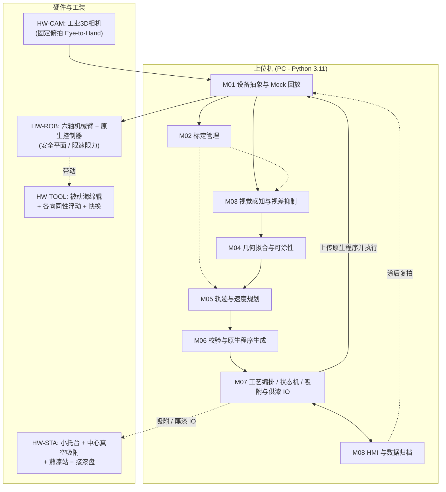
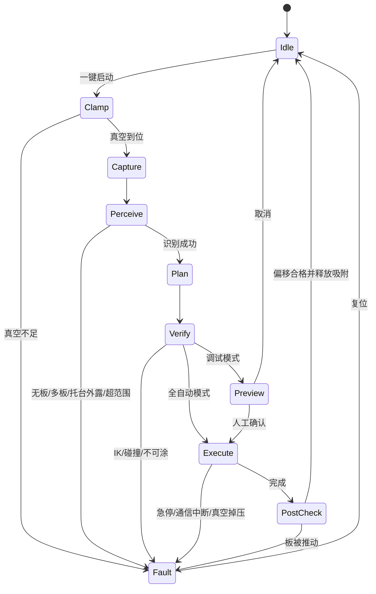

# 视觉免示教木板沿边涂漆系统 —— 综合设计基线规范（Baseline v1.1 终审收敛版）

> **文档版本**：Baseline v1.1 正文保留；**当前执行范围以 2026-10-22 的演示闭环为准**（v1.0 原文存档于 `Docs/Vision_Edge_System_Baseline_v1.0.md`）  
> **状态**：**本期不再按 v1.1 的 125～145 人天实施。** 用户于 2026-10-22 将范围收成固定场景演示。下文技术内容改为扩展清单，客户认可演示后再单独立项。  
> **制定过程**：Gemini 初版架构 → Opus 独立评审 → Opus 复核（`Docs/Reivew.md`）→ Gemini 合并为 v1.0 → Opus 终审（`Docs/Vision_Edge_System_Final_Review.md`，F1~F8）→ v1.1。  
> **关联依据**：  
> - Gemini 初版方案：`Docs/Vision_Guided_Robot_Edge_System_Gemini.md`  
> - Opus 评审报告：`Docs/Vision_Edge_System_Design_Claude.md`  
> - 参考视频：`C:\Users\mimovr\Videos\NVIDIA\screa.mp4`（证据帧存于 `Docs/assets/vision_edge/`）  
> - 防推/防拧转计算脚本：`Docs/assets/vision_edge/calc_push_rotation.py`  
> **本期验收**（唯一交付）：机器人与三维相机位置固定。一块小木板平放在桌面上，下达开始命令后，相机找到木板并沿边缘涂胶。将木板平移并转动后再次开始，不示教、不改程序，仍能涂胶成功。胶落在侧边且目视连续即通过。  
> **本期不做**：多种板型、真空吸附小托台、亚毫米计量、阶段 0 三条红线、蘸漆站与羽化、各向同性浮动机构试验、完整 HMI 与运行归档。板直接放在桌面上，用软辊、慢速和防滑垫减轻推移。  
> **报价**：`Docs/机器人视觉免示教沿边涂抹系统报价单.xlsx`（20261022-3，180 人天 × 2,800 元 = 504,000 元研制费；拆为相机传输、点云实时计算、坐标换算、六轴姿态、机器人驱动、轨迹下发、一键闭环与两次试验）。材料费 5 万元不计入报价单。v1.1 的 145 人天报价、20261022-1 和 20261022-2 均作废。验收范围仍是一块小木板的两次涂胶。  
> **标注约定**：【待核】= 经验值或厂商宣传口径，须在阶段 0 实测或询价确认，不得直接作为对外承诺。

---

## 1. 项目本质与工程范围界定（P0 / P1 / P2）

### 1.1 需求本质与真实物理环境
- **用户核心需求**：操作员把一块 $20\text{ cm}\times 20\text{ cm}$ 级木板放在托台上，系统通过 3D 视觉自主感知位姿与外形，无需示教、无需 CAD，驱动机械臂末端的小圆柱（被动随动海绵辊）以恒定接触线速度沿边缘涂抹油漆。
- **视频抽帧事实纠偏**：
  1. 参考视频（新时达 STEP SmartRobot 2.0 演示切片，16.2 s，截自 1 分 14 秒原片）是**电主轴 + 千叶砂布轮打磨**，不是涂漆。涂漆的核心难点是**供漆连续性、流挂、端面吸漆与羽化搭接**。
  2. 视频中三角板一端被垫块垫起约 $10^\circ$，展示了 6-DOF 位姿自适应；本系统 **P0 只做水平平放**，斜放板列入 P1。
  3. 视频不能证明相机是 Eye-in-Hand；本系统的相机构型按视场、精度与防溅污染独立决策。

### 1.2 范围切割与分期红线

| 维度 | P0（MVP，本期：第 1~12 周） | P1（二期：+5~6 周，+50~65 人天【Opus 原估】） | P2（长期储备） |
| :-- | :-- | :-- | :-- |
| **工件形态** | 单块水平平放的木板/胶合板/MDF；厚 $8\sim 30\text{ mm}$；包围盒 $100\sim 300\text{ mm}$；边缘与板面基本垂直；底面平整可吸附 | 斜放板（板面与桌面夹角 $\le 15^\circ$）；自由曲线外形（B 样条）；多板依次处理 | 三维曲面板、带内孔/镂空工件、传送带流水线 |
| **几何轮廓** | 凸多边形、圆/椭圆、圆角矩形、曲率半径 $\rho \ge 2R$ 的平缓凹弧；**无内通孔** | 尖凹角不可达段优化；窄槽（$\rho < 2R$）避让 | 任意自由曲面与微小孔洞 |
| **摆放与固定** | 放在 **Ø40~50 mm 深色哑光小托台**上（高 $\ge 15\text{ mm}$），**中心真空吸附为标配**；角度 $0\sim 360^\circ$ 任意，板中心落在允许偏移圈内（§2.1） | 去掉托台、直接放在吸附防滑垫上（接受底部 $2\text{ mm}$ 不涂） | 散乱堆叠与料筐抓取 |
| **相机与视差** | 1 台固定俯拍（Eye-to-Hand）工业 3D 相机；遮光罩或固定漫射补光；算法抑制视差、提取真上棱 | 双相机融合（3D 粗定位 + 2D 高分辨率） | 手眼伺服跟踪 |
| **机器人与控制** | 适配 1 款目标机器人（优先协作臂）；**生成控制器原生程序整段上传执行**（直线 + 圆弧 + 交融） | 支持第 2 个品牌 | 实时点流（ServoL）闭环修正 |
| **末端与供漆** | 无动力被动海绵辊 + 各向同性浮动；被动蘸漆站 + 羽化搭接（蠕动泵为备选） | 微型蠕动泵在线供漆；浮动位移传感器闭环监控 | 电机主动驱动 + 恒力主动柔顺控制 |
| **“动态”定义** | **每次放板现拍现算、免示教启动**（放板 → 吸附 → 拍照 → 规划 → 执行 → 复拍）；执行中不做视觉闭环 | 执行中工件微小滑移的在线补正 | 激光线扫实时跟踪 / 力控跟随 |

---

## 2. 核心物理模型与工程判据

### 2.1 防推板与防拧转（终审 F1、F3 修正）

**① 平移推板（接触点在边中点）**
- 200×200×18 mm 胶合板（密度按 0.6 g/cm³【待核】）质量 ≈ 0.43 kg，重力 $G \approx 4.2\text{ N}$。
- 光滑台面 $\mu \approx 0.3$【待核】：$F_{f,\max} \approx 1.26\text{ N}$，安全系数 3 时 $F_n \le 0.42\text{ N}$。
- 防滑硅胶面 $\mu \approx 0.6\sim 0.8$【待核】：$F_{f,\max} \approx 2.5\sim 3.4\text{ N}$，安全系数 3 时 $F_n \le 0.8\text{ N}$。

**② 绕瞬心拧转（接触点在边端头 / 拐角）——决定性工况**
- 接触点偏离板的摩擦中心时，板会绕支撑区内的瞬心转动滑移，临界力远低于 $\mu G$。按均匀压力库仑摩擦数值计算（`calc_push_rotation.py`）：

| 工况 | 临界力 / $\mu G$ | 200 板、μ=0.7 时临界力 | 对 0.8 N 的安全系数 |
| :-- | :-- | :-- | :-- |
| 推边中点（任意托台） | 1.00 | 2.94 N | 3.7 |
| 170 方满托，推边端头 | 0.525 | 1.54 N | 1.9 |
| Ø70 圆托，推边端头 | 0.224 | 0.66 N | 0.8（会转） |
| Ø50 圆托，推边端头 | 0.163 | 0.48 N | 0.6（会转） |

- 托台外缘必须缩进板边 $\ge R+5\text{ mm}$，而同一托台要适配最小 100 mm 的板，托台直径只能 $\le 70\text{ mm}$。**因此只靠自重和摩擦，在 P0 板型范围内防拧转判据必然失效。**

**③ 结论：中心真空吸附为 P0 标配**
- Ø40 吸盘在 $-50\text{ kPa}$ 下法向保持力 $\approx \pi \times 0.02^2 \times 5\times10^4 \approx 63\text{ N}$；边端拧转临界力约 $(0.13\sim 0.16) \times 0.6 \times (4.2 + 63) \approx 5\sim 6\text{ N}$，对 0.8 N 的安全系数约 6~8。真空度受 MDF/胶合板底面透气性与平整度影响【待核，S0-4 实测】。
- 推荐电动微型真空泵 + 真空压力开关（现场无需气源）；**真空压力未到位时 M07 禁止执行**。
- 拐角减压退让（§2.2）正好落在最容易拧转的位置，与防拧转方向一致。

**④ 摆放公差**
- 吸盘须被板完全覆盖、托台须缩进板边 $\ge R+5$，板中心相对托台中心的允许偏移为
  $$e_{\max}=\frac{W_{\min}}{2}-(R+5)-r_{ped}$$
  其中 $W_{\min}$ 为板的最小宽度，$r_{ped}$ 为托台半径。取 Ø50 托台、$R=10$：100 板 $\pm 10\text{ mm}$，200 板 $\pm 60\text{ mm}$，300 板 $\pm 110\text{ mm}$。
- 托台表面刻对中标线；M03 检测到托台外露或偏移超限时拒绝执行并提示重放。

**⑤ 浮动机构刚度与接触力窗口（终审 F4）**
- 名义压紧量 $\delta_0 = 2.5\text{ mm}$，工作区间 $\delta \in [1.0, 4.0]\text{ mm}$；为保证 $\delta_{\max}=4\text{ mm}$ 时 $F_n \le 0.8\text{ N}$：
  $$k_{\text{equiv}} \le \frac{0.8\text{ N}}{4.0\text{ mm}} = 0.2\text{ N/mm}$$
- $k_{\text{equiv}}$ 是**浮动机构与海绵的串联等效刚度**。浮动越软，同样的总压紧量下海绵本身压缩越少、出漆越少。接触力上限由防推决定，**下限由上漆决定**，两者构成接触力窗口，须在 S0-4 / S0-5 联合确定。
- 被动辊轴承摩擦与滚动阻力产生的切向力同样在 S0-4 实测。

### 2.2 拐角接触动力学与漆膜控制（终审 F5 修正）
- **物理本质**：滚轮（半径 $R$）绕 $90^\circ$ 凸角做外法向圆弧包络（半径 $d = R - \delta$）时，滚轮圆心在走圆弧，但**接触点停在角点上不动**。TCP 恒速 $20\text{ mm/s}$、$d = 8.5\text{ mm}$ 时，圆弧长 $13.35\text{ mm}$，滞留 $t_{\text{dwell}} \approx 0.67\text{ s}$，造成积漆和海绵被角割伤。原理上滞留时间不可能降到 0。
- **控制策略（参数为配方值，不是红线）**：
  1. 凸角圆弧段 TCP 提速 $k_c = 2\sim 3\times$（初值 2.5，受机器人加速度限制；$k_c=2.5$ 时滞留降至 $0.27\text{ s}$）；
  2. 凸角段压紧量减到 $\delta_c$（初值 $0.5\delta_0 \approx 1.25\text{ mm}$）。注意：2σ 系统偏差约 $\pm 1.3\text{ mm}$，$\delta_c$ 过小会在角上脱离接触而干涂，须在 S0-6 与阶段 4 按“不积漆、不干涂”调优；
  3. 平缓凹弧按 $v_{\text{tcp}} = v_e (\rho - d)/\rho$ 降速，凸弧按 $v_{\text{tcp}} = v_e (\rho + d)/\rho$ 提速，保证接触点线速度恒为 $v_e$。

### 2.3 供漆工艺与续航（终审 F4 补充）
- **单件需漆量**：周长 $80\text{ cm}$，侧面积 $144\text{ cm}^2$，湿膜 $50\sim 100\ \mu\text{m}$【待核：以涂料 TDS 为准】：
  $$V_{\text{paint}} \approx 0.72\sim 1.44\text{ mL}$$
- Ø20×25 mm 海绵辊单次蘸漆的有效涂布距离 $L_{load}$ **不得预设，必须在 S0-5 实测**。
- **P0 默认（方案 A）**：被动蘸漆站（恒液位漆杯 + 刮漆边 + 接漆盘，不做自清洗）；按实测 $L_{load}$ 分段，分段点优先放在直边中部。
- **羽化搭接**：每个分段起止做 $10\text{ mm}$ 线性羽化（压紧量在进出各 5 mm 内线性变化）。
- **竖直辊的重力沉积**：涂料会向辊下端沉积，导致侧面下部偏厚和待机滴漆。S0-5 须测板厚方向的上下均匀性和待机滴漆量；待机位设在接漆盘上方。
- **备选（方案 B）**：S0-5 不达标时改为微型蠕动泵经空心旋转接头向海绵芯连续微量供漆（+5~8 人天）。

### 2.4 Z 向覆盖与包边
- 辊有效段覆盖 $[Z_{top}-H-m_b,\ Z_{top}-m_t]$；$m_b$ 初值 2 mm（辊下端略低于板底面，覆盖侧面全高）；辊下端距工作台面 $\ge 5\text{ mm}$。
- $m_t$ 由包边策略决定（Q6）：接受 $\le 1\text{ mm}$ 包边时 $m_t \approx 0$；不接受时辊顶低于上表面 $0.5\sim 1\text{ mm}$，上沿留一窄条不涂。

### 2.5 全链路误差预算与顺应行程

| 误差源 | 1σ 估计（mm）【待核：经验值，S0-2/S0-3 实测替换】 | 物理来源 |
| :-- | :-- | :-- |
| 3D 相机平面 / Z 测量 | 0.15 | 近距结构光平面拟合残差 |
| 2D+3D 融合边缘提取（XY） | 0.25 | 视差抑制后的倒圆、木纹、光照干扰 |
| 手眼 / 工具坐标系标定 | 0.25 | TCP 触点刚体配准残差 |
| 机器人工作区内绝对定位 | 0.35 | 未做整机参数补偿时的局域绝对误差 |
| 海绵湿态膨胀与磨损 | 0.30 | 吸漆膨胀、弹性迟滞 |
| 木板边缘本身 | 0.30 | 锯偏、崩边、毛刺、垂直度 |
| **合成（RSS）** | **≈ 0.67（1σ），±1.34（2σ）** | 极端工况按 $\pm 1.5\text{ mm}$ 设计 |

- 浮动机构须具备 $\ge \pm 2\text{ mm}$（推荐 $\pm 3\text{ mm}$）的水平各向同性顺应行程。

---

## 3. 系统架构与模块规范（M01~M08 + HW）

### 3.1 软件模块职责

| 编号 | 名称 | 核心职责 | 输入 / 输出 | 依赖 |
| :-- | :-- | :-- | :-- | :-- |
| **M01** | 设备抽象与 Mock 回放 | `ICamera` / `IRobot` / `IIO` 统一接口；归档数据集回放；机器人仿真器或运动学 Mock。**无硬件也能开发与回归，是 12 周工期成立的前提** | 驱动 / 离线文件 → 统一数据结构 | 底层 |
| **M02** | 标定管理 | Eye-to-Hand 9~12 点 TCP 触点 SVD 刚体配准（主）+ $AX=XB$（交叉校验）；台面与托台平面标定；滚轮湿态半径标定，换辊/清洗后一键重标；9 点验证向导 | 机器人位姿 + 触点 → $T_{cam}^{base}$、残差报告 | M01 |
| **M03** | 视觉感知与视差抑制 | ROI 去噪 → 高度分割 → 剔除托台 → 唯一大簇为板（0 个或多个报错）；上表面 RANSAC，与台面夹角 > 2° 拒绝执行；上表面内点投影 Mask，仅在 Mask 边界过渡带内找“从内往外第一个强梯度”做亚像素上棱；板厚交叉验证；**托台外露 / 偏移超限检测** | 点云 + 2D 图 → 有序闭合上棱 3D 点列 | M01, M02 |
| **M04** | 几何拟合与可涂性 | 角点检测分段 → 直线/圆弧鲁棒拟合（RANSAC/Huber）→ 相邻图元求交；尺寸报告（不强制吸附规则形状）；**两级可涂性判定**：$\rho < 2R$ 超出 P0 范围（警告），$\rho \le d$ 物理不可达（标红并写入报告） | 离散轮廓 → 图元链表 + 不可达段 | M03 |
| **M05** | 轨迹与速度规划 | 解析外法向刀补 $d = R - \delta(s)$（Shapely 仅做交叉校验）；接触线速度剖面（凸角 $k_c$ 提速 + $\delta_c$ 减压、凹弧降速）；Z 向覆盖（§2.4）；最长直边中点切线切入/切出；按 $L_{load}$ 分段与 10 mm 羽化；空跑模式（抬高 30 mm 或刚性假辊留 2 mm 间隙） | 图元 → 笛卡尔轨迹（速度 / 交融 / 固定姿态） | M04 |
| **M06** | 校验与程序生成 | 全路径 IK（可达、限位、手系一致、关节速度突变）；可放板区域热图（部署时预计算）；与台面/托台/板上表面的碰撞校验；PC 端 Z 钳位（第二层防护）；生成带交融半径的控制器原生程序 | 轨迹 → 原生程序包（与规划结果一同归档） | M05 |
| **M07** | 工艺编排与 IO | 状态机（§3.2）；**真空吸附建立与压力互锁**；蘸漆子流程（移位 → 浸入 → 停留 → 刮漆 → 回分段起点）；超时、急停、通信中断处理；复拍 2D ICP 位移判定 | 指令 + DI → 动作与监控 | M06, M01 |
| **M08** | HMI 与数据归档 | PySide6 + PyVista：2D 叠加上棱与不可达段、3D 点云 + 轮廓 + 辊心轨迹 + 分段点 + 可放板区域；配方参数（辊径、$\delta_0$、$v_e$、$k_c$、$\delta_c$、羽化长度、$m_t/m_b$、$L_{load}$、蘸漆停留时间）；调试确认 / 一键全自动两种模式；每次运行一个归档目录，可离线重放 | 交互 + 归档数据 → 界面与报告 | M07, M03 |

### 3.2 运行状态机

### 3.3 硬件与工装交付物（外购件与外协加工费用另计）

| 项目 | 内容 |
| :-- | :-- |
| 末端执行器 | 法兰转接 + 被动辊轴（低阻轴承）+ 各向同性浮动（弹性回中，±3 mm）+ 快换；预留位移传感器接口（P1） |
| 托台与吸附 | Ø40~50 mm 深色哑光托台（高 ≥ 15 mm）+ 中心吸盘 + 电动微型真空泵 + 真空压力开关 + 对中标线 |
| 蘸漆站 | 恒液位漆杯 + 刮漆边 + 接漆盘，固定在工作区边缘已知位置 |
| 背景与照明 | 深色哑光台面；遮光罩或条形漫射补光 |
| 标定与测试附件 | 刚性尖针 TCP、ChArUco 板、对刀块；6 种 CNC 测试板（200 方板、150×250 矩形、Ø200 圆板、圆角矩形、正六边形、平缓凹弧板，带计量报告） |

---

## 4. 阶段 0：预研排雷（S0-1 ~ S0-7）

阶段 0 为期 **3 周**（W1~W3，**28~30 人天**），自 T0（硬件到位日，见 §7.2）起算。

| 编号 | 预研项 | 方法 | 通过判据 | 未通过时的退路 |
| :-- | :-- | :-- | :-- | :-- |
| **S0-1** | 硬件全链路打通 | 相机取图；机器人原生程序上传与远程运行；实时状态回传；DO/DI（含真空泵与压力开关） | 全链路稳定跑通，无偶发掉线 | 改用厂家 SDK 或其他通信路线 |
| **S0-2【红线 1】** | 边缘精度与视差抑制 | CNC 200 方板在 9 位置 × 4 角度采集；对比“只用 3D 边界”与“Mask 约束 2D 亚像素融合” | 融合法：**上棱 RMS ≤ 0.3 mm，最大 ≤ 0.6 mm，边长误差 ≤ 0.5 mm** | 加 2D 辅助相机；降低相机高度 / 缩小工作区 |
| **S0-3** | 手眼标定与配准 | 触点 SVD 配准 vs $AX=XB$；9 点验证 | **平均 ≤ 0.5 mm，最大 ≤ 0.8 mm；两法差值 ≤ 0.5 mm** | 加机器人局部精度补偿；缩小工作区 |
| **S0-4【红线 2】** | 接触力与防推 / 防拧转 | 在边中点、边端头、拐角三处测临界推动力（有/无真空吸附，含 MDF 与胶合板）；测浮动机构与海绵各自及串联的力—位移曲线；测被动辊切向阻力 | **压缩 4 mm 时 $F_n \le \frac{1}{3}\min(F_{\text{mid}}, F_{\text{end}}, F_{\text{corner}})$**；吸附状态下真空度稳定 | 加大吸盘或双吸盘；降低等效刚度；收窄板材种类 |
| **S0-5【红线 3】** | 涂布距离与供漆 | **在 S0-4 确定的压紧量下**，机器人直线匀速实涂，测 $L_{load}$、羽化接缝、板厚方向上下均匀性、待机 60 s 滴漆量 | **测定 $L_{load}$，方板每边一次涂完（≥ 200 mm）；羽化区无明显厚带；侧面上下无明显流挂** | 切换微型蠕动泵（+5~8 人天） |
| **S0-6** | 速度平稳性与交融 | 生成“直线 + 凸角包络 + 凹弧”原生程序，实时口记录 TCP 速度；同时初调 $k_c$、$\delta_c$ | **直线/圆弧段速度波动 ≤ ±10%，段间停顿 0 次** | 加大交融半径 / 降速 / 改用伺服点流 |
| **S0-7（条件触发）** | 相机构型对比 | 仅当 S0-2 在 Eye-to-Hand 下未达标、且 2D 辅助相机仍不能解决时：相机临时夹在法兰上，按 S0-2 条件比对 | 出具对比报告并定型 | 触发即视为红线 1 退路，工期与费用另行评估 |

> [!WARNING]
> **Go/No-Go**：S0-2、S0-4、S0-5 为三条红线。任何一条在第 3 周末未通过，必须先与用户重新确认范围或退路（加 2D 相机、加大吸附、改蠕动泵、收窄板型或放宽精度），重新校准工期与预算后，才进入阶段 1。

---

## 5. 硬件与技术选型

### 5.1 3D 相机
- **不选用**：ToF 相机（如奥比中光 Femto Bolt，边缘多径与飞点）；中远距双目（如 Gemini 335L，亚毫米边缘精度不是设计目标）。
- **候选（阶段 0 实测定型）**：
  1. **工业近距结构光（主选）**：梅卡曼德 Mech-Eye Nano / Nano Ultra，或海康、图漾同级近距型号。精度、视场、价格以询价和规格书为准【待核】；采购周期约 2~4 周【待核】，签约后第 1 天下单。
  2. **低成本对照**：Intel RealSense D405（官方标称理想距离约 7~50 cm【待核】），依赖表面纹理，精度须实测。**选它作主相机时，§6 的视觉/标定指标不能预先承诺**。
  3. **2D 辅助（备选）**：500 万像素工业面阵相机（300 mm 视场约 0.12 mm/px），与 3D 相机共同标定。

### 5.2 机器人
- **首选**：开放 TCP/IP 脚本或 SDK、可配置安全平面的协作臂（节卡、遨博、优傲等）。用户已有机器人时一律按现有机型适配，M06 只做这一家。
- **传统工业臂（FANUC / ABB 等）**：须确认网络传输与程序上传类选项（FANUC 走 `.LS` → TP 需 ASCII Upload 类选项【待核：以 FANUC 选项清单为准】→ FTP → 远程启动）；现场须加安全光幕或安全扫描仪；**+10~15 人天**。
- **安全**：第一层为控制器安全平面 / 工具位置限制 / 协作限速限力 / 急停；第二层为 PC 端规划钳位与全路径校验。

### 5.3 软件栈
- Python 3.11；Open3D（RANSAC、聚类、Mask、ICP，不引入 PCL）；OpenCV 4.x（标定、亚像素）；NumPy / SciPy / Shapely（拟合与几何交叉校验）；PySide6 + PyVista（pyvistaqt）；pytest + 黄金数据集（≥ 30 组真实采集）。

---

## 6. P0 量化验收标准（合同技术附件）

**生效条件**（三项同时满足，否则相应指标在阶段 0 结束时与用户书面重定）：
1. 阶段 0 三条红线已通过，或已书面约定退路；
2. 主相机为工业级近距结构光（选 D405 时，视觉与标定类指标按 S0-2 / S0-3 实测重定）；
3. 现场条件与 §8 的 Q1~Q7 确认书一致。

| 类别 | 指标 | 判据 | 检验方法 |
| :-- | :-- | :-- | :-- |
| 视觉 | 200 方板上棱位置 | RMS ≤ 0.3 mm，最大 ≤ 0.6 mm | CNC 测试板，9 位置 × 4 角度 |
| 视觉 | 尺寸报告 | 边长误差 ≤ 0.5 mm，直角误差 ≤ 0.3° | 对比计量报告 |
| 标定 | 9 点验证 | 平均 ≤ 0.5 mm，最大 ≤ 0.8 mm | TCP 尖针触点复验 |
| 端到端 | 刚性假辊空跑（名义间隙 2 mm） | 8 个采样点实测间隙 2 ± 0.8 mm | 塞尺测量 |
| 运动 | TCP 速度 | 直线/圆弧段波动 ≤ ±10%，段间停顿 0 次 | 控制器实时口记录 |
| 工艺 | 侧面覆盖率 | 可涂区域目视覆盖 ≥ 95%，无流挂、无干涂 | 扣除报告列出的不可达段与 $m_t/m_b$ |
| 工艺 | 拐角与接缝 | 无可见积漆点；接缝无明显厚带 | 目视 + 高清照片留档 |
| 工艺 | 现场清洁 | 工作台面与托台无沾漆 | 目视 |
| 稳定 | 板偏移 | 复拍 Δ ≤ 0.5 mm、Δθ ≤ 0.3° | 涂前涂后 2D ICP |
| 鲁棒性 | 一键成功率 | 6 种测试板在允许偏移圈内随机摆放共 30 次，≥ 28 次无人工干预完成 | §3.3 的 6 种 CNC 测试板 |
| 节拍 | 识别规划 / 单圈涂抹 | 拍照 + 识别 + 规划 ≤ 3 s；200 方板单圈（$v_e$ = 20 mm/s，不含蘸漆与吸附）≤ 60 s | 运行日志 |
| 追溯 | 运行归档 | 100% 运行有完整归档，离线重放得到相同轨迹 | 回放比对 |

---

## 7. 商务报价与工期基准

### 7.1 人力与工期（12 周，125~145 人天）
- 团队：视觉/算法 ×1，机器人/系统 ×1，机械/工艺 ×0.3~0.5，UI/测试 ×0.3~0.5（合计 2~2.5 人）。
- 单价 2,200 元/人天；**基准总额 27.5 万 ~ 31.9 万元**（不含外购硬件与外协加工）。

| 阶段 | 周期 | 交付成果 | 人天 | 金额 |
| :-- | :-- | :-- | :-- | :-- |
| 阶段 0：预研排雷 | W1~W3 | S0-1~S0-6 报告（S0-7 条件触发）、相机定型、工装初版 | 28~30 | 6.16~6.60 万 |
| 阶段 1：标定与感知 | W4~W6 | M01~M04，黄金数据集 ≥ 30 组，轮廓精度回归 | 30~34 | 6.60~7.48 万 |
| 阶段 2：规划与校验 | W6~W8 | M05/M06，仿真与空跑，可放板区域热图，安全平面验证 | 24~28 | 5.28~6.16 万 |
| 阶段 3：集成与 HMI | W9~W10 | M07/M08，一键全流程（含吸附互锁），归档与复拍 | 20~24 | 4.40~5.28 万 |
| 阶段 4：实涂与验收 | W11~W12 | 配方调优（$k_c$、$\delta_c$、$L_{load}$ 等）、验收报告、操作手册 | 18~22 | 3.96~4.84 万 |
| 工装设计（贯穿） | W1~W10 | 末端浮动头、托台与吸附、蘸漆站、测试板图纸与调试 | 5~7 | 1.10~1.54 万 |
| **合计（P0）** | **12 周** | | **125~145** | **27.5~31.9 万** |

### 7.2 商务前提与增补条款（报价单必须列明）
1. **工期起算**：自相机、机器人、真空吸附组件、CNC 测试板全部到位之日（T0）起算。
2. **工业臂增补**：采用 FANUC / ABB 等传统工业臂时 +10~15 人天（+2.2~3.3 万元），并须增设安全光幕。
3. **取消托台增补**：直接放在吸附防滑垫上作业时 +5 人天（+1.1 万元），用户须书面接受底部约 2 mm 不涂；防推判据在 S0-4 重新验证。
4. **蠕动泵增补**：阶段 0 确认需改蠕动泵供漆时 +5~8 人天（+1.1~1.76 万元）。
5. **S0-7 触发**：视为红线 1 退路，工期与费用另行评估。
6. **硬件另计**：3D 相机、机器人本体、工控机、真空泵与吸盘、末端浮动头与托台加工件、CNC 测试板等不含在上述人天费用内。

---

## 8. 报价前须用户确认的输入清单（Q1~Q7）

1. **Q1 机器人**：品牌与完整型号？协作臂还是传统工业臂（如 FANUC 焊接机器人）？控制器是否已开通 PC 通信与程序上传 / 脚本执行选项？
2. **Q2 3D 相机**：是否已采购？预算倾向研发级（千元级，RealSense D405）还是工业级（万元级近距结构光，如梅卡曼德 Mech-Eye Nano）？（不使用 ToF 相机；选 D405 时视觉精度指标须在阶段 0 后重定。）
3. **Q3 涂料与滚轮**：涂料种类（水性 / 油性）与黏度？“可以转的小圆柱”是否接受为无动力随动海绵辊（外径约 Ø20 mm）？若坚持电机驱动，需另行评估。
4. **Q4 “动态”的含义**：是否认可为“每次放板现拍现算、免示教自动执行”？若指执行过程中实时跟踪工件，属于 P2，需重新评估。
5. **Q5 托台与吸附**：是否接受 Ø40~50 mm 小托台 + 中心真空吸附（电动微型真空泵，无需气源）？板材底面是否平整、可吸附（MDF 透气性需实测）？是否接受“任意角度 + 板中心落在允许偏移圈内”的摆放方式？
6. **Q6 涂装覆盖**：侧面是否必须涂满整个厚度？上表面边缘是否允许 ≤ 1 mm 包边？
7. **Q7 交付性质与板型**：演示样机还是高节拍生产设备？P0 必须覆盖哪些板型（默认 §3.3 的 6 种）？

---

## 9. 风险清单

| # | 风险 | 概率 | 影响 | 应对 |
| :-- | :-- | :-- | :-- | :-- |
| R1 | 边缘精度达不到 0.3 mm | 中 | 高 | Mask 约束亚像素 + 2D 辅助相机 + 加大顺应行程 |
| R2 | 板被推动或拧转 | 中 | 高 | 中心真空吸附 + 低刚度浮动 + 拐角减压 + 复拍检测 |
| R3 | 漆量不足、前浓后淡、下端沉积 | 高 | 高 | 分段蘸漆 + 羽化；退路蠕动泵 |
| R4 | 角上积漆或干涂、接缝厚带 | 中 | 中 | $k_c$ / $\delta_c$ 配方调优 + 羽化 |
| R5 | 控制器段间停顿 | 中 | 中 | 原生程序 + 交融，S0-6 验证 |
| R6 | 机器人接口受限 | 未知 | 高 | Q1 尽早确认 |
| R7 | 木纹 / 颜色导致分割失败 | 中 | 中 | 深色哑光背景 + 照明规范 + 鲁棒拟合 |
| R8 | 海绵膨胀导致半径漂移 | 中 | 中 | 湿态半径标定 + 顺应余量 |
| R9 | 镜头或工作区被涂料污染 | 低 | 中 | Eye-to-Hand、保护窗、接漆盘、清洁流程 |
| R10 | 用户把“动态”理解为实时跟踪 | 中 | 高 | Q4 对齐，列为 P2 |
| R11 | 多孔板材真空吸附不足 | 中 | 中 | S0-4 实测；加大吸盘 / 双吸盘 / 底面贴膜 |
| R12 | 硬件采购延误 | 中 | 中 | 工期自 T0 起算；签约后第 1 天下单 |

---

## 10. 修订记录

| 版本 | 日期 | 说明 |
| :-- | :-- | :-- |
| v1.0 | 2026-10-21 | Gemini 依据 Opus 复核意见（B1~B5 / C1~C7）合并形成首版基线 |
| v1.1 | 2026-10-21 | Opus 终审（F1~F8）：真空吸附升为 P0 标配并新增防拧转判据与摆放公差；S0-7 改为条件触发，阶段 0 改为 28~30 人天，合计 125~145 人天成立；接触力窗口与 S0-4/S0-5 联做；$k_c$/$\delta_c$ 改为配方参数；验收加生效条件并补回端到端空跑与无沾漆；新增 T0 起算；恢复【待核】标注、Z 向覆盖、状态机、HW 交付物、风险清单与 P1 估算 |
