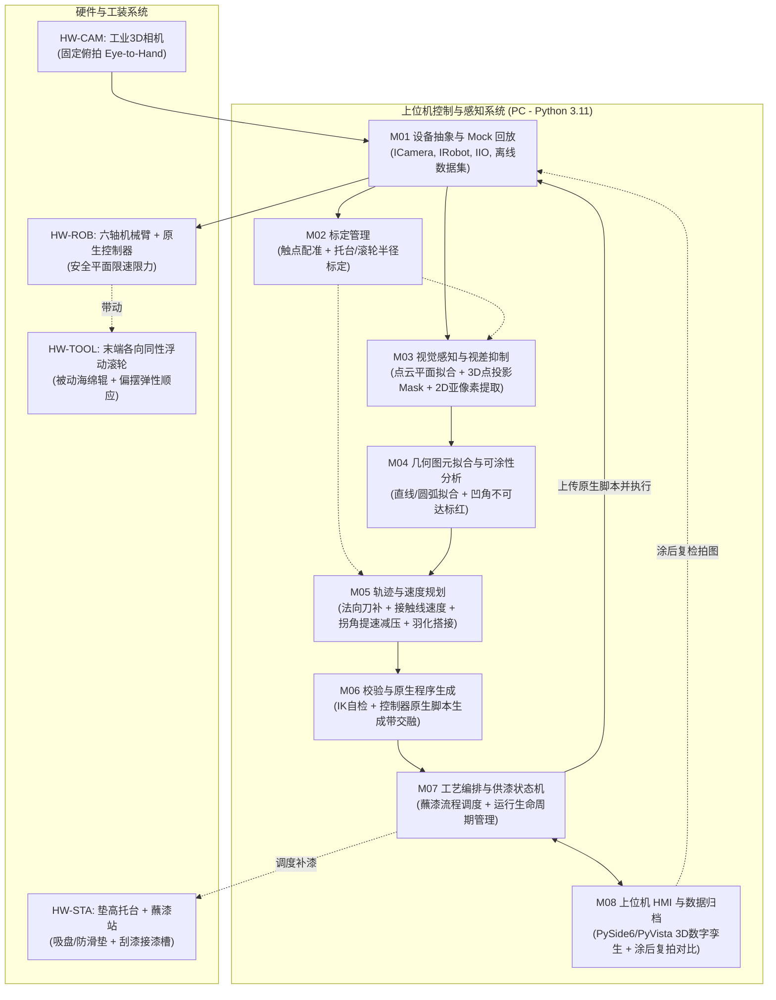

# 视觉免示教木板沿边涂漆系统 —— 综合设计基线规范（Baseline v1.0）

> **文档版本**：Baseline v1.0（2026-10-21）  
> **制定模式**：Gemini 架构规划 + Claude Opus 独立深度评审 + 双模型第二轮交叉收敛定稿  
> **关联依据**：  
> - Gemini 初版方案：`Docs/Vision_Guided_Robot_Edge_System_Gemini.md`  
> - Claude Opus 评审报告：`Docs/Vision_Edge_System_Design_Claude.md`  
> - Opus 审查意见表：`Docs/Reivew.md`  
> - 参考视频：`C:\Users\mimovr\Videos\NVIDIA\screa.mp4`（证据帧存于 `Docs/assets/vision_edge/`）  
> **执行约束**：本文件为本项目阶段 0 预研、软件研发、硬件工装加工及商务报价的**唯一权威基线文档**。未经双模型重新交叉评审与用户授权，严禁擅自改动本基线中的量化指标与模块编号。

---

## 1. 项目本质与工程范围界定（P0 MVP vs P1/P2）

### 1.1 需求本质与真实物理环境
- **用户核心需求**：操作员随手在托台上放置一块 $20\text{ cm}\times 20\text{ cm}$ 级木板，系统通过 3D 视觉自主感知其位姿与外形轮廓，无需示教编程、无需 CAD 模型，驱动机械臂末端旋转小圆柱（被动随动海绵辊）以恒定线速度沿边缘均匀涂抹油漆。
- **视频抽帧事实纠偏**：
  1. 参考视频（新时达 STEP SmartRobot 2.0 演示切片，16.2s）本质为**电主轴+千叶砂布轮打磨**，非流体涂漆；打磨为主动切削与力控，涂漆则核心受制于**供漆连续性、流挂、毛细吸漆与羽化搭接**。
  2. 视频中斜置板（垫块垫高约 $10^\circ$）展示了 6-DOF 位姿自适应能力；本系统 **P0 聚焦水平平放**，斜置板划入 P1。
  3. 视频未证实 Eye-in-Hand 相机构型，且打磨工况容易产生飞溅；本系统 P0 选型基于视场、精度与防溅污染原则独立决策。

### 1.2 范围切割与分期红线（Scope Boundaries）

| 维度 | P0（MVP，本期基线：第 1~12 周） | P1（二期扩展：第 13~18 周） | P2（长期储备） |
| :-- | :-- | :-- | :-- |
| **工件形态** | 单块水平平放木板/胶合板/MDF；厚度 $8\sim 30\text{ mm}$；包围盒 $100\sim 300\text{ mm}$；边缘与表面基本垂直 | 斜放板（板面法向与桌面夹角 $\le 15^\circ$）；复杂外轮廓自由曲线（B 样条）；多板批次处理 | 三维曲面板、带内孔/镂空轮廓工件、传送带动态流水线作业 |
| **几何轮廓** | 凸多边形、圆/椭圆、圆角矩形、曲率半径 $\rho \ge 2R$ 的平缓凹弧；**无内通孔** | 尖凹角不可达段路径优化；窄槽（$\rho < 2R$）刀具自适应避让 | 任意复杂自由曲面与微小孔洞 |
| **摆放与固定** | 平放于专用深色哑光托台（垫高 $\ge 15\text{ mm}$）；角度 $0\sim 360^\circ$ 任意；可选中心真空吸盘防推 | 去掉垫高托台，直接平放于高摩擦垫上（允许底部留白 $2\text{ mm}$） | 散乱堆叠与料筐抓取 |
| **相机与视差** | 1 台固定俯拍（Eye-to-Hand）工业 3D 相机；工作区遮光/恒定补光；算法抑制视差提取真上棱 | 双相机融合（3D 粗定位 + 2D 高分辨率侧棱相机） | 动态手眼伺服跟踪相机 |
| **机器人与控制**| 适配 1 款目标机械臂（优先协作臂）；**编译生成控制器原生程序整包上传执行**（平滑圆弧交融） | 支持 2 款以上异构品牌机器人无缝切换 | 实时点流（ServoL）动态闭环修正 |
| **末端与供漆** | 无动力被动随动海绵滚轮 + 各向同性浮动顺应机构；配被动刮板蘸漆槽与羽化搭接（蠕动泵为备选） | 微型蠕动泵主动在线微量注漆；末端浮动位移传感器闭环监控 | 电机主动驱动自转 + 恒接触力主动柔顺控制 |
| **动态定义** | **现拍现算、免示教启动**（放板 $\rightarrow$ 拍图 $\rightarrow$ 算轨迹 $\rightarrow$ 执行）；非作业中视觉闭环追踪 | 作业中工件微量滑移在线位移补正 | 激光线扫实时缝跟踪/打磨力控跟随 |

---

## 2. 核心物理模型与工程判据（彻底修正 B1~B5 缺陷）

### 2.1 防推板力学平衡与刚度设计（B1 修正）
- **摩擦极限受力分析**：
  - 典型 $20\text{ cm}\times 20\text{ cm}\times 1.8\text{ cm}$ 胶合板质量 $m \approx 0.43\text{ kg}$，重力 $G \approx 4.2\text{ N}$。
  - **光滑台面**（$\mu \approx 0.3$）：最大静摩擦力 $F_{f,\max} \approx 1.26\text{ N}$。若取安全系数 $SF=3$，允许最大法向接触力仅为 **$F_n \le 0.42\text{ N}$**。
  - **防滑垫/托台**（硅胶/高阻尼橡胶，$\mu \approx 0.6\sim 0.8$）：最大静摩擦力 $F_{f,\max} \approx 2.5\sim 3.4\text{ N}$。取安全系数 $SF \ge 3$ 时，法向力上限为 **$F_n \le 0.8\text{ N}$**。
  - **结论与工装约束**：若工件无夹具平放，**必须使用专用防滑托台或硅胶垫**；在光滑台面上 $0.8\text{ N}$ 的接触力安全裕度仅为 1.57，极易失稳。托台若选配微型真空吸盘（$-50\text{ kPa}$ 下保持力 $> 60\text{ N}$），可彻底消除推跑风险。
- **浮动机构等效刚度与压缩行程**：
  - 系统误差预算（见 §2.4）显示合成误差（$2\sigma$）约 $\pm 1.5\text{ mm}$。
  - 顺应机构名义压紧量设定为 $\delta_0 = 2.5\text{ mm}$，工作行程区间允许 $\delta \in [1.0, 4.0]\text{ mm}$。
  - 为确保在最大压紧量 $\delta_{\max} = 4.0\text{ mm}$ 时法向力 $F_n \le 0.8\text{ N}$，末端各向同性浮动机构与海绵组合等效刚度必须满足：
    $$k_{\text{equiv}} \le \frac{0.8\text{ N}}{4.0\text{ mm}} = 0.2\text{ N/mm}$$
  - 被动辊采用低阻尼轴承，轴承摩擦力矩与滚动阻力折算至工件切向力需在阶段 0（S0-4）进行实测，确保切向转矩不引起木板角向滑移。

### 2.2 拐角接触动力学与漆膜控制（B2 修正）
- **直角尖角处的几何物理本质**：
  - 当圆柱滚轮（半径 $R$）绕工件 $90^\circ$ 凸角做外法向圆弧包络（半径 $d = R - \delta$）时，滚轮圆心 TCP 在走圆弧，但**滚轮与工件边缘的物理接触点被瞬时几何锁定在尖角顶点上**（接触线速度在边缘切向瞬时为 0）。
  - 若 TCP 维持恒速 $v_{\text{tcp}} = 20\text{ mm/s}$，$d = 8.5\text{ mm}$ 时圆弧长 $s = \frac{\pi}{2} d \approx 13.35\text{ mm}$，滚轮在尖角处原地碾压停留时间为：
    $$t_{\text{dwell}} = \frac{13.35\text{ mm}}{20\text{ mm/s}} \approx 0.67\text{ s}$$
    这将导致局部供漆量超标数倍，产生严重积漆与海绵撕裂割损。
- **收敛控制策略（提速减压 + 微退让）**：
  - 原理上在尖角处无法将滞留时间归零，但可通过**动态提速与接触减压**实现漆膜均匀：
  1. **TCP 速度提升**：在凸角圆弧段将 TCP 速度提升 $k_c = 2\sim 2.5\times$（取 $k_c = 2.5$ 时，滞留时间从 $0.67\text{ s}$ 压缩至 **$0.27\text{ s}$**），实际受限于机械臂最大角加速度限制；
  2. **法向微量退让减压**：在尖角过渡段，将名义压紧量缩减 $50\%$（$\delta_c \approx 0.5\delta_0 \approx 1.25\text{ mm}$），滚轮圆心外移 $1.25\text{ mm}$，卸除海绵挤压力；
  3. **凹弧降速**：在平缓凹弧（曲率半径 $\rho$）处，按 $v_{\text{tcp}} = v_e \cdot \frac{\rho - d}{\rho}$ 主动减速，保证接触点线速度恒为 $v_e$。

### 2.3 供漆工艺与续航平衡（B4 修正）
- **单件需漆量与海绵储漆平衡**：
  - $20\text{ cm}\times 20\text{ cm}\times 1.8\text{ cm}$ 木板四边总周长 $80\text{ cm}$，侧面总展开面积 $A \approx 144\text{ cm}^2$。
  - 水性木器漆推荐湿膜厚度按 $50\sim 100\ \mu\text{m}$ 计，理论单件需漆量为：
    $$V_{\text{paint}} = 144\text{ cm}^2 \times (50\sim 100\times 10^{-4}\text{ cm}) \approx 0.72\sim 1.44\text{ mL}$$
  - $\varnothing 20\text{ mm}\times 25\text{ mm}$ 的海绵滚轮吸附饱和储漆量有限，有效释漆距离 $L_{load}$ **严禁人为预设（如编造 40 cm），必须在阶段 0（S0-5）实测**。
- **供漆机构与搭接策略**：
  - **P0 默认方案（方案 A）**：被动式蘸漆站（含恒液位漆槽 + 边缘刮板 + 滴漏托盘，**剔除多余的自清洗过度设计**）。若 $L_{load}$ 大于单边长（$\ge 200\text{ mm}$），则在长直边中点设置蘸漆断点；
  - **羽化搭接（Feathering Overlap）**：断点重合段设计 $10\text{ mm}$ 线性变压羽化搭接（进出各 $5\text{ mm}$ 斜坡渐变压紧量），消除重叠接缝厚带；
  - **备选方案（方案 B，微型蠕动泵）**：若 S0-5 验证被动蘸漆槽在浸润均匀性或滴漏控制上不达标，立即平滑启动备选路线——通过空心低摩擦旋转接头将微量涂料连续低速泵注至海绵内芯（工作量增补 5~8 人天）。

### 2.4 全链路误差预算表与顺应行程匹配

| 误差源 | 1σ 估计（mm） | 物理来源与工艺机理 |
| :-- | :-- | :-- |
| 3D 相机平面标定 / Z 轴测量 | 0.15 | 近距结构光平面拟合残差 |
| 2D+3D 融合边缘提取 (XY) | 0.25 | 透视视差抑制后木质纤维与倒角干扰 |
| 手眼标定与工具坐标系标定 | 0.25 | TCP 触点刚体配准残差 |
| 机器人绝对定位精度 | 0.35 | 协作臂未做整机几何参数补偿时的局域绝对误差 |
| 滚轮浸漆膨胀与海绵磨损 | 0.30 | 湿态海绵吸水膨胀与弹性迟滞（标定后漂移） |
| 木板边缘加工粗糙度/垂直度 | 0.30 | 切割崩边、垂直度偏差与毛刺 |
| **合成系统误差（RSS）** | **$\approx 0.65\text{ mm}$ (1σ), $\mathbf{\pm 1.30\text{ mm}}$ (2σ)** | 极端工况峰值误差 $\pm 1.5\text{ mm}$ |

- **结论**：浮动机构必须具备 $\ge \pm 2.0\text{ mm}$（推荐 $\pm 3.0\text{ mm}$）的平动各向同性顺应能力，以彻底吸收 $\pm 1.5\text{ mm}$ 极端误差，防止工件悬空漏涂或刚性硬碰。

---

## 3. 系统架构与统一模块规范（B5 修正，确立 M01~M08）

为杜绝编号冲突并保证软硬件解耦研发，系统统一划分为 **8 大软件模块** 与 **2 大硬件工装模块**：

### 3.1 软件模块详细职责表

| 模块编号 | 模块名称 | 核心职责与关键技术 | 输入 / 输出 | 依赖层 |
| :-- | :-- | :-- | :-- | :-- |
| **M01** | **设备抽象与 Mock 回放** | 统一设备接口（`ICamera`、`IRobot`、`IIO`）；支持离线保存的真实点云/图像数据集回放；提供机器人运动学仿真 Mock。**确保无硬件状态下算法与流程先行开发**。 | 相机驱动/离线文件 $\rightarrow$ 统一数据结构；运动指令 $\rightarrow$ 驱动/回放日志 | 系统底层 |
| **M02** | **标定管理** | 实现 Eye-to-Hand 工作区 9 点 TCP 触点刚体配准（SVD 解算）；托台基准标定；被动滚轮湿态半径标定与零点更新。 | 机械臂位姿 + 触点坐标 $\rightarrow$ 标定变换矩阵 $T_{cam}^{base}$ | 依赖 M01 |
| **M03** | **视觉感知与视差抑制** | RANSAC 提取木板上表面点云；生成上表面内点 2D 投影 Mask，将 Canny/Sobel 搜索带严格限定在 Mask 内边缘过渡带，**彻底消除俯拍透视露出的侧面底棱视差**；亚像素拟合真实上棱。 | RGBD 点云 $\rightarrow$ 上棱 3D 亚像素点列（有序封闭点环） | 依赖 M01, M02 |
| **M04** | **几何拟合与可涂性** | 对离散上棱做直线段、圆弧段与平缓凹弧的几何图元拟合与 RANSAC 滤波；分析曲率与滚轮外径，**对 $\rho < R$ 的不可达凹角区域在 UI 上标红预警**。 | 离散 3D 轮廓点 $\rightarrow$ 解析几何图元链表 + 不可达段标记 | 依赖 M03 |
| **M05** | **轨迹与速度规划** | 计算外法向矢量并生成 $d = R - \delta$ 刀具偏移轨迹；直角凸角实施 $k_c = 2.5\times$ 提速与 $50\%$ 减压退让；根据实测 $L_{load}$ 生成蘸漆断点与 $10\text{ mm}$ 羽化搭接轨迹。 | 几何图元 $\rightarrow$ 机器人笛卡尔空间轨迹点序列（含速度/姿态/交融参数） | 依赖 M04 |
| **M06** | **校验与程序生成** | 逆运动学（IK）全路径连续性自检；机器人控制器安全平面碰撞检测与 Z 轴物理钳位；**编译生成机器人控制器原生脚本程序（如 URScript 或各品牌原生离线程序，带 Blending 圆弧交融）**。 | 笛卡尔规划路径 $\rightarrow$ 目标控制器可直接执行的原生离线程序包 | 依赖 M05 |
| **M07** | **工艺编排与供漆状态机** | 全生命周期状态机编排（空闲 $\rightarrow$ 采图 $\rightarrow$ 规划 $\rightarrow$ 蘸漆 $\rightarrow$ 沿边涂抹 $\rightarrow$ 复拍 $\rightarrow$ 复位）；管理蘸漆槽 IO 或蠕动泵信号。 | 操作指令 + 传感器状态 $\rightarrow$ 系统动作驱动与执行监控 | 依赖 M06, M01 |
| **M08** | **HMI 与数据归档** | PySide6 界面 + PyVista 3D 数字孪生视图；一键式操作面板；自动归档单次任务的点云、图像、生成的路径和机器人实际轨迹日志；**执行涂后复拍 2D ICP 对比（判定工件平移/旋转偏移量）**。 | 用户交互输入 + 传感器归档数据 $\rightarrow$ 界面渲染与质量判定 | 依赖 M07, M03 |

---

## 4. 阶段 0：预研排雷规范（彻底修正 B3 缺陷，锁定 S0-1 ~ S0-7）

阶段 0 为期 **3 周**（W1~W3，共 28~32 人天），目标是消除所有物理与工程暗坑。必须严格执行以下编号与通过判据：

| 编号 | 预研项名称 | 实验方法与技术手段 | 通过判据（量化指标） | 未通过时的熔断与退路 |
| :-- | :-- | :-- | :-- | :-- |
| **S0-1** | **硬件通信全链路打通** | 验证工控机与 3D 相机采集、机器人原生脚本上传及远程运行、实时位姿状态高速回传、IO 控制全通。 | 全链路无卡死跑通，无偶发通信掉线，指令往返时延稳定。 | 重新评估并更换机器人底层通信模式（切换至厂家原生 SDK 或总线板卡）。 |
| **S0-2** | **边缘提取精度与视差抑制 【红线 1】** | 采用 CNC 精加工的标准 200 方板（具备三坐标计量报告），在工作区 9 个位置 × 4 个旋转角度下测试 2D+3D 视差抑制融合算法。 | **上棱轮廓 RMS $\le 0.3\text{ mm}$，最大绝对误差 $\le 0.6\text{ mm}$，边长综合误差 $\le 0.5\text{ mm}$**。 | 增配独立 2D 工业面阵相机辅助，或降低相机架设高度缩小视场。 |
| **S0-3** | **手眼标定与触点配准** | 对比 9 点 TCP 触点 SVD 刚体配准与传统标定板 $AX=XB$ 方法在作业平面的局部精度。 | **9 点验证残差平均 $\le 0.5\text{ mm}$，最大 $\le 0.8\text{ mm}$，两套方法互验差值 $\le 0.5\text{ mm}$**。 | 引入机器人关节局部刚度与绝对精度补偿矩阵，或收紧有效涂抹工作区。 |
| **S0-4** | **接触力与木板推移临界值 【红线 2】** | 在台面/托台上测定不同阻尼介质平放木板的推移力；实测浮动机构与海绵辊在 $1\sim 4\text{ mm}$ 压缩区间下的力—位移曲线。 | **在名义最大压缩量 $4\text{ mm}$ 时，法向力 $F_n \le \frac{1}{3} F_{\text{push}}$（硅胶垫托台 $\le 0.8\text{ N}$）**；且滚轮旋转切向阻力不引起偏转。 | 强制改用带真空吸盘的专用托台（直接物理消除推移风险）。 |
| **S0-5** | **有效涂布距离与供漆工艺 【红线 3】** | 机器人手写直线匀速轨迹，实测单次蘸漆的有效均匀涂抹长度 $L_{load}$；测试断点羽化搭接效果及蘸漆槽滴漆情况。 | **测定真实 $L_{load}$，方板每边至少能一次涂完（$L_{load} \ge 200\text{ mm}$）**；羽化区无明显厚带流挂。 | 若蘸漆槽外圈浸润不均或滴漆无法控制，立即平滑切换至微型蠕动泵方案（+5~8 人天）。 |
| **S0-6** | **速度平稳性与圆弧交融** | 生成包含“直线 + 凸角圆弧过渡 + 凹弧”的原生程序，通过实时状态端口记录并分析 TCP 实际线速度曲线。 | **直线段与圆弧段速度波动 $\le \pm 10\%$，轨迹段间交融过渡无停顿流挂**。 | 调大控制器交融半径（Blending Radius）或适度降低基准进给速度。 |
| **S0-7** | **手眼相机构型对比定型** | 将相机分别置于工作区上方固定支架（Eye-to-Hand）与法兰临时夹具（Eye-in-Hand），在 S0-2 相同条件下比对精度与稳定性。 | 综合比较边缘精度、标定难度及镜头漆雾防污性，出具定型对比数据报告。 | 依据真实实测数据终审选定最佳拓扑（P0 默认倾向 Eye-to-Hand）。 |

> [!WARNING]
> **Go/No-Go 熔断红线**：
> **S0-2（边缘精度）、S0-4（接触推板）、S0-5（供漆续航）为本项目三大生死红线**。
> 若至第 3 周周末任何一项未能达到通过判据，必须立即触发项目评审，与用户商榷并启动既定退路（如改为吸盘固定、增设 2D 相机或改用蠕动泵），重新校准工期与预算后再启动阶段 1 开发。

---

## 5. 硬件与技术选型基线（C5 修正）

### 5.1 3D 相机选型规则与候选清单
- **严正禁选**：**坚决不选用 ToF 原理相机（如奥比中光 Femto Bolt）**，因其在木板边缘存在严重多径效应与飞点噪声；亦不推荐针对中远距仓储搬运设计的双目相机（如 Gemini 335L）。
- **候选配置（阶段 0 实测定型）**：
  1. **工业近距面阵结构光（推荐首选）**：梅卡曼德 Mech-Eye Nano / Nano Ultra 或海康/图漾近距结构光型号。优点是点云致密、边缘锐利，具备工业防护；采购周期需在阶段 0 第 1 天锁定；
  2. **研发验证对照（低成本选型）**：Intel RealSense D405。近距亚毫米级设计（工作距离 7~50 cm），SDK 成熟且成本低，但依赖环境光与工件木纹特征，需在阶段 0 验证抗干扰性；
  3. **2D 辅助增强（备选项）**：500 万像素工业面阵相机（0.12 mm/px 视场），与 3D 相机共体标定，专攻超精细亚像素上棱轮廓。

### 5.2 机器人选型与控制策略
- **首选机型**：六轴轻量协作机械臂（节卡 JAKA、遨博 AUBO、优傲 UR 等），具备开放的 TCP/IP 脚本接口与控制器内部软安全平面配置，操作员放板安全性高。
- **工业机型（如现场为 FANUC/ABB 传统机器人）**：
  - 必须确认是否开通网络传输与脚本执行选项；
  - 采用“上位机编译原生程序（如 FANUC `.LS` 转 `.TP`）$\rightarrow$ FTP 上传 $\rightarrow$ 远程 I/O 触发启动”路线；
  - **商务边界约束**：若采用传统工业机器人，阶段 0 及 M06 需**额外增补 10~15 人天**，且现场必须增设工业级安全光幕。

### 5.3 软件与算法技术栈
- **开发语言**：Python 3.11（保证算法迭代敏捷度，单件现拍现算无极端实时性瓶颈）；
- **3D 视觉处理**：**Open3D**（负责 RANSAC 平面拟合、欧氏聚类、点云 Mask 生成、ICP 配准），**不引入庞杂的 PCL 依赖**，确保 Windows 环境依赖稳定；
- **2D 图像与几何**：OpenCV 4.x（亚像素边缘提取、单应矩阵标定）+ NumPy（向量化刀补计算）+ SciPy/Shapely（轮廓多项式拟合与几何相交校验）；
- **上位机 HMI**：PySide6（Qt for Python）+ PyVista（Qt 嵌入式 3D 数字孪生渲染器）。

---

## 6. P0 量化验收标准与测试协议（C2 补充）

项目终审验收必须 100% 满足以下量化指标，作为商务结算的法律凭据：

| 验收类别 | 指标名称 | 量化判据 | 检验方法与条件 |
| :-- | :-- | :-- | :-- |
| **视觉精度** | 200 方板上棱提取 | **RMS $\le 0.3\text{ mm}$，最大误差 $\le 0.6\text{ mm}$** | CNC 标定样件在 9 个随机位置 × 4 个角度复核 |
| **几何尺寸** | 工件轮廓尺寸估算 | **边长误差 $\le 0.5\text{ mm}$，直角角度误差 $\le 0.3^\circ$** | 视觉测量报告与三坐标计量数据对比 |
| **系统标定** | 手眼触点综合配准 | **平均残差 $\le 0.5\text{ mm}$，最大残差 $\le 0.8\text{ mm}$** | 工作区 9 点 TCP 物理触碰采样复验 |
| **轨迹运动** | TCP 进给平稳性 | **速度波动 $\le \pm 10\%$，全周期段间停顿 0 次** | 机械臂控制器实时监控端口记录导出分析 |
| **涂装质量** | 侧面立面覆盖率 | **有效区域目视覆盖率 $\ge 95\%$，无局部干涂** | 扣除报告明确列出的物理不可达段与安全留白 |
| **流挂控制** | 拐角与接缝外观 | **拐角无明显滴挂积漆，搭接区无肉眼明显厚印** | 4 处拐角及羽化接缝处厚度目测与高清照片留档 |
| **工件稳定** | 涂抹防推跑位移 | **复拍位移量 $\Delta \le 0.5\text{ mm}$，转角 $\Delta\theta \le 0.3^\circ$** | 涂抹前后执行 2D ICP 自动比对计算 |
| **系统稳定性** | 一键执行成功率 | **连续 30 次随机测试，$\ge 28$ 次完全免示教成功** | 覆盖 6 种样板（方板、矩形、圆板、平缓凹弧等） |
| **系统节拍** | 单件全周期耗时 | **感知识别与规划 $\le 3\text{ s}$；单圈涂抹 $\le 60\text{ s}$** | 针对 $20\text{ cm}\times 20\text{ cm}$ 方板（进给 $20\text{ mm/s}$，不含补漆） |
| **工程追溯** | 数据完备性 | **100% 任务具备完整图像、点云、轨迹数据归档** | 离线 Mock 回放功能 100% 重现涂抹规划 |

---

## 7. 商务报价与工期基准（C4 补充）

### 7.1 人力与工期拆解（基准总计：12 周，125 ~ 145 人/天）
- **基准日单价**：2,200 元/人天（严格执行统一单价规范）；
- **基准总金额**：**27.5 万 ~ 31.9 万元人民币**（不含外购硬件与外协加工件）。

| 阶段划分 | 周期安排 | 交付核心成果 | 人天工作量 | 估算金额区间 |
| :-- | :-- | :-- | :-- | :-- |
| **阶段 0：预研排雷** | W1 ~ W3 (3周) | S0-1 ~ S0-7 实验报告、相机定型、机械工装初版 | 28 ~ 32 人天 | 6.16万 ~ 7.04万元 |
| **阶段 1：标定与感知** | W4 ~ W6 (3周) | M01/M02/M03/M04，黄金数据集 $\ge 30$ 组 | 30 ~ 34 人天 | 6.60万 ~ 7.48万元 |
| **阶段 2：规划与校验** | W6 ~ W8 (2周) | M05/M06，仿真与无漆空跑，安全平面验证 | 24 ~ 28 人天 | 5.28万 ~ 6.16万元 |
| **阶段 3：集成与 HMI** | W9 ~ W10 (2周)| M07/M08，全流程一键贯通，运行归档与复拍 | 20 ~ 24 人天 | 4.40万 ~ 5.28万元 |
| **阶段 4：实涂与验收** | W11 ~ W12 (2周)| 实涂调优、工艺配方固化、量化验收终审 | 18 ~ 22 人天 | 3.96万 ~ 4.84万元 |
| **机械工装配合（贯穿）**| W1 ~ W10 | 浮动机构、垫高托台、蘸漆站设计与图纸 | 5 ~ 7 人天 | 1.10万 ~ 1.54万元 |
| **全案合计（P0 MVP）**| **12 周 (约3个月)**| **完整交付免示教木板沿边涂漆软硬件系统** | **125 ~ 145 人天**| **27.5万 ~ 31.9万元** |

### 7.2 商务边界前置约束与增补条款（报价必须列明）
1. **工业臂增补**：若用户指定采用 FANUC / ABB 等传统焊接工业臂而非协作臂，需增加离线协议开发与外部安全光幕集成，**总工期追加 10~15 人天（增补 2.2万~3.3万元）**；
2. **托台取消增补**：若用户强行要求取消垫高托台、直接在平面台面上作业，需增加侧面底部阴影分割与防刮底保护算法，**总工期追加 5 人天（增补 1.1万元）**，且用户须书面接受工件底部留白 $2\text{ mm}$ 无法涂抹；
3. **连续供漆蠕动泵增补**：若阶段 0 确认需由蘸漆槽改为微型蠕动泵在线供漆，**总工期追加 5~8 人天（增补 1.1万~1.76万元）**；
4. **硬件成本独立计费**：上述费用仅包含定制软件开发与工装设计调试人天，**不包含** 3D 相机、机械臂本体、工控机、机械精密加工件（浮动头、托台、吸盘泵）等外购硬件采购成本。

---

## 8. 开工前必须提请用户确认的关键输入清单（Q1~Q6）

在最终出具正式商务报价单及签署合同前，必须向用户呈报并由用户签字确认以下 6 大关键现场条件：

1. **Q1 现场机械臂选型**：现场现有机器人的确切品牌与完整型号？是协作机械臂还是传统工业臂（如 FANUC）？控制器是否已开通 PC 通信及原生脚本下发选项？
2. **Q2 3D 视觉预算与设备现状**：现场是否已自备 3D 相机？若未采购，硬件预算偏好研发级（千元级，如 RealSense D405）还是高可靠工业级（万元级，如梅卡曼德 Mech-Eye）？
3. **Q3 涂料物性与滚轮规范**：待喷涂油漆的化学属性（水性木器漆还是油性漆）及黏度指标？用户描述中“可以转的小圆柱”是否接受为无动力随动海绵滚轮？推荐外径约 $\varnothing 20\text{ mm}$。
4. **Q4 “动态操作”的真实诉求确认**：用户原话中的“动态操作”是否认可定性为**“每次放板现拍现算、全自动自适应（免编程示教）”**？（若用户实际诉求为作业过程中视觉实时闭环跟踪，则属于 P2 研发范围，需重新评估架构与工期）。
5. **Q5 工装托台接受度**：现场是否接受在工作台上放置专用垫高托台（垫高 $\ge 15\text{ mm}$，可选配中心微型吸盘）？该托台可彻底消除底边刮台及木板被推跑隐患。
6. **Q6 涂装工艺覆盖标准**：木板侧面立面是否必须 $100\%$ 全覆盖涂满？上表面边缘是否允许 $\le 1\text{ mm}$ 的自然微量包边（封边效应）？
7. **附加确认（样机 vs 产线）**：本次交付系统定位为实验室/展厅免示教功能演示样机，还是高节拍连续生产装备？
