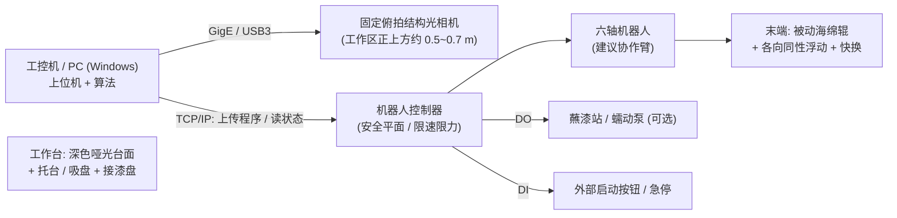
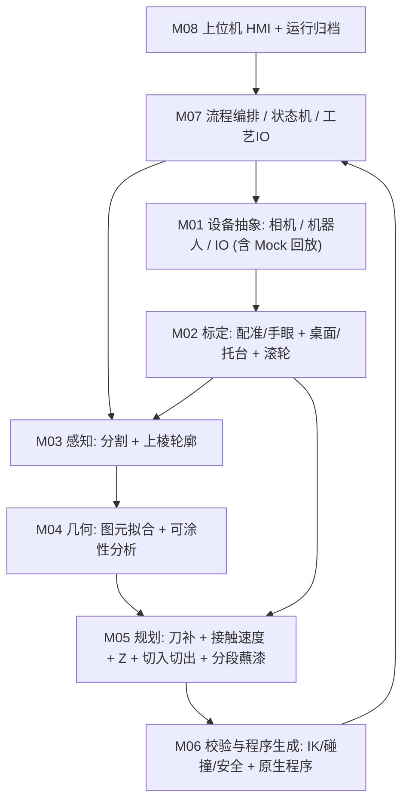
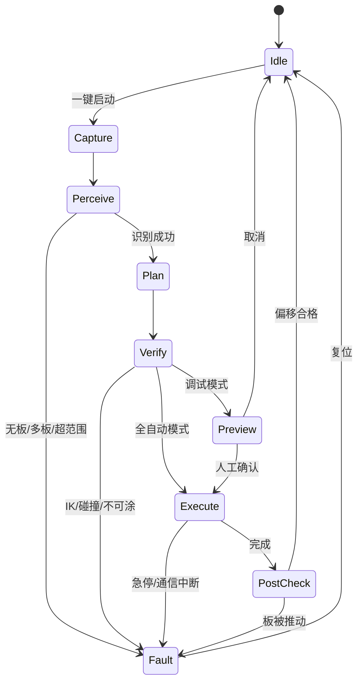
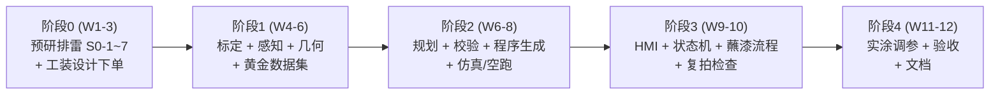

# 视觉免示教木板沿边涂抹系统 —— 独立评审与系统设计（Claude Opus）

> 版本：v1.0（2026-10-21）　作者：Claude Opus　状态：**待 Gemini 交叉复审**
> 输入：`.claude/SessionBrief.md`、`.claude/contexts/VisionEdgeSystem.md`、`Docs/Vision_Guided_Robot_Edge_System_Gemini.md`、参考视频 `C:\Users\mimovr\Videos\NVIDIA\screa.mp4`（本人用 OpenCV 抽帧后逐帧核查，证据帧放在 `Docs/assets/vision_edge/`）
> 约定：【已核】= 本人看过原始证据或查到信源；【待核】= 行业经验值或厂商宣传口径，需在阶段 0 实测或询价确认。

---

## 0. 结论先行（TL;DR）

1. **Gemini 的 6 模块骨架方向对，可以沿用**（视觉 → 轮廓 → 刀补 → 自检 → 下发 → UI）。但初版把它当成一个**纯软件/纯几何问题**来写，漏掉了真正决定成败的三类问题：**涂料怎么上到滚轮上（供漆）**、**接触力与木板被推走（顺应机构）**、**透视视差导致的“看到的边不是上棱”**。这三项每一项都能让演示直接失败。
2. **参考视频有几处被误读，会影响选型**（§1）：视频里是**打磨**（砂布轮 + 竖直电主轴），不是涂漆；演示者**在板下塞了垫块，把板故意垫斜**；三角板和带 U 槽的板是**两块不同的工件**；这个片段是从 1 分 14 秒的原视频里截出来的 16 秒，**没有拍到“高位拍照姿态”，相机装在哪也看不出来**。
3. **P0 的边界**：单块、平放（允许用托台垫高）、厚 8~30 mm、外形是凸多边形/圆/圆角矩形或**曲率半径 ≥ 2R 的平缓凹弧**的木板，拍一次照 → 自动规划 → 开环执行一圈 → 再拍一次检查板有没有被推动。**“动态实时跟踪”、斜放板、自由曲线、内孔、多板一次处理都不进 P0**（§3）。
4. **几项我和 Gemini 意见不同的关键决策**（细节见 §2.2）：
   - 滚轮建议用**被动（随动）海绵辊 + 各向同性径向浮动**，不要用电机驱动；Gemini 提的“单向弹簧铰链”在固定姿态绕一圈时只有一个方向能起作用，**原理上就不成立**。
   - 速度要按**接触点在板边上的速度**来规划，不能按 TCP 恒速：Gemini 的“直角圆弧包络”虽然 TCP 不停，但**接触点在角上原地停留约 0.7 s**，反而容易在角上积漆。
   - P0 推荐**固定俯拍（Eye-to-Hand）**，阶段 0 两种都实测后再定；不管选哪种，都必须专门处理“上棱 vs 侧面”的视差。
   - 机器人程序推荐**生成控制器原生程序（带圆弧和交融）整段上传执行**，不要从 Windows 一条一条流式发 MoveL。
   - 安全围栏要配在**机器人控制器的安全平面**里，PC 端的 Z 钳位只能算第二层保护，不能叫“硬件级”。
5. **周期**：P0 = **阶段 0 预研 3 周 + 开发联调 9 周 ≈ 12 周**，2~2.5 人，约 **125~145 人天**，含末端机构/托台/供漆工装设计；Gemini 的 8~10 周没算机械工装、供漆工艺和预研。P1 再加 5~6 周（§9）。
6. **开工前必须让用户确认 6 件事**（§12）：机器人品牌型号（如果是 FANUC 焊接机器人，在线控制要买选项）、相机有没有买、涂料种类、滚轮是不是被动的、能不能用托台或吸盘、侧面要不要涂满整个厚度。

---

## 1. 参考视频事实核查（逐帧证据）

视频信息【已核】：1920×1080，30 fps，486 帧，**16.2 s**。画面是手机/PC 录屏，播放器进度条显示 `0:02 / 1:14`，也就是从视频号（控制工程网）一段 **1 分 14 秒**的原视频里截了一段。

| # | Gemini/上下文的描述 | 我的逐帧核查 | 对方案的影响 |
| :-- | :-- | :-- | :-- |
| 1 | “将板随意摆放并旋转角度” | **不止这些**。`02.7~03.4 s` 演示者左手放板、右手拿着一个**灰色圆饼状垫块塞到板的一角下面**，字幕是“**再给它增加点难度**”；`08.1~09.5 s` 的近景能清楚看到三角板**一端搭在桌面、一端被垫块撑起，整块板倾斜约 10°**（证据：`screa_03.2s_prop_under_board.jpg`、`screa_08.4s_tilted_board_vertical_spindle.jpg`） | 标杆系统能处理**板面不平行于桌面的 6 自由度位姿**。我们 P0 先做平放，**斜放放到 P1**；但 P0 的算法要预留“板面法向 ≠ 桌面法向”的接口 |
| 2 | “主轴呈 30°~45° 倾角安装，或垂直安装” | **竖直安装**。近景里电主轴轴线竖直向下，末端是一个约 Ø20~25 mm、高约 15~20 mm 的**砂布轮/千叶轮**（棕色磨料、黄色卡套），不是海绵辊 | 视频的工艺是**打磨**（厂商口径是 3D 视觉 + 力控【待核：新时达宣传材料】）。打磨的物理过程（主动磨削、力控）和涂漆（被动滚涂、供漆、流挂）**不一样**，不能照搬 |
| 3 | “带半圆内凹槽的三角形板” | **是两块不同的工件**：倾斜的是**三角板**（无凹槽）；`10.1~12.8 s` 走 U 型凹槽的是另一块**带半圆缺口的红色板**。凹槽半径目测大约是磨头半径的 3~4 倍 | 凹弧场景（ρ ≫ R）是可以做的，可以列入 P1；ρ < R 的窄槽视频里并没有演示 |
| 4 | “00:05~00:07 机械臂停在 50~60 cm 高处俯拍” | **片段中看不到**。`04.0~05.4 s` 是演示者讲解，`06.1~07.4 s` 是末端执行器近景，没有出现高位拍照动作 | 这一条属于推测，不能当作设计依据 |
| 5 | “Eye-in-Hand：末端法兰同时装 3D 相机和磨头” | **无法确认**。末端能看到：带风扇的大黑色模块（更像电主轴驱动/散热）、带两颗绿色指示灯的小黑盒、一根斜向下的银色圆柱形器件（可能是相机/激光传感器，也可能只是航插电缆）、多根蓝色气管（可能是气动柔顺/力控装置）（证据：`screa_06.4s_end_effector.jpg`） | **相机构型应该按我们自己的需求选，而不是“抄视频”**（§4.2） |
| 6 | “小圆柱贴着外轮廓匀速走完一圈” | 片段中只看到**一段直边（倾斜板一角附近）**和**一段 U 型凹弧**，没有完整的一圈 | 没有影响，只是说明证据不足 |
| 7 | “屏幕显示左侧点云与闭合轮廓，右侧参数栏” | `13.5 s` 背景显示器上是 3D 视图（灰色包围盒 + 绿色路径线）和右侧的日志/列表栏，大体相符 | UI 的形态可以参考 |
| 8 | 板材“红白双层、厚 15~20 mm” | 红色面层 + 白色芯层，从外观看更像 **PVC 发泡板/亚克力复合板**，不是木板；厚度目测约 10~15 mm | 木板的纹理、毛刺、倒角、端面吸漆问题，视频**完全没有涉及**，需要我们自己处理 |

> [!IMPORTANT]
> 结论：视频证明了“免示教 + 视觉 + 沿边接触工艺”这条路**商业上可行**，但它演示的是**打磨 + 力控**，硬件也比我们设想的重（电主轴 + 疑似力控/气动柔顺）。我们的涂漆需求在**力**这一侧可以简化（被动顺应就够），但要**多出一块供漆工艺**。

---

## 2. 对 Gemini 初版方案的评审

### 2.1 认同、直接沿用的部分

- 6 模块的拆分和数据流向；“一键拍照 → 自动规划 → 预览确认 / 全自动”两种模式。
- **3D 定平面 + 2D 亚像素边缘 + 射线与平面求交**的融合思路（但要补上视差处理，见 §2.3-3）。
- 外法向刀补 $d = R - \delta$、凸角圆弧包络、最长直边中点起涂、切线切入 / 重叠 / 切出。
- **固定姿态平动**：轴对称滚轮不需要 A6 跟随切向转动，这是这个系统最重要的简化之一。
- 托台垫高木板（Gemini 避坑指南第 2 条），我把它从“建议”升级成 **P0 必选工装**。
- Python 技术栈（拍一次照只算一次，性能不是瓶颈）。

### 2.2 需要纠正或改进的部分

| # | Gemini 原文 | 问题 | 修正 |
| :-- | :-- | :-- | :-- |
| C1 | 拐角圆弧包络能“防止急停、油漆堆积” | 在半径为 $d$ 的凸角圆弧上，TCP 是匀速的，但**接触点始终停在角点上**。$d=8.5$ mm、转 90° 时，圆弧长 13.4 mm，按 20 mm/s 走需要 **0.67 s**，等于滚轮压在角上原地滚动 0.67 s，**恰恰是最容易积漆、海绵被角割伤的位置** | 改成**按接触点速度规划**（§6.3）：凸角圆弧段的 TCP 速度乘一个系数 $k_c$（2~3 倍，受加速度限制），同时压紧量减到 $\delta_c$（≈ 0.5 δ）；凹弧段按 $v_{tcp} = v_e(\rho-d)/\rho$ 降速，避免漆膜变薄 |
| C2 | 在支架上加“轻载径向弹簧浮动铰链” | 固定姿态绕一圈时，接触法向在水平面内**旋转 360°**。单轴铰链只有一个方向能浮动，另外三条边上它是刚性的 | 必须是**各向同性的径向顺应**：① 海绵本身（最简单）；② “摆杆式”浮动：轴顶部用弹性体/球铰回中，下端可以向任意水平方向偏摆 ±3 mm；③ 如果坚持用单轴浮动，A6 就必须跟随切向转动（又会引出 A6 缠线、±360° 限位问题）。**P0 推荐 ① + ②** |
| C3 | “小圆柱自转电机”“顺涂线速度略高于移动速度” | 涂漆用电机主动转：① 一有滑差，切向摩擦力就会给木板一个**转矩**，比法向力更容易把板拧走；② 离心甩漆；③ 在凸角处摩擦海绵。20 mm/s、R=10 mm 时，纯滚动只需要 **≈ 19 rpm**，普通电机不可能刚好匹配 | **P0 用被动随动辊**（就像墙面滚筒），不需要电机，也不需要转速 IO。用户说的“可以转的小圆柱”被动辊就能满足；如果用户坚持要电机，就用低速减速电机 + 速度跟随 $\omega = v_e/R$，并把它列为风险项 |
| C4 | “供漆泵 DO”一笔带过 | **供漆是工艺的核心，不是一个 DO**。粗算：20×20×1.8 cm 的板侧面积 ≈ 144 cm²，湿膜按 50~100 μm 算需要 **0.7~1.4 mL** 涂料；一个 Ø20×25 mm 的海绵辊能有效释放的漆量大约在同一个数量级【待核，阶段 0 实测】。也就是说**一圈下来可能前浓后淡，甚至后半圈干涂** | 阶段 0 必须做“单次蘸漆能涂多长”的实测，再从三个方案里选一个（§5 M07）：A 蘸漆站 + 按长度分段（分段处做羽化搭接）；B 蠕动泵低流量连续滴到辊上；C 储液芯吸式（马克笔原理）。**P0 默认选 A**，因为最可控 |
| C5 | 2D 边缘与上表面平面求交得到 ≤0.3 mm 的 3D 轮廓 | 前提是**检测到的 2D 边缘确实是上棱**。透视成像下，偏离光轴一侧的板**侧面也会被拍到**，宽度约 $H\cdot r/Z_c$（例：H=18、r=175、Z=600 → **5.3 mm**）。Canny 很可能把“侧面和背景的分界”（也就是下棱的投影）当成边缘，再和上表面求交，误差就是好几毫米 | §6.1：用**上表面平面内点的边界**确定上棱粗位置（±1 mm），再只在“上表面和侧面”之间的灰度过渡带里找亚像素边缘；侧面那条带反过来还能用来估计板厚 |
| C6 | 用上表面到桌面的距离自动得到板厚 H | 用托台垫高后，这个距离 = 板厚 + 托台高度。板斜放时这个公式也不成立 | P0：托台高度作为标定常量扣除，再用侧面带的 3D 点交叉验证，UI 允许手动覆盖板厚 |
| C7 | Z 钳位 = “硬件级虚拟电子围栏” | PC 软件里的钳位不是硬件级的。软件出 bug、通信异常、操作员手动点动时都会失效 | **第一层**：机器人控制器的安全配置（安全平面 / 工具位置限制 / 协作限速限力）；**第二层**：PC 端规划阶段的钳位和校验 |
| C8 | 通过 SDK 下发 MoveL + MoveC + Blending | 从 Windows 一条条发运动指令时，控制器缺少前瞻，**指令之间会出现停顿**（停 0.5 s 就会出现流挂，Gemini 自己也提到了）；圆弧指令的**姿态插值规则**也因品牌而异（例如 URScript `movec` 的 mode=1 会让姿态**跟着圆弧切向转**，恰好和我们的需求相反【待核：以目标品牌手册为准】） | **整段生成控制器原生程序（直线 + 圆弧 + 交融半径）后上传执行**；用实时数据口记录 TCP 速度并验收（§11）。只有控制器不支持脚本时，才考虑伺服点流 |
| C9 | 手眼标定只用 AX=XB | Eye-to-Hand 下工作区接近一个平面，**用 TCP 触点法 + 3D 刚体配准（SVD）** 在工作区内采 9~12 个点，局部精度往往比 AX=XB 更好，也更容易验证 | P0：触点配准作为主方案，AX=XB 作为交叉校验（两种结果差值本身就是一个健康指标） |
| C10 | 相机推荐里包含 Femto Bolt、Gemini 335L | Femto Bolt 是 **ToF**，在物体边缘有明显的飞点/多径效应，正好落在我们最在意的边缘上；Gemini 335L 定位是移动机器人的中远距离双目，亚毫米边缘精度不是它的设计目标 | 这两款不建议用于 P0 的精度验证；候选清单见 §7 |
| C11 | 图漾 FM851 “0.1~0.2 mm 精度” | 这个数值没有找到出处，更像是高端蓝光结构光的水平【待核】 | 所有相机精度都以**阶段 0 在我们自己的木板上实测**为准，不采信规格书 |
| C12 | 周期 8~10 周 | 没有算：末端机构设计和加工（浮动辊、相机支架、托台、蘸漆站、接漆盘）、涂料工艺调试、阶段 0 预研、相机采购周期 | 12 周 / 125~145 人天（§9） |

### 2.3 Gemini 漏掉的物理与工程暗坑（按严重度排序）

**暗坑 1：误差预算 vs 接触顺应（决定能不能涂上）**

| 误差源 | 1σ 估计（mm）【待核：经验值】 | 说明 |
| :-- | :-- | :-- |
| 相机上表面平面 / Z | 0.1~0.3 | 结构光在 0.5 m 距离 |
| 边缘 XY（2D+3D 融合后） | 0.2~0.4 | 受棱边倒圆、木纹、光照影响 |
| 手眼 / 配准 | 0.2~0.4 | 工作区局部 |
| 机器人在工作区内的定位 | 0.1~0.5 | 协作臂重复精度约 ±0.03 mm，但**绝对精度**没有标定时可能差很多 |
| 滚轮 TCP 与半径 | 0.2~0.5 | **海绵吸漆后会膨胀**，半径会变 |
| 木板边缘本身 | 0.2~0.5 | 锯偏、毛刺、倒角、边缘不垂直 |
| **合成（RSS）** | **≈ 0.8（1σ），±1.5（2σ）** | |

→ 顺应行程至少要覆盖 **±2 mm**：名义压紧量 $\delta_0 \approx 2.5$ mm，允许范围 1~4 mm。Gemini 写的 1.0~1.5 mm 压紧量在 2σ 情况下会出现**悬空漏涂**。

**暗坑 2：木板被推走或拧走（决定会不会翻车）**

- 20×20×1.8 cm 胶合板约 0.43 kg（按密度 0.6 g/cm³ 算），重力 ≈ 4.2 N。放在光滑台面上 μ≈0.3 时，静摩擦 ≈ **1.3 N**；放在硅胶防滑垫上 μ≈0.6~0.8 时 ≈ **2.5~3.4 N**【待核：实测】。
- 所以要求：**最大法向接触力 ≤ 静摩擦的 1/3**，也就是 P0 目标 ≤ 0.8 N（压紧 4 mm 时）→ 海绵/浮动机构的等效刚度 **≤ 0.2 N/mm**。
- 被动辊的切向力很小；电机驱动辊会产生切向摩擦力 → 形成转矩（这也是 C3 的理由）。
- **最稳的方案是中心真空吸盘托台**：Ø40 mm 吸盘在 −50 kPa 下的保持力 ≈ 63 N，直接把风险消掉。代价是板必须盖住吸盘（摆放的随机度变成“任意角度 + 中心偏移 ±(板尺寸/2 − R − 余量)”）。这**不违背“免编程、免调试”**，只是改变了“随手放”的定义 → 需要用户确认（§12 Q5）。
- **闭环兜底**：涂完再拍一次，比较前后轮廓位姿，偏移 > 0.5 mm 或 > 0.3° 就报警（P0 必做，几乎不增加成本）。

**暗坑 3：透视视差，“上棱 vs 侧面”**（见 C5）。这是 Gemini 声称 ≤0.3 mm 精度时没有考虑的头号误差源。Eye-in-Hand 移到板正上方**也消除不了**：工作距离更近，视角更大，侧面带反而更宽（r/Z 更大）。远心镜头在 200 mm 以上视场下不现实，只能靠算法处理。

**暗坑 4：侧面全高度覆盖 vs 碰桌 / 漆沾到上表面**

- 板直接平放在桌上时，滚轮下端必须离桌面 ≥ 2 mm，所以**侧面最下面 2 mm 一定涂不到**，漆还会蹭到桌面。→ 托台垫高 ≥ 15 mm，托台外缘缩进板边 ≥ R + 5 mm。
- 海绵被压缩后会在上棱处**鼓出包边**，把漆带到上表面边缘约 1 mm 的范围。可以选择：辊顶低于上表面 0.5~1 mm（上沿留一点不涂），或者接受包边（像“封边”的效果）→ 用户确认（§12 Q6）。

**暗坑 5：木材本身**

- 木纹平行于板边时，会产生**假边缘**；端面（横纹）和顺纹边**吸漆量不同**，一遍涂下来颜色深浅不一 → P1 支持“两遍涂”。
- 胶合板侧面露出层状结构；边缘可能有崩边或毛刺 → 拟合时用鲁棒估计（RANSAC/Huber），不能把崩口当成真实轮廓去“跟随”。
- 木板和台面颜色接近时分割困难 → P0 规定**深色哑光背景**（托台和台面都用深灰/黑色哑光材料）。

**暗坑 6：涂料带来的现场问题**

- 滚轮在 Home 位悬空等待时会滴漆 → 需要接漆盘或待机位放在蘸漆站上方。
- Eye-in-Hand 的相机离滚轮只有几厘米，**镜头会被溅到漆** → 需要保护窗片；这也是 P0 倾向 Eye-to-Hand 的理由之一。
- 涂完的湿漆反光会改变边缘外观 → 复拍检查只比较**位姿**，不重新提取漆面细节。
- 滚轮会脏、会干结 → 提供“换辊/清洗”流程，并重新标定半径（UI 一键完成，§5 M02）。

**暗坑 7：凹角和窄槽的物理不可达**

- 90° 尖凹角：滚轮最多碰到距角点 $d$ 处，所以**每侧约有 $d$ 长的段落涂不到**；ρ < d 的窄槽进不去。系统必须**把不可达段在预览里标红并在报告中列出**，而不是假装全部涂到了。

**暗坑 8：机器人品牌导致的在线控制门槛**

- 用户原话是“机器人的**焊接尖端**”。如果现场是 FANUC 焊接机器人，在线运动控制通常需要额外的软件选项（例如 PC Interface、User Socket Messaging、Stream Motion 等【待核：以 FANUC 选项清单为准】）。成本最低的路线是：生成 `.LS` → 转成 TP（需要 ASCII Upload 类选项）→ FTP 传送 → 远程启动。**第一阶段 OLP 方案里的 `.ls` 后置可以复用**。
- 如果是协作臂（UR / 遨博 / 节卡 / 越疆 / 法奥 / 新时达），基本都开放 TCP/IP 脚本或 SDK，难度低很多。**这是决定 M06 工作量的第一变量。**

**暗坑 9：“动态”这个词的歧义**

- 用户原话里的“动态操作”，在 P0 里应该定义为“**每次放板都现拍、现算，不需要预先示教**”，而不是“执行过程中实时跟踪边缘”。实时闭环跟踪需要激光线扫传感器或力控，属于 P2。必须和用户对齐（§12 Q4）。

---

## 3. MVP 范围切分

### 3.1 P0（MVP，第 1~12 周）

| 维度 | P0 范围 |
| :-- | :-- |
| 工件 | 单块；木板/胶合板/中密度板；厚 8~30 mm；外接尺寸 100~300 mm；边缘大致垂直于板面 |
| 外形 | 凸多边形（含正方形、矩形、六边形）、圆、圆角矩形、**曲率半径 ≥ 2R 的平缓凹弧**；不含内孔 |
| 摆放 | 平放在**托台**上（托台高 ≥ 15 mm，深色哑光）；位置随机（托台约束范围内）、角度 0~360° 随机 |
| 环境 | 深色哑光背景；工作区遮光罩或固定补光；工作区域标线 |
| 相机 | 1 台固定俯拍结构光相机（阶段 0 后定型） |
| 机器人 | 1 个品牌（用户确认），固定姿态平动，控制器原生程序执行 |
| 末端 | 被动海绵辊 + 各向同性径向浮动，快换 |
| 供漆 | 蘸漆站 + 按长度分段（分段处做羽化搭接）——阶段 0 实测后确认 |
| 流程 | 一键：拍照 → 分割 → 轮廓 → 规划 → 自检 → 预览（可选择确认）→ 执行 → 复拍检查偏移 → 回 Home |
| 安全 | 控制器安全平面 + 协作限速限力 + 急停；PC 端二级钳位和全路径校验 |
| 数据 | 每次运行自动归档（图像 / 点云 / 轮廓 / 路径 / 机器人日志 / 结果），支持离线回放 |

### 3.2 P1（第 13~18 周）

- 斜放板（和视频一致）：工具轴 ∥ 板法向的固定姿态；垫块识别与剔除。
- 自由曲线外形（B 样条）、视频那种 U 型凹槽、尖凹角的不可达段优化。
- 一次放多块板，依次涂。
- 两遍涂 / 端面补涂策略；连续供漆（蠕动泵）。
- 接触状态检测：在浮动机构上加位移传感器（霍尔/电感），实时记录压紧量，超限暂停。
- 涂后 2D 覆盖率检测（侧面颜色变化率，需要侧向辅助相机，可选）。
- 去掉托台：直接放在防滑垫上（接受底部 2 mm 不涂）。

### 3.3 P2（以后再说）

- 执行中实时闭环边缘跟踪（激光线扫或力控）、传送带跟踪。
- 三维曲面板、带内孔的板（内轮廓）。
- 工艺扩展：打磨 / 去毛刺 / 涂胶（换末端 + 力控），也就是视频里新时达的形态。
- 杂乱场景的 AI 分割、多机器人。

### 3.4 明确不做

CAD 导入、离线编程编辑器、3D PDF、后置多品牌程序库（P0 只支持一个品牌）。

---

## 4. 系统架构

### 4.1 硬件拓扑（P0 推荐）

### 4.2 相机构型决策：P0 推荐 Eye-to-Hand（固定俯拍）

| 维度 | Eye-to-Hand（固定俯拍） | Eye-in-Hand（末端随动） |
| :-- | :-- | :-- |
| 视场 / 分辨率 | 300×300 mm 工作区足够；分辨率固定 | 可以先粗拍再近拍，分辨率更高 |
| 视差（上棱 vs 侧面） | 有，必须算法处理 | **同样有，而且离得近、视角大，可能更宽** |
| 标定 | 一次标定，长期稳定；可以用触点配准 | 拍照位的机器人位姿误差会直接进入结果 |
| 复拍检查偏移 | 机器人退开后随时可以拍 | 要额外移动到拍照位 |
| 被涂料污染 | 离得远，风险低 | 镜头离辊几厘米，**风险高** |
| 负载 / 线缆 | 不占末端负载 | 占负载，线缆随动 |
| 适合 | **P0：工作区固定、工件小** | 工作区大、需要多视角（P1/P2） |

> [!NOTE]
> 阶段 0 会两种都实测（Eye-in-Hand 可以临时把相机夹在法兰上做对比），用“边缘精度 + 标定稳定性”的数据来最终定型，不靠拍脑袋。

### 4.3 软件分层

### 4.4 运行状态机

---

## 5. 模块清单与功能点（P0 标注）

> 和 Gemini 的 M01~M06 对应关系：Gemini M01 → 本文 M02；M02+M03 → M03+M04；M04 → M05；M05 → M06+M07；M06 → M08。新增 **M01 设备抽象 / Mock** 和**非软件交付物 HW**。

### M01 设备抽象与 Mock 回放（P0）
- `ICamera`：`capture() -> (gray/rgb, xyz_map, intrinsics, timestamp)`；`IRobot`：`get_pose()`、`upload_and_run(program)`、`stream_state()`、`set_do()`；`IIO`。
- **Mock 实现**：从归档数据集回放相机帧；机器人用厂商仿真器（例如 URSim 一类）或纯运动学 Mock。**没有硬件也能开发和回归**，这是 12 周工期能成立的前提。

### M02 标定（P0）
| 功能 | 说明 |
| :-- | :-- |
| 2.1 相机—机器人配准 | Eye-to-Hand：用刚性尖针 TCP 去点标定板上 9~12 个角点 → SVD 求刚体变换；用 AX=XB（OpenCV `calibrateHandEye` / `calibrateRobotWorldHandEye`）交叉校验；输出残差报告 |
| 2.2 桌面与托台 | 拟合空台面平面；托台高度作为常量；生成控制器安全平面的建议参数 |
| 2.3 滚轮标定 | 先用同一接口装上**刚性标定针**确定轴线与 TCP；再用相机拍辊（或用对刀块接触）测**湿态有效半径**；换辊或清洗后一键重新测 |
| 2.4 验证向导 | 9 点验证：视觉给点 → 尖针走过去 → 用塞尺/相机测偏差，判定通过/不通过 |

### M03 感知（P0）
| 功能 | 说明 |
| :-- | :-- |
| 3.1 ROI + 去噪 | 只保留工作区盒子内的点；统计滤波 |
| 3.2 分割 | 已知桌面/托台平面 → 高度阈值得到候选点 → 聚类 → 去掉托台（已知形状和位置）→ 唯一大簇就是板；0 个或多个时报错 |
| 3.3 上表面平面 | RANSAC 拟合，得到 $\vec n_{top}$、$Z_{top}$；检查与桌面的夹角 > 2° 时提示“板未放平”（P0 拒绝执行，P1 支持） |
| 3.4 **上棱轮廓（视差感知）** | §6.1 |
| 3.5 板厚 | $H = Z_{top} - Z_{riser}$；用侧面带的 3D 点交叉验证，偏差 > 1 mm 时警告；UI 可以覆盖 |

### M04 几何（P0）
| 功能 | 说明 |
| :-- | :-- |
| 4.1 有序化 | 统一为相对 $\vec n_{top}$ 的逆时针方向，所以外法向 $\vec N = \vec T \times \vec n$ |
| 4.2 图元拟合 | 分段（曲率/角点检测）→ 直线和圆弧鲁棒拟合 → 相邻图元求交得到精确角点；残差 > 阈值的段落用平滑样条兜底（P0 只支持线/弧） |
| 4.3 规则形状吸附（可选） | 识别到“近似正方形/矩形/圆”时给出尺寸报告（如 `199.8 × 200.2 mm`），**不强制吸附**，避免把真实的偏差抹掉 |
| 4.4 可涂性分析 | 凹段的 ρ 和 d 比较；尖凹角不可达段长度；UI 标红并写入报告 |

### M05 轨迹规划（P0）
| 功能 | 说明 |
| :-- | :-- |
| 5.1 解析刀补 | 直线平移 d；圆弧半径 ±d；凸角插入以角点为圆心、半径 d 的圆弧；凹角裁剪求交。用 Shapely `buffer(join_style=round)` 做**几何交叉校验**（不直接用它的折线输出） |
| 5.2 接触速度剖面 | §6.3（$v_e$ 恒定、凸角加速、凹弧降速、加速度限制） |
| 5.3 Z 高度 | 辊有效段覆盖 $[Z_{top}-H-m_b,\ Z_{top}-m_t]$；$m_t$ 由“包边策略”决定；底端钳位到 ≥ 托台面 + 2 mm |
| 5.4 起点、切入、切出、羽化 | 最长直边中点起涂；外侧 30 mm 处下降 → 切线圆弧切入（δ 从 0 线性增加到 δ₀）；收尾重叠 10 mm 内 δ 线性减到 0（**羽化，避免接缝处出现厚带**）→ 切线切出 → 抬升 |
| 5.5 分段蘸漆 | 按阶段 0 测得的有效涂覆长度 $L_{load}$ 把轮廓分段；分段点尽量放在直线中部；每段起止都做羽化搭接 |
| 5.6 空跑模式 | 整条轨迹抬高 +30 mm，或用刚性假辊留 2 mm 间隙走一遍 |

### M06 校验与程序生成（P0）
- 全路径 IK（使用控制器自带的 IK 接口或厂商运动学模型）：可达性、关节限位、手系一致、关节速度突变；**工作区可达性热图**在部署时预计算，UI 上画出“可放板区域”。
- 碰撞：辊/支架和桌面、托台、板上表面（固定姿态时支架必须始终高于板上表面）。
- 生成控制器原生程序：直线 + 圆弧（**统一固定姿态**）+ 交融半径；附带 DO（蘸漆站）和等待逻辑。
- 程序和规划结果一起归档，可以复现。

### M07 流程编排与工艺 IO（P0）
- 状态机（§4.4）；超时、急停、通信中断处理。
- 蘸漆子流程：移动到蘸漆位 → 下压浸入 → 停留 t → 抬起 → 在刮漆边上刮掉多余涂料 → 回到分段起点。
- 复拍检查：执行完毕后拍照 → 和执行前轮廓做 ICP/位姿比较 → 判定是否被推动。

### M08 HMI 与运行归档（P0）
- 左边 2D 图像（叠加上棱轮廓、不可达段标红），右边 3D（点云 + 轮廓绿线 + 辊心轨迹蓝线 + 分段点 + 可放板区域）。
- 配方参数：辊直径/长度、名义压紧量、接触速度 $v_e$、凸角系数 $k_c$、重叠/羽化长度、$m_t / m_b$、$L_{load}$、蘸漆停留时间。
- 两种模式（调试确认 / 一键全自动）；**每次运行一个文件夹**，可以离线重放整条感知和规划流程。

### HW 非软件交付物（P0，Gemini 遗漏）
| 项目 | 说明 |
| :-- | :-- |
| 末端执行器 | 法兰转接 + 被动辊轴（轴承）+ 各向同性浮动（弹性回中，±3 mm）+ 快换；可选位移传感器接口（P1 用） |
| 托台 | 深色哑光圆台 / 三点支撑柱，高 ≥ 15 mm；可选中心真空吸盘版本 |
| 蘸漆站 | 漆杯 + 刮漆边 + 接漆盘；固定在工作区边缘的已知位置 |
| 背景和照明 | 深色哑光台面，遮光罩或条形漫射补光 |
| 标定附件 | 刚性尖针 TCP、ChArUco 板、对刀块、标准测试板（200 方板、圆板、凹弧板，CNC 加工并带测量报告） |

---

## 6. 关键算法说明

### 6.1 视差感知的上棱亚像素提取

1. 上表面 RANSAC 内点 → 投影到像素平面 → 得到**上表面掩膜** $M_{top}$（边界就是上棱，精度约 ±1 mm）。
2. 沿 $M_{top}$ 的边界法向，在 2D 灰度图上取 ±W 像素的剖面（W 覆盖粗定位误差，约 8~15 px）。
3. 在剖面上找**从上表面亮度到下一个区域的第一个强梯度**（上表面 → 侧面，或上表面 → 背景）。“第一个”是指从板内往外数的第一个，这样就排除了侧面和背景之间的那条外缘。用三点抛物线或 Steger 方法做亚像素定位。
4. 亚像素点 → 反投影射线 → 和上表面平面求交 → 得到 3D 上棱点。
5. 照明设计：从上方漫射打光，上表面（法向朝上）亮、侧面（法向水平）暗，让第 3 步的“第一个梯度”更明显。这正是 P0 要规定照明的原因。
6. 副产品：侧面带的宽度 ≈ $H\cdot r/Z_c$，可以反推 H，用于和 3.5 交叉验证。

### 6.2 刀补几何

- 逆时针方向，外法向 $\vec N=\vec T\times\vec n_{top}$；直线 $P \mapsto P + d\vec N$；圆弧（凸）$\rho\mapsto\rho+d$，（凹）$\rho\mapsto\rho-d$，要求 $\rho-d \ge \rho_{min}$（机器人圆弧最小半径，以及保留余量）。
- 凸角：插入以角点为圆心、半径 d、圆心角为 $\pi-\theta_{int}$ 的圆弧。
- 凹角：相邻偏置线求交并裁剪；不可达长度 $\approx d/\tan(\theta_{int}/2)$（90° 时等于 $d$）→ 报告。
- $d = R_{wet} - \delta(s)$，其中 δ 沿弧长 s 可变（切入/羽化/凸角减压）。

### 6.3 接触点速度规划（本文核心修正之一）

设目标是接触点在板边上匀速移动 $v_e$（漆膜均匀的前提）：

$$
v_{tcp}(s)=\begin{cases}
v_e & \text{直线}\\[2pt]
v_e\,\dfrac{\rho+d}{\rho} & \text{凸弧}\\[6pt]
v_e\,\dfrac{\rho-d}{\rho} & \text{凹弧}\\[6pt]
k_c\, v_e,\ \ \delta\to\delta_c & \text{尖凸角圆弧（}\rho=0\text{，接触点不动）}
\end{cases}
$$

- 尖凸角的停留时间 $t_c = d\,(\pi-\theta_{int})/(k_c v_e)$；$k_c=2.5$、$d=8.5$、90°、$v_e=20$ 时 $t_c\approx0.27$ s（原来是 0.67 s）。
- 速度突变的地方受控制器加速度限制，交融半径要按 $v^2/a$ 校核；阶段 0 实测控制器在圆弧上的实际速度跟随能力。
- 如果控制器只支持“段内恒速”，就把每个图元作为一条指令，各自给定速度。

### 6.4 复拍偏移检测

执行前后两次的上棱点集做 2D ICP（板面内 3 自由度）→ 平移量 Δ 和转角 Δθ；阈值 0.5 mm / 0.3°。这个检测同时还能**验证系统的重复性**（不涂、只空跑时 Δ 应该约等于 0）。

---

## 7. 技术与硬件选型

### 7.1 相机（阶段 0 至少实测 2 款）

| 档位 | 候选 | 理由 | 注意 |
| :-- | :-- | :-- | :-- |
| 工业结构光（P0 主选） | 梅卡曼德 Mech-Eye Nano / Nano Ultra 等近距型号；同级别的海康、图漾近距结构光型号 | 近距（约 0.3~0.6 m）视场能覆盖 300 mm 级工作区，同时输出对齐的 2D 图，抗环境光 | 价格、精度、视场以**询价和规格书为准【待核】**；采购周期可能 2~4 周，要放在阶段 0 第 1 天下单 |
| 研发验证（低成本对照） | Intel RealSense D405 | 近距设计（官方标称理想距离约 7~50 cm【待核】），便宜，SDK 成熟 | 没有主动投射器【待核】，依赖表面纹理，木纹有利、纯色板不利；精度要实测 |
| 2D 增强（可选） | 500 万像素工业面阵相机 + 定焦镜头，和 3D 相机共同标定 | 300 mm 视场下约 0.12 mm/px，提升上棱亚像素精度 | 多一次标定和一套同步 |
| 不推荐用于 P0 | Femto Bolt（ToF）、Gemini 335L | 边缘飞点 / 中远距离定位 | 见 C10 |

### 7.2 机器人
- **推荐协作臂**（人要频繁放板），选开放脚本/SDK 且有安全平面配置的型号。如果用户已经有机器人，**一律按现有机器人做**，M06 只适配这一家。
- 如果是 FANUC 等工业机器人：P0 走“生成程序 + 传送 + 远程启动”路线，并且要加安全光幕或安全扫描仪；工作量另外评估（+10~15 人天）。

### 7.3 软件栈
| 层 | 选择 | 说明 |
| :-- | :-- | :-- |
| 语言 | Python 3.11 | 节拍不是瓶颈；关键几何用 NumPy 向量化 |
| 视觉 | OpenCV（标定、亚像素、图像处理）+ **Open3D**（RANSAC、聚类、ICP） | **只用 Open3D，不同时引入 PCL**，减少 Windows 下的构建负担 |
| 几何 | 自研解析刀补 + Shapely（交叉校验）+ SciPy（拟合、样条） | Clipper2 的 Python 绑定成熟度参差，不作为依赖【待核】 |
| UI | PySide6 + PyVista（pyvistaqt）嵌入 3D 视图 | 和 Qt 集成成熟 |
| 机器人 | 厂商 SDK / 脚本接口 + 实时状态口 | 适配层隔离 |
| 数据 | 每次运行一个目录：PNG/NPY/PLY/JSON | 回归测试直接回放 |
| 测试 | pytest + 黄金数据集（≥ 30 组真实采集） | 每次改动算法都跑轮廓精度回归 |

---

## 8. 阶段 0：预研排雷（第 1~3 周，带 Go/No-Go 判据）

| 编号 | 预研项 | 方法 | 通过判据 | 不通过时的退路 |
| :-- | :-- | :-- | :-- | :-- |
| S0-1 | 硬件打通 | 相机取图、机器人上传程序运行、读取实时状态、DO | 全链路可以跑通 | 换 SDK 路线 |
| S0-2 | **边缘精度** | 用 CNC 加工的 200 方板（有测量报告）在 9 个位置 × 4 个角度采集；对比“只用 3D 边界”和“§6.1 融合方法” | 融合方法：上棱 RMS ≤ 0.3 mm、最大 ≤ 0.6 mm；边长误差 ≤ 0.5 mm | 加 2D 工业相机；或缩小工作区/降低相机高度 |
| S0-3 | 标定 | 触点配准 vs AX=XB；9 点验证 | 平均 ≤ 0.5 mm，最大 ≤ 0.8 mm；两种方法差值 ≤ 0.5 mm | 加做机器人局部精度补偿；缩小工作区 |
| S0-4 | **接触与推板** | 测台面/托台上板的推动力；测海绵/浮动机构的力—压缩曲线 | 压缩 4 mm 时法向力 ≤ 1/3 推动力 | 改用真空吸盘托台（直接消除风险） |
| S0-5 | **供漆** | 机器人手写一段直线程序，测“蘸一次能均匀涂多长”$L_{load}$，以及漆膜的均匀度 | 确定 $L_{load}$ 和蘸漆参数；方板每边至少能一次蘸漆涂完 | 改用蠕动泵连续供漆（+5~8 人天） |
| S0-6 | 速度恒定 | 生成“直线 + 圆弧 + 尖角包络”的原生程序，记录 TCP 速度 | 直线和圆弧段速度波动 ≤ ±10%，段间无停顿 | 降低速度 / 加大交融半径 / 改用伺服点流 |
| S0-7 | 构型定型 | Eye-to-Hand vs Eye-in-Hand 临时对比（S0-2 的数据） | 选精度和稳定性更好的一种 | — |

> [!WARNING]
> S0-2、S0-4、S0-5 是三条**红线**：任何一条在第 3 周末没有通过，都必须先和用户重新确认范围（例如允许夹具、降低精度要求或缩小板型），再进入开发。

---

## 9. 开发周期与人力

### 9.1 团队
- 视觉/算法工程师 ×1（M03/M04/M05，标定算法）
- 机器人/系统工程师 ×1（M01/M02/M06/M07、现场联调）
- 机械/工艺 ×0.3~0.5（末端、托台、蘸漆站、涂料调试）
- UI/测试 ×0.3~0.5（M08、数据集、回归）

### 9.2 计划

| 阶段 | 周 | 主要交付 | 人天（估） |
| :-- | :-- | :-- | :-- |
| 0 预研排雷 | W1~3 | S0-1~7 报告、相机定型、工装第一版 | 28~32 |
| 1 标定 + 感知 + 几何 | W4~6 | M01/M02/M03/M04，数据集 ≥ 30 组，轮廓精度回归 | 30~34 |
| 2 规划 + 校验 + 程序生成 | W6~8 | M05/M06，空跑通过，可放板区域热图 | 24~28 |
| 3 集成 | W9~10 | M07/M08，一键全流程，运行归档 | 20~24 |
| 4 实涂调参 + 验收 | W11~12 | 工艺参数配方、验收报告、操作手册 | 18~22 |
| 工装（贯穿） | W1~10 | 末端、托台、蘸漆站、标准测试板（不含外购件费用） | 5~7 |
| **合计 P0** | **12 周** | | **125~145** |
| P1 | +5~6 周 | §3.2 | +50~65 |

> [!NOTE]
> 如果现场是需要额外选项的工业机器人（暗坑 8），P0 加 10~15 人天；如果用户要求去掉托台、直接放桌面，P0 加 5 人天（更难的分割 + 底边策略）。硬件采购费用（相机、机器人、工装加工件）另外计算。

---

## 10. 风险清单

| # | 风险 | 概率 | 影响 | 应对 |
| :-- | :-- | :-- | :-- | :-- |
| R1 | 边缘精度达不到 ±0.3 mm | 中 | 高 | §6.1 + 2D 增强相机 + 加大顺应行程 |
| R2 | 板被推动或拧动 | 中 | 高 | 被动辊 + 低刚度浮动 + 复拍检测；退路是吸盘 |
| R3 | 漆量不足、前浓后淡 | **高** | 高 | 分段蘸漆 + 羽化；退路是蠕动泵 |
| R4 | 角上积漆、接缝出现厚带 | 中 | 中 | §6.3 凸角加速减压 + 羽化重叠 |
| R5 | 控制器段间停顿 | 中 | 中 | 原生程序 + 交融，S0-6 验证 |
| R6 | 机器人品牌接口受限 | 未知 | 高 | §12 Q1 尽早确认 |
| R7 | 木纹/颜色导致分割失败 | 中 | 中 | 深色哑光背景 + 照明规范 + 鲁棒拟合 |
| R8 | 海绵吸漆膨胀导致半径漂移 | 中 | 中 | 湿态半径标定 + 顺应余量 |
| R9 | 镜头/工作区被涂料污染 | 低（E2H） | 中 | 保护窗、接漆盘、定期清洁流程 |
| R10 | 用户把“动态”理解为实时跟踪 | 中 | 高 | §12 Q4 对齐，列为 P2 |

---

## 11. P0 量化验收标准

| 类别 | 指标 | 判据 |
| :-- | :-- | :-- |
| 视觉 | 200 方板上棱位置 | RMS ≤ 0.3 mm，最大 ≤ 0.6 mm（9 个位置 × 4 个角度） |
| 视觉 | 尺寸报告 | 边长误差 ≤ 0.5 mm，角度误差 ≤ 0.3° |
| 标定 | 9 点验证 | 平均 ≤ 0.5 mm，最大 ≤ 0.8 mm |
| 端到端 | 刚性假辊空跑（名义间隙 2 mm） | 8 个采样点实测间隙 2 ± 0.8 mm |
| 运动 | TCP 速度 | 直线/圆弧段相对设定值波动 ≤ ±10%，段间停顿 0 次 |
| 工艺 | 侧面覆盖率 | 可涂区域（扣除报告列出的不可达段和 $m_t/m_b$）目视覆盖 ≥ 95%，无流挂；台面无沾漆 |
| 工艺 | 角部/接缝 | 无可见积漆点；接缝没有明显的厚带（目视 + 拍照存档） |
| 安全/稳定 | 板偏移 | 复拍 Δ ≤ 0.5 mm、Δθ ≤ 0.3° |
| 鲁棒性 | 一键成功率 | 6 种板型（200 方板、150×250 矩形、Ø200 圆板、圆角矩形、正六边形、平缓凹弧板）随机摆放共 30 次，**≥ 28 次无需人工干预**完成 |
| 节拍 | 拍照 + 识别 + 规划 | ≤ 3 s；200 方板单圈涂抹（$v_e$=20 mm/s，不含蘸漆）≤ 60 s |
| 可追溯 | 运行归档 | 100% 运行都有归档，并且可以离线重放出同样的轨迹 |

---

## 12. 需要用户确认的问题（直接影响工作量和方案）

1. **Q1 机器人**：品牌型号？是现有的焊接机器人还是新购协作臂？能不能开放脚本/SDK？
2. **Q2 相机**：已经采购了吗？预算区间是多少（几千元的研发级，还是几万元的工业结构光）？
3. **Q3 涂料与滚轮**：涂料种类（水性/油性、黏度）？“可以转的小圆柱”是被动随动还是电机驱动？尺寸多大？
4. **Q4 “动态”的含义**：每次现拍现算（P0），还是执行过程中实时跟踪（P2）？
5. **Q5 摆放约束**：能不能用托台垫高？能不能用中心吸盘？还是必须直接放在桌面上？
6. **Q6 涂抹范围**：侧面要涂满整个厚度吗？上表面边缘能接受约 1 mm 的包边吗？
7. （附加）P0 必须覆盖哪些板型？是演示样机还是生产使用（决定节拍和成功率指标）？

---

## 13. 给 Gemini 复审的重点建议

- 请重点挑战 **C1（接触速度）、C2（各向同性浮动）、C3（被动辊）、C4（供漆）、C5（视差）** 这五条修正，它们改变了硬件形态和工作量。
- 报价时请把**HW 工装**和**阶段 0**单独列项；把 Q1 中的机器人品牌作为报价的前提条件写清楚。
- §1 的视频证据帧在 `Docs/assets/vision_edge/` 目录下，可以直接核对。

---

## 14. 修订记录

| 版本 | 日期 | 说明 |
| :-- | :-- | :-- |
| v1.0 | 2026-10-21 | Claude Opus 独立评审初版：视频逐帧核查纠偏 8 处；对 Gemini 方案提出 12 条修正、9 类暗坑；P0/P1/P2 切分；阶段 0 七项预研和 Go/No-Go；12 周 / 125~145 人天；量化验收标准；6+1 个待确认问题 |
