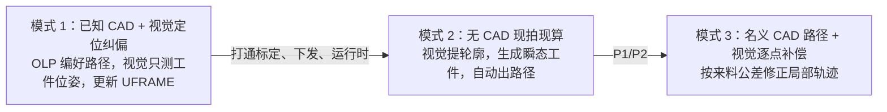
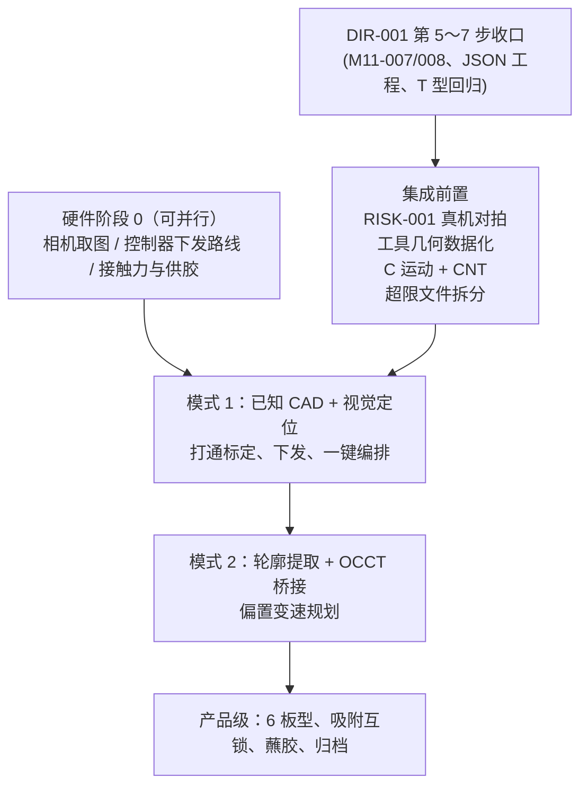

# 在 OLP 离线编程基础上引入视觉涂胶系统 —— 难度与复杂度评估

> **版本**：v0.1（Opus 独立评估稿，2026-10-28）  
> **性质**：只做分析，没有改工程代码（遵守 `Rules.md`「提问阶段只出分析与方案」）。要采纳的话，按双模型规程走 `PlanDocs/`，交 Gemini 复审后再写入 `.claude/Plan.md`。  
> **评估依据**：  
> - OLP 当前态：`.claude/SessionBrief.md`、`.claude/Plan.md`、`PlanDocs/DECISIONS.md`（`DIR-001`），以及 `include/`、`src/` 源码（截至 2026-10-28，614 项测试全绿，第 5 步为 CHANGES_REQUESTED）  
> - 视觉涂胶方案：`Docs/Vision_Edge_System_Baseline.md`（v1.1 正文，加上 2026-10-22 收窄后的演示范围）和 `.claude/contexts/VisionEdgeSystem.md`  
> **标注约定**：【待核】表示没有拿到一手信源，或者要靠实测、询价确认，不能直接对外承诺。【估算】表示 Opus 给的工程量估计，需要 Gemini 复审。

---

## 0. 结论速览

| 维度 | 结论 |
| :-- | :-- |
| **技术难度（不确定性）** | **中高**。最难的三件事是视觉上棱精度、接触防推、供胶连续。它们都是物理和硬件问题，OLP **一点也减不了**。 |
| **工程复杂度（体量与耦合）** | **高**。两套系统的范式相反：一个离线、有人审核、CAD 驱动；另一个在线、无人值守、靠视觉驱动。中间还隔着 C++ 和 Python 两种语言、控制器运行时下发、IO 状态机。 |
| **OLP 能复用的** | 运动学、FCL 碰撞、轨迹仿真、三维视口与回放、`.ls` 后处理、问题面板、PDF 报告。**直接省下约 15～20 人天，占 v1.1 总量的 12%～15%【估算】**。 |
| **集成的真正价值** | 省工时不是主要收益。主要收益是：① 视觉现算出来的路径，执行前能过一遍和离线编程同级的 IK、碰撞、仿真校验和三维预览；② 两条产品线共用一个内核；③ 「已知 CAD + 视觉定位纠偏」几乎就是 OLP 顺手往下延伸，成本很低。 |
| **最大分叉点** | **用什么机器人。** 用 FANUC 这类球形腕机器人，OPW 逆解和后处理可以复用，但运行时下发会很难。用 UR 构型的协作臂，下发很容易，但 OPW 逆解、J2/J3 耦合和 `.ls` 后处理都用不上。 |
| **建议** | 先把 `DIR-001` 收口，再开集成。硬件阶段 0 可以先并行做。首期用**模式 1（已知 CAD + 视觉定位）**打通标定、下发和运行时，再上**模式 2（无 CAD 现拍现算）**。 |

---

## 1. 评估前提与口径

### 1.1 「视觉涂胶」指什么（先要对齐）

| 方案 | 说明 | 对本评估的影响 |
| :-- | :-- | :-- |
| **A. 接触式软辊沿边涂（归档方案）** | 被动海绵辊贴住板的侧面滚涂（`Vision_Edge_System_Baseline.md`）。演示验收写的是「胶落在侧边且目视连续」 | **本文默认按这个评估** |
| B. 非接触点胶枪打胶线 | 胶枪离面 1～3 mm【待核】，沿轮廓挤出一条胶线（汽车和电子行业常说的「视觉涂胶」） | 没有防推、蘸胶、拐角积漆问题，物理难度**明显更低**；要换来的是胶线宽度和速度、流量的同步，以及开关胶的提前量和滞后量。见 §8.3 |

### 1.2 OLP 当前基线（2026-10-28 源码核对）

- **已有**：C++20、Qt 6.12、OCCT 8.0、FCL 0.7 五层架构；`olp_algo` 和 `olp_io` 不依赖 Qt，可以无头构建（架构铁律 1）；OPW 8 解逆解加 FANUC 配置字；连杆 STL 和焊枪球之间做 FCL 精确间隙；J/L 插补、梯形速度和帧烘焙；`.ls` 后处理；2D PDF。
- **未完成**：`DIR-001` 第 5 步（`M11-007`、`M11-008`）、第 6 步（JSON 工程保存）、第 7 步。`RISK-001`（没有和真机或 ROBOGUIDE 对拍过）仍然开着。
- **对集成影响最大的现状**：
  - 后处理**拒绝圆弧运动 C**：[FanucLsPostProcessor.cpp L82](file:///c:/Users/mimovr/Desktop/TEmp/Si_FastSuite/src/io/FanucLsPostProcessor.cpp#L82)。仿真只有 J 和 L。
  - 工具几何**写死**成 4 个焊枪球，而且写在两处：[CollisionAndSim.cpp L388-L403](file:///c:/Users/mimovr/Desktop/TEmp/Si_FastSuite/src/algo/CollisionAndSim.cpp#L388-L403)、[FclCollisionQueries.cpp L273-L300](file:///c:/Users/mimovr/Desktop/TEmp/Si_FastSuite/src/algo/FclCollisionQueries.cpp#L273-L300)。
  - 焊缝标架按角平分线构造，见 [`computeSeamFrame`](file:///c:/Users/mimovr/Desktop/TEmp/Si_FastSuite/include/olp/algo/SeamAndToolpathAlgo.h#L14-L20)。
  - 数据模型围绕「CAD 文件 + 拓扑签名」设计，见 [`TopologicalSignature`](file:///c:/Users/mimovr/Desktop/TEmp/Si_FastSuite/include/olp/core/ProjectModel.h#L27-L39)。
  - 工艺只有焊接一种，见 [`WeldScheduleDefinition`](file:///c:/Users/mimovr/Desktop/TEmp/Si_FastSuite/include/olp/core/ProjectModel.h#L155-L176) 和 [`ProcessEventType`](file:///c:/Users/mimovr/Desktop/TEmp/Si_FastSuite/include/olp/core/ProjectModel.h#L178-L186)。不过 `DigitalOut` 已经能写 `DO[n]=ON/OFF`。

---

## 2. 两套系统的本质差异

| 维度 | OLP 离线编程（现状） | 视觉涂胶（归档方案） | 集成难点 |
| :-- | :-- | :-- | :-- |
| 几何来源 | STEP B-Rep，持久化拓扑签名 | 每次现拍的点云，用完即弃，没有 CAD | 要有「瞬态工件」的概念；拓扑签名对它没有意义 |
| 人在不在环 | 工程师逐点审核，ROBOGUIDE 或 T1 试跑 | 一键全自动，无人审核 | 校验必须全自动、零误报；控制器侧安全必须是第一道防线 |
| 修改方式 | 所有修改走 `CommandManager`，可撤销 | 运行时一次性生成，不需要撤销 | 要有一条绕开命令栈的「无头运行管线」 |
| 交付物 | `.ls` 文件，人工装到控制器 | 每件都现算，自动下发并执行 | **控制器运行时通信，OLP 完全没有** |
| 时间约束 | 交互式，秒级到分钟级都能接受 | 识别加规划 ≤ 3 s（v1.1 指标） | 整条程序的 FCL 校验耗时没测过 |
| 工具 | 焊枪，非接触，焊丝尖端豁免 | 软辊，**要压进工件 δ** | 接触豁免要按面区分（侧面豁免，上表面不豁免） |
| 轨迹 | 开放焊缝，直线取两端点，L 运动 | 闭合轮廓、外法向偏置、凸角包络圆弧、变速、羽化 | 要 C 运动或密集 L 加 CNT，要新的姿态模式 |
| 语言与栈 | C++ / Qt / OCCT | Python / Open3D / OpenCV / PySide6 | 用侧车进程还是 C++ 重写 |
| 硬件 | 不碰硬件 | 相机、机器人、真空、蘸胶站、IO | 设备抽象、Mock 回放、状态机，全部要新建 |

---

## 3. 三种集成模式（建议的切入顺序）

| 模式 | 复用度 | 难度 | 与客户诉求的关系 |
| :-- | :-- | :-- | :-- |
| **模式 1** | **高**。OLP 铁律 4「位姿存相对 UFRAME，工件挪动只需校准 UFRAME」本来就是为它设计的 | **低～中**。平放板只要测 3 个自由度（x、y、θ），加上台面高度 | 字面上满足演示验收：「平移并转动后再次开始，不示教、不改程序」。但**体现不出「任意形状、无 CAD」**，要客户书面认可 |
| **模式 2** | 中。运动学、碰撞、仿真、后处理可以复用；感知、拟合、偏置、变速都要新做 | **高**（红线 1～3 全在这里） | 这才是归档方案的原始诉求 |
| 模式 3 | 中高 | 高（逐点配准和补偿） | 不在本期 |

> [!IMPORTANT]
> 模式 1 和模式 2 共用标定、控制器下发、运行时编排、滚轮工具模型、接触豁免这些部件，模式 2 只是在前面多了「感知 → 拟合 → 瞬态工件」一段。**先做模式 1，等于用最低风险把集成的一半工程量做掉。**

---

## 4. 逐模块复用映射（视觉 M01～M08 对 OLP 资产）

| 视觉模块 | 能复用的 OLP 资产 | 复用度 | 新增或改造内容 |
| :-- | :-- | :-- | :-- |
| M01 设备抽象与 Mock | 无头构建和测试框架（`OLP_HEADLESS`、`tests/`） | 低 | `ICamera` / `IRobot` / `IIO`，数据集回放。全新 |
| M02 标定管理 | [`Transform4d::fromThreePoints`](file:///c:/Users/mimovr/Desktop/TEmp/Si_FastSuite/src/app/WorkcellLayoutService.cpp#L66-L95)、UFRAME / UTOOL 数据结构 | 低 | 9～12 点触点 SVD 配准、AX=XB 交叉校验、滚轮湿态半径标定。基本全新 |
| M03 视觉感知 | 无 | **0** | 平面分割、Mask 约束亚像素上棱、托台外露检测。全新，也是风险最高的一块 |
| M04 几何拟合与可涂性 | OCCT 可以把图元链做成 B-Rep（见 §5.1） | 低 | 角点分段、直线和圆弧鲁棒拟合、两级可涂性判定 |
| M05 轨迹与速度规划 | `SeamSampleFrame`、`isClosed`、切入切出生成、SLERP、`Target.speedValue` 逐点速度 | 中 | 外法向偏置 d = R − δ、凸角包络、恒定接触线速度剖面、δ(s) 调制、羽化、按 L_load 分段、闭环起点选择 |
| M06 校验与程序生成 | **OPW 逆解、配置字、限位和奇异点、FCL 碰撞、仿真烘焙、`.ls` 后处理** | **高**（前提是用 FANUC 球形腕机器人） | C 运动和 CNT 交融、滚轮工具几何、接触豁免、运行时下发 |
| M07 工艺编排与 IO | `ProcessEventType::DigitalOut` | 很低 | 状态机、真空互锁、蘸胶子流程、故障恢复、复拍。全新 |
| M08 HMI 与归档 | Qt 外壳、`OcctViewport`、时间轴回放、问题面板、PDF 报告 | 中 | 点云显示（OCCT `AIS_PointCloud`）、2D 图像叠加、操作员一键模式、配方参数、运行归档与离线重放 |

---

## 5. 推荐的技术接法（最小改动，落在现有结构上）

### 5.1 「视觉结果 CAD 化」桥接（模式 2 的核心思路）

把 M04 拟合出的闭合图元链（直线加圆弧）用 OCCT 拉伸成一个**瞬态棱柱实体**，当成 `Workpiece` 塞进场景。之后的焊缝取边、面法向、FCL 碰撞、仿真、视口显示和报告**都走现有管线**：

- 用到的 OCCT 类：`GC_MakeSegment`、`GC_MakeArcOfCircle`、`BRepBuilderAPI_MakeWire`、`BRepBuilderAPI_MakeFace`、`BRepPrimAPI_MakePrism`。凸角包络可以直接用 `BRepOffsetAPI_MakeOffset`（`GeomAbs_Arc` 连接）生成辊心等距线。**限制**：等距偏置只能用常数 d；凸角降压 δc 要自己拼过渡段，演示级可以先只靠变速。
- 同一个实体里，上表面和侧面是拓扑相邻的，所以现有的「同实体相邻面」分支就能直接给出 n1（上表面，+Z）和 n2（侧面外法向）。
- 自由曲线（B 样条）属于 P1，那时再评估噪声轮廓构造 B-Rep 的稳健性。

### 5.2 数据模型的最小扩展（遵守「新建类前先归并评估」）

| 改动 | 落点 | 说明 |
| :-- | :-- | :-- |
| 工序类型 | `Operation` 加 `processKind`（Weld / EdgeRoll / Dispense） | 不新建 Operation 子类 |
| 滚涂参数 | `ToolpathGenParams` 加辊半径 R、δ0、δc、kc、v_e、羽化长度 | 演示级只用 R、δ0、v_e |
| 胶开关 | 复用 `ProcessEventType::DigitalOut` | 不新增事件类型 |
| 瞬态工件 | `SceneNode` 加 `transient` 标记，带上生成它的轮廓参数 | 工程保存（`DIR-001` 第 6 步）时存轮廓，不存 CAD 哈希 |
| 工具几何数据化 | 把两处写死的 `kTorchSpheres` 收进 ToolNode 数据（球或圆柱基元列表，FCL 有 `fcl::Cylinder`） | **必改**。也顺带消掉两份副本 |
| 沿边姿态 | `SeamAndToolpathAlgo` 加一个函数：Z 竖直向下，偏置方向取侧面外法向 n2 | 做成私有或静态函数，不新建类 |
| 新模块目录 | `src/vision/`（标定、轮廓桥接，不依赖 Qt）和 `src/runtime/`（编排、控制器通信） | 按规则，M11 以后的新模块从第一天起就放在自己的目录里 |

### 5.3 视觉算法用什么语言

| 方案 | 优点 | 代价 | 建议 |
| :-- | :-- | :-- | :-- |
| **Python 侧车进程**：用 `QProcess` 或本地 TCP 交换 JSON（轮廓、平面、置信度） | 阶段 0 迭代最快，Open3D 生态成熟；耦合最低，复用 Qt 自带通道，不加依赖 | 安装包要带嵌入式 Python 和 wheels；两种语言要分别维护 | **P0 推荐** |
| C++ 原生（OpenCV 加 PCL，经 vcpkg） | 单一语言，部署简单 | 点云算法迭代慢 15%～25%【估算】；Open3D 有没有 vcpkg 官方端口【待核】 | 产品化之后再评估 |
| pybind11 把 Python 嵌进进程 | — | GIL、崩溃会传染主进程、调试困难 | 不推荐 |

---

## 6. 关键暗坑（独立判断）

1. **机器人选型决定复用度。** OPW 解析逆解只适用于**球形腕**。UR、节卡、遨博这类协作臂多是偏置腕（d4、d5、d6 都不为零，信源是各厂公开的 DH 参数【待核：以具体型号为准】），OLP 的 M06 **不能直接用**，得补一套解析或数值逆解（OLP 计划把阻尼最小二乘列在 P1），后处理也要重写成脚本或 SDK。v1.1 当时偏好协作臂，这个前提和 OLP 是冲突的。
2. **FANUC 运行时下发是硬骨头。** `.ls` 要变成 `.tp`，需要控制器的 ASCII Upload 类选项，或者 ROBOGUIDE 的 MakeTP。**用户已经决定不装 ROBOGUIDE。** 可选路线：
   - 固定 TP 骨架加 `PR[]` 寄存器，由 PC 经 User Socket Messaging 或 KAREL 写入。量产推荐这条，但 PR 数量上限要核。
   - 每件生成 `.ls`，经 FTP 加 ASCII Upload 装进控制器。
   - Stream Motion 实时流式控制。属于 P2。

   以上选项名称、编号和价格都【待核：以 FANUC 选项清单和现场控制器为准】。这就是 v1.1 里「工业臂 +10～15 人天」那一项。
3. **`RISK-001` 从「可以容忍」变成「阻断」。** 离线程序可以靠人工 T1 试跑兜底；视觉无人值守不行。J2/J3 耦合符号、圈数、法兰位姿**必须真机对拍过**才能上线。
4. **绝对精度。** OLP 没做机器人标定（属于 P2），视觉路径却直接依赖机器人在工作区里的绝对定位（v1.1 误差预算按 1σ 0.35 mm【待核】）。触点 SVD 配准能在局部吸收一部分；剩下的靠浮动机构 ±2～3 mm 的顺应行程兜住。
5. **圆弧和交融缺失。** 后处理拒绝 C，仿真只有 J 和 L。沿边要恒速，就得补 C 运动，或者用密集 L 加 CNT。FANUC 短段密集 L 在 CNT 下的速度跌落要在 S0-6 实测【待核】。
6. **接触豁免太粗。** 现有豁免按「零件加尖端半径」来做。滚轮**应该**压进侧面 δ，**不应该**刮到上表面。按零件整体豁免，会把真正的上表面干涉一起盖掉。要么把瞬态工件拆成侧面带和上表面板两个碰撞对象，要么在规划阶段用 Z 覆盖规则（m_t、m_b）解析地保证。
7. **焊缝标架不适用。** 角平分线 b = n1 + n2 是给角焊用的。滚涂要用侧面外法向做偏置方向，工具轴竖直。直接套用会让辊子 45° 斜压。
8. **闭合轮廓的切入点和搭接。** `isClosed` 已经有了，但 `generateOperationTargets` 的 trim 和切入切出是按开放焊缝写的。闭环要在最长直边中点切线切入，接缝处做 10 mm 羽化，这是新逻辑。
9. **实时性没测过。** 识别加规划要 ≤ 3 s。OLP 整条程序的 FCL 校验加烘焙耗时没测过，72 组自转扫描已经要放后台跑。运行时管线必须关掉扫描、降低采样率，并单独实测。
10. **文件行数红线。** `CommandManager.cpp` 已有 898 行，`OcctCadKernel.cpp` 797 行，`ShellWindow.cpp` 751 行，`SeamAndToolpathAlgo.cpp` 725 行。一开始集成，大概率先触发 1000 行拆分规则，这部分要提前算进工期。
11. **无人值守的安全。** 第一道防线必须在控制器里（FANUC DCS 位置和速度检查，属于选项【待核】），还要加安全光幕。PC 端的校验只能算第二道。
12. **模式 1 的对称歧义。** 方板有 90° 对称。闭环路径本身对称没关系，但接缝和切入点的位置会跳；非对称板必须在定位时消除这个歧义。
13. **物理红线不会因为集成而变简单。** S0-2（上棱 RMS ≤ 0.3 mm）、S0-4（防推和防拧转，必须真空吸附）、S0-5（供胶续航）照样存在，而且和 OLP 没有任何关系。

---

## 7. 难度与复杂度评级矩阵

★ 越多越难。「对比」一列看的是集成到 OLP 之后，比视觉方案单独做难度变了多少。

| 子项 | 难度 | 对比 | 说明 |
| :-- | :-- | :-- | :-- |
| 视觉上棱精度（模式 2） | ★★★★★ | 不变 | 红线 1，OLP 帮不上 |
| 视觉位姿估计（模式 1） | ★★★ | — | 平放 3 自由度加 CAD 外轮廓配准 |
| 手眼标定 | ★★★ | 不变 | 全新 |
| 接触工艺（防推、供胶、拐角） | ★★★★ | 不变 | 红线 2、3，属于硬件和物理问题 |
| 偏置与变速规划 | ★★★ | 略降 | 标架、切入切出、逐点速度可以复用 |
| 运动学、碰撞、仿真（FANUC 球形腕） | ★★ | **大降** | OLP 现成，614 项回归在护航 |
| 运动学、碰撞、仿真（协作臂） | ★★★★ | 上升 | OPW 不适用，要新写逆解和后处理 |
| 控制器运行时下发（FANUC） | ★★★★ | 上升 | 牵涉选项，又不装 ROBOGUIDE |
| 控制器运行时下发（协作臂） | ★★ | 不变 | 有开放脚本和 SDK |
| 架构改造（离线范式转运行时范式） | ★★★ | **新增** | 瞬态工件、无头管线、工具数据化、文件拆分 |
| 安全与无人值守 | ★★★ | 不变 | 控制器侧安全配置 |
| 双语言部署 | ★★ | **新增** | 侧车打包 |

---

## 8. 工作量估算【估算，需 Gemini 复审】

> [!NOTE]
> 下面是工程口径的人天，不调整已经出具的报价单（`20261022-3`，180 人天）。硬件采购和外协加工另计。工期一律从硬件到位日 T0 起算。

### 8.1 演示级（2026-10-22 收窄范围：一块板、固定场景、目视连续）

| 工作项 | 模式 1（已知 CAD） | 模式 2（无 CAD） |
| :-- | :-- | :-- |
| 硬件链路（相机取图、FANUC 运行时下发、IO） | 8～12 | 8～12 |
| 视觉：模式 1 做位姿配准；模式 2 提轮廓（不追亚毫米） | 8～10 | 12～16 |
| 手眼标定（触点 SVD） | 5～7 | 5～7 |
| 拟合加 OCCT 棱柱桥接 | — | 6～8 |
| 偏置、变速、闭环切入（复用焊缝和切入切出） | 2～3 | 6～8 |
| 滚轮工具数据化、接触豁免、沿边姿态 | 5～7 | 5～7 |
| C 运动和 CNT（演示可以先用密集 L 加 CNT 顶替） | 0～5 | 0～5 |
| 一键编排（拍照 → 定位或规划 → 校验 → 下发 → 执行） | 6～8 | 6～8 |
| 实涂调试和两次试验 | 6～8 | 6～8 |
| **合计** | **40～60** | **54～79** |

### 8.2 产品级（v1.1 P0：6 种板型、亚毫米、真空吸附、蘸胶、HMI、归档）

| 阶段 | 视觉方案单独做（v1.1） | 集成到 OLP（FANUC） | 差异原因 |
| :-- | :-- | :-- | :-- |
| 阶段 0 预研 | 28～30 | 31～35 | 多了 FANUC 运行时下发 spike，以及侧车和 C++ 二选一的定型 |
| 阶段 1 标定与感知（M01～M04） | 30～34 | 32～38 | 感知没有可复用的；多了 JSON 契约和侧车进程管理 |
| 阶段 2 规划与校验（M05/M06） | 24～28 | 22～28 | 逆解、碰撞、仿真、后处理省约 10；OCCT 桥接、工具数据化、C 运动、沿边姿态加约 8～10 |
| 阶段 3 集成与 HMI（M07/M08） | 20～24 | 26～32 | 复用外壳、视口、时间轴省约 4；FANUC 运行时通信和监控加 10～15 |
| **集成专项（新增）** | 0 | 10～14 | 工序类型、瞬态工件、无头运行管线、配方持久化、超限文件拆分、回归测试 |
| 阶段 4 实涂验收 | 18～22 | 18～22 | 不变 |
| 工装 | 5～7 | 5～7 | 不变 |
| **合计** | **125～145**（协作臂前提） | **144～176** | |

- 拿同样用 FANUC 的单独方案来比（v1.1 加 10～15，即 135～160），集成**多出约 5～15 人天**。换来的是 OLP 级别的校验、三维预览和统一内核。
- 如果集成后用协作臂：运行时下发能省 5～10，但要加偏置腕逆解和新后处理 15～25，**净增约 10～15**。

### 8.3 如果「涂胶」其实是非接触点胶（方案 B）

- 去掉防推和吸附、蘸胶站、羽化、拐角减压，阶段 0 的红线 2、3 换成「胶线宽度一致性和开关胶提前量」。
- 碰撞上不再需要接触豁免，喷嘴保持常规安全间隙就行，**更贴合 OLP 现有的非接触焊枪模型**。
- 演示级和产品级都能降 15%～25%【估算】。前提是方案 B 要确认胶阀和控制器的 IO 联动，以及流量和速度的同步方式。

---

## 9. 前置条件与推荐顺序

**硬约束**：

1. `DIR-001` 收口之前，不往 OLP 主线里加视觉代码，免得冲掉还在审核的 M11。
2. `RISK-001` 不关，视觉不准进入无人值守自动运行。
3. 新代码进 `src/vision/` 和 `src/runtime/`，不往已经接近 1000 行的文件里续写。

---

## 10. 需要用户拍板的问题

1. **涂胶工艺**：是接触式软辊（归档方案 A），还是非接触点胶枪（方案 B）？
2. **机器人**：视觉涂胶用的就是 FANUC M-10iA（或其他球形腕 FANUC）吗？控制器已经开了哪些软件选项（ASCII Upload、Socket Messaging、KAREL、DCS）？
3. **演示口径**：客户能否接受**模式 1（已知板型 CAD + 视觉定位）**作为首期演示？还是必须证明「任意形状、无 CAD」？
4. **时间节奏**：等 `DIR-001` 收口再启动？硬件阶段 0 现在能不能先并行？
5. **产品形态**：同一个 exe 加一个「视觉工作台」，还是共享内核库、另出一个操作员 exe？
6. **视觉语言**：P0 接受 Python 侧车进程吗？

---

## 11. 信源与待核清单

| 项 | 状态 |
| :-- | :-- |
| OLP 现状（后处理拒绝 C、焊枪球写死、文件行数、数据结构） | 已对源码核实（2026-10-28） |
| OCCT 类 `BRepPrimAPI_MakePrism`、`BRepOffsetAPI_MakeOffset`、`AIS_PointCloud`；FCL `fcl::Cylinder` | 公开 API，是否可用以 OCCT 8.0 和 FCL 0.7 实际编译为准 |
| FANUC 的 ASCII Upload、User Socket Messaging、KAREL、Stream Motion、DCS 选项名称和编号 | 【待核：FANUC 选项清单和现场控制器】 |
| 协作臂是偏置腕（OPW 不适用） | 【待核：以具体型号 DH 参数为准】 |
| Open3D 有没有 vcpkg 官方端口；Mech-Eye 和 RealSense 的 C++ SDK | 【待核】 |
| 误差预算、摩擦系数、点胶间隙等物理参数 | 沿用 v1.1 的【待核】，要在阶段 0 实测 |
| 全部人天数字 | 【估算】，需 Gemini 复审 |
