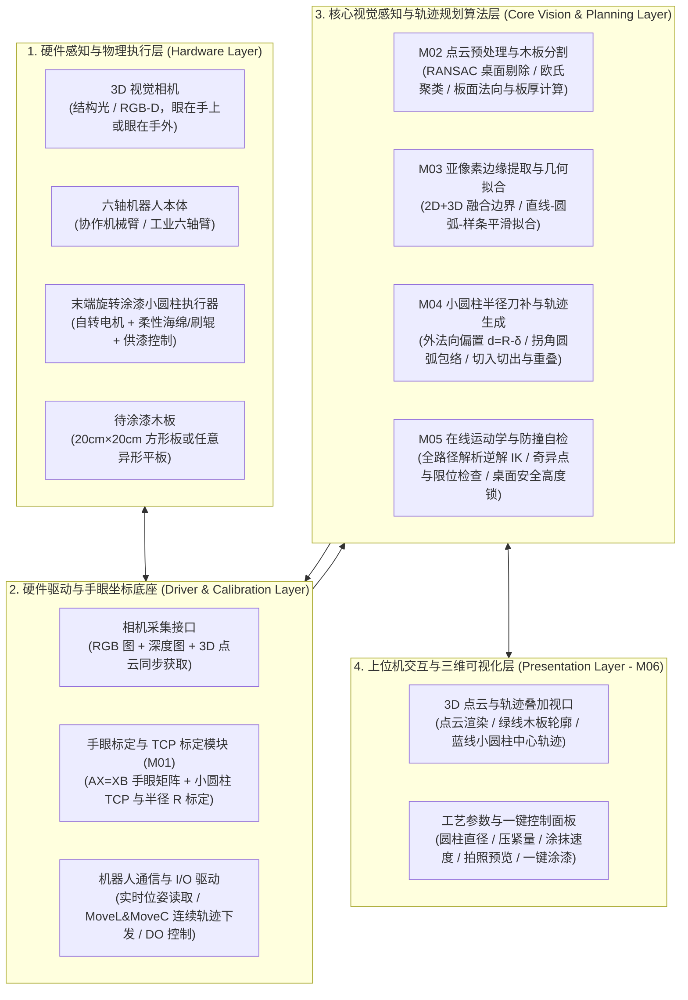
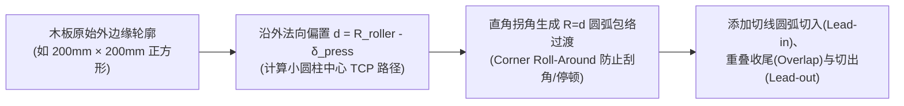
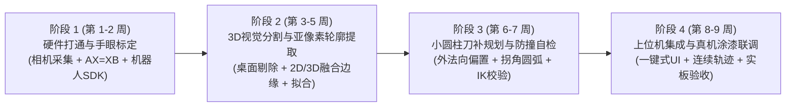

# 基于 3D 视觉的机器人免示教动态沿边涂抹系统 —— 架构设计与开发周期规划

> **参考标杆视频**：`C:\Users\mimovr\Videos\NVIDIA\screa.mp4`（STEP 新时达 SmartRobot 2.0 免示教智能沿边打磨/作业方案）  
> **核心业务目标**：在**无 CAD 模型输入、无人工示教编程**的前提下，工作台上任意摆放一块木板（如 $20\text{cm} \times 20\text{cm}$ 方形木板或异形板材），下达指令后，机器人通过 3D 视觉自动识别木板空间位置与外边缘轮廓，自动控制末端可自转的涂漆小圆柱贴合木板边缘缓慢、均匀地涂抹油漆。

---

## 一、 视频解析与核心技术原理还原

### 1.1 参考视频（`screa.mp4`）工作流拆解
通过对参考视频 `00:00 ~ 00:15` 的逐帧分析，该免示教系统的完整物理与算法闭环如下：

| 阶段 | 视频时间轴 | 视觉画面与动作表现 | 底层发生的核心计算与控制逻辑 |
| :--- | :---: | :--- | :--- |
| **1. 工件盲放** | `00:00 ~ 00:04` | 演示者将红白双层异形板（含直线边、圆角及半圆内凹槽）随意放置在平整工作台上，并随机旋转角度，无任何定位夹具。 | 工件位姿 $(X, Y, \theta)$ 完全未知，且无预先导入的 CAD 模型文件。 |
| **2. 视觉俯拍** | `00:05 ~ 00:07` | 六轴协作机器人停在工作台正上方高处拍照姿态；机器人第 6 轴末端法兰侧面挂载一台黑色 **3D 视觉相机（Eye-in-Hand）**，下方斜挂一个**旋转小圆柱工具头**。 | 触发 3D 相机采集工作台区域的对齐彩色图（RGB）与三维深度点云（Point Cloud），并通过手眼标定矩阵将点云转换至机器人基座坐标系（Base Frame）。 |
| **3. 轮廓提取与自动规划** | `00:07 ~ 00:08` | 无需人工操作，后方电脑屏幕（`00:00`、`00:13`）显示点云分割结果与自动生成的闭合边缘路径。 | 1. 拟合桌面平面并剔除背景，分割出工件点云，计算工件上表面高度 $Z_{\text{top}}$ 与厚度 $H$。 2. 提取工件外边缘点集，进行去噪与几何曲线拟合（直线+圆弧/样条）。 3. 按小圆柱半径 $R$ 向外法向偏置（刀补），生成切入、沿边包络与切出轨迹。 |
| **4. 动态贴边作业** | `00:08 ~ 00:12` | 机器人自动下降，开启末端小圆柱自转，使小圆柱外圆周侧面精准贴合板材立面边缘，匀速走完直线段、外圆角与 U 型内凹槽。 | 下发连续交融轨迹指令（`MoveL` / `MoveC`），保持恒定线速度与恒定下探高度，避免任何中途停顿或撞击桌面。 |

---

### 1.2 从“离线编程（OLP）”到“视觉免示教动态沿边”的架构转换
相比于第一阶段的 CAD 离线编程软件，本系统的技术重心发生了根本性转移：
1. **几何来源变了**：不再读取精确的 `.step` CAD 模型（砍掉 OpenCASCADE / `usd-brep` 内核），而是直接从带有噪声、飞点和边缘缺失的**传感器原始图像与 3D 点云**中重建精确几何边缘。
2. **交互模式变了**：不再需要工程师在电脑前花半小时拖拽 3D Gizmo 调整几百个路径点（砍掉重型 3D 编辑器与复杂 Undo/Redo 栈），而是追求**“一键拍照 $\rightarrow$ 算法 2 秒内全自动生成平滑无碰撞刀补路径 $\rightarrow$ 预览确认或直接驱动真机作业”**。
3. **输出对象变了**：不再导出静态 `.ls` 文本或 3D PDF 动画（砍掉后置编译器与 PDF 渲染管线），而是通过以太网 SDK **直接在线控制机器人与末端涂漆电机联动**。

---

## 二、 系统总体架构设计

系统由 **硬件感知与执行层**、**驱动与通信层**、**核心视觉与轨迹算法层** 以及 **上位机监控交互层** 四大部分组成：

---

## 三、 核心模块与功能点详细拆解（6 大模块）

### 模块一（M01）：手眼系统集成与高精度标定模块
视觉引导机器人的前提是建立**相机坐标系（Camera）**、**机器人基座坐标系（Base）**、**末端法兰坐标系（Flange）**与**小圆柱工具坐标系（TCP）**之间的毫米级精确映射。

| 功能点 | 详细工程实现说明 |
| :--- | :--- |
| **1.1 手眼安装构型支持** | 支持两种主流构型： • **方案 A（Eye-in-Hand 眼在手上，同视频方案）**：相机固定在机器人第 6 轴末端支架上。机器人先移动到高处“全局拍照位”俯拍桌面，必要时可移动到木板上方近距离补拍以获得更高分辨率。 • **方案 B（Eye-to-Hand 眼在手外）**：相机固定在工作台正上方的龙门支架上，机械臂不遮挡视线时一键全局拍照，机械臂末端只需挂载轻便的涂漆小圆柱。 |
| **1.2 自动/半自动手眼标定（$AX=XB$）** | 在工作台上放置标准棋盘格或 ChArUco 标定板，上位机控制机器人自动走 12~15 个预设的不同倾角拍照位姿，调用 OpenCV `calibrateHandEye`（Tsai / Park / Horaud 算法）解算手眼变换矩阵 $T_{\text{cam}}^{\text{flange}}$ 或 $T_{\text{cam}}^{\text{base}}$，并提供标定重投影误差与空间点验证报告（要求标定误差 $\le 0.5\text{ mm}$）。 |
| **1.3 涂漆小圆柱 TCP 标定** | 支持“四点法/六点法”或基于标准定位锥标定小圆柱旋转轴中心点（TCP 原点：$X, Y, Z$）及圆柱旋转轴向量 $(W, P, R)$；支持在软件中输入或实测校准小圆柱物理半径 $R_{\text{roller}}$（如 $R=10\text{ mm}$）与有效柱面长度 $L_{\text{roller}}$。 |
| **1.4 工作台安全基准面标定** | 首次部署时标定工作台桌面的基准平面方程与绝对安全高度阈值 $Z_{\text{table\_min}}$，在软件底层形成硬件级“虚拟电子围栏”，任何情况下严禁小圆柱底端低于 $Z_{\text{table\_min}} + 2\text{ mm}$。 |

---

### 模块二（M02）：3D 视觉采集与目标木板分割模块
负责在无需任何背景建模的情况下，从杂乱或空白的工作台点云中把“木板”准确找出来，并测量其三维姿态与厚度。

| 功能点 | 详细工程实现说明 |
| :--- | :--- |
| **2.1 相机 SDK 与多模态数据采集** | 封装统一的相机抽象接口 `ICameraSensor`，获取时间同步且像素对齐的 2D 彩色/灰度图像（RGB/Mono）与 3D 深度点云（XYZ Point Cloud）；支持曝光时间、增益、点云滤波参数配置。 |
| **2.2 ROI 裁剪与点云去噪滤波** | 根据工作台三维边界框（Bounding Box ROI）裁剪掉工作台以外的背景（如地面、周围人员、机械臂自身底座），并通过统计滤波（Statistical Outlier Removal）滤除深度相机边缘飞点。 |
| **2.3 工作台桌面拟合与剔除（RANSAC）** | 使用 RANSAC 平面分割算法自动识别面积最大的工作台桌面平面 $a x + b y + c z + d = 0$，计算桌面法向量 $\vec{n}_{\text{table}}$，并将属于桌面的背景点云剔除。 |
| **2.4 目标木板点云聚类与三维测量** | 对高于桌面平面的剩余点云进行欧氏聚类分割（Euclidean Cluster Extraction），提取出木板点云簇： 1. 拟合木板上表面平面方程，获取木板上表面法向量 $\vec{n}_{\text{board}}$ 与上表面高度 $Z_{\text{top}}$。 2. 计算木板上表面到桌面平面的垂直距离，自动得出**木板真实厚度 $H_{\text{board}}$**（例如自动测出木板厚 $18\text{ mm}$）。 |

---

### 模块三（M03）：亚像素边缘提取与几何曲线拟合模块
**这是决定机器人移动时“是否抖动、边缘准不准”的核心视觉算法模块。**

| 功能点 | 详细工程实现说明 |
| :--- | :--- |
| **3.1 2D+3D 融合高精度边缘提取** | 单纯依赖 3D 点云边界（Concave Hull）受限于深度相机分辨率和边缘飞点，精度往往只有 $1\sim 2\text{ mm}$。本模块采用**“2D 亚像素边缘 + 3D 平面求交”融合算法**： 1. 利用 M02 分割出的木板点云生成 2D 掩膜（Mask）感兴趣区域。 2. 在高分辨率 2D 图像上沿掩膜边缘法向进行 Canny / 亚像素梯度极值检测，获得亚像素级 2D 闭合轮廓点 $(u_i, v_i)$。 3. 将 $(u_i, v_i)$ 经相机内参反投影为 3D 射线，与 M02 拟合出的木板上表面 3D 平面求交（Ray-Plane Intersection），得到既无深度飞点抖动、精度又达到 $\le 0.3\text{ mm}$ 的三维外轮廓点集！ |
| **3.2 轮廓有序化与多边形/曲线拟合** | 将提取出的三维边缘点集按顺时针（CW）或逆时针（CCW）統一排序，并提供两种几何拟合模式： • **规则板材模式（如 $20\text{cm}\times 20\text{cm}$ 方形木板）**：通过 Douglas-Peucker 多边形逼近与 RANSAC 直线拟合，精准提取出 4 条几何直线段与 4 个顶点坐标，完全消除边缘微小毛刺。 • **任意异形板材模式（如视频中带圆弧凹槽的板材）**：采用“直线段 + 圆弧段（Biarc / Line-Arc）”分段拟合或弦长参数化三次 B 样条曲线（Cubic B-Spline）平滑拟合，确保曲率连续。 |
| **3.3 凹槽可加工性检查（防过切校验）** | 若异形木板存在内凹槽（如视频中的 U 型槽），自动检测内凹处的最小曲率半径 $R_{\text{concave}}$ 是否大于涂漆小圆柱半径 $R_{\text{roller}}$；若凹槽比小圆柱还窄，自动生成跨槽包络轨迹并提示，防止小圆柱卡入窄缝。 |

---

### 模块四（M04）：小圆柱半径补偿（刀补）与贴边轨迹规划模块
**这是将“木板外边缘轮廓”转化为“小圆柱中心 TCP 真实运动轨迹”的核心几何模块。**

| 功能点 | 详细工程实现说明 |
| :--- | :--- |
| **4.1 小圆柱外法向半径补偿（Tool Offset）** | 涂漆时是小圆柱的**外侧面**接触木板边缘。设小圆柱半径为 $R_{\text{roller}}$，预设压紧（吃刀/海绵压缩）量为 $\delta_{\text{press}}$，则有效偏置距离为 $d = R_{\text{roller}} - \delta_{\text{press}}$。 算法在木板平面内计算每一点的单位切向量 $\vec{T}(s)$ 与指向木板外部的单位外法向量 $\vec{N}_{\text{out}}(s) = \vec{T}(s) \times \vec{n}_{\text{board}}$，生成偏置路径点：$P_{\text{tcp}}(s) = P_{\text{edge}}(s) + d \cdot \vec{N}_{\text{out}}(s)$。 |
| **4.2 拐角圆弧包络过渡（Corner Roll-Around）** | 当涂抹到 $20\text{cm} \times 20\text{cm}$ 木板的 $90^\circ$ 直角顶点 $V_{\text{corner}}$ 时，若小圆柱直接走尖角折线，不仅会导致机器人在角点急停造成油漆严重堆积，还会在转角瞬间脱离木板角部。 系统在每个凸拐角处自动插入一段**以木板角点 $V_{\text{corner}}$ 为圆心、以 $d = R_{\text{roller}} - \delta_{\text{press}}$ 为半径的圆弧轨迹（`MoveC`）**，使小圆柱外表面始终紧贴木板角部匀速滚过 $90^\circ$。 |
| **4.3 涂抹高度（Z 轴）自动对齐与防撞桌面保护** | 根据木板上表面高度 $Z_{\text{top}}$ 与厚度 $H_{\text{board}}$，自动计算小圆柱 TCP 的下探高度，使小圆柱侧面的有效涂漆区中心对准木板侧面中心（$Z_{\text{target}} = Z_{\text{top}} - H_{\text{board}}/2 + \Delta Z_{\text{offset}}$）。同时强制执行 $\max(Z_{\text{target}}, Z_{\text{table}} + Z_{\text{safe}})$ 钳位保护，绝不擦碰桌面。 |
| **4.4 切入（Lead-in）、重叠（Overlap）与切出（Lead-out）** | 1. **起点优选**：自动选择最长直线边的中点作为起涂点（避开在拐角处起涂）。 2. **平滑切入（Lead-in）**：先从上方安全高度下降到起涂点外侧 $30\text{ mm}$ 处，开启小圆柱自转后，沿切线圆弧平滑贴靠到木板边缘，避免垂直撞击木板产生刷痕。 3. **防漏涂重叠（Overlap）**：绕木板走完一整圈（$360^\circ$）回到起点后，继续沿原轨迹多涂抹 $L_{\text{overlap}}$（如 $10\text{ mm}$），彻底消除首尾接缝处的漏涂。 4. **平滑切出（Lead-out）**：沿切线圆弧平滑脱离木板边缘，停止小圆柱旋转，抬升返回安全高度。 |
| **4.5 末端姿态策略（固定姿态 vs 切向跟随）** | 提供两种姿态控制模式： • **模式 1（垂直轴对称固定姿态，强烈推荐用于 $20\text{cm}\times 20\text{cm}$ 木板）**：若小圆柱旋转轴垂直于木板表面安装，由于小圆柱是 $360^\circ$ 轴对称的，它在前后左右四个方向涂抹时**完全不需要旋转机器人第 6 轴**！保持工具姿态恒定、仅做 $XYZ$ 平动即可走完四条边，能彻底避免第 6 轴超限位、电缆缠绕和腕部奇异点。 • **模式 2（斜装主轴法向跟随姿态，同视频构型）**：若相机与斜装小圆柱同在末端，为避免相机碰撞工件或让斜装圆柱贴合边缘，工具坐标系 $X$ 轴实时跟随轮廓外法向旋转。 |

---

### 模块五（M05）：在线运动学自检与机器人实时运动控制模块
负责将规划好的空间轨迹安全、匀速地转化为真实机器人的物理动作。

| 功能点 | 详细工程实现说明 |
| :--- | :--- |
| **5.1 运动前全路径逆解（IK）与安全自检** | 在向真机发送任何移动指令前，先在内存中对整条轨迹（切入点 $\rightarrow$ 沿边采样点 $\rightarrow$ 切出点）执行高速逆运动学（IK）校验： 1. 检查所有点是否在机器人工作半径内（可达性）。 2. 检查各关节角是否超出软限位、整圈运动中手系配置是否一致、关节角是否存在突变（奇异点拦截）。 3. 校验通过后才允许启动真机移动；若木板放得太远超出臂展，界面立即弹窗提示“木板超出机器人可达工作范围”。 |
| **5.2 连续交融轨迹下发（Blending / 恒速控制）** | 涂抹油漆最忌讳“走走停停”（停顿 0.5 秒就会在木板边缘留下一坨油漆流挂）。模块通过机器人 SDK 下发带**交融半径（Blend Radius / CNT）**的连续轨迹（直线段 `MoveL` + 拐角圆弧 `MoveC`，或高密度笛卡尔伺服点流 `servoj`/` movej_pose`），确保小圆柱以设定的缓慢速度（如 $15 \sim 40\text{ mm/s}$）全程匀速走完一圈。 |
| **5.3 末端涂漆小圆柱电机与供漆 I/O 联动** | 通过机器人控制器或末端工具 IO（Digital Output / PWM / RS485）控制小圆柱自转电机： • 到达切入起点前 $0.5\text{ s}$ 自动启动小圆柱旋转； • 沿边涂抹期间保持恒定转速； • 完成重叠段切出离开木板后自动停转，并支持手动点动测试小圆柱正反转。 |

---

### 模块六（M06）：一键式上位机监控与三维点云预览界面
对标视频 `00:13` 电脑屏幕中的极简工业上位机软件，让现场工人“零门槛”操作。

| 功能点 | 详细工程实现说明 |
| :--- | :--- |
| **6.1 2D 图像与 3D 点云/轨迹同屏显示** | • **左视图（2D 相机画面）**：实时显示相机彩色图、识别到的木板外框与角点像素位置。 • **右视图（3D 空间视口）**：显示木板 3D 点云、提取出的木板边缘线（绿色）、向外刀补后的小圆柱中心轨迹线（蓝色）、起点/切入切出箭头及虚拟机器人位置。 |
| **6.2 涂漆工艺参数快捷配置栏** | 直观配置 6 个核心工艺参数（自动持久化保存）： 1. `小圆柱直径 D (mm)` 2. `涂抹压紧量 δ (mm)` 3. `涂抹高度偏置 ΔZ (mm)` 4. `涂抹移动速度 V (mm/s)` 5. `拐角收尾重叠量 Overlap (mm)` 6. `小圆柱自转转速 / 转向` |
| **6.3 双工作模式（调试确认模式 vs 一键全自动模式）** | • **调试模式（两步走）**：点击【拍照识别】 $\rightarrow$ 界面显示识别出的木板尺寸（如 `199.8mm × 200.2mm`）与蓝色涂漆轨迹 $\rightarrow$ 人工确认无误后点击【启动涂抹】。 • **全自动模式（一步走，同视频演示）**：放好木板后点击【一键自动涂漆】（或按外部物理启动按钮），机器人自动完成“拍照 $\rightarrow$ 识别 $\rightarrow$ 规划 $\rightarrow$ 沿边涂漆 $\rightarrow$ 回 Home 位”全流程。 |

---

## 四、 关键工程挑战与物理设计建议（避坑指南）

为了让这套系统在真实物理世界中 100% 稳定跑通，以下 **3 个物理与工程细节**至关重要：

1. **视觉误差与涂漆接触的物理顺应（强烈建议采用海绵/毛刷柔性圆柱或弹簧浮动头）**：
   - 工业 3D 相机定位 + 手眼标定 + 机器人绝对定位精度的综合误差通常在 **$\pm 0.5 \sim 1.0\text{ mm}$**。
   - 同时，视频和您的场景中**木板是直接平放在桌面上的（没有夹具锁死）**。如果末端是一个纯刚性的金属小圆柱，偏置少算 $0.8\text{ mm}$ 就会直接把木板推跑；偏置多算 $0.8\text{ mm}$ 就会悬空涂不上漆！
   - **解决方案**：涂漆小圆柱本身应采用**具有 $2\sim 3\text{ mm}$ 径向弹性压缩余量的高密海绵滚筒/毛刷滚轮**（或者在固定小圆柱的支架上加一个轻载径向弹簧浮动铰链）。软件设定默认压入量 $\delta_{\text{press}} = 1.0 \sim 1.5\text{ mm}$，这样既能靠海绵弹性完美吸收 $\pm 1\text{ mm}$ 的视觉与手眼误差，保证四周油漆涂抹极其均匀，又不会产生过大的侧向推力把桌面上的木板推歪！
2. **木板防滑垫块（兼顾防推跑与底部防沾漆）**：
   - 当小圆柱涂抹木板整个侧面边缘时，如果木板底面直接贴在桌面上，一方面小圆柱涂到木板下半部时极易把油漆蹭到桌面上，另一方面光滑桌面摩擦力小。
   - **解决方案**：在桌面上贴一层高摩擦硅胶垫，或者在木板下方垫一块比木板小一圈（如 $12\text{cm}\times 12\text{cm}$、厚 $15\text{mm}$）的防滑胶垫将木板架空！把木板架空 $15\text{mm}$ 有两大巨大好处：
     1. 3D 相机俯拍时，木板边缘与背景之间有明显的 $15\text{mm}$ 高度断层，点云分割与边缘识别准确率达到 **100%**（哪怕是很薄的木板也能瞬间识别）！
     2. 小圆柱可以毫无顾忌地完整包覆涂抹木板的整个侧面厚度，绝对不用担心蹭脏工作台面或撞击桌面！
3. **小圆柱自转方向的选择**：
   - 当小圆柱沿着木板边缘移动时，小圆柱的自转线速度方向若与机器人移动方向相反（逆涂），涂层更厚更饱满，但在出角处容易飞溅；若与移动方向相同且线速度略高于移动速度（顺涂），边缘过渡最平滑且不易推动木板。软件中应支持一键切换正反转。

---

## 五、 推荐硬件与软件技术栈选型

### 5.1 硬件选型建议（如尚未采购）
* **3D 视觉相机**：
  - **高性价比研发/轻工业首选**：**奥比中光（Orbbec）Femto Bolt / Gemini 335L** 或 **Intel RealSense D405（近距高精度亚毫米级 RGB-D） / D435i**（价格仅 ¥1,500 ~ ¥3,500，SDK 极其友好，完全满足 $20\text{cm}\times 20\text{cm}$ 木板检测）。
  - **高精工业结构光首选（同视频级别）**：**图漾科技（Percipio）FM851** 或 **梅卡曼德（Mech-Eye）Nano / 先临三维 / 海康机器人 MV-DP 系列**（亚毫米级 $0.1\sim 0.2\text{ mm}$ 精度，抗环境光干扰强）。
* **六轴机器人**：
  - 支持任意具备实时 SDK 接口的六轴协作机械臂（如 **新时达 STEP、遨博 AUBO i5、节卡 JAKA Zu 5、越疆 Dobot CR5、法奥意威 FAIRINO、优傲 UR5e**）或工业六轴机器人（如 **FANUC LR Mate 200iD / M-10iA**）。

### 5.2 软件技术栈建议
* **开发语言**：**C++17 + Python 3.10+ 混合架构**（或纯 C++ / 纯 Python，由于本系统每次只需在拍照后花 $0.5\sim 1$ 秒计算一次路径，**Python (PySide6 + OpenCV + Open3D + NumPy/SciPy)** 的运行速度完全绰绰有余，且开发效率比纯 C++ 快一倍以上！）。
* **核心算法库**：
  - 2D 视觉与手眼标定：**OpenCV**（`calibrateHandEye`、亚像素边缘检测、多边形拟合）。
  - 3D 点云处理：**Open3D** 或 **PCL (Point Cloud Library)**（RANSAC 平面分割、欧氏聚类、法向估计）。
  - 几何刀补与曲线偏置：**Clipper2 / Shapely**（多边形外偏置与圆角包络）+ **SciPy / Eigen**（样条拟合与刚体变换）。
  - 上位机界面与 3D 渲染：**Qt6 (PySide6 / C++ Qt) + VTK / PyVista / Open3D GUI**。

---

## 六、 软件开发周期（SDLC）规划（预计 8 ~ 10 周）

相比于离线编程软件的 28 周，本视觉动态沿边系统周期大幅缩短，分为 **4 个紧凑阶段**：

1. **阶段 1：硬件通信打通与手眼/TCP 标定（第 1 ~ 2 周）**
   - 打通 3D 相机 SDK 点云采集与机器人 SDK 运动控制及 DO 信号控制。
   - 完成自动手眼标定（$AX=XB$）模块与涂漆小圆柱 TCP 标定，验证“视觉点哪、机器人小圆柱就精确移到哪”（定位误差 $\le 1\text{ mm}$）。
2. **阶段 2：3D 桌面分割与高精度木板轮廓提取（第 3 ~ 5 周）**
   - 实现 RANSAC 桌面平面剔除、木板点云分割、板面法向与板厚自动测量。
   - 实现 2D+3D 融合亚像素边缘提取，完成方形木板（4 边直线拟合）与异形木板（直线+圆弧/样条拟合）算法，确保在木板任意摆放角度下轮廓提取稳定无毛刺。
3. **阶段 3：小圆柱半径补偿、拐角包络与安全自检（第 6 ~ 7 周）**
   - 实现小圆柱半径外法向刀补偏置（$d = R - \delta$）、直角拐角圆弧包络过渡、切线平滑切入切出及首尾重叠（Overlap）。
   - 实现运动前全路径逆解（IK）与桌面防撞安全高度锁，打通机器人 `MoveL`/`MoveC` 连续匀速轨迹下发。
4. **阶段 4：上位机界面集成与真机实板涂漆验收（第 8 ~ 9 周）**
   - 完成 2D/3D 点云与轨迹预览上位机界面、参数持久化与一键式全自动流程。
   - 使用 $20\text{cm}\times 20\text{cm}$ 木板及异形木板进行空走与实际涂漆测试，调优拐角速度与海绵滚轮压紧量，完成交付。
