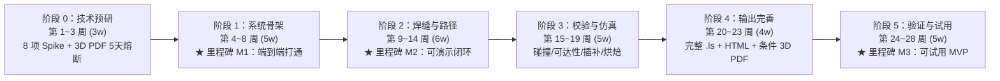

# 焊接机器人离线编程（OLP）系统 —— 完整开发计划（基于 `OLP_System_Design_Claude.md` v1.1 定版）

> **基线依据**：严格遵循 [`Docs/OLP_System_Design_Claude.md`](file:///c:/Users/mimovr/Desktop/TEmp/Si_FastSuite/Docs/OLP_System_Design_Claude.md)（v1.1 最终定版）与 [`Docs/FASTSUITE_OLP_System_Architecture.md`](file:///c:/Users/mimovr/Desktop/TEmp/Si_FastSuite/Docs/FASTSUITE_OLP_System_Architecture.md)。
> **对标产品**：德国 CENIT **FASTSUITE Edition 2**（下文简称 FS E2）。
> **目标闭环**：**3D 场景导入 → 工位/机器人配置 → 焊缝与路径编辑 → 可达性/碰撞校验 → 轨迹仿真预览 → 输出 FANUC `.ls` 与 3D PDF / 单文件离线 HTML 3D 动画包**。
> **最近刷新**：2026-10-28。当前正在做的事只写在 `.claude/Plan.md`：`DIR-001` 第 3 步 FCL 精确间隙检测已完成并 APPROVED。下一步是第 4 步：运动学金样改为从 URDF 读关节原点并比较完整姿态。

---

## 一、 当前活跃推进事项（Active Sprint）

1. **[DONE 2026-10-25] 真实测试场景资产（`SampleScenes/`）结构核验与 3.4 节场景导入方案拍板**：
   - 已核验 `SampleScenes/Scene1_TJoint_And_FANUC_M10iA/` 与 `SampleScenes/Scene2_Full_Workcell_STEP/`。
   - **正式拍板 3.4 节采用【方案 A：整场景 STEP 导入 + 内置库同型号可动机器人替换】（P0 默认，工期 1 周）**，并将 `FANUC M-10iA / ARC Mate 100iC`（含 URDF 精确关节参数、OPW 7 参数与视觉/碰撞 STL 网格）作为 M05 内置机器人库首款标准型号。
2. **[DONE 2026-10-27] 阶段 1 骨架和 M02～M13 的当前范围**：五层 CMake 工程、命令栈、STEP 导入、边拾取、TcpGizmo、OPW、焊缝路径、碰撞简化模型、仿真、`.ls` 和 2D PDF 已落地。阶段 0 的 ROBOGUIDE 对拍、FCL 耗时、3D PDF 熔断和三维 HTML 没有按原验收做完。达成度见 `.claude/Plan.md`。
3. **[DONE 2026-10-28] FCL 精确间隙替换（`DIR-001` 第 3 步，`M10-COLLISION-FCL-001` 已 APPROVED）**：
   - 连杆 1~6 STL 加 4 个焊枪球对工件/夹具/底座精确 FCL 窄相位网格距离（接触/穿透为 0.0 mm，碰撞 `<= 0.0`）；
   - 72 组自转扫描后台异步（支持取消），拖拽微调防抖双检防丢帧全臂逆解预览；代码拆分 `< 1000` 行；610 项测试全绿。
4. **[NEXT] 运动学金样改为从 URDF 读关节原点并比较完整姿态（`DIR-001` 第 4 步）**：
   - 解析 URDF origin 与 axis，比较完整旋转矩阵与位置，保持 `RISK-001` 开着。细节见 `.claude/Plan.md`。

---

## 二、 `SampleScenes` 场景资产核验与 3.4 节方案拍板结论

对工作区 [`SampleScenes/`](file:///c:/Users/mimovr/Desktop/TEmp/Si_FastSuite/SampleScenes) 下两套资源的实测核验结果如下：

### 2.1 场景一：`SampleScenes/Scene1_TJoint_And_FANUC_M10iA/`
1. **机器人运动学与网格资产（`Robot_FANUC_M10iA/`）**：
   - 包含 `urdf/fanuc_m10ia_standalone.urdf`、`m10ia.xacro`、`m10ia_macro.xacro` 及 `meshes/visual/base_link~link_6.stl`、`meshes/collision/base_link~link_6.stl`。
   - **机型**：`FANUC M-10iA / ARC Mate 100iC`（6 轴弧焊机器人）。
   - **OPW 几何参数（已标注并核实）**：
     - $a_1 = 150\text{ mm}$, $a_2 = -150\text{ mm}$, $b = 0\text{ mm}$, $c_1 = 450\text{ mm}$, $c_2 = 600\text{ mm}$, $c_3 = 640\text{ mm}$, $c_4 = 100\text{ mm}$。
   - **关节轴向与软限位（rad / deg）**：
     - `J1`: 轴 `(0, 0, 1)`，限位 `[-2.967, 2.967]` rad（`±170°`），最大角速度 `3.665 rad/s`
     - `J2`: 轴 `(0, 1, 0)`，限位 `[-1.570, 2.792]` rad（`-90° ~ +160°`），最大角速度 `3.316 rad/s`
     - `J3`: 轴 `(0, -1, 0)`，限位 `[-2.967, 4.014]` rad（`-170° ~ +230°`），最大角速度 `3.665 rad/s`
     - `J4`: 轴 `(-1, 0, 0)`，限位 `[-3.316, 3.316]` rad（`±190°`），最大角速度 `6.981 rad/s`
     - `J5`: 轴 `(0, -1, 0)`，限位 `[-3.316, 3.316]` rad（`±190°`），最大角速度 `6.981 rad/s`
     - `J6`: 轴 `(-1, 0, 0)`，限位 `[-6.283, 6.283]` rad（`±360°`），最大角速度 `10.471 rad/s`
2. **典型待焊工件 STEP（3 件）**：
   - `Workpiece_TJoint_With_Clamps.step`：含 4 个独立 `MANIFOLD_SOLID_BREP` 实体（底板 `Base_Plate_400x300x12`、立板 `Vertical_Web_Plate_400x12x160`、左夹具 `Fixture_Clamp_Left`、右夹具 `Fixture_Clamp_Right`）。专门用于验证 **M07 跨零件（立板边 + 底板面）T 型角焊缝两侧面识别** 与 **M10 焊枪对夹具碰撞检测/焊丝尖端豁免**。
   - `Workpiece_PipeFlange_DN15.step`：管法兰装配体（`DN15_Stamped_Flange`），含圆柱面与闭合回转曲面，专门用于验证闭合圆柱曲线焊缝采样与法向求取。
   - `Workpiece_U_Bracket_L70.step`：U 型折弯支架零件，用于验证直线+圆角切线连续边链扩展。

### 2.2 场景二：`SampleScenes/Scene2_Full_Workcell_STEP/`
1. **带机器人的完整焊接工位总装（`Full_Welding_Cell_With_Robot.step`）**：
   - AP214 工业标准 STEP，内部单位为 `mm`、`rad`，包含 **12 个命名 `MANIFOLD_SOLID_BREP` 实体**：
     - 机器人底座基台（1 个实体）：`Robot_Pedestal_Base`（顶面 `Robot_Pedestal_Base_Top` 位于 `Z = 500 mm`）
     - 静态机器人外形（5 个实体）：`FANUC_M10iA_Static_Base`、`FANUC_M10iA_Static_Link1_Turret`、`FANUC_M10iA_Static_Link2_LowerArm`、`FANUC_M10iA_Static_Link3_UpperArm`、`FANUC_M10iA_Static_Wrist_And_Torch`
     - 焊接工装台（1 个实体）：`Welding_Fixture_Table`
     - 待焊箱体角焊工件（3 个实体）：`Workpiece_Base_Plate`、`Workpiece_BoxWall_Front`、`Workpiece_BoxWall_Side`
     - 压紧夹具（2 个实体）：`Table_Clamp_Block_1`、`Table_Clamp_Block_2`
2. **附加待焊工件 STEP（2 件）**：
   - `Workpiece_SquareTube_80x80x5.step`（EN10219 80×80×5 方管）
   - `Workpiece_SteelHanger_SAET200.step`（SAET200 钢吊架）

### 2.3 第 3.4 节“导入带机器人的场景”正式拍板结论
- **拍板方案**：**方案 A（整场景 STEP 导入 + 用机器人库中同型号可动机器人替换静态机器人外形）作为 P0 默认实现（工期 1 周）**，同时吸收 Scene 1 的 `FANUC M-10iA` URDF + STL 资产直接构建 M05 内置标准机器人库包。
- **技术执行路径**：
  1. 用 OCCT 导入 `Full_Welding_Cell_With_Robot.step` 整场景，解析出 12 个实体节点；
  2. 自动按名称前缀 `FANUC_M10iA_Static_*`（或由用户在场景树中框选标记）识别静态机器人外形部件；
  3. 拾取 `Robot_Pedestal_Base_Top` 安装面（或读取 `FANUC_M10iA_Static_Base` 底面坐标 `(0, 0, 500)`），从内置库加载可动的 `FANUC M-10iA` 机器人并精确对齐基座（误差 `< 0.01 mm`）；
  4. 自动隐藏或移除静态机器人外形实体，保留底座、工装台、箱体工件与夹具参与后续选边编程和碰撞检测。

---

## 三、 MVP 范围定义（严格执行 P0 / P1 / P2 边界）

### 3.1 P0（MVP 必须包含）
1. **CAD 场景导入**：导入 STEP（`.step/.stp`）工件和夹具，保留装配结构、名称和颜色；导入 STL 作为辅助显示与碰撞几何；内部统一为 **毫米（mm）、弧度（rad）、Z 轴向上**。
2. **带机器人整场景导入与替换（3.4 节方案 A）**：导入含静态机器人的整场景 STEP，识别/标记静态机器人部件，对齐底座安装面并替换为内置库可动同型号机器人。
3. **内置机器人库**：内置 `FANUC M-10iA / ARC Mate 100iC`（可扩展 ARC Mate 100iD / M-10iD/12）6 轴弧焊机器人模型（含 OPW 参数、限位、J2/J3 耦合系数、各连杆视觉与碰撞网格、Home 位姿）。
4. **焊枪与坐标系定义**：焊枪挂载到法兰，定义 `UTOOL`（TCP 位姿偏移 X,Y,Z,W,P,R）；定义用户坐标系 `UFRAME`（数值输入 + 模型表面三点法：原点、X 方向点、XY 平面点）。
5. **焊缝定义（工艺几何）**：在 B-Rep 模型上拾取边 / 切线连续边链 $\rightarrow$ 自动识别两侧面（含同一实体相邻面 + 跨实体最近点距离匹配贴合面） $\rightarrow$ 选择焊接侧（显示预览箭头） $\rightarrow$ 按弧长采样计算焊缝局部坐标系。
6. **路径生成**：按步长或弦高误差离散（直线焊缝自动取首尾两端点 L 运动）、设置工作角（Work Angle）/ 行走角（Travel Angle）/ 自转角（Twist Angle）、自动生成切入点（Approach）与切出点（Retract）。
7. **路径编辑**：增、删、插入、重排、路径反向（自动交换起弧/收弧事件）、`TcpGizmo` 三维手柄拖拽（拖动只预览、松开提交单条命令）、数值修改（X,Y,Z,W,P,R 及参考坐标系切换）、焊接角修改、多选批量编辑、首尾两点间 SLERP 姿态插值、逐点跳转导航、重生成路径时保留手工修改点（`userModified` 标记）。
8. **运动学求解**：正运动学（FK）、OPW 8 组解析逆解（IK）、圈数扩展（±360°）、FANUC 配置字（`F/N, U/D, T/B + turn`）计算与选解锁定、**FANUC J2/J3 轴耦合换算**、软限位与接近限位预警（`< 5°`）、雅可比奇异点检测（腕部/肘部/肩部）、关节滑块点动与笛卡尔点动。
9. **可达性与碰撞校验**：碰撞对矩阵配置、**焊丝尖端与当前待焊工件碰撞豁免**、FCL/Coal 粗网格 BVH 离散点检测 + 段内自适应插补采样检测、碰撞（`≤ 0`）与接近（`< d_safe`）两级阈值、整路径批量可达性检查、可点击定位的 **问题列表（Issues）面板**、选中点 `[-180°, 180°]` **绕焊丝轴自转角可行性环扫描图**。
10. **运动仿真**：关节同步插补（J）、直线位置+SLERP 姿态插补（L，强制配置一致）、梯形/S 形速度规划、时间轴控制（播放/暂停/停止/单步/倍速/进度条拖拽/从选中点播放）、`StartState` 起始状态复位、节拍时间估算（标注几何准确、节拍为估算值）、仿真帧烘焙（`时间 → 各连杆 4x4 变换序列`）。
11. **工艺事件**：起弧 `Arc Start[n]`、收弧 `Arc End[n]`、焊接速度 `WELD_SPEED`、定位类型 `FINE / CNT0~100`、焊接条件号参数表。
12. **后处理与导出交付物**：
    - **FANUC `.ls` 程序**：含 `/PROG`、`/ATTR`、`/APPL`、`/MN`、`/POS`、`/END`，可在 ROBOGUIDE 中加载（或 MakeTP 编译为 `.tp`）并正确运行；支持界面预览文本。
    - **2D PDF 工艺报告**：含工位信息、UTOOL/UFRAME 参数、程序与焊缝表、点位明细表、节拍估算、问题清单及多视角离屏高清截图（基于 Qt `QPdfWriter`）。
    - **单文件离线 HTML 3D 动画包（P0 保底）**：单个 `.html` 内嵌 Three.js 与 Base64 GLB（OCCT `RWGltf_CafWriter` 写网格 + `tinygltf` 补写烘焙关键帧动画），断网双击可旋转、缩放、播放、倍速、拖进度条。
    - **3D PDF 动画（条件 P0）**：阶段 0 限时 5 个工作日熔断验证，通过则入 P0（阶段 4 实现），未通过则执行熔断规则。
13. **工程化基础**：工程文件保存/打开（ZIP 包：`project.json` + CAD 副本 + `.brep` 缓存 + 网格缓存）、全局命令系统与多步撤销/重做（Undo/Redo）、定时自动保存与崩溃恢复（Windows minidump）。

### 3.2 P1（下一阶段扩展）
- 圆弧运动（C）插补与曲线焊缝圆弧拟合；
- 两面求交（`BRepAlgoAPI_Section`）生成焊缝、FS E2 式“投影法”（Welding contour by projection）生成焊缝；
- 整条焊缝动态规划（DP）自动避障优化；
- 多焊缝间安全平面/安全点自动过渡路径规划；
- 运动学定义向导（3.4 节方案 B）、通用 URDF/USD 关节树导入与数值逆解后备（阻尼最小二乘）；
- OpenUSD 动画导出、视口 MP4 视频录制、焊接参数模板库、多程序拆分与 MakeTP 命令行自动编译回显。

### 3.3 P2（明确不做）
- 变位机/导轨等外部轴协同、多机器人协同、焊缝寻位/激光跟踪、多层多道焊、机器人标定与 TCP 实测补偿、`.ls` 逆向读回（Uploader）、其他品牌后处理（ABB/KUKA/Yaskawa）、AI 路径优化、Weld Cockpit 3D 焊接符号识别。

---

## 四、 系统总体架构与核心数据契约

### 4.1 五层架构与 CMake 模块映射

| 架构分层 | CMake Target | 核心职责 | 依赖约束 |
| :--- | :--- | :--- | :--- |
| **L4 数据与几何层（基础）** | `olp_core` | 单位/设置、变换树 `SceneNode`（`PartNode`/`RobotNode`/`ToolNode`/`FrameNode`）、`ControllerUnit`、`Program`、`Operation`、`Target`、`SeamDefinition`、拓扑几何签名 | 仅依赖 C++20 STL + Eigen3 + nlohmann_json；**严禁依赖 Qt 或 UI** |
| **L4 几何内核适配层** | `olp_cad` | `ICadKernel` 纯虚接口 + `OcctCadKernel`（STEP/STL 导入、拓扑查询、边弧长求值、面法向求值、细/粗双网格离散化、持久化签名计算） | 依赖 `olp_core` + OpenCASCADE（通过 `ICadKernel` 向外隔离 OCCT 头文件） |
| **L4 设备与运动学模型层** | `olp_device` | `RobotModel`（OPW 参数、关节限位、J2/J3 耦合系数、连杆网格引用）、`ToolModel`（焊枪与多 TCP）、内置 `FANUC M-10iA` 机器人包加载器 | 依赖 `olp_core` |
| **L3 核心算法层** | `olp_algo` | `M06` OPW 正逆运动学/配置字/奇异点/WPR 转换；`M10` 可达性/FCL 碰撞检测/焊丝尖端豁免/自转角扫描；`M11` J/L 插补/速度规划/节拍/帧烘焙 | 依赖 `olp_core`, `olp_cad`, `olp_device`, FCL/Coal；**纯 C++，与 Qt/视图完全解耦，100% 可单测** |
| **L5 输入输出层** | `olp_io` | `M12` FANUC `.ls` 后处理器；`M13` 2D PDF / 单文件离线 HTML 动画包 / 3D PDF 导出器；`M14` 工程文件读写器 | 依赖 `olp_core`, `olp_device`, `olp_algo` |
| **L2 应用业务层** | `olp_app` | `M01` `ProjectDocument`、`CommandManager`（Undo/Redo 栈与拖拽命令合并）、`SelectionManager`、`EventBus`、`TaskRunner`；`M04` 工位布局与机器人替换；`M07` 焊缝构建；`M08` 路径生成与编辑；`M09` 工艺事件管理 | 依赖 `olp_core`, `olp_cad`, `olp_device`, `olp_algo`, `olp_io` |
| **L1 表现与交互层** | `olp_ui` / `SiFastSuiteOLP` | Qt6 主窗口、布局/编程双工作台切换、7 大停靠面板、`OcctViewport` 三维视口、自研 `TcpGizmo` 操纵器交互控制层 | 依赖 `olp_app` + Qt6 Widgets/Gui/PrintSupport + OCCT AIS/V3d |

### 4.2 四大核心架构铁律
1. **算法层不依赖 Qt 和视图**：运动学、碰撞、插补、后处理全部封装为纯 C++ 库（`olp_algo`、`olp_io`），可直接通过 CLI 和 GoogleTest 驱动验证。
2. **所有修改强制走命令（Command Pattern）**：UI 严禁直接改写 `ProjectDocument`；一切增删改操作封装为 `ICommand` 派生类提交至 `CommandManager`，修改文档后触发 `EventBus` 信号驱动视图与面板刷新。
3. **派生数据可重算**：路径点由 `SeamDefinition` + `GenParams` 派生生成；逆解关节角、碰撞状态、最小间隙、仿真烘焙帧均为缓存（`TargetCache`），源数据变更时自动标记失效并在后台线程重算。
4. **三大数据持久化规则**：
   - **位姿存相对 `UFRAME` 的 $4\times 4$ 齐次变换矩阵**：现场工件挪动只需校准 `UFRAME`，所有路径点局部坐标无需重算。
   - **“自动生成 + 手工修改”共存（`userModified`）**：用户通过 Gizmo 或数值手工微调过的 `Target` 打上 `userModified = true` 标记并记录相对弧长比例 $s/L$ 与局部偏移 $\Delta T$；修改焊缝参数重新生成路径时，按弧长比例匹配保留手工修改点。
   - **B-Rep 拓扑持久化几何签名（`TopologicalSignature`）**：除存储 CAD 文件 SHA-256 哈希与 TopExp 索引外，同时存储边的几何签名（起点坐标、终点坐标、中点坐标、弧长、切向向量），重新打开工程或更新 STEP 时校验签名，防止索引漂移。

---

## 五、 十五大模块（M01 ~ M15）开发实施细则与关键算法规格

### M01 应用框架（`src/app/`）
- **文档模型 `ProjectDocument`**：统一持有 `Units/Settings`、`Scene`、`DeviceLibrary`、`ControllerUnit` 列表、`SeamDefinition` 列表及脏标记（`isDirty`）。
- **命令栈 `CommandManager`**：
  - 接口：`execute(cmd)`、`undo()`、`redo()`、`canUndo()`、`canRedo()`、`clear()`，默认栈深度 200 步（可配置）。
  - 支持命令合并 `mergeWith(const ICommand*)`：用于 `TcpGizmo` 拖动松开提交及微调滑块连续修改。
- **选择集 `SelectionManager`**：支持 `SceneNode`、`SeamDefinition`、`Operation`、`Target`、CAD 子形状（`Face`/`Edge`/`Vertex`）多类型选择同步与悬停预高亮。
- **事件总线 `EventBus` 与后台任务 `TaskRunner`**：当路径或工位变换改变时，自动触发后台工作线程重算批量 IK 与碰撞，支持进度回调与取消令牌（`std::atomic<bool> cancelToken`）。

### M02 几何内核适配层（`src/cad/`）
- **抽象接口 `ICadKernel`**：
  - `loadStep(path, outSceneNodes)`：使用 `STEPCAFControl_Reader` 解析装配树、零件名称、RGB 颜色及原始单位（自动乘尺度因子统一换算至 `mm`）。
  - `loadStl(path, outMesh)`：加载视觉/碰撞三角网格。
  - `getEdges(partId)`、`getAdjacentFaces(partId, edgeId)`：利用 `TopExp::MapShapesAndAncestors` 查询拓扑邻接面。
  - `findClosestFacesAcrossParts(edge, candidateParts, maxTolMm)`：**专解 T 型角焊跨零件暗坑**——当焊缝边属于立板 A，而底板 B 是另一独立 Solid 时，在边中点/采样点处通过 `BRepExtrema_DistShapeShape` 计算到相邻零件各面的最小距离，匹配距离 `< 1.0 mm` 的贴合母材面。
  - `evaluateEdgeAtArcLength(partId, edgeId, s)`：通过 `BRepAdaptor_Curve` 与 `GCPnts_AbscissaPoint` 求弧长 $s$ 处的三维点 $p(s)$ 与切向 $t(s)$（自动处理 `TopAbs_REVERSED` 边方向）。
  - `evaluateFaceNormalAtPoint(partId, faceId, pt)`：通过 `ShapeAnalysis_Surface` 投影求 $(u,v)$，再用 `BRepLProp_SLProps` 求外法向（自动根据 `face.Orientation() == TopAbs_REVERSED` 翻转确保指向材料外侧）。
  - `tessellate(partId, fineDeflection, coarseDeflection)`：生成细渲染网格（弦高 `0.1 mm`）与粗碰撞网格（弦高 `1.0 mm`）。
  - `computeEdgeSignature(partId, edgeId)`：生成持久化几何签名。

### M03 三维视图与 `TcpGizmo` 操纵器（`src/ui/viewport/`）
- **视口 `OcctViewport`**：集成 Qt6 `QWidget` 与 OCCT `V3d_View` / `AIS_InteractiveContext`，支持着色/边线/线框/透明度显示、`AIS_ViewCube` 视图立方体、对象/面/边/顶点四级拾取模式切换、路径折线（切入黄/焊接红/切出青/空走蓝）与 TCP 轨迹渲染。
- **`TcpGizmo` 5 条硬核设计规范**：
  1. **不挂接对象**：复用 `AIS_Manipulator` 作为视觉手柄并调用 `StartTransform / Transform / StopTransform` 提取鼠标拖动增量 $\Delta T$，**绝不调用 `Attach()` 直接改写路径点对象**。
  2. **自定义参考系与步进吸附**：拖动增量 $\Delta T$ 先转换至当前激活参考系（世界 World / 工具 Tool / 用户 UFRAME / 焊缝 Seam），再按步进阈值（如平移 `1.0 mm`、旋转 `1.0°`）取整得到预览位姿 $T_{\text{preview}}$。
  3. **拖动中只预览、后台仅算最新帧**：鼠标移动时仅发出 `PreviewPoseChanged(targetId, T_preview)`，文档数据不变；后台工作线程使用长度=1 的最新请求槽（丢弃中间排队帧）实时计算当前点 OPW 逆解并刷新机器人各连杆矩阵 + 单点碰撞检测变色，确保 100 万三角面下帧率 `≥ 30 FPS`、跟随延迟 `< 100 ms`。
  4. **松开鼠标才提交单条命令**：`mouseReleaseEvent` 时生成唯一一条 `ModifyTargetPoseCommand` 压入 `CommandManager` 撤销栈，并触发该点所在运动段的完整段内插补碰撞重算；拖拽途中按 `Esc` 立即取消预览并恢复原位姿。
  5. **多选联动拖动**：同时选中多个路径点时，同一参考系增量作用至全部选中点，松手时打包为一条 `MacroCommand` 入栈。

### M04 工位布局（`src/app/layout/`）
- **场景树管理**：显隐、锁定、重命名、父子层级调整、工件/夹具/环境碰撞分组标记。
- **3.4 节方案 A 整场景机器人替换器（`RobotReplacementService`）**：
  - 自动扫描整场景 STEP 中名称匹配 `FANUC_*` / `Robot_*` 的静态实体节点（或支持用户手动指定）；
  - 提取静态底座基准面坐标系（如 `Full_Welding_Cell_With_Robot.step` 中 `Z = 500 mm` 的 `Robot_Pedestal_Base_Top`），从 `DeviceLibrary` 实例化可动的 `FANUC M-10iA` `RobotNode`，自动对齐基座变换（位置偏差 `< 0.01 mm`），并将原静态机器人实体设为隐藏与不参与碰撞。
- **UFRAME 定义**：支持直接输入 `(X, Y, Z, W, P, R)` 或在 CAD 模型上拾取三点（$P_0$ 原点、$P_x$ X轴正向点、$P_{xy}$ XY平面点）构建正交右手系，并自动换算为相对于机器人基座世界坐标系的变换。

### M05 设备与运动学模型（`src/device/`）
- **机器人 JSON 定义规范（`resources/robots/fanuc_m10ia.json`）**：
  - 完整描述 `FANUC M-10iA / ARC Mate 100iC` 的 OPW 7 参数（`a1=150, a2=-150, b=0, c1=450, c2=600, c3=640, c4=100` mm）、轴方向符号、6 轴位置限位/速度限位/加速度限位、`j2_j3_coupling = true`、Home 关节角 `[0, 0, 0, 0, -90°, 0]`，以及绑定 `SampleScenes/Scene1_TJoint_And_FANUC_M10iA/Robot_FANUC_M10iA/meshes/` 下的视觉与碰撞 STL 网格。
- **焊枪工具定义（`ToolModel`）**：支持挂载焊枪几何体、设置多个 `UTOOL[n]` TCP 坐标偏移，支持在焊枪模型上拾取焊丝尖端点与导电嘴轴向自动生成 TCP。

### M06 运动学求解（`src/algo/kinematics/`）
- **正运动学（FK）**：输入 6 关节角 $\theta_1 \dots \theta_6$，输出各连杆变换矩阵 $T_1 \dots T_6$、法兰位姿 $T_{\text{flange}}$ 与 TCP 位姿 $T_{\text{tcp}} = T_{\text{base}} \cdot T_{\text{flange}}(\theta) \cdot T_{\text{utool}}$。
- **OPW 解析逆解（IK）与圈数扩展**：
  - 基于 OPW 7 参数闭式求解 8 组基本解；
  - 对 `J1`、`J4`、`J6` 进行 $\pm 360^\circ$ 圈数展开并按各轴软限位过滤。
- **FANUC J2/J3 轴耦合换算（关键行业暗坑修正）**：
  - 建立内部独立几何模型关节角 $(\theta_2_{\text{model}}, \theta_3_{\text{model}})$ 与 FANUC 示教器/ROBOGUIDE 显示角 $(J_2, J_3)$ 之间的双向精确换算关系（支持可配置耦合系数 $k_{23} \in \{-1, 0, +1\}$，默认按 FANUC 平行四边形等效耦合规则 $\theta_{3,\text{world}} = J_2 + J_3$ 对拍核定）。
- **FANUC 配置字（Configuration String）与选解策略**：
  - 自动判定 `F/N`（Flip / Non-flip，由 $J_5$ 正负决定）、`U/D`（Up / Down，肘部上下）、`T/B`（Top / Bottom，手腕朝向）及三主轴圈数 `turn1, turn2, turn3`，格式化为 `'N U T, 0, 0, 0'`。
  - **选解优先级**：用户强制锁定的配置字 $>$ 与上一路径点加权关节距离最小（底座大轴权重高于腕部小轴） $>$ 远离奇异点与限位边界。
  - **硬约束**：同一焊接段（`Arc Start` 至 `Arc End`）内严禁配置字跳变；若同配置无解，立即标记该点为 `CONFIG_JUMP / UNREACHABLE` 问题点，绝不静默切换配置。
- **WPR 欧拉角双向转换（6.4 节公式）**：
  - 旋转矩阵 $R = R_z(r) \cdot R_y(p) \cdot R_x(w)$ 转 FANUC `W, P, R`（单位 `deg`）：
    $$p = \operatorname{atan2}\!\left(-r_{31},\ \sqrt{r_{11}^2 + r_{21}^2}\right),\quad w = \operatorname{atan2}(r_{32},\ r_{33}),\quad r = \operatorname{atan2}(r_{21},\ r_{11})$$
  - 当 $|p| \to 90^\circ$（$\sqrt{r_{11}^2 + r_{21}^2} < 10^{-7}$）触发万向锁时，固定 $w = 0$ 并由 $\operatorname{atan2}(-r_{12}, r_{22})$ 求解 $r$。

### M07 焊缝定义与焊枪姿态标架算法（`src/app/seam/`，6.1 节公式）
- 在焊缝边链弧长 $s$ 处：
  1. 求曲线点 $p(s)$ 与单位切向向量 $t(s)$（结合边拓扑方向与用户指定焊接前进方向）。
  2. 将 $p(s)$ 投影至两侧母材面（支持同实体相邻面与跨零件最近点贴合面），求取朝向材料外侧的单位外法向 $n_1, n_2$。
  3. 计算两侧面外法向的单位角平分线向量：
     $$b = \frac{n_1 + n_2}{\|n_1 + n_2\|}$$
     若 $\|n_1 + n_2\| < 10^{-5}$（两面法向完全反向），立即报错提示用户翻转面法向。
  4. 构建焊缝局部正交右手坐标系 $F_{\text{seam}}(s)$：
     $$X = t(s),\quad Z_0 = -b \text{（指向焊缝根部）},\quad Y = \frac{Z_0 \times X}{\|Z_0 \times X\|},\quad Z = X \times Y$$
  5. 叠加焊接工艺三角度得到目标 TCP 位姿旋转矩阵：
     $$R_{\text{tcp}}(s) = R_{\text{seam}}(s) \cdot R_x(\alpha_{\text{work}}) \cdot R_y(\beta_{\text{travel}}) \cdot R_z(\gamma_{\text{twist}})$$

### M08 & M09 路径生成、编辑与工艺事件（`src/app/toolpath/`）
- **自动路径生成**：
  - 起点/终点内缩（Start/End Trim）后，直线焊缝默认仅取首尾 2 个焊接点（`WELD_START`、`WELD_END`），曲线焊缝按步长（如 `5~10 mm`）或弦高误差采样中间点（`WELD_VIA`）。
  - 自动沿焊枪退枪方向（$-Z_{\text{tcp}}$）偏移 $d_{\text{approach}}$（默认 `50 mm`）与 $d_{\text{retract}}$（默认 `50 mm`）生成切入点 `APPROACH` 与切出点 `RETRACT`。
- **默认工艺事件规则（M09）**：
  - `APPROACH`：`J` 或 `L` 运动，速度 `50%` 或 `200 mm/sec`，`CNT50`；
  - `WELD_START`：`L` 运动，速度 `200 mm/sec`，`FINE`，挂载 `Arc Start[1]`；
  - `WELD_VIA`：`L` 运动，速度 `WELD_SPEED`，`CNT100`；
  - `WELD_END`：`L` 运动，速度 `WELD_SPEED`，`FINE`，挂载 `Arc End[1]`；
  - `RETRACT`：`L` 运动，速度 `200 mm/sec`，`CNT50`。
- **编辑能力**：增删插改、路径反向（自动互换首尾点的 `Arc Start[n]` 与 `Arc End[n]`）、首尾两点间按弧长权重做四元数 `SLERP` 姿态插值、重生成路径时按弧长比例恢复 `userModified == true` 的微调点。

### M10 可达性、碰撞检测与自转角扫描（`src/algo/collision/`）
- **碰撞对矩阵与焊丝尖端豁免**：
  - 默认开启 `机器人连杆 1~6 + 焊枪本体` vs `工件 + 夹具 + 工装台 + 底座` 碰撞检测；自动屏蔽相邻连杆及法兰与焊枪。
  - **焊丝尖端碰撞豁免（暗坑保护）**：在 `WELD_START / WELD_VIA / WELD_END` 焊接段内，将焊丝尖端球域（TCP 周围半径 $r_{\text{exempt}} = 8\sim 15\text{ mm}$）或导电嘴末端几何体对**当前绑定的待焊工件实体**做碰撞豁免，而焊枪枪体对其余夹具（如 `Fixture_Clamp_Left/Right`）保持严格碰撞检测。
- **离散点 + 段内采样双重检测**：
  - 除检查每个 `Target` 端点外，在相邻两点间按最大步长 `5 mm` / 最大转角 `2°` 自适应插补采样，杜绝“端点不撞中间撞”。
- **自转角可行性环扫描（6.5 节）**：
  - 对当前选中路径点，以 $\Delta\gamma = 5^\circ$ 遍历绕焊丝轴自转角 $\gamma \in [-180^\circ, 180^\circ]$（共 72 组采样），计算每组角度的可达性、同配置逆解、最小碰撞间隙与奇异值，输出可视化红/黄/绿可行性圆环供用户一键拖拽至最优无碰撞区间。

### M11 运动仿真与帧烘焙（`src/algo/simulation/`）
- **插补器**：
  - `J` 运动：6 轴关节空间同步梯形速度插补，所有轴同时起止。
  - `L` 运动：笛卡尔空间位置线性插值 + 姿态四元数 `SLERP` 插值，每个采样步按“距离上一采样步最近且同配置”求逆解；若相邻采样步关节角突变超过阈值（如 `> 15°`），立即标记该段穿过奇异点或发生配置跳变。
- **时间轴与帧烘焙（Frame Baking）**：
  - 每次从 `Program::StartState` 复位启动，计算总节拍、焊接时间、空走时间；
  - 将仿真结果按指定帧率（如 `30 FPS`）及关键变化拐点烘焙为 `BakedAnimation`（时间戳序列 + 各刚体节点三维平移/四元数旋转通道 + TCP 焊道轨迹点序列），供 HTML 动画包和 3D PDF 直接复用。

### M12 FANUC `.ls` 后处理器（`src/io/post/`）
- 严格输出可在 FANUC ROBOGUIDE 中直接加载或通过 `MakeTP` 编译的 ASCII `.ls` 文件：
  - 校验程序名（大写英文字母开头，仅含字母数字下划线，长度 `≤ 8~16` 字符）；
  - 生成 `/PROG`、`/ATTR`（含 `DEFAULT_GROUP = 1,*,*,*,*;`）、`/APPL`（含 `ARC Welding Equipment : 1,*,*,*,*;`）、`/MN`（带行号指令序列：`UFRAME_NUM`、`UTOOL_NUM`、`J/L P[i:comment] speed term ;`、`Arc Start[n] ;`、`Arc End[n] ;`）、`/POS`（含 `GP1: UF, UT, CONFIG, X, Y, Z, W, P, R` 精确到小数点后 3 位）、`/END`。

### M13 报告、单文件离线 HTML 动画包与 3D PDF 熔断机制（`src/io/export/`）
1. **2D PDF 工艺报告（P0）**：使用 Qt `QPdfWriter` + `QPainter` 输出工位概览、UTOOL/UFRAME 标定表、焊缝与工艺参数表、路径点位坐标表、节拍统计、问题列表及多视角截图。
2. **单文件离线 HTML 3D 动画包（P0 保底交付物，工期 1.5~2 周）**：
   - 将减面后的工位网格与 M11 烘焙的连杆运动关键帧写入 GLB（或 JSON 场景包），与离线精简版 Three.js 播放器及时间轴 UI 内嵌打包为**单一独立 `.html` 文件**；
   - 支持断网环境双击通过 Chrome/Edge 打开，支持旋转/缩放、播放/暂停/倍速、拖动进度条、显隐路径线与焊道轨迹、按焊缝跳转及实时显示当前关节角/焊接参数。
3. **3D PDF 动画 5 个工作日严格熔断规则（条件 P0）**：
   - 在阶段 0 预研中投入严格不超过 **5 个工作日**，测试 `IDTF/U3D + PDF 3D Annotation + Acrobat 3D JavaScript` 帧驱动动画链路，并在最新版 Adobe Acrobat Reader（开启 3D 选项）中实测；
   - **5 天内跑通**：3D PDF 正式纳入 P0，排入阶段 4 完成工程化封装；
   - **5 天内未跑通**：立即触发熔断停止开源链路投入，转交用户二选一决策：① 采购商业 SDK（HOOPS Publish / PDF3D）；② MVP 以“2D PDF 工艺报告 + 单文件离线 HTML 3D 动画包”作为正式交付物，3D PDF 移入后续版本。

### M14 & M15 工程文件、质量保障与 CI（`src/io/project/`, `tests/`）
- **工程文件格式（`.fsproj` / ZIP）**：包含 `project.json`（含 schema 版本号与自动迁移器）、源 STEP/STL 副本、OCCT `.brep` 缓存与三角网格缓存，支持定时自动保存与崩溃恢复。
- **GoogleTest 自动化测试套件**：覆盖运动学正逆解闭环（$\text{FK}(\text{IK}(T)) = T$ 位置误差 `< 0.01 mm`、姿态误差 `< 0.001°`）、WPR 欧拉角与万向锁、命令栈撤销/重做 100 步一致性、T 型角焊缝两侧面法向与角平分线计算、`.ls` 金样本逐行比对。

---

## 六、 六阶段 28 周详细开发排期与里程碑（Phase 0 ~ Phase 5）

> **团队配置假设**：4 名全职研发（1 技术负责人/框架、1 几何算法、1 机器人算法、1 应用与输出）+ 0.3 名兼职焊接工艺/FANUC 顾问。
> **工期总览**：**第 3 周末**完成阶段 0 预研排雷 $\rightarrow$ **第 8 周末（M1）**打通端到端骨架闭环 $\rightarrow$ **第 14 周末（M2）**达成可演示完整闭环 $\rightarrow$ **第 28 周末（M3）**交付可在真实工位试用的 MVP。

### 阶段 0：技术预研（第 1~3 周，共 3 周）
**核心目标**：在全面铺开 UI 之前，将最高风险的技术不确定性全部排雷并冻结架构契约。

| 周次 | 任务编号 | 具体预研任务（Spike） | 负责角色 | 验收产出物 |
| :--- | :--- | :--- | :--- | :--- |
| **第 1 周** | **S0-1** | **真实场景文件核验与 3.4 节方案拍板**：解析 `SampleScenes/Scene1` 与 `Scene2` 全部 STEP/URDF/STL，确认整工位 STEP 结构与 `FANUC M-10iA` 参数 | 全员 | **【已于 2026-10-25 完成】** 拍板方案 A（整场景导入+机器人替换） |
| **第 1 周** | **S0-2** | **CMake + Qt6 + OCCT 基础工程骨架与 CI 搭建**：建立五层 CMake 工程、模块接口头文件、GoogleTest 测试框架 | 技术负责人 | 可编译通过的 C++20 模块化工程骨架与单测流水线 |
| **第 1~2 周** | **S0-3** | **OCCT 几何导入与拾取预研**：加载 `Workpiece_TJoint_With_Clamps.step`、`Workpiece_PipeFlange_DN15.step`、`Full_Welding_Cell_With_Robot.step`；验证边拾取、跨零件相邻面查找、面外法向求值及百万三角面显示帧率 | 几何算法 | OCCT 拓扑查询与跨零件角焊面识别验证程序 |
| **第 1~2 周** | **S0-4** | **FANUC M-10iA 运动学对拍预研**：实现 OPW 正逆解、配置字、J2/J3 耦合与 WPR 转换；与 ROBOGUIDE 20 组采样点比对，位置误差 `< 0.01 mm`、角度误差 `< 0.001°` | 机器人算法 | `olp_algo` 运动学模块 + 20 组点位对拍单测报告 |
| **第 2 周** | **S0-5** | **FANUC `.ls` 金样本加载验证**：生成包含 `UFRAME/UTOOL`、`J/L`、`Arc Start[1]/Arc End[1]` 的 `.ls` 文件，验证在 ROBOGUIDE 中无报错加载并运行 | 应用与输出 | 标准 `.ls` 金样本模板与 `FanucLsPostProcessor` 原型 |
| **第 2 周** | **S0-6** | **3D PDF 限时 5 个工作日严格熔断验证**：验证开源 U3D + PDF 3D 注释 + 3D JS 能否在最新版 Adobe Reader 中驱动机器人动画播放；第 5 天末严格按熔断规则拍板 | 应用与输出 | 3D PDF 预研原型或熔断决策记录 |
| **第 3 周** | **S0-7** | **单文件离线 HTML 动画包验证（1~2 天）**：输出工件与机器人网格至 glTF/GLB，写入一段关节关键帧动画并内嵌至单文件 Three.js HTML，验证断网双击播放 | 应用与输出 | 单文件离线 HTML 3D 播放器原型 |
| **第 3 周** | **S0-8** | **`TcpGizmo` 操纵器与 FCL 单次碰撞耗时验证**：验证不挂接对象的 `AIS_Manipulator` 提取拖动增量驱动机器人实时逆解，并实测 FCL 在“机器人+焊枪 vs 夹具”上的单点碰撞耗时（目标 `< 10 ms`） | 技术负责人 + 机器人算法 | `TcpGizmo` 原型与 FCL 性能测试报告 |

---

### 阶段 1：系统骨架与端到端打通（第 4~8 周，共 5 周）
**核心目标**：建立强制走命令栈的编辑器骨架，在第 8 周末跑通第一条从“导入带机器人场景”到“导出 `.ls` 在 ROBOGUIDE 运行”的端到端链路。

- **4.1 框架与视图主线（技术负责人，5 周）**：
  - 第 4~5 周：完成 M01 `ProjectDocument`、`CommandManager`（Undo/Redo 栈）、`SelectionManager`、`EventBus`、后台任务调度器与主窗口布局/编程双工作台切换框架；
  - 第 6 周：完成 M03 `OcctViewport` 三维视图基础（旋转/平移/缩放、`AIS_ViewCube`、着色/线框显示模式、对象/面/边子形状拾取与高亮）；
  - 第 7 周：完成 M03 自研 `TcpGizmo` 操纵器（复用 `AIS_Manipulator` 取增量、世界/工具/用户/焊缝四参考系切换、步进吸附、拖动后台预览、松手提交单条命令、`Esc` 取消）；
  - 第 8 周：完成 M14 基础版工程文件（`.fsproj` / JSON）保存与打开。
- **4.2 几何与布局主线（几何算法 + 应用与输出，5 周）**：
  - 第 4~5 周：完成 M02 `OcctCadKernel` 的 STEP（XCAF 装配树、名称、颜色、单位统一至 `mm`）与 STL 导入、细渲染网格与粗碰撞网格双离散化；
  - 第 6 周：完成 M04 场景树面板、对象数值/Gizmo 放置、焊枪挂载、UTOOL 与 UFRAME（数值 + 三点法）定义；
  - 第 7 周：完成 M04 **3.4 节方案 A 整场景 STEP 导入与静态机器人替换**（在 `Full_Welding_Cell_With_Robot.step` 上一键替换为内置库可动 `FANUC M-10iA`）；
  - 第 8 周：完成 M12 基础版 `.ls` 导出器与联调。
- **4.3 机器人与运动学主线（机器人算法，5 周）**：
  - 第 4~5 周：完成 M05 机器人 JSON 库定义与内置 `FANUC M-10iA` 资源包封装；
  - 第 6~7 周：完成 M06 正运动学 FK、OPW 8 组解析逆解 IK、圈数扩展、配置字计算与锁定、J2/J3 耦合换算、软限位与奇异点检测；
  - 第 8 周：完成 J1~J6 关节点动滑块面板、笛卡尔点动面板及简单关节/直线点位顺序播放。
- **★ 里程碑 M1（第 8 周末验收）**：
  - 导入 `Full_Welding_Cell_With_Robot.step` 整场景 $\rightarrow$ 将静态机器人外形替换为内置可动 `FANUC M-10iA` $\rightarrow$ 手工示教 3~5 个路径点（用 `TcpGizmo` 拖动微调，验证 Undo/Redo 正常） $\rightarrow$ 在视口内简单播放轨迹 $\rightarrow$ 导出 `.ls` 程序并在 ROBOGUIDE 中跑出完全一致的轨迹。

---

### 阶段 2：焊缝定义、路径生成编辑与保底导出（第 9~14 周，共 6 周）
**核心目标**：完成核心焊接工艺几何算法与路径编辑器，在第 14 周末交付可对外完整演示的闭环系统。

- **5.1 焊缝与路径生成主线（几何算法，6 周）**：
  - 第 9~10 周：完成 M07 选边与切线连续边链自动扩展、同实体相邻面 + 跨实体最近点距离两侧面识别（在 `Workpiece_TJoint_With_Clamps.step` 与 `Full_Welding_Cell_With_Robot.step` 箱体角焊上验证）、焊接侧箭头预览与切换；
  - 第 11~12 周：完成 M07 焊缝局部坐标系采样计算（6.1 节角平分线算法）、起止点内缩/外延、B-Rep 边几何持久化签名；
  - 第 13~14 周：完成 M08 由焊缝自动生成路径（步长/弦高采样、直线段两点优化、工作角/行走角/自转角合成、切入/切出点生成、重生成保留 `userModified` 手改点）。
- **5.2 路径编辑与工艺事件主线（技术负责人 + 机器人算法，6 周）**：
  - 第 9~10 周：完成 M08 程序/操作树（ControllerUnit $\rightarrow$ Program $\rightarrow$ Operation $\rightarrow$ Target）与路径点明细表格视图；
  - 第 11~12 周：完成 M08 路径点增删插改、复制粘贴、路径反向（自动互换起弧/收弧）、多选批量偏移/改角度/改速度、首尾两点间 `SLERP` 姿态插值、前后键逐点跳转导航（对标 FS E2 *Events and teach*）；
  - 第 13~14 周：完成 M09 焊接工艺事件（`Arc Start[n]`、`Arc End[n]`、`WELD_SPEED`、`FINE/CNT`）及焊接条件号参数表。
- **5.3 报告与离线 HTML 动画包主线（应用与输出，6 周）**：
  - 第 9~10 周：完成 M13 基于 `QPdfWriter` 的 2D PDF 工艺报告导出（含离屏多视角高清截图、坐标系表、焊缝表、点位表）；
  - 第 11~14 周：完成 M13 glTF/GLB 场景网格导出（`RWGltf_CafWriter`）、连杆变换关键帧动画通道写入（`tinygltf`）及单文件离线 HTML（内嵌 Three.js）播放器基础版。
- **★ 里程碑 M2（第 14 周末验收 —— 可演示完整闭环）**：
  - 在 T 型角焊工件（`Workpiece_TJoint_With_Clamps.step`）与整工位箱体工件（`Full_Welding_Cell_With_Robot.step`）上拾取焊缝边 $\rightarrow$ 自动生成带切入/切出和起弧/收弧的焊接路径 $\rightarrow$ 用 `TcpGizmo` 与焊接角面板微调姿态 $\rightarrow$ 播放仿真 $\rightarrow$ 一键导出 FANUC `.ls`、2D PDF 工艺报告和单文件离线 HTML 3D 动画包。

---

### 阶段 3：可达性校验、碰撞检测与高保真仿真（第 15~19 周，共 5 周）
**核心目标**：补齐工业级防撞校验、自转角避障辅助与连续运动仿真插补。

- **6.1 碰撞与可达性主线（机器人算法 + 几何算法，5 周）**：
  - 第 15~16 周：完成 M10 碰撞对矩阵配置、FCL/Coal BVH 粗碰撞网格与机器人连杆凸包加速、**焊丝尖端与当前待焊工件碰撞豁免机制**；
  - 第 17 周：完成 M10 离散路径点碰撞/最小间隙查询 + 两点间自适应插补采样检测（防止端点不撞中间撞）、两级阈值（碰撞 `≤ 0` 红色、接近 `< d_safe` 黄色）；
  - 第 18~19 周：完成 M10 整条路径批量可达性扫描（不可达/超限位/奇异点/配置跳变/碰撞）、可点击跳转定位的 **问题列表（Issues）面板**，以及选中点 `[-180°, 180°]` **绕焊丝轴自转角可行性环扫描图**。
- **6.2 运动仿真与时间轴主线（技术负责人 + 应用与输出，5 周）**：
  - 第 15~16 周：完成 M11 关节空间同步插补（J）与笛卡尔直线+SLERP 插补（L，强制检查采样点配置一致性）；
  - 第 17~18 周：完成 M11 梯形/S 形加减速速度规划、`StartState` 起始状态强制复位、完整时间轴面板（播放/暂停/停止/按点或按时间单步/倍速/进度条拖拽/从选中点起播）；
  - 第 19 周：完成 M11 总节拍/焊接时间/空走时间分项估算与高压缩比仿真帧烘焙（`BakedAnimation`）。

---

### 阶段 4：输出模块完善与条件 3D PDF 落地（第 20~23 周，共 4 周）
**核心目标**：将 `.ls` 后处理、HTML 动画包与（条件通过的）3D PDF 打磨至工业交付水准。

- **第 20~21 周（M12 `.ls` 完整后处理）**：支持单工程多程序导出、Home 等点的关节坐标输出（自动处理 J2/J3 耦合）、程序名/注释长度/行数合法性校验、控制器单元专属后处理配置、界面内 `.ls` 语法高亮预览。
- **第 20~21 周（M13 HTML 动画包完善）**：增加按程序/焊缝列表点击跳转、当前播放点实时关节角与焊接参数 HUD 信息面板、网格减面与关键帧抽稀（只在旋转/平移变化超阈值处保留关键帧，确保典型工位单文件 `< 50 MB`）。
- **第 22~23 周（M13 条件项 3D PDF 动画或 P1 增强）**：
  - 若阶段 0 预研跑通或已引入商业 SDK：完成烘焙帧 $\rightarrow$ PDF 3D 注释与 3D JavaScript 播放控件、路径线叠加及首页“Adobe Reader 开启 3D 指引”；
  - 若阶段 0 已触发熔断且不采购商业 SDK：将这 2 周投入阶段 3 复杂工件碰撞性能优化及 P1 高优功能（两面求交焊缝 / 焊缝间安全高度自动过渡）。

---

### 阶段 5：回归验证、真机实焊与安装包交付（第 24~28 周，共 5 周）
**核心目标**：通过 ROBOGUIDE 回归库与真机实焊验收，交付稳定可靠的工业试用版 MVP。

- **第 24~25 周（ROBOGUIDE 全面对拍与回归测试）**：建立覆盖 T 型角焊、搭接焊、管板（`Workpiece_PipeFlange_DN15`）、方管（`Workpiece_SquareTube_80x80x5`）、箱体内角（`Full_Welding_Cell_With_Robot`）等 10~20 个典型工件的回归场景库，逐一在 ROBOGUIDE 中验证点位、姿态、配置字与运动轨迹 100% 一致。
- **第 26~27 周（真机空走与实焊验证）**：在真实 FANUC 弧焊工位上完成至少 2 个典型工件空走验证（不起弧核验 TCP 轨迹与防撞）和至少 1 个工件实焊验证。
- **第 27~28 周（性能、稳定性加固与安装器打包）**：
  - 100 万三角面大夹具场景渲染与拖拽性能优化；
  - 连续编辑 2 小时无内存泄漏/崩溃压测、100 步 Undo/Redo 一致性压测、定时自动保存与崩溃恢复测试；
  - 制作包含 VC++ 运行库、Qt6 与 OpenCASCADE 动态库的 Windows 独立安装包（NSIS / WiX）。
- **★ 里程碑 M3（第 28 周末验收 —— 可在真实工位试用的 MVP）**：全部 9 项量化验收指标（见第八节）100% 达标。

---

## 七、 风险管控矩阵与应对预案

| 序号 | 风险项 | 影响程度 | 落地应对措施 |
| :--- | :--- | :--- | :--- |
| **R01** | 缺少 ROBOGUIDE 或真机验证环境 | 致命（`.ls` 与运动学无法验收） | 阶段 0 先以内置 `FANUC M-10iA` 标准 OPW 公式与 `.ls` 金样本建立自动化单测；立项并行落实 ROBOGUIDE（含 ArcTool）授权对拍 |
| **R02** | 运动学参数/J2-J3 耦合与真机不一致 | 高（仿真看似正确、现场跑偏） | 在 `OpwKinematics` 中显式实现 J2/J3 耦合开关与系数配置，入库前必须通过 100 组采样点正逆解双向对拍测试 |
| **R03** | 开源 3D PDF 动画链路陈旧难调 | 中（吞噬数周工期或无法交付） | 严格执行阶段 0 **5 个工作日熔断规则**；将“2D PDF 报告 + 单文件离线 HTML 动画包”提为 P0 保底，共用烘焙帧零重复开发 |
| **R04** | 新版 Adobe Reader 默认禁用 3D 内容 | 中（客户打开 3D PDF 显示空白） | 在 PDF 报告首页自动生成图文开启指引，并始终同步交付双击即看的单文件离线 HTML 动画包 |
| **R05** | 场景导入范围蔓延 | 高（无休止适配非标机器人格式） | 已通过核验 `SampleScenes/` 拍板 P0 走 **3.4 节方案 A（整场景 STEP 导入 + 内置库同型号替换）** |
| **R06** | `TcpGizmo` 拖动卡顿或刷爆撤销栈 | 高（交互体验不可用） | 复用 `AIS_Manipulator` 仅取增量、不挂接对象；拖动中后台线程只算最新一帧预览，松手才合并提交单条 `ModifyTargetPoseCommand` |
| **R07** | STEP 模型质量差或跨零件选边识别难 | 中（T 型角焊找不到另一母材面） | 在 `ICadKernel` 中同时实现“同实体拓扑邻接面查找”与“跨实体空间最近点距离（`< 1.0 mm`）贴合面查找”，并允许用户手动指定两面或翻转焊接侧 |
| **R08** | 焊接点焊丝尖端贴合工件引发碰撞误报 | 高（所有焊接点全红报警） | M10 强制实现**焊丝尖端球域对当前待焊工件豁免机制**，仅检测焊枪本体/导电嘴上部与工件、夹具的真实干涉 |
| **R09** | 后期补做撤销/重做导致编辑器推倒重写 | 高（架构返工） | 阶段 1 第 1 天即在 `olp_app` 中建立 `ICommand` / `CommandManager` 架构，严禁 UI 绕过命令栈直接改写文档 |

---

## 八、 MVP 量化验收标准（9 大硬指标）

1. **运动学精度**：在 ROBOGUIDE 中随机取 100 组关节角，软件 FK 计算的 TCP 位置误差 `< 0.01 mm`、姿态误差 `< 0.001°`；IK 在同配置字下能 100% 还原原关节角（误差 `< 0.001°`）。
2. **`.ls` 程序正确性**：回归场景库中所有生成的 `.ls` 程序均能被 ROBOGUIDE 加载（或 MakeTP 编译为 `.tp`）且零语法错误；运行后每个路径点的 TCP 位姿与软件内一致（误差同第 1 条）。
3. **焊缝自动姿态精度**：在 T 型角焊、搭接焊、箱体内角三类工件上，选边后自动生成的焊枪姿态与焊接顾问认可姿态偏差 `< 5°`。
4. **碰撞检测准确率**：人为构造的 10 个干涉碰撞场景（如焊枪碰左右压块 `Fixture_Clamp_Left/Right`）100% 检出；无碰撞的标准焊接路径零误报（焊丝尖端豁免正常生效）。
5. **交互性能指标**：在 100 万三角面规模的工位中拖动 `TcpGizmo`，三维视图帧率 `≥ 30 FPS`，机器人逆解跟随延迟 `< 100 ms`；一次完整拖拽（按下到释放）仅产生 1 条撤销记录，途中按 `Esc` 可无损取消。
6. **预览与报告输出**：
   - **2D PDF 报告**：含完整焊缝表、点位表、节拍统计、问题清单与多视角截图，任意 PDF 阅读器正常打开；
   - **单文件离线 HTML 动画包**：单个 `.html` 文件（典型工位 `< 50 MB`），在断网 Windows 电脑上用 Chrome/Edge 双击即可旋转、播放、倍速、拖动进度条，动画与软件内仿真完全一致；
   - **条件项 3D PDF**：若进入 P0，在开启 3D 的 Adobe Acrobat Reader 中可旋转、可播放且文件 `< 50 MB`。
7. **整场景导入与机器人替换**：至少 2 份带机器人外形的真实整场景，完成可动机器人替换后，基座对齐位置偏差 `< 1 mm`。仓库里的 `Full_Welding_Cell_With_Robot.step` 是自生成方盒场景，不能单独充当这项验收。
8. **系统工程稳定性**：连续编辑操作 2 小时无崩溃；执行 Undo/Redo 连续 100 步状态完全一致；工程保存（`.fsproj`）后重新打开，所有场景、焊缝、路径点及 `userModified` 状态 100% 一致。
9. **真机验证**：至少 2 个典型工件在 FANUC 真机上空走验证通过，至少 1 个工件实焊成功。
