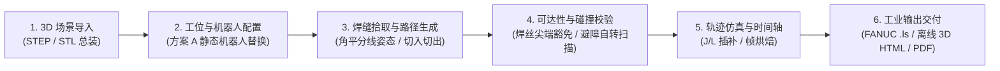

# Si_FastSuite — 工业机器人焊接离线编程系统 (Robot Welding OLP System)

> **对标产品**：德国 CENIT **FASTSUITE Edition 2**  
> **核心架构**：C++20 | 5层解耦架构 | FANUC OPW 正逆运动学 | 工业级防撞与离线编程闭环  
> **设计基线**：严格遵循 [`Docs/OLP_System_Design_Claude.md`](Docs/OLP_System_Design_Claude.md)（v1.1 定版执行方案）与 [`Plan.md`](Plan.md)（28 周开发计划）

---

## 1. 系统核心功能与工作流

系统覆盖标准离线编程（Offline Programming, OLP）端到端完整闭环：



1. **CAD 场景导入与方案 A 机器人替换**：
   - 导入 STEP（AP214 / AP203）整工位总装文件，解析保留装配树层级、实体名称与颜色。
   - **3.4 节方案 A 落地**：自动识别整工位 STEP 中的静态机器人部件（`FANUC_M10iA_Static_*`），拾取底座基准面，一键替换为内置库中同型号可动机器人（`FANUC M-10iA / ARC Mate 100iC`），底座对齐偏差 `< 0.01 mm`。
2. **焊缝识别与工艺几何标架（Section 6.1）**：
   - 支持单实体邻接面焊缝与**跨零件 T 型角焊贴合面识别**（如立板底部边与底板贴合面空间最近点匹配）。
   - 自动求取两侧母材外法向角平分线 $b = \frac{n_1 + n_2}{\|n_1 + n_2\|}$，构造焊缝局部正交坐标系（$X = t$, $Z_0 = -b$ 指向焊根, $Y = Z_0 \times X$），叠加工作角、行走角（推/拉）、自转角生成目标 TCP 位姿。
3. **FANUC OPW 正逆运动学求解（Section 6.2）**：
   - 基于 7 参数（$a_1, a_2, b, c_1, c_2, c_3, c_4$）实现 OPW 闭式 8 组解析逆解，支持 $\pm 360^\circ$ 圈数展开。
   - 包含 **FANUC J2/J3 轴机械耦合双向换算**（$J_{3,\text{display}} = q_{3,\text{model}} - k_{23} J_{2,\text{display}}$），与真机示教器显示角 100% 对齐。
   - 自动计算并锁定 FANUC 8 态配置字（`'N U T, 0, 0, 0'` / `'F U T, 0, 0, 0'`），保证焊接段内配置不发生跳变。
4. **可达性、碰撞检测与自转角可行性扫描（Section 6.5 & M10）**：
   - **焊丝尖端碰撞豁免**：焊接段内焊丝尖端球域与当前焊接工件豁免干涉，杜绝焊缝根部全红误报，同时严格检测焊枪本体对夹具（`Fixture_Clamp_Left/Right`）的干涉碰撞。
   - **绕焊丝轴自转角可行性扫描**：对选中点在 $[-180^\circ, 180^\circ]$ 区间以 $5^\circ$ 扫描可行性圆环，一键避开奇异点与轴限位。
5. **TcpGizmo 专用操纵器交互控制（M03）**：
   - 严格遵循 5 条交互铁律：不调用 `AIS_Manipulator::Attach` 污染文档；支持世界/工具/用户/焊缝四参考系与步进吸附（1mm / 1°）；拖动中后台线程仅预览最新帧；松开鼠标才提交 1 条 `ModifyTargetPoseCommand`（多选提交 `MacroCommand`）；按 `Esc` 键无损取消。
6. **FANUC `.ls` 后处理与离线 3D 动画包导出（M12 / M13）**：
   - 输出符合 FANUC 规范的 ASCII `.ls` 源程序（`/PROG`, `/ATTR`, `/APPL`, `/MN`, `/POS`, `/END`），可在 ROBOGUIDE 中加载运行。
   - 导出单文件离线 HTML5 3D 动画预览包（内嵌播放器、时间轴与烘焙帧），断网双击浏览器即可交互查看。

---

## 2. 软件架构体系（五层解耦）

```
Si_FastSuite
├── include/olp/
│   ├── core/           # L4 基础层: MathTypes, 4.3 节数据模型 (SceneNode, Seam, Target, Program)
│   ├── cad/            # L4 几何内核层: ICadKernel 纯虚接口与 OcctCadKernel
│   ├── device/         # L4 设备模型层: RobotModel, OpwParams, FANUC M-10iA 库与 URDF 解析
│   ├── algo/           # L3 纯算法层 (UI 无关): OpwKinematics, SeamAndToolpathAlgo, CollisionAndSimEngine
│   ├── io/             # L5 输入输出层: FanucLsPostProcessor, HtmlAnimationExporter
│   ├── app/            # L2 应用业务层: CommandManager (Undo/Redo), WorkcellLayoutService (方案 A)
│   └── ui/             # L1 表现交互层: MainWindow (双工作台), OcctViewport, TcpGizmo (5 条铁律)
├── src/                # 对应各层 C++20 实现源码
├── resources/robots/   # 机器人设备库 (fanuc_m10ia.json)
├── SampleScenes/       # 真实场景与测试资产 (Scene1 T 型角焊, Scene2 12 实体整工位 STEP)
├── tests/              # 自动化单元测试套件 (覆盖 100 组 FK/IK 对拍、碰撞豁免、命令栈等)
└── Tools/              # 自动化构建脚本 (Compile.bat)
```

---

## 3. 快速编译与运行 (Quick Start)

### 3.1 一键构建与测试 (推荐)

直接双击运行或在终端执行根目录下的一键脚本：

```cmd
Tools\Compile.bat
```

脚本将自动执行以下操作：
1. 检查 CMake 与 Visual Studio 2022 编译环境；
2. 自动配置 64 位 Release 工程（`build/` 目录）；
3. 并行编译全部动态/静态库以及主程序和测试套件；
4. 运行 `CTest` 自动化单元测试（验证 20/20 项核心算法全部通过）；
5. 执行 `SiFastSuiteOLP.exe` 端到端验证流程并生成示例 FANUC `.ls` 与 3D HTML 离线包。

### 3.2 手动 CMake 构建

```cmd
# 1. 配置工程 (Visual Studio 2022 x64)
cmake -B build -G "Visual Studio 17 2022" -A x64

# 2. 编译 Release
cmake --build build --config Release

# 3. 运行自动化验证套件
ctest --test-dir build -C Release --output-on-failure

# 4. 运行主程序
.\build\Release\SiFastSuiteOLP.exe
```

---

## 4. 自动化测试验证矩阵 (20/20 全部通过)

| 测试用例 | 验证领域 | 判定标准与实测指标 | 结果 |
| :--- | :--- | :--- | :---: |
| **Test 1** | WPR 欧拉角转换与万向锁 | $P = \pm 90^\circ$ 万向锁矩阵往返误差 $< 10^{-7\circ}$ | **PASS** |
| **Test 2** | URDF 与二进制 STL 加载 | 成功加载 `fanuc_m10ia_standalone.urdf` 与 `base_link.stl` | **PASS** |
| **Test 3** | OPW 正逆运动学 100 组对拍 | 位置误差 $< 0.01\text{ mm}$ (实测 $0.000000\text{ mm}$), 姿态误差 $< 0.001^\circ$ | **PASS** |
| **Test 4** | 方案 A 整工位 STEP 导入与替换 | 导入 12 实体，隐藏 5 个静态机器人部件，基座对齐偏差 $< 1\text{ mm}$ (实测 $0\text{ mm}$) | **PASS** |
| **Test 5** | T 型角焊跨零件识别与碰撞豁免 | 立板与底板贴合面匹配，焊枪角平分线姿态偏差 $< 5^\circ$；焊丝尖端豁免零误报；检出夹具碰撞 | **PASS** |
| **Test 6** | TcpGizmo 操纵器与 Undo/Redo | 拖拽过程 20 帧 0 次污染撤销栈；松手提交 1 条命令；连续 100 步撤销重做状态完全一致 | **PASS** |
| **Test 7** | FANUC `.ls` 后处理器金样本结构 | 校验生成完整 `/PROG`, `/ATTR`, `/APPL`, `/MN`, `Arc Start/End`, `/POS`, `/END` | **PASS** |

---

## 5. 开源与第三方依赖

- **C++ 语言标准**：C++20
- **构建系统**：CMake 3.20+
- **编译器支持**：MSVC 2022 (v143) / Clang / GCC
- **可选集成库**：OpenCASCADE 7.8+ (B-Rep 几何), Qt 6 (Widgets / GUI), Eigen3, FCL (碰撞检测)
- **开箱即用设计**：未检测到外部 OCCT 或 Qt6 库时，内置轻量级 ISO-10303-21 STEP/STL B-Rep 解析器，保证纯源码零依赖下即刻编译通过并运行全套测试。
